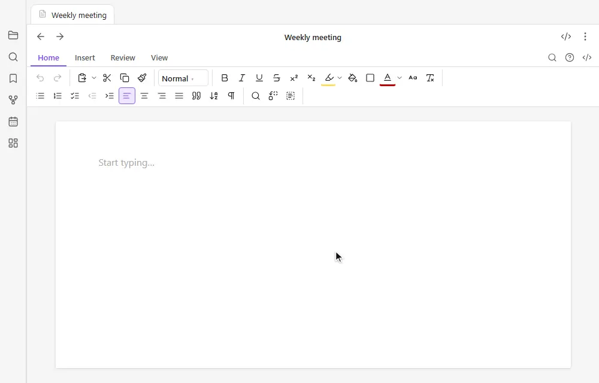
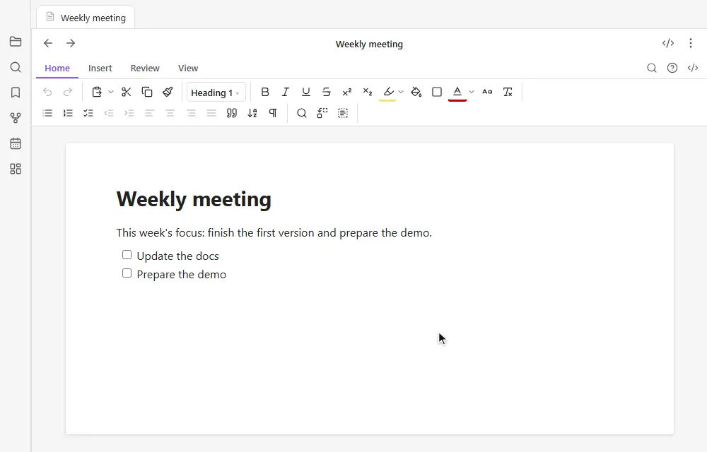

# Word Mode

[English](README.md) | [繁體中文](README.zh-TW.md) | [台文](README.nan-TW.md) | [粵語](README.yue-HK.md) | [简体中文](README.zh-CN.md) | [日本語](README.ja.md) | [한국어](README.ko.md) | [Tiếng Việt](README.vi.md) | [Français](README.fr.md) | [Deutsch](README.de.md) | [Español](README.es.md) | **العربية** | [עברית](README.he.md)

حرّر ملاحظاتك في [Obsidian](https://obsidian.md) كما تفعل في Word: شريط أدوات بعلامات تبويب، وجداول، ومعادلات، ومخططات، دون الحاجة إلى حفظ صيغة Markdown. وتبقى كل ملاحظة محفوظة كملف Markdown عادي.

> لم يراجع متحدثون أصليون هذه الترجمة العربية بعد. إذا وجدت صياغة ركيكة أو غير طبيعية، فيُرجى إبلاغنا بها في Issue.

## لماذا Word Mode؟

- **لا شيء لتحفظه.** نسّق النص بأزرار شريط الأدوات وبالاختصارات التي تعرفها من برامج معالجة النصوص، مثل `Ctrl+B` للغامق و`Ctrl+K` للرابط.
- **تبقى ملفاتك بتنسيق Markdown.** عند تحرير ملاحظة، لا تُعاد كتابة إلا الكتل التي غيّرتها. ويبقى كل ما عداها كما كان تمامًا، حرفًا بحرف، فلا ترى المزامنة وسجل الإصدارات إلا ما حررته.
- **بدّل في أي وقت.** اضغط `Ctrl+E` (`Cmd+E` على macOS)، أو اختر الزر في رأس الملاحظة، للتنقل بين وضع Word والمحرر الأصلي في Obsidian.
- **مصمم لـ Obsidian.** تعمل الروابط والوسوم والخصائص ومربعات التنبيه والتضمينات والحواشي السفلية والصيغ الرياضية ومخططات Mermaid واستعلامات Dataview كلها في وضع Word.

## الميزات

### التنسيق أثناء الكتابة

هذا ما تعرضه الرسوم المتحركة في الأعلى. ابدأ فقرة بـ `# ` أو `- ` أو `1. ` أو `> ` أو `[ ] `، أو أكمل `**غامق**` أو `*مائل*` أو `[[ملاحظة]]`، فيتحول إلى تنسيق. وتراجعٌ واحد يزيل التنسيق ويُبقي ما كتبته. اكتب `[[` لاختيار ملاحظة أو عنوان، أو `#` لاختيار وسم.

### الشريط

- **علامات التبويب الرئيسية وإدراج ومراجعة وعرض**، مرتبة كما في برامج معالجة النصوص.
- **لون الخط والتمييز**: الألوان القياسية بدرجاتها الفاتحة والداكنة، وألوانك الأخيرة، أو أي لون تختاره أو تكتبه كرمز Hex. ويمكن أن يستخدم التمييز أي لون وأي درجة من العتامة.
- **خصّصه كما تحب**: اعرض علامات التبويب كنص أو أيقونات أو كليهما، أو اجمعها في زر قائمة واحد، وأعد تسميتها. ويمكنك إعادة تسمية مجموعات الأزرار وإعادة ترتيبها وإخفاؤها أو نقلها إلى علامة تبويب أخرى.

المزيد عن شريط الأدوات

- **شريط الأدوات نفسه في وضعي Markdown والقراءة**، بالتخطيط نفسه، فلا يقفز شيء عند التبديل. يمكنك إظهاره في الوضعين، أو في أحدهما فقط، أو عدم إظهاره في أي منهما.
- **تلميحات مفصلة**: يشرح لك كل زر تمرر المؤشر فوقه برسوم متحركة قصيرة، بما في ذلك أزرار أوضاع العرض وأزرار شريط الحالة. وهي مفعّلة افتراضيًا، ويمكنك إيقافها من الإعدادات أو من قائمة الاختصارات.

### على الهاتف والجهاز اللوحي

- **تحريك المؤشر بالسحب**: عندما تكون لوحة المفاتيح مفتوحة على الهاتف، يصبح الصف الذي فوقها لوحة لمس. اضغط مطولًا لحظة في أي مكان حتى تبهت الأزرار، ثم اسحب يمينًا أو يسارًا لتحريك المؤشر خطوة خطوة، أو لأعلى ولأسفل لتغيير السطر. زر قائمة علامات التبويب في البداية يعمل فورًا دون ضغط مطول. أثناء السحب تظهر معاينة مكبّرة فوق المؤشر تبيّن موضعه بدقة. النقر على الأزرار وتمرير الصف أفقيًا يبقيان كما هما. يمكن من الإعدادات ضبط مدة الضغط وسرعة السحب، واختيار شكل العدسة (كبسولة أو بطاقة) وتكبيرها وعرضها، أو إيقافها. بجانب العدسة تظهر تسمية صغيرة توضح مكان المؤشر: نوع الكتلة (نص، عنوان، قائمة، صف وعمود الجدول) ورقم الحرف، ويمكن إيقافها. عند السحب لأعلى ولأسفل يبقى المؤشر في العمود نفسه (حتى داخل الجداول)، ويتوقف عند المعادلات والمخططات والخطوط الأفقية في الطريق ويذكر ما هي، وعند بداية المستند أو نهايته يظهر تنبيه قبل معلومات الموضع المعتادة.
- **مساحة أكبر للكتابة على الهاتف**: عندما تكون لوحة المفاتيح على الشاشة مفتوحة، يصغر شريط الأدوات إلى صف واحد فوقها. تُجمع علامات التبويب في زر قائمة وتعرض الأزرار أيقوناتها فقط، ويعود كل شيء عند إغلاق لوحة المفاتيح. يمكنك إيقاف ذلك من الإعدادات.
- **إيماءات على الهاتف**: اسحب للأعلى على زر «تراجع» للإعادة، وعلى زر «إعادة» للتراجع (وزرا المسافة البادئة يعملان بالطريقة نفسها؛ وتظهر نقطة صغيرة على هذه الأزرار). انقر بإصبعين لتحديد الفقرة كاملة. النقر على خلية في الجدول يضع المؤشر فورًا، من دون أن تعترضه قائمة النظام «قص / نسخ / لصق». وفي منتقي الرموز أزواج من الأقواس وعلامات الاقتباس تحيط بالنص المحدد.
- **الإدراج بالشرطة المائلة** (معطّل افتراضيًا؛ فعّله من الإعدادات): اكتب `/` في بداية فقرة فارغة لاختيار عنوان أو قائمة أو جدول أو كتلة شيفرة أو مربع تنبيه أو معادلة أو مخطط أو صورة أو رابط، وتابع الكتابة للتصفية. على الهاتف هذا أسرع من تمرير شريط الأدوات. التبديل بين وضع Word و Markdown ووضع القراءة يبقيك في المكان نفسه من الملاحظة؛ وفي وضع القراءة على الهاتف يصغر شريط الأدوات إلى صف واحد من الأزرار التي ما زالت تعمل؛ وللجداول زرّا **الخلية السابقة** و**الخلية التالية** لأن لوحة المفاتيح على الشاشة لا تحتوي على مفتاح Tab. على الهاتف، أزرار الجداول والمعادلات والمخططات وكتل الشيفرة أكبر ومتباعدة، وزر الحذف باللون الأحمر ومنفصل.

المزيد للهاتف والجهاز اللوحي

- **لوحات سفلية على الهاتف**: تنزلق اللوحات المنسدلة لشريط الأدوات (علامات التبويب، الأنماط، المخطط، الألوان، الرموز، إدراج جدول) من أسفل الشاشة مثل قوائم Obsidian على الهاتف، وتظهر فوق لوحة المفاتيح عندما تكون مفتوحة.
- **إخفاء لوحة المفاتيح**: عندما تكون لوحة المفاتيح على الشاشة مفتوحة، يظهر زر في نهاية شريط الأدوات (وبجانب «إلغاء» في محرري المعادلات والمخططات) لإغلاقها.
- **أكثر سلاسة على الهاتف**: ينزلق شريط الأدوات مع لوحة المفاتيح بدل أن يقفز؛ اسحب للأسفل على شريط الأدوات لإخفاء لوحة المفاتيح؛ للأدراج عنوان، وتضع علامة على الاختيار الحالي، ويمكن سحبها للأسفل لإغلاقها؛ زر الإغلاق في شريط البحث ثابت في أقصى الطرف؛ أزرار الجداول والمخططات وكتل الشيفرة لم تعد تغطي المحتوى؛ يبقى شريط الأدوات في الأسفل أيضًا في وضعي Markdown والقراءة؛ والسحب على شريط الأدوات لم يعد يُخرج الأشرطة الجانبية في Obsidian.
- **لوحة المفاتيح المناسبة لكل حقل**: تُكتب المعادلات والشيفرة وحقول البحث كما هي (من دون أحرف كبيرة تلقائية أو تصحيح تلقائي، وكذلك عندما يكون المؤشر داخل كتلة شيفرة أو شيفرة ضمن السطر)؛ حقول الأرقام تفتح لوحة الأرقام وحقول الروابط لوحة عناوين URL؛ ويعرض مفتاح الإدخال «بحث» أو «تم» حيث يكون ذلك عمله.
- **محررا المعادلات والمخططات على الهاتف**: عند فتح لوحة المفاتيح يبقى مربع الحوار فوقها ويعرض ما تحتاجه فقط: المعادلة التي تحررها، وصفًا واحدًا من الرموز يمكن سحبه، والمعاينة؛ ويعود العنوان ومفاتيح تبديل الوضع عند إغلاق لوحة المفاتيح.

### الجداول

- اختر الحجم من الشبكة، ثم اكتب واضغط Tab للانتقال إلى الخلية التالية. والضغط على Tab في الخلية الأخيرة يضيف صفًا.
- انقر بزر الماوس الأيمن على خلية لإضافة صفوف وأعمدة أو إزالتها أو نقلها، أو للفرز حسب عمود، أو لتعيين محاذاة عمود.
- الصق خلايا من جدول بيانات، فتصبح جدولًا.
- عندما يكون المؤشر داخل جدول، يظهر تبويب **جدول** في الشريط. ومقابض حواف الجدول تحدد صفًا كاملًا أو عمودًا كاملًا وتفتح قائمته، وتعمل على الهاتف أيضًا.
- حدد صفوفًا أو أعمدة كاملة أو الجدول كله واضغط Backspace لحذفها؛ أما Delete فيمسح المحتوى فقط. والأزرار بجانب الجدول تنسخه بتنسيق Markdown أو تحذفه بنقرة واحدة.
- حوّل بضعة أسطر مفصولة بـ Tab أو `|` أو فواصل إلى جدول، أو أعد الجدول إلى نص. ويخرج Ctrl+Enter من الجدول ويبدأ فقرة أسفله. والجدول المنسوخ يُلصق في جدول البيانات مقسمًا إلى أعمدة.

### المعادلات

- الكسور والجذور والأسس والأقواس والمصفوفات مربعات تكتب فيها. اختر بنية من اللوحة، أو اكتب `\frac` أو `\sqrt` أو `\alpha` متبوعة بمسافة.
- تنقلك مفاتيح Tab و Enter والأسهم بين المربعات. والضغط على Backspace في مربع فارغ يزيل البنية المحيطة به.
- يمكنك التبديل إلى LaTeX العادي في أي وقت. تُحفظ المعادلات بالصيغة المعتادة `$…$` أو `$$…$$`، فتظهر في كل مكان يعرض فيه Obsidian الصيغ الرياضية.

المزيد عن محرر المعادلات

- افتحه من **إدراج ← معادلة**، أو بالنقر المزدوج على معادلة، أو بالضغط على Enter عند تحديد إحداها.
- تظهر للمعادلة الموجودة في سطر مستقل أزرار صغيرة في زاويتها العلوية عند الإشارة إليها بالمؤشر (وفي الهاتف عند النقر عليها): تحرير، وخيارات إضافية (جعلها ضمن السطر، ونسخ LaTeX أو Markdown)، وحذف.
- يفتح `^` مربعًا للأس و`_` مربعًا للدليل. ويتنقل سهما الأعلى والأسفل بين البسط والمقام.
- للتراجع والإعادة استخدم الأزرار، أو `Ctrl+Z` و`Ctrl+Y`.
- **الصيغ الشائعة والمعادلات الأخيرة**: أدرج صيغة كاملة، مثل القانون العام للمعادلة التربيعية أو الانحراف المعياري، ثم غيّر الأجزاء التي تحتاجها.
- **صيغك الخاصة**: اختر زر الإشارة المرجعية بجوار المعاينة لحفظ المعادلة الحالية باسم تختاره. تظهر الصيغ المحفوظة ضمن **صيغي** في اللوحة، وتُدرج بنقرة واحدة.
- المعادلة التي لا تغيّرها تُكتب كما كانت تمامًا.
- **على الهواتف والأجهزة اللوحية**: لأن لوحات المفاتيح على الشاشة لا تحتوي على مفاتيح أسهم، توجد فوق منطقة التحرير أزرار للانتقال إلى المربع السابق أو التالي ولإزالة البنية عند المؤشر. وعلى الهاتف، تبقى منطقة التحرير في الأعلى أثناء تمرير اللوحة.
- **لا شيء يضيع بالخطأ**: إذا كانت هناك تغييرات لم تُطبَّق بعد، فإن Esc أو النقر خارج مربع الحوار أو الزر × يسأل أولًا هل تريد تجاهلها. ومحرر المخططات يفعل الشيء نفسه.

### المخططات

- **نماذج لـ 11 نوعًا من مخططات Mermaid**: المخطط الانسيابي، والمخطط التسلسلي، ومخطط جانت، والمخطط الدائري، ومخطط الحالات، ومخطط الفئات، والخريطة الذهنية، والمخطط الزمني، ومخطط ER، ورحلة المستخدم، والمخطط الرباعي.
- **التحرير على المخطط**: حدد نصًا في المعاينة لتغييره في مكانه، أو أضف الخطوة التالية، أو اختر لون التعبئة.
- **كتابة حرة**: اكتب أي كود Mermaid مع معاينة مباشرة، بما في ذلك الأنواع التي ليس لها نموذج، مثل مخططات Git ومخططات XY.
- تُحفظ المخططات ككتل برمجية Mermaid عادية. والمخطط الذي يستخدم صيغة لا يغطيها النموذج يُفتح ككود مع عرض السبب، فلا يضيع شيء.

المزيد عن محرر المخططات

- افتحه من **إدراج ← مخطط**، أو بزر التحرير على كتلة Mermaid.
- أشر إلى مخطط في ملاحظة لتظهر الأزرار في زاويته العلوية: تحرير، وعرض الكود، ونسخ، وحذف. الحذف يزيل المخطط كله، والتراجع يعيده.
- على المخطط، اضغط Enter لتطبيق التغيير، أو Tab لتطبيقه والانتقال إلى النص التالي. وإعادة تسمية مشارك أو حالة أو فئة أو كيان تعيد تسمية كل إشارة إليه.
- **المظهر**: اختر سمة Mermaid لمخطط واحد بعينه، ولون تعبئة لكل خطوة في المخطط الانسيابي.
- **المعاينة**: كبّر وصغّر بالأزرار، أو بـ `Ctrl` وعجلة الماوس. يُعرض المخطط بحجمه الحقيقي بدلًا من تصغيره حتى يتعذر قراءة النص، وزر واحد يلائم المخطط كله مع عرض المعاينة.
- **معرفة موضعك**: ضع المؤشر في صف من النموذج فتُبرز المعاينة ذلك العنصر بإطار. وحدد عنصرًا في المعاينة فينتقل النموذج إلى صفه.
- **قوالبك الخاصة**: احفظ المخطط الحالي باسم تختاره من **قوالبي**، وابدأ منه في المرة القادمة. وفي الإعدادات تختار المخطط الذي يبدأ به كل مخطط جديد، والأنواع المضمنة التي تظهر في القائمة.
- **المخططات الطويلة**: تعرض القوائم في النموذج 40 صفًا في كل مرة ويمكن تصفيتها بالكتابة، فيبقى تحرير مخطط انسيابي من مئات الخطوات سريعًا. وفي الملاحظة، يُطوى المخطط الطويل جدًا إلى ارتفاع ثابت مع زر لإظهاره كاملًا، ولا تُرسم المخططات إلا عند التمرير إليها.
- لا تُرسم أنواع المخططات الأحدث إلا إذا كان إصدار Mermaid المدمج في Obsidian يدعمها.
- **على الهواتف**: تبقى المعاينة في الأعلى والنموذج أسفلها، وتأتي الحقول والأزرار بأحجام مناسبة للمس.

### والمزيد

عرض الكل: الخصائص والصور والروابط والبحث والاستبدال وشريط الحالة والمؤشر وغيرها

- **شريط الحالة**: عدد الكلمات، وحالة الحفظ، وأزرار التبديل بين وضع Word و Markdown وعرض القراءة، وعرض الخصائص، والتكبير. ويحتفظ وضعا Markdown والقراءة بالأزرار نفسها ويحسبان الكلمات بالطريقة نفسها. ويمكنك إيقاف ذلك من الإعدادات. ويُعرض عدد الكلمات فقط، دون رموز Markdown وعناوين الروابط؛ أما عدد الأحرف ووقت القراءة فيظهران في التلميح. وللحصول على الأرقام نفسها التي يعطيها عدّاد Obsidian المدمج، غيّر «طريقة عدّ الكلمات» في الإعدادات.
- **مسار الملاحظة ونسخ المسار**: على سطح المكتب، يعرض شريط الحالة مجلد الملاحظة واسم ملفها. انقر أو انقر بالزر الأيمن لنسخ المسار داخل الخزنة أو المسار الكامل على حاسوبك أو رابط Obsidian أو اسم الملف أو المجلد. النقر بالزر الأيمن على رابط أو تضمين أو صورة في المستند يعرض الملف الذي يشير إليه ويتيح نسخ مساره بالطريقة نفسها.
- **الأسطر الفارغة تبقى ظاهرة**: عدة أسطر فارغة متتالية في Markdown تظهر كفقرات فارغة، كما لو ضغطت Enter عدة مرات في Word. احذف واحدة فينقص سطر فارغ واحد؛ وما لم تلمسه يُحفظ كما هو.
- **مؤشر أجمل وقابل للتعديل**: المؤشر خط رفيع بحواف مستديرة بلون التمييز، ينزلق أثناء الكتابة ويخفت بهدوء عند التوقف. في الإعدادات يمكنك اختيار الشكل (خط رفيع، خط سميك، مربع، خط سفلي أو مؤشر النظام) واللون وطريقة الوميض وسرعته والحركة السلسة. ويعمل أيضًا على الهواتف والأجهزة اللوحية (أثناء الضغط المطوّل لسحب تحديد يعود مؤشر النظام مؤقتًا)، وتعرض الإعدادات معاينة مباشرة.
- **الخصائص** في نموذج: تظهر الوسوم والروابط كشارات يمكنك تحديدها لفتحها، وتظهر القيم المتداخلة كشجرة، ويمكنك تغيير نوع الخاصية أو إعادة تسميتها من أيقونتها. ويعرضها «عرض الخصائص»، في علامة التبويب «عرض» وفي شريط الحالة، دون التمرير إلى الأعلى، ويتيح تصفية القائمة الطويلة. ويثبّت زر الدبوس في عنوان الخصائص (أو أحد الإعدادات) شريط خصائص رفيعًا في الأعلى أثناء التمرير؛ انقر عليه لرؤية القائمة كاملة. ويمكنك عرض الخصائص كمربع بحدود وخلفية، أو بالحدود فقط، أو بنمط بسيط بلا حدود.
- **الصور**: الصق صورة أو اخترها، ثم اسحب لتغيير حجمها.
- **الروابط** إلى الملاحظات والعناوين وصفحات الويب، مع شريط أدوات صغير يظهر عندما يكون المؤشر على رابط.
- **البحث والاستبدال**، مع خياري مطابقة الكلمة بأكملها والتعبيرات النمطية.
- **الشريط الجانبي للمخطط التفصيلي** وطي العناوين.
- **التضمينات**: تُعرض الملاحظات والعناوين والملفات الصوتية ومقاطع الفيديو وملفات PDF وروابط YouTube المضمنة في مكانها. وتُعرض استعلامات Dataview والكتل البرمجية من المكونات الإضافية الأخرى كنتائج.
- **الحواشي السفلية**: أدرج حاشية سفلية، ومرر المؤشر فوق رقمها لقراءتها، وحرر نصها دون لمس الصيغة.
- **مربعات التنبيه** (بما فيها القابلة للطي)، و**قوائم المهام** بحالات مخصصة مثل `[/]` و`[-]`، و**الوسوم**، و**الكتل البرمجية** مع تلوين الصيغة وأرقام أسطر اختيارية.
- **علامات التنسيق** مثل `¶`، وأداة لتنظيف الأحرف غير المرئية أو الشاردة.
- **لصق نص Markdown** وتحويله إلى نص منسق بخطوة واحدة.
- **التعامل مع تعارض المزامنة**: إذا تغيرت ملاحظة على القرص وفيها تعديلات لم تحفظها بعد، تختار أنت النسخة التي تحتفظ بها.
- **قائمة اختصارات لوحة المفاتيح**: ابحث فيها أو اختر فئة، وحدد اختصارًا لمشاهدة رسوم متحركة قصيرة توضح عمله. ومربع الاختيار في أسفلها يشغّل التلميحات المفصلة أو يوقفها.
- الواجهة متوفرة بالصينية التقليدية، والتايوانية (بالأحرف الصينية)، والكانتونية، والصينية المبسطة، والإنجليزية، واليابانية، والكورية، والفيتنامية، والفرنسية، والألمانية، والإسبانية، والعربية، والعبرية.

كل ما لا يستطيع Word Mode تحريره بصريًا، مثل كتلة HTML، يُعرض ككتلة خام ويُحفظ دون تغيير. أشر إليها، أو إلى حاشية سفلية أو كتلة تعليق، لتظهر في زاويتها العلوية أزرار للتحرير والنسخ والحذف. وحذف الحاشية السفلية يزيل أرقامها في النص أيضًا.

## البدء

### التثبيت

يتطلب Obsidian 1.5.7 أو أحدث.

1. نزّل `main.js` و`manifest.json` و`styles.css` من [أحدث إصدار](https://github.com/NatLee/obsidian-word-mode/releases/latest).
2. انسخ الملفات الثلاثة إلى `<your vault>/.obsidian/plugins/natlee-word-mode/`، حيث `<your vault>` هو مجلد خزنتك.
3. في Obsidian، افتح **الإعدادات ← المكونات الإضافية المجتمعية** وفعّل **Word Mode**.

### الاستخدام

بعد تفعيل المكون الإضافي، تُفتح ملاحظات Markdown في وضع Word.

- للتبديل بين وضع Word و Markdown، اختر الزر في الزاوية العلوية اليمنى من الملاحظة، أو اضغط `Ctrl+E` (`Cmd+E` على macOS).
- لفتح ملاحظة في وضع محدد، انقر عليها بزر الماوس الأيمن واختر **فتح في وضع Word** أو **فتح بتنسيق Markdown**.
- لاستثناء ملاحظة واحدة من وضع Word، أضف `word-mode: false` إلى خصائصها.
- لاستثناء مجلدات كاملة من وضع Word، أدرجها في **الإعدادات ← Word Mode ← المجلدات المستثناة من وضع Word**.

الإعدادات مقسمة إلى فئات، مع صف من علامات التبويب في الأعلى يعرض فئة واحدة في كل مرة. وللعثور على إعداد لا تعرف فئته، اكتب في مربع البحث فوق علامات التبويب. فهو يقترح الإعدادات المطابقة أثناء الكتابة، ويطابق أيضًا خيارات القوائم المنسدلة وأسماء الإعدادات بلغات أخرى (يمكنك الكتابة بالإنجليزية والواجهة بالعربية)، وينقلك إلى الإعداد الذي تختاره. الفئات التي تضم إعدادات كثيرة مقسّمة إلى أقسام لها عناوين؛ فمثلًا إعدادات المؤشر في «العرض» مجمّعة في قسم «المؤشر» مع معاينة مباشرة في أعلاه.

### الأوامر

عرض الأوامر

| الأمر | الوصف |
| --- | --- |
| تحرير الملاحظة الحالية في وضع Word | تبديل الملاحظة الحالية إلى وضع Word. |
| تحرير الملاحظة الحالية بتنسيق Markdown | إعادة الملاحظة الحالية إلى محرر Markdown. |
| تبديل وضع Word / Markdown | التبديل بين الوضعين. |
| تبديل الشريط الجانبي للمخطط التفصيلي | إظهار المخطط التفصيلي أو إخفاؤه. |
| بحث | البحث في الملاحظة الحالية. |
| بحث واستبدال | البحث والاستبدال في الملاحظة الحالية. |
| المخطط التفصيلي: الانتقال إلى عنوان | الانتقال إلى عنوان في الملاحظة الحالية. |
| عرض اختصارات لوحة المفاتيح | عرض جميع اختصارات وضع Word. |

لا يملك أي أمر اختصارًا افتراضيًا. ويمكنك تعيين اختصاراتك من **الإعدادات ← مفاتيح الاختصار**.

## الخصوصية والإفصاحات

- **استخدام الشبكة**: فقط لعرض محتوى الويب الذي تشير إليه ملاحظاتك أصلًا. إذا احتوت ملاحظة على صورة أو ملف صوتي أو فيديو من عنوان ويب، يحمّله وضع Word من ذلك العنوان. وإذا ضمّنت ملاحظة رابط YouTube، يعرض وضع Word مشغل YouTube، الذي يتصل بـ `youtube.com`. وهذا هو المحتوى نفسه الذي يحمّله محرر Obsidian الأصلي لتلك الملاحظة. ولا يرسل المكون الإضافي أيًا من ملاحظاتك أو بياناتك إلى أي مكان.
- **القياس عن بُعد**: لا يوجد.
- **الحسابات والدفع**: غير مطلوبين.
- **الملفات خارج خزنتك**: لا تُقرأ ولا تُكتب أبدًا.
- **أسماء الملفات في خزنتك**: يسرد المكون الإضافي الملفات الموجودة في خزنتك ليعرضها في أدوات اختيار الروابط والصور والقوالب، وفي الاقتراحات بعد `[[`. وتبقى القائمة على جهازك.
- **الحافظة**: لا تُقرأ إلا عندما تختار **لصق** من شريط الأدوات أو من قائمة النقر بزر الماوس الأيمن، ولا يُكتب فيها إلا عندما تختار **قص** أو **نسخ** أو زر نسخ.
- **الملفات التي ينشئها المكون الإضافي**: تُحفظ الصور التي تلصقها في مجلد المرفقات. وإذا اخترت الاحتفاظ بالنسختين عند تعارض المزامنة، تُحفظ نسختك كنسخة منفصلة بجوار الملاحظة.

## القيود المعروفة

- على الهواتف والأجهزة اللوحية اختُبر على جهاز iPhone حقيقي فقط؛ لم تُختبر أجهزة Android وiPad على أجهزة حقيقية.
- بعض الأزرار في شريط الأدوات الذي يظهر في وضعي Markdown والقراءة تستدعي أوامر Obsidian المدمجة، ولم تُختبر كلها واحدًا واحدًا.
- الترجمات إلى غير الصينية التقليدية والإنجليزية لم يراجعها متحدثون أصليون.
- في العربية والعبرية، يُترجم النص فقط، ويحتفظ شريط الأدوات ومربعات الحوار بتخطيطهما من اليسار إلى اليمين.
- نتائج المخططات والاستعلامات، والتضمينات، ومعاينات الصفحات يرسمها Obsidian. وهي مغطاة باختبارات آلية تحاكي Obsidian، لكنها لم تُفحص مع كل مكون إضافي وكل سمة.
- مظهر المخطط (سمة Mermaid) وألوان تعبئة المخطط الانسيابي يرسمها Mermaid داخل Obsidian. وقد فُحصت مقارنةً بـ Mermaid نفسه، لا مع كل سمة من سمات Obsidian.

## المساهمة

نرحب ببلاغات الأخطاء والأفكار في [Issues](https://github.com/NatLee/obsidian-word-mode/issues). ولبناء المكون الإضافي، أو تشغيل الاختبارات، أو فهم طريقة عمله من الداخل، أو نشر إصدار، اقرأ [دليل المطور (بالإنجليزية)](docs/development.md).

## شكر وتقدير

يتضمن Word Mode مكتبات المصدر المفتوح التالية:

- [ProseMirror](https://prosemirror.net) من تطوير Marijn Haverbeke والمساهمين، رخصة MIT.
- [markdown-it](https://github.com/markdown-it/markdown-it) و[markdown-it-mark](https://github.com/markdown-it/markdown-it-mark)، رخصة MIT.
- [entities](https://github.com/fb55/entities)، رخصة BSD 2-Clause.

## الترخيص

[رخصة MIT](LICENSE).

