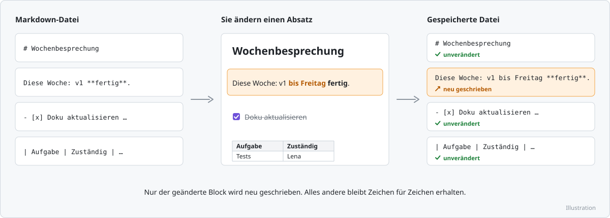
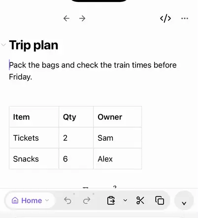

# Word Mode

[English](README.md) | [繁體中文](README.zh-TW.md) | [台文](README.nan-TW.md) | [粵語](README.yue-HK.md) | [简体中文](README.zh-CN.md) | [日本語](README.ja.md) | [한국어](README.ko.md) | [Tiếng Việt](README.vi.md) | [Français](README.fr.md) | **Deutsch** | [Español](README.es.md) | [العربية](README.ar.md) | [עברית](README.he.md)

Bearbeiten Sie Ihre [Obsidian](https://obsidian.md)-Notizen wie in Word: mit Menüband, Tabellen, Formeln und Diagrammen, ohne sich Markdown-Syntax merken zu müssen. Jede Notiz wird weiterhin als reine Markdown-Datei gespeichert.

> Diese deutsche Fassung wurde nicht von Muttersprachlern geprüft. Falls Ihnen eine Formulierung seltsam vorkommt, melden Sie es bitte in einem Issue.

## Warum Word Mode

- **Nichts auswendig lernen.** Formatieren Sie mit den Schaltflächen der Symbolleiste und den Tastenkürzeln, die Sie aus der Textverarbeitung kennen, etwa `Ctrl+B` für Fett und `Ctrl+K` für einen Link.
- **Ihre Dateien bleiben Markdown.** Beim Bearbeiten einer Notiz werden nur die geänderten Blöcke neu geschrieben. Alles andere bleibt Zeichen für Zeichen genau so, wie es war, sodass Synchronisierung und Versionsverlauf nur Ihre Änderungen sehen.
- **Jederzeit wechseln.** Mit `Ctrl+E` (`Cmd+E` unter macOS) oder der Schaltfläche in der Kopfzeile der Notiz wechseln Sie zwischen dem Word-Modus und dem Obsidian-eigenen Editor.
- **Für Obsidian gemacht.** Links, Tags, Eigenschaften, Callouts, Einbettungen, Fußnoten, Mathematik, Mermaid-Diagramme und Dataview-Abfragen funktionieren alle im Word-Modus.

## Funktionen

### Formatierung beim Tippen

Zu sehen in der Animation oben. Beginnen Sie einen Absatz mit `# `, `- `, `1. `, `> ` oder `[ ] ` oder schließen Sie `**fett**`, `*kursiv*` oder `[[Notiz]]` ab, und es wird zu Formatierung. Ein einziges Rückgängig entfernt die Formatierung und behält den getippten Text. Tippen Sie `[[`, um eine Notiz oder Überschrift auszuwählen, oder `#`, um einen Tag auszuwählen.

### Menüband

- **Registerkarten Start, Einfügen, Überprüfen und Ansicht**, angeordnet wie in einer Textverarbeitung.
- **Schriftfarbe und Hervorhebung**: Standardfarben mit Hell- und Dunkeltönen, zuletzt verwendete Farben oder jede beliebige Farbe, die Sie auswählen oder als Hex-Code eingeben. Hervorhebungen können jede Farbe und Deckkraft haben.
- **Ganz nach Ihren Wünschen**: Registerkarten als Text, Symbole oder beides anzeigen, in eine einzige Menüschaltfläche zusammenfassen und umbenennen. Schaltflächengruppen umbenennen, umsortieren, ausblenden oder auf eine andere Registerkarte verschieben.

Mehr zur Symbolleiste

- **Dieselbe Symbolleiste in der Markdown- und Leseansicht**, mit demselben Layout, sodass beim Wechseln nichts springt. Sie lässt sich in beiden, in einer davon oder in keiner anzeigen.
- **Ausführliche Tooltips**: Das Überfahren einer Schaltfläche erklärt sie mit einer kurzen Animation, auch bei den Schaltflächen für die Ansichtsmodi und in der Statusleiste. Sie sind standardmäßig eingeschaltet und lassen sich in den Einstellungen oder in der Liste der Tastenkürzel ausschalten.

### Auf Smartphone und Tablet

- **Cursor durch Ziehen bewegen**: Bei geöffneter Tastatur auf dem Smartphone wird die Leiste über der Tastatur zum Trackpad. Irgendwo kurz gedrückt halten, bis die Schaltflächen verblassen, dann nach links oder rechts ziehen, um den Cursor Zeichen für Zeichen zu bewegen, oder nach oben und unten, um die Zeile zu wechseln. Die Registerkarten-Menüschaltfläche am Anfang funktioniert sofort ohne Halten. Beim Ziehen zeigt eine vergrößerte Vorschau über dem Cursor genau, wo er steht. Tippen auf Schaltflächen und seitliches Scrollen der Leiste funktionieren wie bisher. In den Einstellungen lassen sich Haltedauer und Geschwindigkeit anpassen sowie Aussehen (Kapsel oder Karte), Vergrößerung und Breite der Lupe wählen oder die Lupe ausschalten. Neben der Lupe zeigt ein kleines Etikett, wo der Cursor steht: die Art des Blocks (Text, Überschrift, Liste, Tabellenzeile und -spalte) und das wievielte Zeichen; es lässt sich ausschalten. Nach oben und unten bleibt der Cursor in derselben Spalte (auch in Tabellen), hält unterwegs auf Formeln, Diagrammen und horizontalen Linien an und benennt sie; am Anfang oder Ende des Dokuments erscheint ein Hinweis vor der gewohnten Position.
- **Mehr Platz beim Tippen auf dem Smartphone**: Solange die Bildschirmtastatur offen ist, schrumpft die Symbolleiste auf eine Zeile direkt darüber. Die Registerkarten wandern in eine Menüschaltfläche, und die Schaltflächen zeigen nur Symbole; sobald die Tastatur geschlossen wird, ist alles wieder da. Lässt sich in den Einstellungen abschalten.
- **Gesten auf dem Smartphone**: Auf „Rückgängig“ nach oben wischen stellt wieder her, auf „Wiederholen“ nach oben wischen macht rückgängig (die beiden Einzugsschaltflächen funktionieren genauso; ein kleiner Punkt markiert diese Schaltflächen). Mit zwei Fingern tippen markiert den ganzen Absatz. Ein Tipp auf eine Tabellenzelle setzt den Cursor sofort, ohne dass das Systemmenü Ausschneiden / Kopieren / Einfügen stört. Die Symbolauswahl enthält außerdem Klammer- und Anführungszeichenpaare, die den markierten Text umschließen.
- **Einfügen mit Schrägstrich** (standardmäßig aus; in den Einstellungen aktivieren): Tippe `/` am Anfang eines leeren Absatzes, um Überschrift, Liste, Tabelle, Codeblock, Callout, Formel, Diagramm, Bild oder Link auszuwählen; Weitertippen filtert. Auf dem Smartphone geht das schneller, als die Symbolleiste zu durchsuchen. Beim Wechsel zwischen Word-Modus, Markdown und Leseansicht bleibst du an derselben Stelle der Notiz; in der Leseansicht auf dem Smartphone schrumpft die Symbolleiste auf eine Zeile mit den Schaltflächen, die dort funktionieren; und Tabellen haben die Schaltflächen **Vorherige Zelle** und **Nächste Zelle**, weil die Bildschirmtastatur keine Tab-Taste hat. Auf dem Smartphone sind die Schaltflächen an Tabellen, Formeln, Diagrammen und Codeblöcken größer und weiter auseinander, Löschen steht in Rot abgesetzt.

Mehr für Smartphone und Tablet

- **Auf dem Smartphone als Schublade von unten**: Die Aufklappfelder der Symbolleiste (Registerkarten, Formatvorlagen, Gliederung, Farben, Symbole, Tabelle einfügen) gleiten wie die Menüs von Obsidian Mobile vom unteren Bildschirmrand herein und liegen bei geöffneter Tastatur direkt darüber.
- **Tastatur ausblenden**: Solange die Bildschirmtastatur offen ist, blendet eine Schaltfläche am Ende der Symbolleiste (und neben „Abbrechen“ im Formel- und Diagrammeditor) sie aus.
- **Flüssiger auf dem Smartphone**: Die Symbolleiste gleitet mit der Tastatur, statt zu springen; ein Wisch nach unten auf der Symbolleiste blendet die Tastatur aus; Schubladen haben einen Titel, markieren die aktuelle Auswahl und lassen sich nach unten wegziehen; in der Suchleiste sitzt „Schließen“ ganz rechts; Schaltflächen an Tabellen, Diagrammen und Codeblöcken verdecken den Inhalt nicht mehr; die Symbolleiste bleibt auch in der Markdown- und Leseansicht unten; und ein Wisch entlang der Symbolleiste zieht nicht mehr die Seitenleisten von Obsidian heraus.
- **Die passende Tastatur für jedes Feld**: Formeln, Code und Suchfelder werden so übernommen, wie sie getippt werden (keine automatische Großschreibung oder Autokorrektur, auch wenn der Cursor in einem Codeblock oder in Inline-Code steht); Zahlenfelder öffnen den Ziffernblock, Linkfelder die URL-Tastatur; die Eingabetaste zeigt „Suchen“ oder „Fertig“, wo sie genau das tut.
- **Formel- und Diagrammeditor auf dem Smartphone**: Bei geöffneter Tastatur bleibt der Dialog darüber und zeigt nur das Nötige: die Formel in Arbeit, eine wischbare Zeile mit Symbolen und die Vorschau; Titel und Modusumschalter kehren zurück, sobald die Tastatur geschlossen wird.

### Tabellen

- Wählen Sie eine Größe im Raster, tippen Sie dann und springen Sie mit Tab zur nächsten Zelle. Tab in der letzten Zelle fügt eine Zeile hinzu.
- Mit einem Rechtsklick auf eine Zelle fügen Sie Zeilen und Spalten hinzu, entfernen oder verschieben sie, sortieren nach einer Spalte oder legen die Ausrichtung einer Spalte fest.
- Aus einer Tabellenkalkulation eingefügte Zellen werden zu einer Tabelle.
- Steht der Cursor in einer Tabelle, erscheint im Menüband die Registerkarte **Tabelle**. Griffe am Rand der Tabelle markieren eine ganze Zeile oder Spalte und öffnen ihr Menü, auch auf dem Smartphone.
- Markieren Sie ganze Zeilen, Spalten oder die ganze Tabelle und drücken Sie Backspace, um sie zu löschen; Delete leert nur den Inhalt. Mit den Schaltflächen neben der Tabelle kopieren Sie sie als Markdown oder löschen sie mit einem Klick.
- Wandeln Sie markierte Zeilen, die durch Tabs, `|` oder Kommas getrennt sind, in eine Tabelle um, oder eine Tabelle wieder in Text. Strg+Enter verlässt die Tabelle und beginnt darunter einen Absatz. Eine kopierte Tabelle wird in einer Tabellenkalkulation in Spalten eingefügt.

### Formeln

- Brüche, Wurzeln, Hochstellungen, Klammern und Matrizen sind Felder, in die Sie direkt tippen. Wählen Sie eine Struktur aus der Palette oder tippen Sie `\frac`, `\sqrt` oder `\alpha` gefolgt von einem Leerzeichen.
- Tab, Enter und die Pfeiltasten wechseln zwischen den Feldern. Backspace in einem leeren Feld entfernt die umgebende Struktur.
- Sie können jederzeit zu reinem LaTeX wechseln. Formeln werden als gewöhnliches `$…$` oder `$$…$$` gespeichert und daher überall dargestellt, wo Obsidian Mathematik darstellt.

Mehr zum Formeleditor

- Öffnen über **Einfügen → Formel**, per Doppelklick auf eine Formel oder mit Enter auf einer ausgewählten Formel.
- Eine Formel in eigener Zeile zeigt kleine Schaltflächen oben rechts, wenn Sie mit der Maus darauf zeigen (auf dem Smartphone: antippen): Bearbeiten, weitere Optionen (in den Text setzen, LaTeX oder Markdown kopieren) und Löschen.
- `^` und `_` öffnen eine Hoch- oder Tiefstellung. Die Pfeiltasten nach oben und unten wechseln zwischen Zähler und Nenner.
- Rückgängig und Wiederholen über die Schaltflächen oder mit `Ctrl+Z` und `Ctrl+Y`.
- **Häufige und zuletzt verwendete Formeln**: Fügen Sie eine ganze Formel ein, etwa die Lösungsformel für quadratische Gleichungen oder eine Standardabweichung, und ändern Sie dann die benötigten Teile.
- **Eigene Formeln**: Mit der Lesezeichen-Schaltfläche neben der Vorschau speichern Sie die aktuelle Formel unter einem Namen. Gespeicherte Formeln erscheinen in der Palette unter **Meine Formeln** und werden mit einem Klick eingefügt.
- Eine unveränderte Formel wird genau so zurückgeschrieben, wie sie war.
- **Auf Smartphones und Tablets**: Schaltflächen über dem Bearbeitungsbereich springen zum vorherigen oder nächsten Feld und entfernen die Struktur am Cursor, weil Bildschirmtastaturen keine Pfeiltasten haben. Auf dem Smartphone bleibt der Bearbeitungsbereich oben, während Sie in der Palette scrollen.
- **Nichts geht versehentlich verloren**: Bei noch nicht übernommenen Änderungen fragen Esc, ein Klick außerhalb und das × zuerst, ob sie verworfen werden sollen. Der Diagramm-Editor macht es genauso.

### Diagramme

- **Elf Arten von Mermaid-Diagrammen haben ein Formular**: Flussdiagramm, Sequenzdiagramm, Gantt-Diagramm, Kreisdiagramm, Zustandsdiagramm, Klassendiagramm, Mindmap, Zeitleiste, ER-Diagramm, User Journey und Quadrantendiagramm.
- **Im Diagramm bearbeiten**: Wählen Sie eine Beschriftung in der Vorschau, um sie direkt zu ändern, fügen Sie den nächsten Schritt hinzu oder wählen Sie eine Füllfarbe.
- **Freie Eingabe**: Schreiben Sie beliebigen Mermaid-Code mit Live-Vorschau, auch für Arten ohne Formular wie Git-Graphen und XY-Diagramme.
- Diagramme werden als gewöhnliche Mermaid-Codeblöcke gespeichert. Ein Diagramm mit Syntax, die das Formular nicht abdeckt, wird als Code geöffnet und der Grund angezeigt, sodass nichts verloren geht.

Mehr zum Diagrammeditor

- Öffnen über **Einfügen → Diagramm** oder mit der Bearbeiten-Schaltfläche auf einem Mermaid-Block.
- Zeigen Sie mit der Maus auf ein Diagramm in einer Notiz, erscheinen oben rechts die Schaltflächen: Bearbeiten, Code anzeigen, Kopieren und Löschen. Löschen entfernt das ganze Diagramm, Rückgängig holt es zurück.
- Im Diagramm übernimmt Enter eine Änderung, Tab übernimmt sie und springt zur nächsten Beschriftung. Wird ein Teilnehmer, ein Zustand, eine Klasse oder eine Entität umbenannt, werden alle Verweise darauf mit umbenannt.
- **Darstellung**: Wählen Sie ein Mermaid-Theme für ein einzelnes Diagramm und eine Füllfarbe für jeden Schritt eines Flussdiagramms.
- **Vorschau**: Zoomen Sie über die Schaltflächen oder mit `Ctrl` und dem Mausrad. Ein Diagramm wird in seiner echten Größe angezeigt, statt so weit verkleinert zu werden, dass der Text unlesbar ist, und eine Schaltfläche passt das ganze Diagramm an die Breite der Vorschau an.
- **Orientierung**: Steht der Cursor in einer Zeile des Formulars, umrandet die Vorschau dieses Element. Wählen Sie ein Element in der Vorschau, springt das Formular zu seiner Zeile.
- **Eigene Vorlagen**: Speichern Sie das aktuelle Diagramm unter **Meine Vorlagen** mit einem Namen und beginnen Sie beim nächsten Mal damit. In den Einstellungen legen Sie fest, womit ein neues Diagramm beginnt und welche integrierten Arten aufgeführt werden.
- **Lange Diagramme**: Listen im Formular zeigen vierzig Zeilen auf einmal und lassen sich durch Tippen filtern, sodass auch ein Flussdiagramm mit Hunderten von Schritten schnell bearbeitbar bleibt. In einer Notiz wird ein sehr hohes Diagramm auf eine feste Höhe eingeklappt, mit einer Schaltfläche, die alles anzeigt, und Diagramme werden erst gezeichnet, wenn Sie zu ihnen scrollen.
- Neuere Diagrammarten werden nur gezeichnet, wenn die in Obsidian integrierte Mermaid-Version sie unterstützt.
- **Auf Smartphones**: Die Vorschau bleibt oben, das Formular darunter, und Felder und Schaltflächen sind für die Touch-Bedienung bemessen.

### Und mehr

Alles anzeigen: Eigenschaften, Bilder, Links, Suchen und Ersetzen, Statusleiste, Cursor …

- **Statusleiste** mit Wortanzahl, Speicherstatus, Schaltflächen zum Wechseln zwischen Word-Modus, Markdown und Leseansicht, „Eigenschaften anzeigen“ und Zoom. Markdown- und Leseansicht behalten dieselben Schaltflächen und zählen Wörter auf dieselbe Weise. Das lässt sich in den Einstellungen abschalten. Angezeigt wird nur die Wortanzahl, ohne Markdown-Symbole und Linkadressen; Zeichenanzahl und Lesezeit stehen im Tooltip. Für dieselben Zahlen wie die integrierte Wortanzahl von Obsidian lässt sich in den Einstellungen die „Zählweise der Wörter“ umstellen.
- **Pfad der Notiz und Pfad kopieren**: Auf dem Desktop zeigt die Statusleiste Ordner und Dateinamen der Notiz. Per Klick oder Rechtsklick lassen sich der Pfad im Tresor, der vollständige Pfad auf dem Computer, die Obsidian-URL, der Dateiname oder der Ordner kopieren. Ein Rechtsklick auf einen Link, eine Einbettung oder ein Bild im Dokument zeigt die Zieldatei und kopiert ihren Pfad auf dieselbe Weise.
- **Leerzeilen bleiben sichtbar**: Mehrere Leerzeilen hintereinander im Markdown erscheinen als leere Absätze, so als hätte man in Word mehrmals die Eingabetaste gedrückt. Löscht man einen, verschwindet eine Leerzeile; unberührte werden unverändert gespeichert.
- **Ein schönerer, einstellbarer Cursor**: Der Cursor ist eine abgerundete dünne Linie in der Akzentfarbe, die beim Tippen gleitet und im Ruhezustand sanft aus- und einblendet. In den Einstellungen wählst du Form (dünne Linie, dicke Linie, Block, Unterstrich oder Systemcursor), Farbe, Blinken samt Geschwindigkeit und ob er gleitend bewegt wird. Das gilt auch auf Smartphones und Tablets (während du gedrückt hältst, um eine Auswahl zu ziehen, übernimmt kurz der Systemcursor), und die Einstellungen zeigen eine Live-Vorschau.
- **Eigenschaften** als Formular: Tags und Links erscheinen als Chips, die Sie zum Öffnen auswählen können, verschachtelte Werte erscheinen als Baum, und über das Symbol einer Eigenschaft ändern Sie ihren Typ oder benennen sie um. „Eigenschaften anzeigen“ auf der Registerkarte Ansicht und in der Statusleiste zeigt sie, ohne dass Sie nach oben scrollen müssen, und lässt lange Listen filtern. Die Stecknadel in der Kopfzeile der Eigenschaften (oder eine Einstellung) heftet beim Scrollen eine schmale Eigenschaftsleiste oben an; ein Klick darauf zeigt die vollständige Liste. Eigenschaften lassen sich als Kasten mit Rahmen und Hintergrund, nur mit Rahmen oder in einem minimalen Stil ohne Rahmen darstellen.
- **Bilder**: Fügen Sie ein Bild ein oder wählen Sie eines aus und ändern Sie dann die Größe durch Ziehen.
- **Links** zu Notizen, Überschriften und Webseiten, mit einer kleinen Symbolleiste, die erscheint, wenn der Cursor auf einem Link steht.
- **Suchen und Ersetzen** mit den Optionen „Nur ganzes Wort“ und „Regulärer Ausdruck“.
- **Gliederungs-Seitenleiste** und einklappbare Überschriften.
- **Einbettungen**: Eingebettete Notizen, Überschriften, Audio, Video, PDFs und YouTube-Links werden an Ort und Stelle angezeigt. Dataview-Abfragen und Codeblöcke anderer Plugins werden als ihre Ergebnisse angezeigt.
- **Fußnoten**: Fügen Sie eine Fußnote ein, lesen Sie sie beim Überfahren ihrer Nummer und bearbeiten Sie ihren Text, ohne die Syntax anzufassen.
- **Callouts** (auch einklappbare), **Aufgabenlisten** mit eigenen Status wie `[/]` und `[-]`, **Tags** und **Codeblöcke** mit Syntaxhervorhebung und optionalen Zeilennummern.
- **Formatierungszeichen** wie `¶` und ein Werkzeug zum Bereinigen unsichtbarer oder verirrter Zeichen.
- **Markdown-Text einfügen** und in einem Schritt in formatierten Text umwandeln.
- **Umgang mit Synchronisierungskonflikten**: Ändert sich eine Notiz auf der Festplatte, während Sie ungespeicherte Änderungen haben, entscheiden Sie, welche Version behalten wird.
- **Liste der Tastenkürzel**: Durchsuchen Sie sie oder wählen Sie eine Kategorie, und wählen Sie ein Tastenkürzel aus, um eine kurze Animation seiner Wirkung zu sehen. Mit dem Kontrollkästchen unten schalten Sie die ausführlichen Tooltips ein oder aus.
- Oberfläche in Chinesisch (traditionell), Taiwanisch (Han-Schriftzeichen), Kantonesisch, Chinesisch (vereinfacht), Englisch, Japanisch, Koreanisch, Vietnamesisch, Französisch, Deutsch, Spanisch, Arabisch und Hebräisch.

Alles, was Word Mode nicht visuell bearbeiten kann, etwa ein HTML-Block, wird als Rohblock angezeigt und unverändert gespeichert. Zeigen Sie mit der Maus darauf, auf eine Fußnote oder einen Kommentarblock, erscheinen oben rechts Schaltflächen zum Bearbeiten, Kopieren und Löschen. Wird eine Fußnote gelöscht, verschwinden auch ihre Verweise im Text.

## Erste Schritte

### Installation

Erfordert Obsidian 1.5.7 oder neuer.

1. Laden Sie `main.js`, `manifest.json` und `styles.css` aus dem [neuesten Release](https://github.com/NatLee/obsidian-word-mode/releases/latest) herunter.
2. Kopieren Sie die drei Dateien nach `<Ihr Tresor>/.obsidian/plugins/natlee-word-mode/`.
3. Öffnen Sie in Obsidian **Einstellungen → Community-Plugins** und aktivieren Sie **Word Mode**.

### Verwendung

Nach dem Aktivieren des Plugins werden Markdown-Notizen im Word-Modus geöffnet.

- Zum Wechseln zwischen Word-Modus und Markdown wählen Sie die Schaltfläche oben rechts in der Notiz oder drücken `Ctrl+E` (`Cmd+E` unter macOS).
- Um eine Notiz in einem bestimmten Modus zu öffnen, klicken Sie mit der rechten Maustaste auf die Notiz und wählen **Im Word-Modus öffnen** oder **Als Markdown öffnen**.
- Um eine einzelne Notiz vom Word-Modus auszunehmen, fügen Sie ihren Eigenschaften `word-mode: false` hinzu.
- Um ganze Ordner vom Word-Modus auszunehmen, tragen Sie sie unter **Einstellungen → Word Mode → Vom Word-Modus ausgenommene Ordner** ein.

Die Einstellungen sind in Kategorien gegliedert; eine Reihe von Registerkarten oben zeigt jeweils eine Kategorie. Um eine Einstellung zu finden, ohne ihre Kategorie zu kennen, tippen Sie in das Suchfeld über den Registerkarten. Es schlägt beim Tippen passende Einstellungen vor, durchsucht auch die Optionen von Dropdown-Menüs und die Namen der Einstellungen in anderen Sprachen (bei deutscher Oberfläche funktionieren also auch englische Begriffe) und bringt Sie zu der gewählten Einstellung. Kategorien mit vielen Einstellungen sind in Abschnitte mit Überschriften unterteilt; zum Beispiel stehen unter „Anzeige“ alle Cursor-Einstellungen im Abschnitt „Cursor“, ganz oben mit einer Live-Vorschau.

### Befehle

Befehle anzeigen

| Befehl | Beschreibung |
| --- | --- |
| Aktuelle Notiz im Word-Modus bearbeiten | Schaltet die aktuelle Notiz in den Word-Modus. |
| Aktuelle Notiz als Markdown bearbeiten | Schaltet die aktuelle Notiz zurück in den Markdown-Editor. |
| Word-Modus/Markdown umschalten | Wechselt zwischen beiden. |
| Gliederungs-Seitenleiste ein-/ausblenden | Zeigt oder verbirgt die Gliederung. |
| Suchen | Sucht in der aktuellen Notiz. |
| Suchen und Ersetzen | Sucht und ersetzt in der aktuellen Notiz. |
| Gliederung: zu Überschrift springen | Springt zu einer Überschrift in der aktuellen Notiz. |
| Tastenkürzel anzeigen | Listet alle Tastenkürzel des Word-Modus auf. |

Kein Befehl hat ein voreingestelltes Tastenkürzel. Eigene können Sie unter **Einstellungen → Tastenkürzel** festlegen.

## Datenschutz und Offenlegungen

- **Netzwerkzugriff**: nur, um Webinhalte anzuzeigen, auf die Ihre Notizen bereits verweisen. Enthält eine Notiz ein Bild, Audio oder Video von einer Webadresse, lädt der Word-Modus es von dieser Adresse. Bettet eine Notiz einen YouTube-Link ein, zeigt der Word-Modus den YouTube-Player, der sich mit `youtube.com` verbindet. Das sind dieselben Inhalte, die der Obsidian-eigene Editor für diese Notiz lädt. Das Plugin sendet keine Ihrer Notizen oder Daten irgendwohin.
- **Telemetrie**: keine.
- **Konten und Bezahlung**: nicht erforderlich.
- **Dateien außerhalb Ihres Tresors**: werden nie gelesen oder geschrieben.
- **Dateinamen in Ihrem Tresor**: Das Plugin listet die Dateien in Ihrem Tresor auf, um sie in der Link-, Bild- und Vorlagenauswahl sowie in den Vorschlägen nach `[[` anzubieten. Die Liste bleibt auf Ihrem Gerät.
- **Zwischenablage**: wird nur gelesen, wenn Sie in der Symbolleiste oder im Kontextmenü **Einfügen** wählen, und nur beschrieben, wenn Sie **Ausschneiden**, **Kopieren** oder eine Kopieren-Schaltfläche wählen.
- **Vom Plugin erstellte Dateien**: Eingefügte Bilder werden in Ihrem Anhangsordner gespeichert. Wenn Sie bei einem Synchronisierungskonflikt beide Versionen behalten, wird Ihre Version als Kopie neben der Notiz gespeichert.

## Bekannte Einschränkungen

- Auf Smartphone und Tablet wurde nur auf einem echten iPhone getestet; Android-Geräte und iPad wurden nicht auf echter Hardware getestet.
- Einige Schaltflächen der Symbolleiste in der Markdown- und Leseansicht rufen integrierte Obsidian-Befehle auf und wurden nicht alle einzeln getestet.
- Die Übersetzungen außer Chinesisch (traditionell) und Englisch wurden nicht von Muttersprachlern geprüft.
- Auf Arabisch und Hebräisch ist der Text übersetzt, aber Symbolleiste und Dialoge behalten ihr Layout von links nach rechts.
- Diagramm- und Abfrageergebnisse, Einbettungen und Seitenvorschauen werden von Obsidian gezeichnet. Sie sind durch automatisierte Tests abgedeckt, die Obsidian simulieren, wurden aber nicht mit jedem Plugin und Theme geprüft.
- Die Darstellung eines Diagramms (Mermaid-Theme) und die Füllfarben von Flussdiagrammen werden von Mermaid innerhalb von Obsidian gezeichnet. Sie wurden mit Mermaid selbst geprüft, nicht mit jedem Obsidian-Theme.

## Mitwirken

Fehlerberichte und Ideen sind in den [Issues](https://github.com/NatLee/obsidian-word-mode/issues) willkommen. Wie Sie das Plugin bauen, die Tests ausführen, die interne Funktionsweise verstehen oder ein Release veröffentlichen, steht im [Entwicklerhandbuch (Englisch)](docs/development.md).

## Danksagung

Word Mode enthält diese Open-Source-Bibliotheken:

- [ProseMirror](https://prosemirror.net) von Marijn Haverbeke und Mitwirkenden, MIT-Lizenz.
- [markdown-it](https://github.com/markdown-it/markdown-it) und [markdown-it-mark](https://github.com/markdown-it/markdown-it-mark), MIT-Lizenz.
- [entities](https://github.com/fb55/entities), BSD-2-Clause-Lizenz.

## Lizenz

[MIT-Lizenz](LICENSE).
