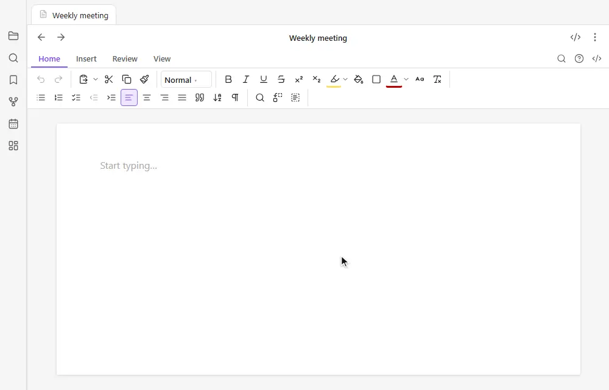
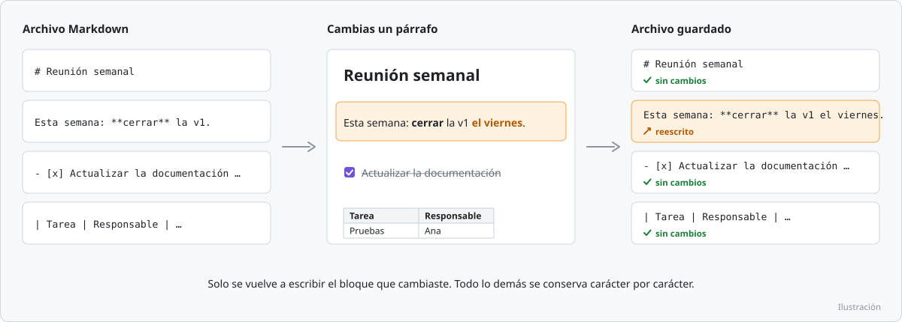
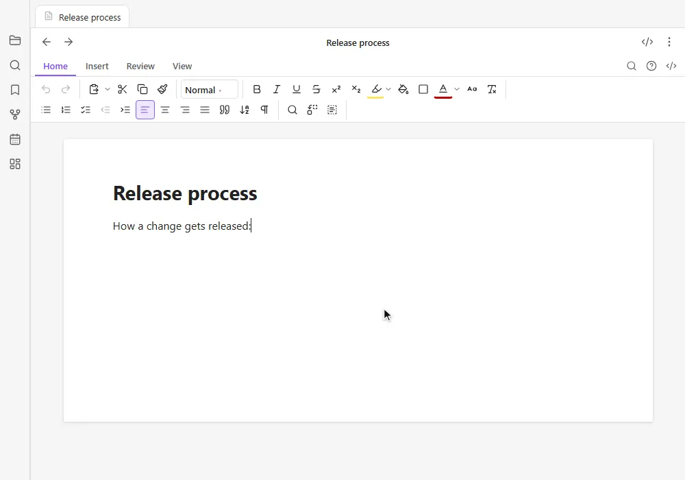

# Word Mode

[English](README.md) | [繁體中文](README.zh-TW.md) | [台文](README.nan-TW.md) | [粵語](README.yue-HK.md) | [简体中文](README.zh-CN.md) | [日本語](README.ja.md) | [한국어](README.ko.md) | [Tiếng Việt](README.vi.md) | [Français](README.fr.md) | [Deutsch](README.de.md) | **Español** | [العربية](README.ar.md) | [עברית](README.he.md)

Edita tus notas de [Obsidian](https://obsidian.md) como lo harías en Word: con una cinta de opciones, tablas, ecuaciones y diagramas, y sin tener que recordar la sintaxis de Markdown. Cada nota se sigue guardando como un archivo Markdown normal.

> Esta traducción al español no ha sido revisada por hablantes nativos. Si encuentras alguna expresión poco natural, avísanos en un Issue.

## Por qué Word Mode

- **Nada que memorizar.** Da formato con los botones de la barra de herramientas y con los atajos que ya conoces de los procesadores de texto, como `Ctrl+B` para negrita y `Ctrl+K` para un enlace.
- **Tus archivos siguen siendo Markdown.** Cuando editas una nota, solo se vuelven a escribir los bloques que cambiaste. Todo lo demás se conserva exactamente como estaba, carácter por carácter, así que la sincronización y el historial de versiones solo ven lo que editaste.
- **Cambia cuando quieras.** Pulsa `Ctrl+E` (`Cmd+E` en macOS), o selecciona el botón del encabezado de la nota, para pasar del modo Word al editor propio de Obsidian y viceversa.
- **Hecho para Obsidian.** Los enlaces, las etiquetas, las propiedades, los destacados, las incrustaciones, las notas al pie, las fórmulas matemáticas, los diagramas de Mermaid y las consultas de Dataview funcionan en modo Word.

## Funciones

### Formato mientras escribes

Es lo que se ve en la animación del principio. Empieza un párrafo con `# `, `- `, `1. `, `> ` o `[ ] `, o termina de escribir `**negrita**`, `*cursiva*` o `[[nota]]`, y se convierte en formato. Con un solo deshacer se quita el formato y se conserva lo que escribiste. Escribe `[[` para elegir una nota o un título, o `#` para elegir una etiqueta.

### Cinta de opciones

- **Pestañas Inicio, Insertar, Revisar y Vista**, organizadas como en un procesador de texto.
- **Color de fuente y resaltado**: colores estándar con sus tonos claros y oscuros, tus colores recientes, o cualquier color que elijas o escribas como código hex. Los resaltados pueden usar cualquier color y opacidad.
- **Adáptala a tu gusto**: muestra las pestañas como texto, iconos o ambos, agrúpalas en un solo botón de menú y cámbiales el nombre. Los grupos de botones se pueden renombrar, reordenar, ocultar o mover a otra pestaña.
- **La misma barra de herramientas en Markdown y en la vista de lectura**, con la misma distribución, para que nada salte al cambiar. Puedes mostrarla en ambos, solo en uno de ellos o en ninguno.
- **Descripciones detalladas**: al pasar el ratón sobre un botón, verás una explicación con una breve animación, también en los botones del grupo Vistas y en los de la barra de estado. Vienen activadas; puedes desactivarlas en los ajustes o en la lista de atajos.
- **Barra de estado** con el recuento de palabras, el estado de guardado, botones para cambiar entre el modo Word, Markdown y la vista de lectura, Ver propiedades y el zoom. Markdown y la vista de lectura mantienen los mismos botones y cuentan las palabras de la misma forma. Puedes desactivarla en los ajustes. Solo muestra el número de palabras, sin contar los símbolos de Markdown ni las direcciones de los enlaces; los caracteres y el tiempo de lectura están en su descripción emergente. Para obtener los mismos números que el recuento integrado de Obsidian, cambia "Forma de contar palabras" en los ajustes.

### Tablas

- Elige un tamaño en la cuadrícula, escribe y pulsa Tab para pasar a la celda siguiente. Tab en la última celda añade una fila.
- Haz clic derecho en una celda para añadir, quitar o mover filas y columnas, ordenar por una columna o definir la alineación de una columna.
- Pega celdas copiadas de una hoja de cálculo y se convertirán en una tabla.

### Ecuaciones

- Las fracciones, raíces, superíndices, paréntesis y matrices son casillas en las que escribes directamente. Elige una estructura de la paleta, o escribe `\frac`, `\sqrt` o `\alpha` seguido de un espacio.
- Tab, Enter y las teclas de flecha te mueven entre las casillas. Backspace en una casilla vacía quita la estructura que la rodea.
- Cambia a LaTeX sin formato en cualquier momento. Las ecuaciones se guardan como `$…$` o `$$…$$` normales, así que se muestran en cualquier lugar donde Obsidian muestre fórmulas matemáticas.

Más sobre el editor de ecuaciones

- Ábrelo con **Insertar → Ecuación**, haciendo doble clic en una ecuación o pulsando Enter sobre una ecuación seleccionada.
- Una ecuación en su propia línea muestra botones pequeños en la esquina superior derecha al pasar el puntero por encima (en un teléfono, tócala): editar, más opciones (ponerla en línea, copiar el LaTeX o el Markdown) y eliminar.
- `^` y `_` abren un superíndice o un subíndice. Las flechas arriba y abajo te mueven entre el numerador y el denominador.
- Deshaz y rehaz con los botones, o con `Ctrl+Z` y `Ctrl+Y`.
- **Fórmulas comunes y ecuaciones recientes**: inserta una fórmula completa, como la fórmula cuadrática o una desviación estándar, y luego cambia las partes que necesites.
- **Tus propias fórmulas**: selecciona el botón de marcador junto a la vista previa para guardar la ecuación actual con un nombre. Las fórmulas guardadas aparecen en **Mis fórmulas** en la paleta, y se insertan con un clic.
- Una ecuación que no cambias se vuelve a escribir exactamente como estaba.
- **En teléfonos y tabletas**: unos botones encima del área de edición te llevan a la casilla anterior o siguiente y quitan la estructura donde está el cursor, porque los teclados en pantalla no tienen teclas de flecha. En un teléfono, el área de edición se queda arriba mientras desplazas la paleta.
- **Nada se pierde por accidente**: si hay cambios sin aplicar, Esc, un clic fuera o la × preguntan primero si quieres descartarlos. El editor de diagramas hace lo mismo.

### Diagramas

- **Once tipos de diagrama de Mermaid tienen formulario**: diagrama de flujo, diagrama de secuencia, diagrama de Gantt, gráfico circular, diagrama de estados, diagrama de clases, mapa mental, línea de tiempo, diagrama ER, recorrido del usuario y gráfico de cuadrantes.
- **Edita sobre el diagrama**: selecciona una etiqueta en la vista previa para cambiarla ahí mismo, añadir el paso siguiente o elegir un color de relleno.
- **Libre**: escribe cualquier código Mermaid con vista previa en directo, incluidos los tipos que no tienen formulario, como los gráficos de Git y los gráficos XY.
- Los diagramas se guardan como bloques de código Mermaid normales. Un diagrama que usa sintaxis que el formulario no cubre se abre como código, con el motivo indicado, para que no se pierda nada.

Más sobre el editor de diagramas

- Ábrelo con **Insertar → Diagrama**, o con el botón de edición de un bloque Mermaid.
- Pasa el puntero por un diagrama de una nota para ver los botones de la esquina superior derecha: editar, mostrar el código, copiar y eliminar. Eliminar quita el diagrama entero, y deshacer lo recupera.
- En el diagrama, pulsa Enter para aplicar un cambio, o Tab para aplicarlo y pasar a la siguiente etiqueta. Al cambiar el nombre de un participante, un estado, una clase o una entidad, se cambian todas las referencias a ese elemento.
- **Apariencia**: elige un tema de Mermaid para un solo diagrama, y un color de relleno para cada paso de un diagrama de flujo.
- **Vista previa**: haz zoom con los botones, o con `Ctrl` y la rueda del ratón. El diagrama se muestra a su tamaño real en lugar de reducirse hasta que el texto sea ilegible, y un botón ajusta todo el diagrama al ancho de la vista previa.
- **Ubícate fácilmente**: pon el cursor en una fila del formulario y la vista previa marca ese elemento con un contorno. Selecciona un elemento en la vista previa y el formulario salta a su fila.
- **Tus propias plantillas**: guarda el diagrama actual con un nombre desde **Mis plantillas** y empieza a partir de él la próxima vez. En los ajustes eliges con qué diagrama empieza uno nuevo y qué tipos integrados aparecen en la lista.
- **Diagramas largos**: las listas del formulario muestran cuarenta filas a la vez y se pueden filtrar escribiendo, así que un diagrama de flujo con cientos de pasos se sigue editando con fluidez. En una nota, un diagrama muy alto se contrae a una altura fija con un botón para mostrarlo entero, y los diagramas se dibujan a medida que llegas a ellos al desplazarte.
- Los tipos de diagrama más recientes solo se dibujan si la versión de Mermaid integrada en Obsidian los admite.
- **En teléfonos**: la vista previa se queda arriba con el formulario debajo, y los campos y botones tienen un tamaño pensado para pantallas táctiles.

### Y más

- **Propiedades** en forma de formulario: las etiquetas y los enlaces aparecen como fichas que puedes seleccionar para abrirlos, los valores anidados aparecen como un árbol, y desde el icono de una propiedad puedes cambiar su tipo o su nombre. Ver propiedades, en la pestaña Vista y en la barra de estado, las muestra sin tener que desplazarte hasta arriba y te permite filtrar una lista larga. El botón de chincheta del encabezado de las propiedades (o un ajuste) fija arriba una barra de propiedades delgada mientras te desplazas; haz clic en ella para ver la lista completa. Puedes mostrar las propiedades como un cuadro con borde y fondo, solo con borde, o con un estilo mínimo sin borde.
- **Imágenes**: pega o elige una imagen y luego arrástrala para cambiar su tamaño.
- **Enlaces** a notas, títulos y páginas web, con una pequeña barra de herramientas que aparece cuando el cursor está sobre un enlace.
- **Buscar y reemplazar**, con opciones de palabras completas y expresiones regulares.
- **Barra lateral del esquema** y plegado de títulos.
- **Incrustaciones**: las notas, títulos, audios, videos, PDF y enlaces de YouTube incrustados se muestran en su lugar. Las consultas de Dataview y los bloques de código de otros complementos se muestran como su resultado.
- **Notas al pie**: inserta una nota al pie, pasa el ratón sobre su número para leerla y edita su texto sin tocar la sintaxis.
- **Destacados** (incluidos los plegables), **listas de tareas** con estados personalizados como `[/]` y `[-]`, **etiquetas** y **bloques de código** con resaltado de sintaxis y números de línea opcionales.
- **Marcas de formato** como `¶`, y una herramienta para limpiar caracteres invisibles o sueltos.
- **Pega texto Markdown** y conviértelo en texto con formato en un solo paso.
- **Gestión de conflictos de sincronización**: si una nota cambia en el disco mientras tienes cambios sin guardar, eliges qué versión conservar.
- **Lista de atajos**: busca en ella o elige una categoría, y selecciona un atajo para ver una breve animación de lo que hace. La casilla de abajo activa o desactiva las descripciones detalladas.
- Interfaz en chino tradicional, taiwanés (caracteres han), cantonés, chino simplificado, inglés, japonés, coreano, vietnamita, francés, alemán, español, árabe y hebreo.

Todo lo que Word Mode no puede editar visualmente, como un bloque HTML, se muestra como un bloque sin procesar y se guarda sin cambios. Pasa el puntero por encima, o por una nota al pie o un bloque de comentario, para ver en la esquina superior derecha botones para editarlo, copiarlo o eliminarlo. Al eliminar una nota al pie también se quitan sus llamadas en el texto.

## Primeros pasos

### Instalación

Requiere Obsidian 1.5.7 o posterior.

1. Descarga `main.js`, `manifest.json` y `styles.css` de la [última versión](https://github.com/NatLee/obsidian-word-mode/releases/latest).
2. Copia los tres archivos en `<tu bóveda>/.obsidian/plugins/natlee-word-mode/`.
3. En Obsidian, abre **Ajustes → Complementos de la comunidad** y activa **Word Mode**.

### Uso

Después de activar el complemento, las notas Markdown se abren en modo Word.

- Para cambiar entre el modo Word y Markdown, selecciona el botón de la esquina superior derecha de la nota o pulsa `Ctrl+E` (`Cmd+E` en macOS).
- Para abrir una nota en un modo específico, haz clic derecho en la nota y selecciona **Abrir en modo Word** o **Abrir como Markdown**.
- Para que una sola nota no use el modo Word, añade `word-mode: false` a sus propiedades.
- Para que carpetas enteras no usen el modo Word, escríbelas en **Ajustes → Word Mode → Carpetas excluidas del modo Word**.

Los ajustes están agrupados en categorías, con una fila de pestañas arriba que muestra una categoría a la vez. Para encontrar un ajuste sin saber en qué categoría está, escribe en el cuadro de búsqueda que hay encima de las pestañas. Mientras escribes te sugiere los ajustes que coinciden, también busca en las opciones de los menús desplegables y en los nombres de los ajustes en otros idiomas (puedes escribir en inglés aunque la interfaz esté en español), y te lleva al ajuste que elijas.

### Comandos

| Comando | Descripción |
| --- | --- |
| Editar la nota actual en modo Word | Cambia la nota actual al modo Word. |
| Editar la nota actual como Markdown | Devuelve la nota actual al editor Markdown. |
| Alternar modo Word / Markdown | Cambia entre los dos. |
| Mostrar u ocultar la barra lateral del esquema | Muestra u oculta el esquema. |
| Buscar | Busca en la nota actual. |
| Buscar y reemplazar | Busca y reemplaza en la nota actual. |
| Esquema: ir a un título | Salta a un título de la nota actual. |
| Mostrar atajos de teclado | Muestra todos los atajos del modo Word. |

Ningún comando tiene un atajo predeterminado. Puedes asignar los tuyos en **Ajustes → Atajos de teclado**.

## Privacidad y avisos

- **Uso de la red**: solo para mostrar contenido web al que tus notas ya apuntan. Si una nota contiene una imagen, un audio o un video de una dirección web, el modo Word lo carga desde esa dirección. Si una nota incrusta un enlace de YouTube, el modo Word muestra el reproductor de YouTube, que se conecta a `youtube.com`. Es el mismo contenido que carga el editor propio de Obsidian para esa nota. El complemento no envía tus notas ni tus datos a ningún sitio.
- **Telemetría**: ninguna.
- **Cuentas y pagos**: no se necesitan.
- **Archivos fuera de tu bóveda**: nunca se leen ni se escriben.
- **Nombres de archivo de tu bóveda**: el complemento obtiene la lista de archivos de tu bóveda para ofrecerlos en los selectores de enlaces, imágenes y plantillas, y en las sugerencias después de `[[`. La lista no sale de tu dispositivo.
- **Portapapeles**: solo se lee cuando seleccionas **Pegar** en la barra de herramientas o en el menú contextual, y solo se escribe cuando seleccionas **Cortar**, **Copiar** o un botón de copiar.
- **Archivos que crea el complemento**: las imágenes que pegas se guardan en tu carpeta de archivos adjuntos. Si en un conflicto de sincronización eliges conservar ambas versiones, tu versión se guarda como una copia junto a la nota.

## Limitaciones conocidas

- El uso en móviles no se ha probado en dispositivos reales.
- Algunos botones de la barra de herramientas que se muestra en Markdown y en la vista de lectura llaman a comandos integrados de Obsidian, y no todos se han probado uno por uno.
- Las traducciones distintas del chino tradicional y el inglés no han sido revisadas por hablantes nativos.
- En árabe y hebreo, el texto está traducido, pero la barra de herramientas y los cuadros de diálogo mantienen el diseño de izquierda a derecha.
- Los resultados de diagramas y consultas, las incrustaciones y las vistas previas de página los dibuja Obsidian. Están cubiertos por pruebas automatizadas que simulan Obsidian, pero no se han comprobado con todos los complementos y temas.
- La apariencia de un diagrama (tema de Mermaid) y los colores de relleno de los diagramas de flujo los dibuja Mermaid dentro de Obsidian. Se comprobaron con el propio Mermaid, no con todos los temas de Obsidian.

## Contribuir

Los informes de errores y las ideas son bienvenidos en [Issues](https://github.com/NatLee/obsidian-word-mode/issues). Para compilar el complemento, ejecutar las pruebas, ver cómo funciona por dentro o publicar una versión, lee la [guía para desarrolladores (en inglés)](docs/development.md).

## Créditos

Word Mode incluye estas bibliotecas de código abierto:

- [ProseMirror](https://prosemirror.net), de Marijn Haverbeke y colaboradores, licencia MIT.
- [markdown-it](https://github.com/markdown-it/markdown-it) y [markdown-it-mark](https://github.com/markdown-it/markdown-it-mark), licencia MIT.
- [entities](https://github.com/fb55/entities), licencia BSD 2-Clause.

## Licencia

[Licencia MIT](LICENSE).
