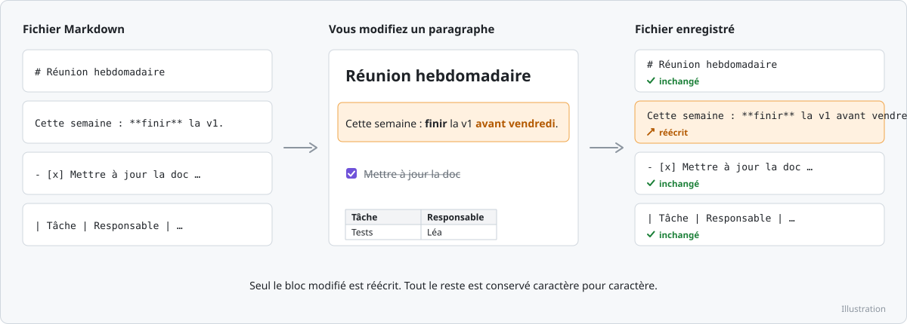
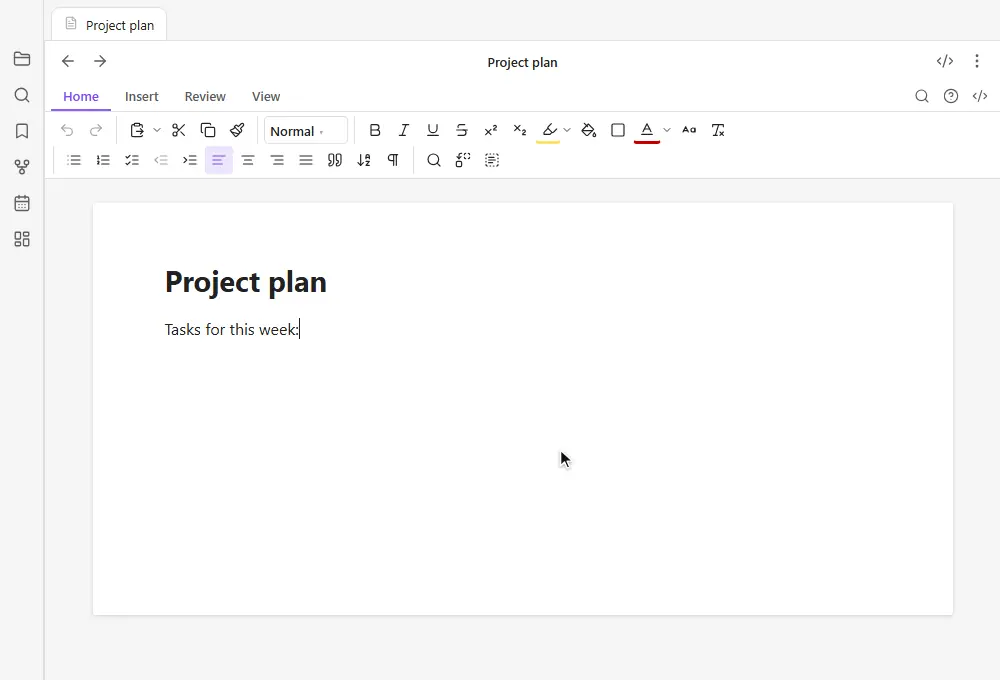

# Word Mode

[English](README.md) | [繁體中文](README.zh-TW.md) | [台文](README.nan-TW.md) | [粵語](README.yue-HK.md) | [简体中文](README.zh-CN.md) | [日本語](README.ja.md) | [한국어](README.ko.md) | [Tiếng Việt](README.vi.md) | **Français** | [Deutsch](README.de.md) | [Español](README.es.md) | [العربية](README.ar.md) | [עברית](README.he.md)

Modifiez vos notes [Obsidian](https://obsidian.md) comme dans Word : un ruban, des tableaux, des équations et des diagrammes, sans aucune syntaxe Markdown à retenir. Chaque note reste enregistrée sous forme de fichier Markdown brut.

> Cette version française n'a pas été relue par des locuteurs natifs. Si une formulation vous semble maladroite, signalez-la dans une Issue.

## Pourquoi Word Mode

- **Rien à mémoriser.** Mettez en forme avec les boutons de la barre d'outils et les raccourcis habituels des traitements de texte, comme `Ctrl+B` pour le gras et `Ctrl+K` pour un lien.
- **Vos fichiers restent en Markdown.** Quand vous modifiez une note, seuls les blocs modifiés sont réécrits. Tout le reste est conservé exactement tel quel, caractère pour caractère : la synchronisation et l'historique des versions ne voient que ce que vous avez modifié.
- **Basculez à tout moment.** Appuyez sur `Ctrl+E` (`Cmd+E` sur macOS), ou sélectionnez le bouton dans l'en-tête de la note, pour passer du mode Word à l'éditeur d'Obsidian et inversement.
- **Conçu pour Obsidian.** Liens, étiquettes, propriétés, encadrés (callouts), intégrations, notes de bas de page, maths, diagrammes Mermaid et requêtes Dataview fonctionnent tous en mode Word.

## Fonctionnalités

### Mise en forme pendant la saisie

C'est ce que montre l'animation du haut. Commencez un paragraphe par `# `, `- `, `1. `, `> ` ou `[ ] `, ou terminez `**gras**`, `*italique*` ou `[[note]]`, et le texte se transforme en mise en forme. Une seule annulation retire la mise en forme et garde ce que vous avez tapé. Tapez `[[` pour choisir une note ou un titre, ou `#` pour choisir une étiquette.

### Ruban

- **Onglets Accueil, Insérer, Révision et Affichage**, organisés comme dans un traitement de texte.
- **Couleur de police et surlignage** : couleurs standard avec leurs nuances, couleurs récentes, ou n'importe quelle couleur choisie ou saisie en code hexadécimal. Le surlignage accepte n'importe quelle couleur et opacité.
- **À votre goût** : affichez les onglets en texte, en icônes ou les deux, regroupez-les dans un seul bouton de menu et renommez-les. Renommez, réordonnez, masquez ou déplacez les groupes de boutons vers un autre onglet.
- **La même barre d'outils en mode Markdown et lecture**, avec la même disposition, pour que rien ne saute quand vous changez de mode. Vous pouvez l'afficher dans les deux, dans un seul ou dans aucun.
- **Info-bulles détaillées** : une fois activées, survoler un bouton l'explique avec une courte animation, y compris pour les boutons de vue et ceux de la barre d'état.
- **Barre d'état** avec le nombre de mots, l'état de l'enregistrement, des boutons pour passer du mode Word au Markdown ou au mode lecture, l'affichage des propriétés et le zoom. Les modes Markdown et lecture gardent les mêmes boutons et comptent les mots de la même façon. Vous pouvez désactiver cela dans les paramètres.

### Tableaux

- Choisissez une taille dans la grille, puis tapez et appuyez sur Tab pour passer à la cellule suivante. Tab dans la dernière cellule ajoute une ligne.
- Faites un clic droit sur une cellule pour ajouter, supprimer ou déplacer des lignes et des colonnes, trier selon une colonne ou définir l'alignement d'une colonne.
- Collez des cellules d'un tableur : elles deviennent un tableau.

### Équations

- Fractions, racines, exposants, parenthèses et matrices sont des cases dans lesquelles vous tapez. Choisissez une structure dans la palette, ou tapez `\frac`, `\sqrt` ou `\alpha` suivi d'une espace.
- Tab, Enter et les flèches permettent de passer d'une case à l'autre. Backspace dans une case vide retire la structure qui l'entoure.
- Passez au LaTeX brut à tout moment. Les équations sont enregistrées en `$…$` ou `$$…$$` ordinaires, et s'affichent donc partout où Obsidian affiche des maths.

En savoir plus sur l'éditeur d'équations

- Ouvrez-le avec **Insérer → Équation**, en double-cliquant sur une équation, ou en appuyant sur Enter quand une équation est sélectionnée.
- `^` et `_` ouvrent un exposant ou un indice. Les flèches haut et bas passent du numérateur au dénominateur.
- Annulez et rétablissez avec les boutons, ou avec `Ctrl+Z` et `Ctrl+Y`.
- **Formules courantes et équations récentes** : insérez une formule entière, comme les solutions d'une équation du second degré ou un écart type, puis modifiez les parties nécessaires.
- **Vos propres formules** : sélectionnez le bouton signet à côté de l'aperçu pour enregistrer l'équation actuelle sous un nom. Les formules enregistrées apparaissent sous **Mes formules** dans la palette, et un clic les insère.
- Une équation que vous ne modifiez pas est réécrite exactement telle qu'elle était.
- **Sur téléphone et tablette** : des boutons au-dessus de la zone d'édition permettent de passer à la case précédente ou suivante et de retirer la structure au curseur, car les claviers virtuels n'ont pas de flèches. Sur téléphone, la zone d'édition reste en haut pendant que vous faites défiler la palette.
- **Rien de perdu par mégarde** : s'il reste des modifications non appliquées, Échap, un clic à l'extérieur ou la croix demandent d'abord s'il faut les abandonner. L'éditeur de diagrammes fait de même.

### Diagrammes

- **Onze types de diagrammes Mermaid disposent d'un formulaire** : organigramme, diagramme de séquence, diagramme de Gantt, diagramme circulaire, diagramme d'états, diagramme de classes, carte mentale, chronologie, diagramme ER, parcours utilisateur et graphique à quadrants.
- **Modification sur le diagramme** : sélectionnez un libellé dans l'aperçu pour le modifier sur place, ajoutez l'étape suivante ou choisissez une couleur de remplissage.
- **Libre** : écrivez n'importe quel code Mermaid avec un aperçu en direct, y compris pour les types sans formulaire, comme les graphes Git et les graphiques XY.
- Les diagrammes sont enregistrés comme des blocs de code Mermaid ordinaires. Un diagramme qui utilise une syntaxe non couverte par le formulaire s'ouvre en code, avec la raison affichée, pour que rien ne soit perdu.

En savoir plus sur l'éditeur de diagrammes

- Ouvrez-le avec **Insérer → Diagramme**, ou avec le bouton de modification d'un bloc Mermaid.
- Sur le diagramme, appuyez sur Enter pour appliquer une modification, ou sur Tab pour l'appliquer et passer au libellé suivant. Renommer un participant, un état, une classe ou une entité renomme toutes ses références.
- **Apparence** : choisissez un thème Mermaid pour un seul diagramme, et une couleur de remplissage pour chaque étape d'un organigramme.
- **Aperçu** : zoomez avec les boutons, ou avec `Ctrl` et la molette de la souris. Un diagramme est affiché à sa taille réelle au lieu d'être réduit jusqu'à rendre le texte illisible, et un bouton ajuste tout le diagramme à la largeur de l'aperçu.
- **Se repérer** : placez le curseur sur une ligne du formulaire et l'aperçu entoure l'élément correspondant. Sélectionnez un élément dans l'aperçu et le formulaire saute à sa ligne.
- **Vos propres modèles** : enregistrez le diagramme actuel sous un nom depuis **Mes modèles**, et repartez-en la prochaine fois. Dans les paramètres, vous choisissez le contenu initial d'un nouveau diagramme et les types intégrés à lister.
- **Longs diagrammes** : les listes du formulaire affichent quarante lignes à la fois et se filtrent en tapant, si bien qu'un organigramme de plusieurs centaines d'étapes reste rapide à modifier. Dans une note, un diagramme très haut est réduit à une hauteur fixe avec un bouton pour l'afficher en entier, et les diagrammes ne sont dessinés qu'au moment où vous les faites défiler jusqu'à l'écran.
- Les types de diagrammes plus récents ne sont dessinés que si la version de Mermaid intégrée à Obsidian les prend en charge.
- **Sur téléphone** : l'aperçu reste en haut avec le formulaire en dessous, et les champs et boutons sont dimensionnés pour le tactile.

### Et plus encore

- **Propriétés** sous forme de formulaire : les étiquettes et les liens apparaissent comme des pastilles que vous pouvez sélectionner pour les ouvrir, les valeurs imbriquées apparaissent en arborescence, et vous pouvez changer le type d'une propriété ou la renommer depuis son icône. **Voir les propriétés**, dans l'onglet Affichage et la barre d'état, les affiche sans remonter en haut et permet de filtrer une longue liste. Un paramètre peut aussi épingler une fine barre de propriétés en haut pendant le défilement ; cliquez dessus pour voir la liste complète. Vous pouvez afficher les propriétés dans un bloc avec bordure et fond, avec une bordure seule, ou dans un style minimal sans bordure.
- **Images** : collez ou choisissez une image, puis faites glisser pour la redimensionner.
- **Liens** vers des notes, des titres et des pages web, avec une petite barre d'outils qui apparaît quand le curseur est sur un lien.
- **Rechercher et remplacer**, avec les options mot entier et expression régulière.
- **Barre latérale du plan** et repli des titres.
- **Intégrations** : les notes, titres, fichiers audio, vidéos, PDF et liens YouTube intégrés s'affichent sur place. Les requêtes Dataview et les blocs de code d'autres plugins s'affichent sous forme de résultats.
- **Notes de bas de page** : insérez une note de bas de page, survolez son numéro pour la lire et modifiez son texte sans toucher à la syntaxe.
- **Encadrés** (y compris repliables), **listes de tâches** avec des statuts personnalisés comme `[/]` et `[-]`, **étiquettes** et **blocs de code** avec coloration syntaxique et numéros de ligne en option.
- **Marques de mise en forme** comme `¶`, et un outil de nettoyage des caractères invisibles ou parasites.
- **Collez du texte Markdown** et convertissez-le en texte mis en forme en une étape.
- **Gestion des conflits de synchronisation** : si une note change sur le disque alors que vous avez des modifications non enregistrées, vous choisissez la version à garder.
- **Liste des raccourcis** : faites une recherche ou choisissez une catégorie, et sélectionnez un raccourci pour voir une courte animation de ce qu'il fait.
- Interface en chinois traditionnel, taïwanais (caractères Han), cantonais, chinois simplifié, anglais, japonais, coréen, vietnamien, français, allemand, espagnol, arabe et hébreu.

Tout ce que Word Mode ne peut pas modifier visuellement, comme un bloc HTML, s'affiche sous forme de bloc brut et est enregistré sans modification.

## Prise en main

### Installation

Nécessite Obsidian 1.5.7 ou une version ultérieure.

1. Téléchargez `main.js`, `manifest.json` et `styles.css` depuis la [dernière version](https://github.com/NatLee/obsidian-word-mode/releases/latest).
2. Copiez les trois fichiers dans `<votre coffre>/.obsidian/plugins/natlee-word-mode/`.
3. Dans Obsidian, ouvrez **Paramètres → Plugins communautaires** et activez **Word Mode**.

### Utilisation

Une fois le plugin activé, les notes Markdown s'ouvrent en mode Word.

- Pour passer du mode Word au Markdown et inversement, sélectionnez le bouton en haut à droite de la note, ou appuyez sur `Ctrl+E` (`Cmd+E` sur macOS).
- Pour ouvrir une note dans un mode précis, faites un clic droit sur la note et sélectionnez **Ouvrir en mode Word** ou **Ouvrir en Markdown**.
- Pour exclure une seule note du mode Word, ajoutez `word-mode: false` à ses propriétés.
- Pour exclure des dossiers entiers du mode Word, listez-les dans **Paramètres → Word Mode → Dossiers exclus du mode Word**.

Les paramètres sont regroupés par catégories, avec une rangée d'onglets en haut qui affiche une catégorie à la fois. Pour trouver un paramètre sans connaître sa catégorie, tapez dans le champ de recherche au-dessus des onglets. Il suggère les paramètres correspondants pendant la saisie, cherche aussi dans les options des listes déroulantes et dans les noms des paramètres dans d'autres langues (vous pouvez taper en anglais alors que l'interface est en français), et vous amène à celui que vous choisissez.

### Commandes

| Commande | Description |
| --- | --- |
| Modifier la note actuelle en mode Word | Passe la note actuelle en mode Word. |
| Modifier la note actuelle en Markdown | Ramène la note actuelle dans l'éditeur Markdown. |
| Basculer mode Word / Markdown | Passe de l'un à l'autre. |
| Afficher/masquer la barre latérale du plan | Affiche ou masque le plan. |
| Rechercher | Recherche dans la note actuelle. |
| Rechercher et remplacer | Recherche et remplace dans la note actuelle. |
| Plan : aller à un titre | Va à un titre de la note actuelle. |
| Afficher les raccourcis clavier | Liste tous les raccourcis du mode Word. |

Aucune commande n'a de raccourci par défaut. Vous pouvez attribuer les vôtres dans **Paramètres → Raccourcis clavier**.

## Confidentialité et informations

- **Utilisation du réseau** : uniquement pour afficher le contenu web vers lequel vos notes pointent déjà. Si une note contient une image, un fichier audio ou une vidéo provenant d'une adresse web, le mode Word le charge depuis cette adresse. Si une note intègre un lien YouTube, le mode Word affiche le lecteur YouTube, qui se connecte à `youtube.com`. C'est le même contenu que l'éditeur d'Obsidian charge pour cette note. Le plugin n'envoie aucune de vos notes ni aucune de vos données nulle part.
- **Télémétrie** : aucune.
- **Compte et paiement** : non requis.
- **Fichiers hors de votre coffre** : jamais lus ni écrits.
- **Noms des fichiers de votre coffre** : le plugin liste les fichiers de votre coffre pour les proposer dans les sélecteurs de liens, d'images et de modèles, ainsi que dans les suggestions après `[[`. Cette liste reste sur votre appareil.
- **Presse-papiers** : lu uniquement quand vous sélectionnez **Coller** dans la barre d'outils ou le menu contextuel, et écrit uniquement quand vous sélectionnez **Couper**, **Copier** ou un bouton de copie.
- **Fichiers créés par le plugin** : les images que vous collez sont enregistrées dans votre dossier des pièces jointes. Si vous choisissez de garder les deux versions lors d'un conflit de synchronisation, votre version est enregistrée en copie à côté de la note.

## Limites connues

- L'utilisation sur mobile n'a pas été testée sur de vrais appareils.
- Certains boutons de la barre d'outils affichée en mode Markdown et lecture appellent des commandes intégrées d'Obsidian et n'ont pas tous été testés individuellement.
- Les traductions autres que le chinois traditionnel et l'anglais n'ont pas été relues par des locuteurs natifs.
- En arabe et en hébreu, le texte est traduit mais la barre d'outils et les boîtes de dialogue gardent leur disposition de gauche à droite.
- Les résultats de diagrammes et de requêtes, les intégrations et les aperçus de page sont dessinés par Obsidian. Ils sont couverts par des tests automatisés qui simulent Obsidian, mais n'ont pas été vérifiés avec chaque plugin et chaque thème.
- L'apparence d'un diagramme (thème Mermaid) et les couleurs de remplissage des organigrammes sont dessinées par Mermaid dans Obsidian. Elles ont été vérifiées avec Mermaid lui-même, pas avec chaque thème Obsidian.

## Contribuer

Les rapports de bugs et les idées sont les bienvenus dans les [Issues](https://github.com/NatLee/obsidian-word-mode/issues). Pour compiler le plugin, lancer les tests, comprendre son fonctionnement interne ou publier une version, lisez le [guide du développeur (en anglais)](docs/development.md).

## Remerciements

Word Mode intègre ces bibliothèques open source :

- [ProseMirror](https://prosemirror.net) par Marijn Haverbeke et ses contributeurs, licence MIT.
- [markdown-it](https://github.com/markdown-it/markdown-it) et [markdown-it-mark](https://github.com/markdown-it/markdown-it-mark), licence MIT.
- [entities](https://github.com/fb55/entities), licence BSD 2-Clause.

## Licence

[Licence MIT](LICENSE).
