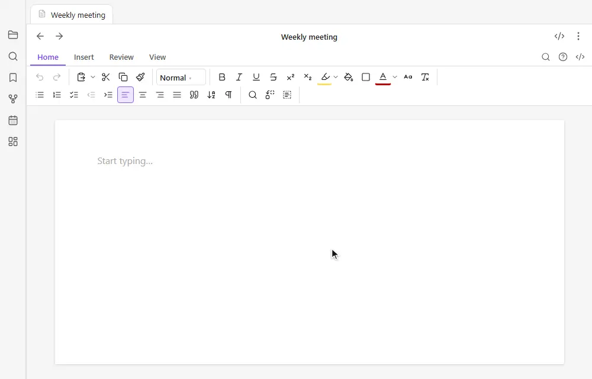
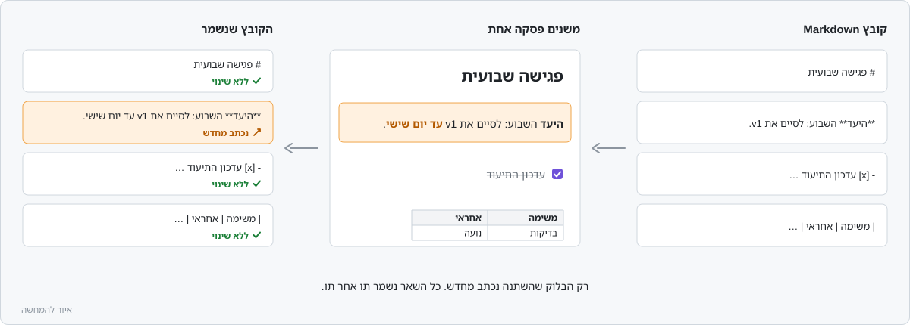

# Word Mode

[English](README.md) | [繁體中文](README.zh-TW.md) | [台文](README.nan-TW.md) | [粵語](README.yue-HK.md) | [简体中文](README.zh-CN.md) | [日本語](README.ja.md) | [한국어](README.ko.md) | [Tiếng Việt](README.vi.md) | [Français](README.fr.md) | [Deutsch](README.de.md) | [Español](README.es.md) | [العربية](README.ar.md) | **עברית**

עם Word Mode עורכים את הפתקים ב-[Obsidian](https://obsidian.md) כמו ב-Word: רצועת כלים, טבלאות, משוואות ותרשימים, בלי לזכור תחביר Markdown. כל פתק עדיין נשמר כקובץ Markdown רגיל.

> התרגום לעברית לא נבדק על ידי דוברי עברית כשפת אם. אם ניסוח כלשהו נשמע לא טבעי, אפשר לדווח עליו ב-Issue.

## למה Word Mode

- **אין מה לשנן.** מעצבים בעזרת לחצני סרגל הכלים וקיצורי המקלדת המוכרים ממעבדי תמלילים, כמו `Ctrl+B` לטקסט מודגש ו-`Ctrl+K` לקישור.
- **הקבצים נשארים Markdown.** בעריכת פתק, רק הבלוקים ששונו נכתבים מחדש. כל השאר נשמר בדיוק כפי שהיה, תו אחר תו, כך שהסנכרון והיסטוריית הגרסאות רואים רק את מה שנערך.
- **מעבר בכל רגע.** הקשה על `Ctrl+E` (ב-macOS: `Cmd+E`), או לחיצה על הלחצן שבראש הפתק, עוברת בין מצב Word לבין העורך המובנה של Obsidian.
- **נבנה בשביל Obsidian.** קישורים, תגיות, מאפיינים, תיבות הסבר, הטמעות, הערות שוליים, מתמטיקה, תרשימי Mermaid ושאילתות Dataview עובדים כולם במצב Word.

## תכונות

### עיצוב תוך כדי הקלדה

מוצג באנימציה שבראש הדף. כשמתחילים פסקה ב-`# `, `- `, `1. `, `> ` או `[ ] `, או מסיימים להקליד `**bold**`, `*italic*` או `[[note]]`, הטקסט הופך לעיצוב. ביטול אחד מסיר את העיצוב ומשאיר את מה שהוקלד. הקלדת `[[` מאפשרת לבחור פתק או כותרת, והקלדת `#` מאפשרת לבחור תגית.

### רצועת הכלים

- **הכרטיסיות בית, הוספה, סקירה ותצוגה**, מסודרות כמו במעבד תמלילים.
- **צבע גופן והדגשה**: צבעים סטנדרטיים בגוונים בהירים וכהים, צבעים אחרונים, או כל צבע שבוחרים או מקלידים כקוד hex. להדגשה אפשר להשתמש בכל צבע ובכל רמת אטימות.
- **התאמה אישית**: אפשר להציג את הכרטיסיות כטקסט, כסמלים או בשניהם, לכווץ אותן ללחצן תפריט אחד ולשנות את שמותיהן. את קבוצות הלחצנים אפשר לשנות שם, לסדר מחדש, להסתיר או להעביר לכרטיסייה אחרת.
- **יותר מקום להקלדה בטלפון**: כשהמקלדת שעל המסך פתוחה, סרגל הכלים מצטמצם לשורה אחת מעליה. הכרטיסיות עוברות לכפתור תפריט והכפתורים מציגים סמלים בלבד; הכול חוזר כשהמקלדת נסגרת. אפשר לכבות את זה בהגדרות.
- **אותו סרגל כלים בעריכת Markdown ובתצוגת קריאה**, באותה פריסה, כך ששום דבר לא קופץ במעבר. אפשר להציג אותו בשניהם, רק באחד מהם או באף אחד.
- **תיאורי כלים מפורטים**: מעבר עם העכבר מעל לחצן מציג הסבר עם אנימציה קצרה, גם בלחצני מצבי התצוגה ובלחצני שורת המצב. הם מופעלים כברירת מחדל, ואפשר לכבות אותם בהגדרות או ברשימת הקיצורים.
- **שורת המצב** עם ספירת מילים, מצב השמירה, לחצנים למעבר בין מצב Word, Markdown ותצוגת קריאה, הצגת מאפיינים וזום. בעריכת Markdown ובתצוגת קריאה נשארים אותם לחצנים, והמילים נספרות באותה דרך. אפשר לכבות זאת בהגדרות. מוצגת רק ספירת המילים, בלי סימני Markdown וכתובות קישורים; מספר התווים וזמן הקריאה מופיעים בתיאור הכלי. כדי לקבל את אותם מספרים כמו ספירת המילים המובנית של Obsidian, אפשר לשנות את "שיטת ספירת המילים" בהגדרות.

### טבלאות

- בוחרים גודל מהרשת, מקלידים ומקישים Tab כדי לעבור לתא הבא. Tab בתא האחרון מוסיף שורה.
- לחיצה ימנית על תא מאפשרת להוסיף, להסיר או להזיז שורות ועמודות, למיין לפי עמודה או לקבוע את היישור של עמודה.
- תאים שמודבקים מגיליון אלקטרוני הופכים לטבלה.
- כשהסמן נמצא בטבלה, מופיעה ברצועת הכלים הכרטיסייה **טבלה**. ידיות בשולי הטבלה בוחרות שורה או עמודה שלמה ופותחות את התפריט שלה, גם בטלפון.
- בוחרים שורות, עמודות או את הטבלה כולה ומקישים Backspace כדי למחוק אותן; Delete מנקה רק את התוכן. הכפתורים שליד הטבלה מעתיקים אותה כ-Markdown או מוחקים אותה בלחיצה אחת.
- אפשר להמיר כמה שורות שמופרדות ב-Tab, ב-`|` או בפסיקים לטבלה, או להחזיר טבלה לטקסט. Ctrl+Enter יוצא מהטבלה ומתחיל פסקה מתחתיה. טבלה שהועתקה מודבקת בגיליון אלקטרוני מחולקת לעמודות.

### משוואות

- שברים, שורשים, כתב עילי ותחתי, סוגריים ומטריצות הם תיבות שמקלידים בתוכן. אפשר לבחור מבנה מהלוח, או להקליד `\frac`, `\sqrt` או `\alpha` ואחריהם רווח.
- Tab, Enter ומקשי החיצים עוברים בין התיבות. Backspace בתיבה ריקה מסיר את המבנה שסביבה.
- אפשר לעבור ל-LaTeX רגיל בכל רגע. משוואות נשמרות כ-`$…$` או `$$…$$` רגילים, כך שהן מוצגות בכל מקום שבו Obsidian מציג מתמטיקה.

עוד על עורך המשוואות

- פותחים אותו דרך **הוספה ← משוואה**, בלחיצה כפולה על משוואה, או בהקשה על Enter כשמשוואה מסומנת.
- משוואה בשורה נפרדת מציגה לחצנים קטנים בפינה העליונה כשמצביעים עליה (בטלפון: מקישים עליה): עריכה, אפשרויות נוספות (העברה לתוך הטקסט, העתקת LaTeX או Markdown) ומחיקה.
- `^` ו-`_` פותחים כתב עילי או תחתי. החיצים למעלה ולמטה עוברים בין המונה למכנה.
- ביטול וביצוע מחדש בעזרת הלחצנים, או עם `Ctrl+Z` ו-`Ctrl+Y`.
- **נוסחאות נפוצות ומשוואות אחרונות**: מוסיפים נוסחה שלמה, כמו נוסחת השורשים או סטיית תקן, ואז משנים את החלקים הנדרשים.
- **נוסחאות משלך**: לחצן הסימנייה שליד התצוגה המקדימה שומר את המשוואה הנוכחית בשם. נוסחאות שמורות מופיעות תחת **הנוסחאות שלי** בלוח, ולחיצה אחת מוסיפה אותן.
- משוואה שלא שונתה נכתבת בחזרה בדיוק כפי שהייתה.
- **בטלפונים ובטאבלטים**: לחצנים מעל אזור העריכה עוברים לתיבה הקודמת או הבאה ומסירים את המבנה שבמיקום הסמן, כי במקלדות מסך אין מקשי חיצים. בטלפון, אזור העריכה נשאר למעלה בזמן גלילת הלוח.
- **שום דבר לא הולך לאיבוד בטעות**: כשיש שינויים שעוד לא הוחלו, Esc, לחיצה מחוץ לחלון או × שואלים קודם אם לבטל אותם. עורך התרשימים עושה אותו דבר.

### תרשימים

- **לאחד עשר סוגים של תרשימי Mermaid יש טופס**: תרשים זרימה, תרשים רצף, תרשים גאנט, תרשים עוגה, תרשים מצבים, תרשים מחלקות, מפת חשיבה, ציר זמן, תרשים ER, מסע משתמש ותרשים רביעים.
- **עריכה על התרשים**: בחירה בתווית בתצוגה המקדימה מאפשרת לשנות אותה במקום, להוסיף את השלב הבא או לבחור צבע מילוי.
- **כתיבה חופשית**: כותבים כל קוד Mermaid עם תצוגה מקדימה חיה, כולל סוגים שאין להם טופס, כמו גרפי Git ותרשימי XY.
- תרשימים נשמרים כבלוקי קוד Mermaid רגילים. תרשים שמשתמש בתחביר שהטופס לא מכסה נפתח כקוד, עם הסבר למה, כך ששום דבר לא הולך לאיבוד.

עוד על עורך התרשימים

- פותחים אותו דרך **הוספה ← תרשים**, או בלחצן העריכה שעל בלוק Mermaid.
- הצביעו על תרשים בפתק כדי להציג את הלחצנים בפינה העליונה שלו: עריכה, הצגת הקוד, העתקה ומחיקה. מחיקה מסירה את כל התרשים, וביטול מחזיר אותו.
- על התרשים, Enter מחיל את השינוי, ו-Tab מחיל אותו ועובר לתווית הבאה. שינוי שם של משתתף, מצב, מחלקה או ישות משנה את השם בכל מקום שמפנה אליו.
- **מראה**: בחירת ערכת נושא של Mermaid לתרשים בודד, וצבע מילוי לכל שלב בתרשים זרימה.
- **תצוגה מקדימה**: זום בעזרת הלחצנים, או עם `Ctrl` וגלגלת העכבר. התרשים מוצג בגודלו האמיתי במקום להתכווץ עד שאי אפשר לקרוא את הטקסט, ולחצן אחד מתאים את התרשים כולו לרוחב התצוגה המקדימה.
- **למצוא את המקום**: כשהסמן נמצא בשורה של הטופס, התצוגה המקדימה מסמנת את הפריט הזה במסגרת. בחירה בפריט בתצוגה המקדימה מעבירה את הטופס לשורה שלו.
- **תבניות משלך**: שומרים את התרשים הנוכחי בשם דרך **התבניות שלי**, ומתחילים ממנו בפעם הבאה. בהגדרות אפשר לבחור במה מתחיל תרשים חדש ואילו סוגים מובנים מופיעים ברשימה.
- **תרשימים ארוכים**: הרשימות בטופס מציגות ארבעים שורות בכל פעם ואפשר לסנן אותן בהקלדה, כך שגם תרשים זרימה עם מאות שלבים נשאר מהיר לעריכה. בפתק, תרשים גבוה מאוד מכווץ לגובה קבוע עם לחצן להצגת כולו, ותרשימים מצוירים רק כשגוללים אליהם.
- סוגי תרשימים חדשים יותר מצוירים רק אם גרסת Mermaid המובנית ב-Obsidian תומכת בהם.
- **בטלפונים**: התצוגה המקדימה נשארת למעלה והטופס מתחתיה, והשדות והלחצנים בגודל שמתאים למגע.

### ועוד

- **מאפיינים** כטופס: תגיות וקישורים מוצגים כתגים שאפשר ללחוץ עליהם כדי לפתוח, ערכים מקוננים מוצגים כעץ, ואפשר לשנות את הסוג או את השם של מאפיין דרך הסמל שלו. הלחצן "הצגת מאפיינים", בכרטיסייה תצוגה ובשורת המצב, מציג אותם בלי לגלול לראש הפתק ומאפשר לסנן רשימה ארוכה. לחצן הנעץ בכותרת המאפיינים (או הגדרה) מצמיד סרגל מאפיינים דק לראש העמוד בזמן גלילה; לחיצה עליו מציגה את הרשימה המלאה. את המאפיינים אפשר להציג כתיבה עם מסגרת ורקע, עם מסגרת בלבד, או בסגנון מינימלי ללא מסגרת.
- **תמונות**: מדביקים או בוחרים תמונה, ואז גוררים כדי לשנות את גודלה.
- **קישורים** לפתקים, לכותרות ולדפי אינטרנט, עם סרגל כלים קטן שמופיע כשהסמן נמצא על קישור.
- **חיפוש והחלפה**, עם אפשרויות של התאמת מילה שלמה וביטוי רגולרי.
- **סרגל המתאר** וכיווץ כותרות.
- **הטמעות**: פתקים, כותרות, שמע, וידאו, קובצי PDF וקישורי YouTube מוטמעים מוצגים במקומם. שאילתות Dataview ובלוקי קוד של תוספים אחרים מוצגים כתוצאה שלהם.
- **הערות שוליים**: הוספת הערת שוליים, קריאה שלה במעבר עם העכבר מעל המספר, ועריכת הטקסט שלה בלי לגעת בתחביר.
- **תיבות הסבר** (כולל כאלה שאפשר לכווץ), **רשימות משימות** עם סטטוסים מותאמים אישית כמו `[/]` ו-`[-]`, **תגיות**, ו**בלוקי קוד** עם הדגשת תחביר ומספרי שורות לפי בחירה.
- **סימני עיצוב** כמו `¶`, וכלי ניקוי לתווים בלתי נראים או תועים.
- **הדבקת טקסט Markdown** והמרתו לטקסט מעוצב בצעד אחד.
- **טיפול בהתנגשויות סנכרון**: אם פתק משתנה בדיסק בזמן שיש בו עריכות שלא נשמרו, בוחרים איזו גרסה לשמור.
- **רשימת קיצורים**: אפשר לחפש בה או לבחור קטגוריה, ולבחור קיצור כדי לצפות באנימציה קצרה של מה שהוא עושה. תיבת הסימון בתחתית מפעילה או מכבה את תיאורי הכלים המפורטים.
- ממשק בסינית מסורתית, טאיוואנית (בכתב סיני), קנטונזית, סינית מפושטת, אנגלית, יפנית, קוריאנית, וייטנאמית, צרפתית, גרמנית, ספרדית, ערבית ועברית.

כל מה ש-Word Mode לא יכול לערוך באופן חזותי, כמו בלוק HTML, מוצג כבלוק מקור ונשמר ללא שינוי. הצביעו עליו, או על הערת שוליים או בלוק הערה, כדי להציג בפינה העליונה לחצנים לעריכה, להעתקה ולמחיקה. מחיקת הערת שוליים מסירה גם את המספרים שלה בטקסט.

## תחילת העבודה

### התקנה

נדרש Obsidian 1.5.7 ומעלה.

1. יש להוריד את `main.js`, `manifest.json` ו-`styles.css` [מהגרסה האחרונה](https://github.com/NatLee/obsidian-word-mode/releases/latest).
2. יש להעתיק את שלושת הקבצים אל `<your vault>/.obsidian/plugins/natlee-word-mode/` (במקום `<your vault>` יש לשים את התיקייה של הכספת).
3. ב-Obsidian, יש לפתוח את **הגדרות ← תוספים קהילתיים** ולהפעיל את **Word Mode**.

### שימוש

אחרי הפעלת התוסף, פתקי Markdown נפתחים במצב Word.

- כדי לעבור בין מצב Word ל-Markdown, יש ללחוץ על הלחצן בפינה הימנית העליונה של הפתק, או להקיש `Ctrl+E` (ב-macOS: `Cmd+E`).
- כדי לפתוח פתק במצב מסוים, יש ללחוץ לחיצה ימנית על הפתק ולבחור **פתיחה במצב Word** או **פתיחה כ-Markdown**.
- כדי שפתק מסוים לא ייפתח במצב Word, יש להוסיף `word-mode: false` למאפיינים שלו.
- כדי להוציא תיקיות שלמות ממצב Word, יש לרשום אותן תחת **הגדרות ← Word Mode ← תיקיות ללא מצב Word**.

ההגדרות מחולקות לקטגוריות, ושורת כרטיסיות בראש הדף מציגה קטגוריה אחת בכל פעם. כדי למצוא הגדרה בלי לדעת באיזו קטגוריה היא נמצאת, אפשר להקליד בתיבת החיפוש שמעל הכרטיסיות. היא מציעה הגדרות תואמות תוך כדי הקלדה, מתאימה גם לאפשרויות ברשימות נפתחות ולשמות ההגדרות בשפות אחרות (אפשר להקליד באנגלית גם כשהממשק בעברית), ומעבירה אל ההגדרה שנבחרה.

### פקודות

| פקודה | תיאור |
| --- | --- |
| עריכת הפתק הנוכחי במצב Word | העברת הפתק הנוכחי למצב Word. |
| עריכת הפתק הנוכחי כ-Markdown | החזרת הפתק הנוכחי לעורך ה-Markdown. |
| מעבר בין מצב Word ל-Markdown | מעבר בין השניים. |
| הצגה/הסתרה של סרגל המתאר | הצגה או הסתרה של המתאר. |
| חיפוש | חיפוש בפתק הנוכחי. |
| חיפוש והחלפה | חיפוש והחלפה בפתק הנוכחי. |
| מתאר: מעבר לכותרת | מעבר לכותרת בפתק הנוכחי. |
| הצגת קיצורי מקלדת | רשימה של כל קיצורי המקלדת של מצב Word. |

לאף פקודה אין מקש קיצור כברירת מחדל. אפשר להקצות קיצורים תחת **הגדרות ← מקשי קיצור**.

## פרטיות וגילוי נאות

- **שימוש ברשת**: רק כדי להציג תוכן מהאינטרנט שהפתקים כבר מפנים אליו. אם פתק מכיל תמונה, שמע או וידאו מכתובת אינטרנט, מצב Word טוען אותם מהכתובת הזו. אם פתק מטמיע קישור YouTube, מצב Word מציג את נגן YouTube, שמתחבר אל `youtube.com`. זה אותו תוכן שהעורך המובנה של Obsidian טוען עבור אותו פתק. התוסף לא שולח את הפתקים או הנתונים שלך לשום מקום.
- **טלמטריה**: אין.
- **חשבונות ותשלום**: לא נדרשים.
- **קבצים מחוץ לכספת**: אף פעם לא נקראים ולא נכתבים.
- **שמות הקבצים בכספת**: התוסף מקבל רשימה של הקבצים בכספת כדי להציע אותם בבוררי הקישורים, התמונות והתבניות, ובהצעות שמופיעות אחרי `[[`. הרשימה נשארת במכשיר שלך.
- **לוח הגזירים**: נקרא רק כשבוחרים ב**הדבקה** בסרגל הכלים או בתפריט הלחיצה הימנית, ונכתב רק כשבוחרים ב**גזירה**, ב**העתקה** או בלחצן העתקה.
- **קבצים שהתוסף יוצר**: תמונות שמדביקים נשמרות בתיקיית הקבצים המצורפים. אם בוחרים לשמור את שתי הגרסאות בהתנגשות סנכרון, הגרסה שלך נשמרת כעותק ליד הפתק.

## מגבלות ידועות

- השימוש בנייד לא נבדק במכשירים אמיתיים.
- חלק מהלחצנים בסרגל הכלים שמוצג בעריכת Markdown ובתצוגת קריאה מפעילים פקודות מובנות של Obsidian, ולא כולם נבדקו אחד אחד.
- התרגומים לשפות שאינן סינית מסורתית ואנגלית לא נבדקו על ידי דוברי השפה כשפת אם.
- בערבית ובעברית מתורגם רק הטקסט, וסרגל הכלים ותיבות הדו-שיח שומרים על פריסה משמאל לימין.
- תוצאות של תרשימים ושאילתות, הטמעות ותצוגות מקדימות של דפים מצוירים על ידי Obsidian. הם מכוסים בבדיקות אוטומטיות שמדמות את Obsidian, ולא נבדקו עם כל תוסף וכל ערכת נושא.
- המראה של תרשים (ערכת הנושא של Mermaid) וצבעי המילוי בתרשימי זרימה מצוירים על ידי Mermaid בתוך Obsidian. הם נבדקו מול Mermaid עצמו, לא מול כל ערכת נושא של Obsidian.

## השתתפות בפיתוח

דיווחי באגים ורעיונות יתקבלו בברכה ב-[Issues](https://github.com/NatLee/obsidian-word-mode/issues). כדי לבנות את התוסף, להריץ את הבדיקות, להבין איך הוא עובד מבפנים או לפרסם גרסה, אפשר לעיין [במדריך למפתחים (באנגלית)](docs/development.md).

## תודות

Word Mode כולל את ספריות הקוד הפתוח הבאות:

- [ProseMirror](https://prosemirror.net) מאת Marijn Haverbeke ותורמים, רישיון MIT.
- [markdown-it](https://github.com/markdown-it/markdown-it) ו-[markdown-it-mark](https://github.com/markdown-it/markdown-it-mark), רישיון MIT.
- [entities](https://github.com/fb55/entities), רישיון BSD 2-Clause.

## רישיון

[רישיון MIT](LICENSE).

