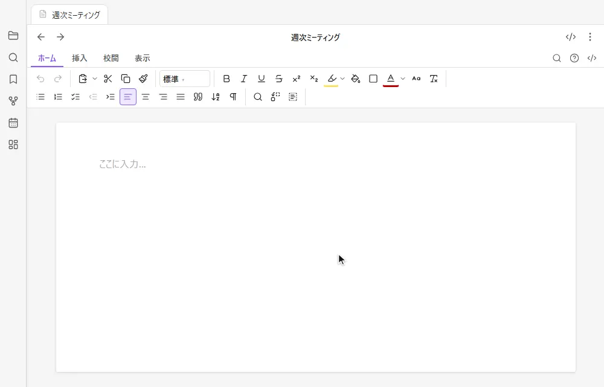
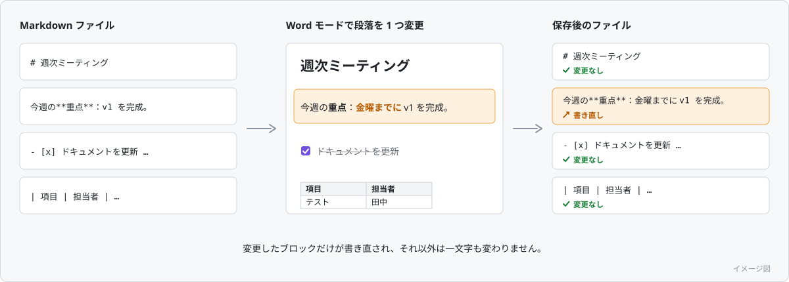
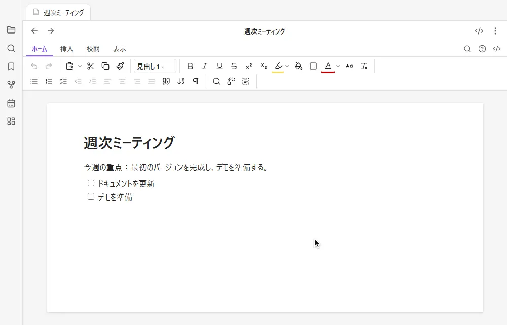
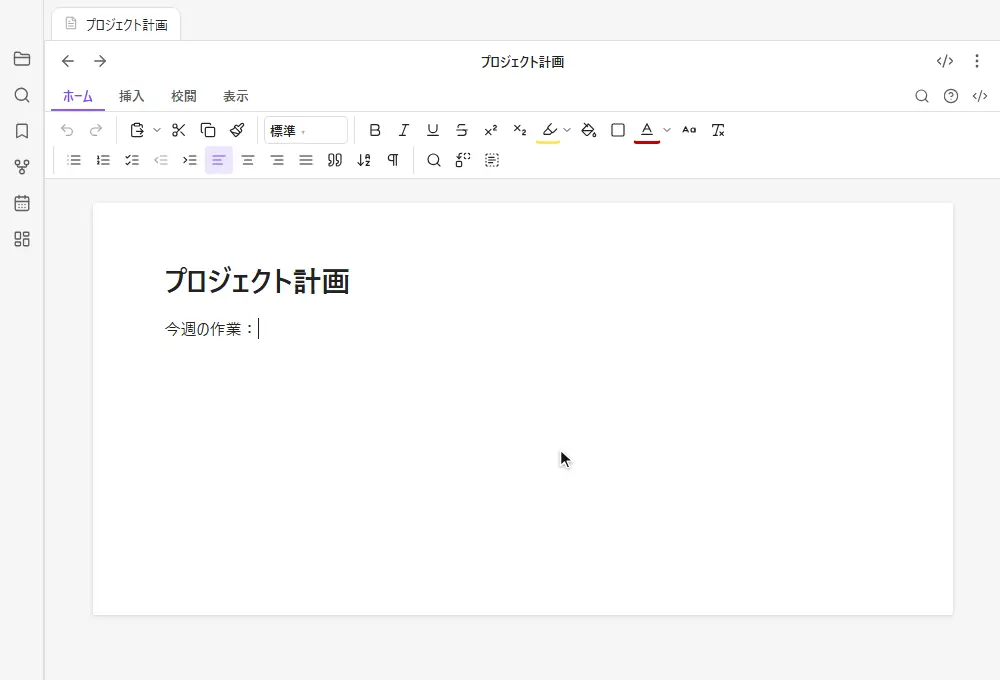
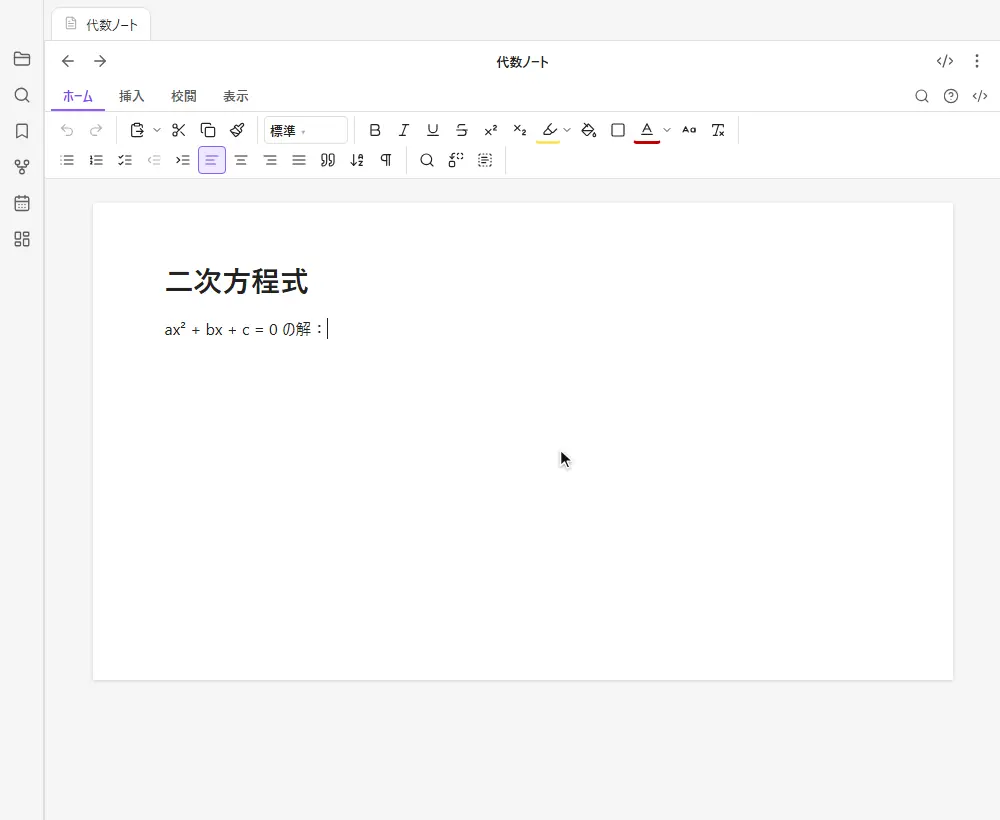
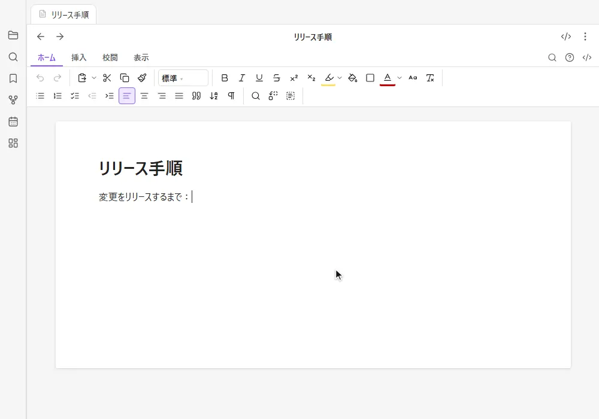

# Word Mode

[English](README.md) | [繁體中文](README.zh-TW.md) | [台文](README.nan-TW.md) | [粵語](README.yue-HK.md) | [简体中文](README.zh-CN.md) | **日本語** | [한국어](README.ko.md) | [Tiếng Việt](README.vi.md) | [Français](README.fr.md) | [Deutsch](README.de.md) | [Español](README.es.md) | [العربية](README.ar.md) | [עברית](README.he.md)

[Obsidian](https://obsidian.md) のノートを Word のように編集できます。リボンツールバー、表、数式、図に対応し、Markdown の記法を覚える必要はありません。ノートはすべてプレーンな Markdown ファイルのまま保存されます。

> この日本語版はネイティブスピーカーによる校正を受けていません。不自然な表現があれば、Issue でお知らせください。

## Word Mode を使う理由

- **覚えることはありません**：ツールバーのボタンや、ワープロソフトでおなじみのショートカット（太字は `Ctrl+B`、リンクは `Ctrl+K` など）で書式を設定できます。
- **ファイルは Markdown のまま**：ノートを編集すると、変更したブロックだけが書き直され、それ以外は一文字も変わりません。同期や履歴に残るのは編集した部分だけです。
- **いつでも切り替え**：`Ctrl+E`（macOS では `Cmd+E`）を押すか、ノートのヘッダーのボタンを選ぶと、Word モードと Obsidian 標準のエディターを切り替えられます。
- **Obsidian のための設計**：リンク、タグ、プロパティ、コールアウト、埋め込み、脚注、数式、Mermaid の図、Dataview のクエリが Word モードでも使えます。

## 機能

### 入力中の自動書式設定

一番上のアニメーションで紹介している機能です。段落の先頭で `# `、`- `、`1. `、`> `、`[ ] ` と入力するか、`**太字**`、`*斜体*`、`[[ノート]]` を入力し終えると書式に変わります。元に戻すを 1 回押すと書式だけが取り消され、入力した文字は残ります。`[[` でノートや見出し、`#` でタグを選べます。

### リボンツールバー

- **ホーム、挿入、校閲、表示の 4 つのタブ**。ワープロソフトと同じ並びです。
- **フォントの色と蛍光ペン**：標準の色とその濃淡のパレット、最近使った色に加えて、色を選ぶかカラーコードを入力して指定できます。蛍光ペンは任意の色と不透明度を使えます。
- **使いやすく調整**：タブの行は文字、アイコン、その両方で表示でき、1 つのメニューボタンにまとめることも、タブ名を変更することもできます。ボタングループは名前の変更、並べ替え、非表示、別のタブへの移動ができます。
- **スマートフォンでの入力中は広く使える**：画面キーボードが開いている間、ツールバーはキーボードの上の1行に縮みます。タブはメニューボタンにまとまり、ボタンはアイコンだけになります。キーボードを閉じると元に戻ります。設定でオフにできます。
- **スマートフォンではボトムシート**：ツールバーのドロップダウン（タブ、スタイル、アウトライン、色、記号、表の挿入）は、Obsidian のモバイル版メニューと同じように画面の下からせり上がります。キーボードが開いているときはその上に表示されます。
- **ドラッグでカーソルを移動**：スマートフォンでキーボードが開いているとき、ツールバー先頭のタブメニューボタンを押したまま左右にドラッグするとカーソルが1つずつ動き、上下にドラッグすると行を移動します。タップするとこれまでどおりタブメニューが開きます。ドラッグ中はカーソルの上に拡大プレビューが出て、位置を正確に確認できます。
- **スマートフォンでのジェスチャー**：「元に戻す」を上にスワイプするとやり直し、「やり直し」を上にスワイプすると元に戻します（2つのインデントボタンも同じで、これらのボタンには小さな点が付きます）。2本指でタップすると段落全体を選択します。表のセルをタップするとすぐにカーソルが入り、システムのカット／コピー／ペーストのメニューに邪魔されません。記号の挿入には、選択した文字を囲む括弧と引用符のペアもあります。
- **Markdown と閲覧モードにも同じツールバー**：レイアウトが同じなので、モードを切り替えても画面が動きません。両方で表示、どちらか一方だけで表示、両方で非表示を選べます。
- **詳しいヒント**：ボタンにマウスを合わせると、説明とアニメーションが表示されます。表示モードのボタンとステータスバーのボタンにもあります。最初からオンになっていて、設定かショートカット一覧でオフにできます。
- **ステータスバー**：文字数、保存状態、Word モード／Markdown／閲覧の切り替えボタン、プロパティの表示、ズーム。Markdown と閲覧モードでも同じボタンが残り、文字数も同じ数え方です。設定でオフにできます。表示は語数だけで、Markdown の記号やリンクのアドレスは数えません。文字数と読了時間の目安はヒントに表示されます。Obsidian 標準の文字数と同じ数え方にしたいときは、設定の「文字数の数え方」で切り替えられます。

### 表

- グリッドで大きさを選び、入力したら Tab で次のセルへ移動します。最後のセルで Tab を押すと行が増えます。
- セルを右クリックすると、行と列の追加・削除・移動、列での並べ替え、列の配置の設定ができます。
- 表計算ソフトからコピーしたセルを貼り付けると表になります。
- カーソルが表の中にあると、リボンに「表」タブが表示されます。表の端にあるハンドルで行全体や列全体を選択してメニューを開けます（スマートフォンでも使えます）。
- 行全体・列全体・表全体を選択して Backspace を押すと削除されます（Delete は内容だけをクリア）。表の横のボタンで、Markdown としてコピーしたり、表をワンクリックで削除したりできます。
- タブ、`|`、カンマで区切った数行を選択すると表に変換でき、表を文字に戻すこともできます。Ctrl+Enter で表から出て、その下に入力を続けられます。コピーした表は表計算ソフトに貼り付けると列に分かれます。

### 数式

- 分数、根号、上付き・下付き、括弧、行列は、直接入力できる枠になります。パレットから構造を選ぶか、`\frac`、`\sqrt`、`\alpha` と入力してスペースを押します。
- Tab、Enter、矢印キーで枠の間を移動します。空の枠で Backspace を押すと、外側の構造を取り除きます。
- いつでも LaTeX のソースに切り替えられます。数式は通常の `$…$` または `$$…$$` として保存されるので、Obsidian が数式を表示する場所ならどこでも表示されます。

数式エディターのその他の機能

- 「挿入 → 数式」から開きます。数式をダブルクリックするか、数式を選択して Enter を押しても開けます。
- 独立した行の数式にポインターを合わせると（スマートフォンではタップすると）、右上に小さなボタンが出ます：編集、その他の操作（文中にする、LaTeX や Markdown をコピー）、削除。
- `^` と `_` で上付き・下付きの枠を開きます。上下キーで分子と分母の間を移動できます。
- 元に戻す・やり直し：ボタン、または `Ctrl+Z` と `Ctrl+Y`。
- **よく使う数式と最近使った数式**：二次方程式の解や標準偏差などを丸ごと挿入し、必要な部分だけ書き換えます。
- **マイ数式**：プレビュー横のブックマークボタンで、現在の数式に名前を付けて保存できます。保存した数式はパレットの「マイ数式」に表示され、クリックで挿入できます。
- 変更していない数式は元のまま書き戻されます。
- **スマートフォンとタブレット**：画面キーボードには矢印キーがないため、編集エリアの上に「前のマス」「次のマス」「カーソルのある構造を取り除く」ボタンがあります。スマートフォンでは、パレットをスクロールしても編集エリアが上部に固定されます。
- **うっかり消えない**：まだ適用していない変更があるときは、Esc、ダイアログの外側のクリック、× のどれでも、破棄するかを先に確認します。図表エディターも同じです。

### 図

- **11 種類の Mermaid の図にフォームがあります**：フローチャート、シーケンス図、ガントチャート、円グラフ、状態図、クラス図、マインドマップ、タイムライン、ER 図、ジャーニー図、象限図。
- **図の上で編集**：プレビューの文字を選ぶとその場で変更でき、次のステップの追加や塗りつぶしの色の選択もできます。
- **自由記述**：フォームのない種類（Git グラフ、XY チャートなど）も含め、Mermaid のコードを自分で書けます。プレビューは入力に合わせて更新されます。
- 図は通常の Mermaid コードブロックとして保存されます。フォームが対応していない書き方を使った図は、理由を表示してコードで開くので、内容は失われません。

図エディターのその他の機能

- 「挿入 → 図」から開くか、Mermaid ブロックの編集ボタンを押します。
- ノートの図にポインターを合わせると、右上にボタンが出ます：編集、コードを表示、コピー、削除。削除すると図全体が消え、元に戻すで復元できます。
- 図の上では Enter で適用、Tab で適用して次の文字へ移動します。参加者、状態、クラス、エンティティの名前を図の上で変えると、それを参照している箇所もすべて変わります。
- **外観**：図ごとに Mermaid のテーマを選べます。フローチャートではステップごとに塗りつぶしの色を選べます。
- **プレビュー**：ボタン、または `Ctrl` を押しながらマウスホイールで拡大・縮小します。図は文字が読めなくなるまで縮小されず、実際の大きさで表示されます。ボタン 1 つで図全体をプレビューの幅に合わせられます。
- **位置がわかる**：フォームの行にカーソルを置くと、プレビュー上でその項目が枠で示されます。プレビューで項目を選ぶと、フォームもその行に移動します。
- **マイテンプレート**：「マイテンプレート」から現在の図に名前を付けて保存し、次回はそこから始められます。設定では、新しい図の最初の内容と、表示する組み込みの図の種類を選べます。
- **長い図**：フォームの一覧は 40 行ずつ表示され、入力して絞り込めるので、数百ステップのフローチャートでも快適に編集できます。ノート内の縦に長い図は一定の高さに折りたたまれ、ボタンで全体を表示できます。図はスクロールして見える位置に来たときに描画されます。
- 新しい種類の図は、Obsidian 内蔵の Mermaid が対応している場合だけ描画されます。
- **スマートフォン**：プレビューが上部に固定され、その下にフォームが表示されます。入力欄とボタンはタッチしやすい大きさになります。

### そのほかの機能

- **プロパティ**：フォームで編集します。タグとリンクは選択して開けるチップで、入れ子の値はツリーで表示し、プロパティのアイコンから種類の変更や名前の変更ができます。表示タブとステータスバーの「プロパティを表示」を使うと、一番上までスクロールしなくても確認でき、プロパティが多いときは絞り込めます。プロパティの見出しにあるピン（または設定）で、スクロール中も上部に細いプロパティバーを表示できます。クリックすると一覧を展開します。外観は、枠線と背景色のあるボックス、枠線のみ、枠線のないシンプルから選べます。
- **画像**：貼り付けまたは選択して挿入し、ドラッグでサイズを変更できます。
- **リンク**：ノート、見出し、ウェブページへのリンク。カーソルがリンク上にあると小さなツールバーが表示されます。
- **検索と置換**：単語単位の検索と正規表現が使えます。
- **アウトラインサイドバー**と見出しの折りたたみ。
- **埋め込み**：埋め込んだノート、見出し、音声、動画、PDF、YouTube リンクをその場に表示します。Dataview のクエリや他のプラグインのコードブロックも結果として表示されます。
- **脚注**：脚注の挿入、番号にマウスを重ねて内容を確認、構文を気にせず内容を編集できます。
- **コールアウト**（折りたたみ可能なものを含む）、**タスクリスト**（`[/]`、`[-]` などのカスタム状態を含む）、**タグ**、**コードブロック**（シンタックスハイライト付き、行番号も表示可能）。
- **編集記号**（`¶` など）の表示と、見えない文字や不要な記号を削除するツール。
- **Markdown テキストの貼り付け**：ワンクリックで書式に変換できます。
- **同期の競合への対応**：未保存の変更があるノートがディスク上で変更された場合、どちらを残すか選べます。
- **ショートカット一覧**：検索やカテゴリでの絞り込みができ、項目を選ぶとそのショートカットの動きを短いアニメーションで確認できます。下のチェックボックスで詳しいヒントのオン・オフを切り替えられます。
- インターフェース言語：繁体字中国語、台湾語（漢字）、広東語、簡体字中国語、英語、日本語、韓国語、ベトナム語、フランス語、ドイツ語、スペイン語、アラビア語、ヘブライ語。

HTML ブロックなど、Word Mode で視覚的に編集できない内容は、原文ブロックとして表示され、そのまま保存されます。こうしたブロック（脚注やコメントのブロックも）にポインターを合わせると、右上に編集・コピー・削除のボタンが出ます。脚注を削除すると、本文中の番号も一緒に消えます。

## はじめに

### インストール

Obsidian 1.5.7 以降が必要です。

1. [最新リリース](https://github.com/NatLee/obsidian-word-mode/releases/latest)から `main.js`、`manifest.json`、`styles.css` をダウンロードします。
2. 3 つのファイルを `<保管庫>/.obsidian/plugins/natlee-word-mode/` にコピーします。
3. Obsidian で「設定 → コミュニティプラグイン」を開き、「Word Mode」を有効にします。

### 使い方

プラグインを有効にすると、Markdown ノートは既定で Word モードで開きます。

- Word モードと Markdown を切り替えるには、ノート右上のボタンを選択するか、`Ctrl+E`（macOS では `Cmd+E`）を押します。
- モードを指定して開くには、ノートを右クリックして「Word モードで開く」または「Markdown で開く」を選択します。
- 特定のノートで Word モードを使わないようにするには、ノートのプロパティに `word-mode: false` を追加します。
- フォルダー全体で Word モードを使わないようにするには、「設定 → Word Mode → Word モードを使わないフォルダー」にフォルダーを入力します。

設定はカテゴリに分かれていて、設定画面の上部に並ぶタブで一度に 1 つのカテゴリだけを表示します。どのカテゴリにあるか分からない設定は、タブの上の検索ボックスに入力して探せます。入力に合わせて該当する設定を候補として表示し、ドロップダウンの選択肢や他の言語での設定名も検索対象になります（日本語の画面で英語を入力しても見つかります）。候補を選ぶとその設定へ移動します。

### コマンド

| コマンド | 説明 |
| --- | --- |
| 現在のノートを Word モードで編集 | 現在のノートを Word モードに切り替えます。 |
| 現在のノートを Markdown で編集 | 現在のノートを Markdown エディターに戻します。 |
| Word モード／Markdown を切り替え | 2 つのモードを切り替えます。 |
| アウトラインサイドバーを開く／閉じる | アウトラインを表示または非表示にします。 |
| 検索 | 現在のノート内を検索します。 |
| 検索と置換 | 現在のノート内を検索して置換します。 |
| アウトライン：見出しへ移動 | 現在のノートの見出しへ移動します。 |
| ショートカット一覧を表示 | Word モードのショートカットをすべて表示します。 |

どのコマンドにも既定のホットキーはありません。「設定 → ホットキー」で自由に割り当てられます。

## プライバシーと開示事項

- **ネットワーク**：ノートがすでに参照しているウェブ上のコンテンツを表示するためだけに使用します。ノートに URL の画像、音声、動画がある場合、Word モードはその URL から読み込みます。ノートに YouTube リンクが埋め込まれている場合、Word モードは YouTube プレーヤーを表示し、プレーヤーは `youtube.com` に接続します。これは、Obsidian 標準のエディターが同じノートで読み込む内容と同じです。プラグインがノートやデータを外部に送信することはありません。
- **テレメトリー**：ありません。
- **アカウントと支払い**：不要です。
- **保管庫の外のファイル**：読み書きしません。
- **保管庫内のファイル名**：リンク、画像、テンプレートの選択画面と、`[[` 入力後の候補に表示するため、保管庫内のファイルを一覧します。一覧はお使いのデバイスの外には出ません。
- **クリップボード**：ツールバーまたは右クリックメニューの「貼り付け」を選択したときだけ読み取り、「切り取り」「コピー」またはコピーボタンを選択したときだけ書き込みます。
- **プラグインが作成するファイル**：貼り付けた画像は添付ファイルフォルダーに保存されます。同期の競合で両方を残すことを選んだ場合、あなたのバージョンがノートの隣にコピーとして保存されます。

## 既知の制限

- モバイルでの操作は実機でテストしていません。
- Markdown モードと閲覧モードで表示されるツールバーの一部のボタンは Obsidian の組み込みコマンドを呼び出しますが、すべてを個別にテストしたわけではありません。
- 繁体字中国語と英語以外の翻訳は、ネイティブスピーカーによる校正を受けていません。
- アラビア語とヘブライ語は文字列のみ翻訳しており、ツールバーとダイアログは左から右のレイアウトのままです。
- 図やクエリの結果、埋め込み、ページプレビューは Obsidian が描画します。Obsidian を模した自動テストで確認していますが、すべてのプラグインやテーマとの組み合わせは確認していません。
- 図の外観（Mermaid のテーマ）とフローチャートの塗りつぶしの色は、Obsidian 内の Mermaid が描画します。Mermaid 単体では確認していますが、すべての Obsidian テーマとの組み合わせは確認していません。

## 開発に参加する

不具合の報告やアイデアは [Issues](https://github.com/NatLee/obsidian-word-mode/issues) へどうぞ。ビルド、テスト、内部の仕組み、リリース方法については[開発者ガイド（英語）](docs/development.md)をご覧ください。

## クレジット

Word Mode は次のオープンソースライブラリを同梱しています。

- [ProseMirror](https://prosemirror.net)（Marijn Haverbeke とコントリビューター）、MIT ライセンス。
- [markdown-it](https://github.com/markdown-it/markdown-it) と [markdown-it-mark](https://github.com/markdown-it/markdown-it-mark)、MIT ライセンス。
- [entities](https://github.com/fb55/entities)、BSD 2-Clause ライセンス。

## ライセンス

[MIT ライセンス](LICENSE)。
