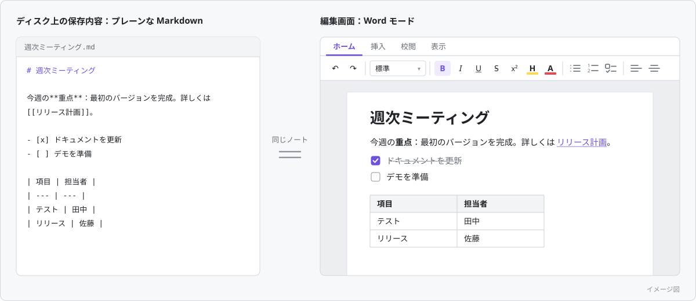

# Word Mode

[English](README.md) | [繁體中文](README.zh-TW.md) | **日本語** | [한국어](README.ko.md)

[Obsidian](https://obsidian.md) の Markdown ノートを Word 文書のように編集できます。リボンツールバー、表、画像に対応し、ノートはきれいな Markdown のまま保存されます。

> この日本語版はネイティブスピーカーによる校正を受けていません。不自然な表現があれば、Issue でお知らせください。

## 概要

Word Mode は `.md` ノート用のエディターをもう一つ追加します。Markdown 記法ではなく書式付きのテキストが表示され、ツールバーのボタンや、ワープロソフトでおなじみのショートカットキーで書式を設定できます。

ファイルはプレーンな Markdown のままです。ノートを編集すると、変更したブロックだけが書き直され、それ以外は一文字も変わらずに保持されます。

## 機能

- **リボンツールバー**：ホーム、挿入、校閲、表示の 4 つのタブ。タブの行は文字、アイコン、その両方で表示でき、1 つのメニューボタンにまとめることも、タブ名を変更することもできます。Markdown と閲覧モードのツールバーも同じレイアウトなので、モードを切り替えても画面が動きません。
- **フォントの色と蛍光ペン**：標準の色とその濃淡のパレット、最近使ったユーザー設定の色に加えて、色を選ぶかカラーコードを入力して指定できます。蛍光ペンは任意の色と不透明度を使えます。
- **表**：その場で編集でき、行と列の追加・削除・移動、列での並べ替え、配置の設定、表計算ソフトからのセルの貼り付けができます。右クリックメニューではこれらの機能を短いサブメニューにまとめています。
- **プロパティ**：フォームで編集します。タグとリンクは選択して開けるチップで、入れ子の値はツリーで表示し、プロパティのアイコンから種類の変更や名前の変更ができます。
- **画像**：貼り付けまたは選択して挿入し、ドラッグでサイズを変更できます。
- **リンク**：ノート、見出し、ウェブページへのリンク。カーソルがリンク上にあると小さなツールバーが表示されます。
- **検索と置換**：単語単位の検索と正規表現が使えます。
- **アウトラインサイドバー**と見出しの折りたたみ。
- **編集記号**（`¶` など）の表示と、見えない文字や不要な記号を削除するツール。
- **入力中の自動書式設定**：段落の先頭で `- `、`1. `、`# `、`> `、`[ ] ` と入力するか、`**太字**`、`*斜体*`、`[[ノート]]` を入力し終えると書式に変わります。書式設定は独立した 1 ステップなので、元に戻すを 1 回押すと書式だけが取り消され、入力した文字は残ります。
- **入力候補**：`[[` でノートと見出し、`#` でタグの候補が表示されます。
- **図**：Mermaid の図をそのまま図として表示します。図エディターでは、フローチャート、シーケンス図、ガントチャート、円グラフ、状態図、クラス図、マインドマップ、タイムライン、ER 図をフォームで編集でき、ライブプレビューが付きます。プレビュー上の文字を選ぶとその場で変更でき、項目の追加と削除もできます。フォームが対応していない書き方の図はコードで編集します。Dataview のクエリや他のプラグインのコードブロックも結果として表示されます。
- **数式**：分数、根号、上付き・下付き、行列を枠として入力できるビジュアルエディター、または LaTeX の直接編集。ビジュアルエディターでは元に戻す・やり直しができ、空の枠で Backspace を押すとその構造を取り除き、`\frac`、`\sqrt`、`\alpha` と入力してスペースを押すと対応する構造や記号になります。既定の方法は設定で選べます。
- **埋め込み**：埋め込んだノート、見出し、音声、動画、PDF、YouTube リンクをその場に表示します。
- **脚注**：脚注の挿入、番号にマウスを重ねて内容を確認、構文を気にせず内容を編集できます。
- **コールアウト**（折りたたみ可能なものを含む）、**タスクリスト**（`[/]`、`[-]` などのカスタム状態を含む）、**タグ**、**コードブロック**（シンタックスハイライト付き、行番号も表示可能）。カーソルがコードブロック内にあるときは、プレーンテキストに使えないボタンが無効になります。
- **Markdown テキストの貼り付け**：ワンクリックで書式に変換できます。
- **同期の競合への対応**：未保存の変更があるノートがディスク上で変更された場合、どちらを残すか選べます。
- インターフェース言語：繁体字中国語、英語、日本語、韓国語。

HTML ブロックや脚注の定義など、Word Mode で視覚的に編集できない内容は、原文ブロックとして表示され、そのまま保存されます。

## 使い方

プラグインを有効にすると、Markdown ノートは既定で Word モードで開きます。

- Word モードと Markdown を切り替えるには、ノート右上のボタンを選択するか、`Ctrl+E`（macOS では `Cmd+E`）を押します。
- モードを指定して開くには、ノートを右クリックして「Word モードで開く」または「Markdown で開く」を選択します。
- 特定のノートで Word モードを使わないようにするには、ノートのプロパティに `word-mode: false` を追加します。
- フォルダー全体で Word モードを使わないようにするには、「設定 → Word Mode → Word モードを使わないフォルダー」にフォルダーを入力します。

### コマンド

| コマンド | 説明 |
| --- | --- |
| 現在のノートを Word モードで編集 | 現在のノートを Word モードに切り替えます。 |
| 現在のノートを Markdown で編集 | 現在のノートを Markdown エディターに戻します。 |
| Word モード／Markdown を切り替え | 2 つのモードを切り替えます。 |
| アウトラインサイドバーを開く／閉じる | アウトラインを表示または非表示にします。 |
| 検索 | 現在のノート内を検索します。 |
| 検索と置換 | 現在のノート内を検索して置換します。 |
| アウトライン：見出しへ移動 | 現在のノートの見出しへ移動します。 |
| ショートカット一覧を表示 | Word モードのショートカットをすべて表示します。 |

どのコマンドにも既定のホットキーはありません。「設定 → ホットキー」で自由に割り当てられます。

## インストール

Obsidian 1.5.7 以降が必要です。

1. [最新リリース](https://github.com/NatLee/obsidian-word-mode/releases/latest)から `main.js`、`manifest.json`、`styles.css` をダウンロードします。
2. 3 つのファイルを `<保管庫>/.obsidian/plugins/natlee-word-mode/` にコピーします。
3. Obsidian で「設定 → コミュニティプラグイン」を開き、「Word Mode」を有効にします。

## プライバシーと開示事項

- **ネットワーク**：ノートがすでに参照しているウェブ上のコンテンツを表示するためだけに使用します。ノートに URL の画像、音声、動画がある場合、Word モードはその URL から読み込みます。ノートに YouTube リンクが埋め込まれている場合、Word モードは YouTube プレーヤーを表示し、プレーヤーは `youtube.com` に接続します。これは、Obsidian 標準のエディターが同じノートで読み込む内容と同じです。プラグインがノートやデータを外部に送信することはありません。
- **テレメトリー**：ありません。
- **アカウントと支払い**：不要です。
- **保管庫の外のファイル**：読み書きしません。
- **保管庫内のファイル名**：リンク、画像、テンプレートの選択画面と、`[[` 入力後の候補に表示するため、保管庫内のファイルを一覧します。一覧はお使いのデバイスの外には出ません。
- **クリップボード**：ツールバーまたは右クリックメニューの「貼り付け」を選択したときだけ読み取り、「切り取り」「コピー」またはコピーボタンを選択したときだけ書き込みます。
- **プラグインが作成するファイル**：貼り付けた画像は添付ファイルフォルダーに保存されます。同期の競合で両方を残すことを選んだ場合、あなたのバージョンがノートの隣にコピーとして保存されます。

## 既知の制限

- モバイルでの操作は実機でテストしていません。
- Markdown モードと閲覧モードで表示されるツールバーの一部のボタンは Obsidian の組み込みコマンドを呼び出しますが、すべてを個別にテストしたわけではありません。
- 日本語と韓国語の翻訳は、ネイティブスピーカーによる校正を受けていません。

## 開発

開発手順、プロジェクト構成、リリース方法については、[英語版 README](README.md#development) をご覧ください。

## クレジット

Word Mode は次のオープンソースライブラリを同梱しています。

- [ProseMirror](https://prosemirror.net)（Marijn Haverbeke とコントリビューター）、MIT ライセンス。
- [markdown-it](https://github.com/markdown-it/markdown-it) と [markdown-it-mark](https://github.com/markdown-it/markdown-it-mark)、MIT ライセンス。
- [entities](https://github.com/fb55/entities)、BSD 2-Clause ライセンス。

## ライセンス

[MIT ライセンス](LICENSE)。
