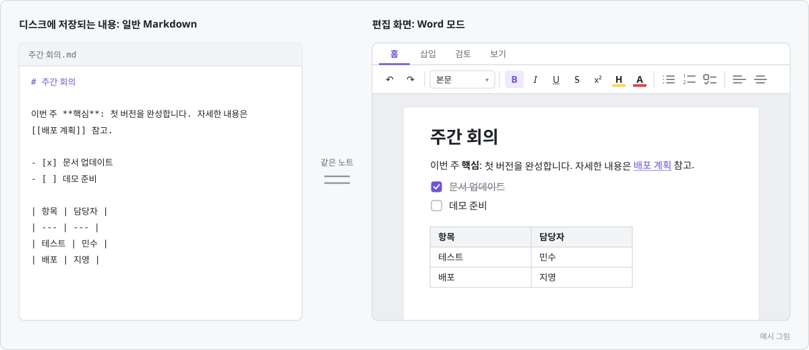
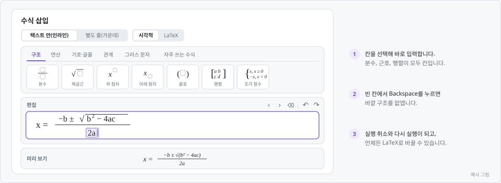
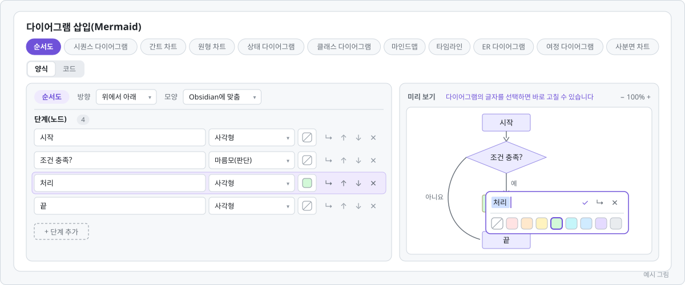

# Word Mode

[English](README.md) | [繁體中文](README.zh-TW.md) | [日本語](README.ja.md) | **한국어**

[Obsidian](https://obsidian.md)의 Markdown 노트를 Word 문서처럼 편집할 수 있습니다. 리본 도구 모음, 표, 이미지를 지원하며, 노트는 깔끔한 Markdown 그대로 저장됩니다.

> 이 한국어 문서는 원어민의 검수를 받지 않았습니다. 어색한 표현이 있으면 Issue로 알려 주세요.

## 개요

Word Mode는 `.md` 노트용 편집기를 하나 더 추가합니다. Markdown 문법 대신 서식이 적용된 텍스트가 보이며, 도구 모음 버튼과 워드프로세서에서 익숙한 단축키로 서식을 지정할 수 있습니다.

파일은 일반 Markdown 그대로입니다. 노트를 편집하면 변경한 블록만 다시 기록되고, 나머지는 한 글자도 바뀌지 않고 그대로 유지됩니다.

## 기능

- **리본 도구 모음**: 홈, 삽입, 검토, 보기 탭. 탭 줄은 글자, 아이콘, 또는 둘 다로 표시할 수 있고, 메뉴 버튼 하나로 접거나 탭 이름을 바꿀 수도 있습니다. Markdown과 읽기 모드의 도구 모음도 같은 레이아웃이라 모드를 바꿔도 화면이 움직이지 않습니다. 세 개의 보기 모드 버튼의 글자는 설정에서 꺼서 아이콘만 표시할 수 있습니다.
- **글꼴 색과 형광펜**: 표준 색과 밝기 단계 팔레트, 최근 사용한 사용자 지정 색을 제공하며, 색을 고르거나 색상 코드를 입력해 지정할 수도 있습니다. 형광펜은 원하는 색과 불투명도를 쓸 수 있습니다.
- **표**: 표 안에서 바로 편집하고, 행과 열을 추가·삭제·이동하고, 열 기준으로 정렬하고, 정렬 방식을 지정하고, 스프레드시트의 셀을 붙여 넣을 수 있습니다. 오른쪽 클릭 메뉴는 이 기능들을 짧은 하위 메뉴로 묶어 보여 줍니다.
- **속성**: 양식으로 편집합니다. 태그와 링크는 선택해서 열 수 있는 칩으로, 중첩된 값은 트리로 표시하며, 속성 아이콘에서 유형을 바꾸거나 이름을 바꿀 수 있습니다.
- **이미지**: 붙여 넣거나 선택해서 삽입하고, 드래그해서 크기를 조절합니다.
- **링크**: 노트, 제목, 웹 페이지로 연결합니다. 커서가 링크 위에 있으면 작은 도구 모음이 나타납니다.
- **찾기 및 바꾸기**.
- **개요 사이드바**와 제목 접기.
- **편집 기호**(`¶` 등) 표시와, 보이지 않는 문자나 불필요한 기호를 정리하는 도구.
- **입력할 때 자동 서식**: 문단 첫머리에 `- `, `1. `, `# `, `> `, `[ ] `를 입력하거나 `**굵게**`, `*기울임*`, `[[노트]]`를 입력을 마치면 서식으로 바뀝니다. 서식 적용은 별도의 한 단계이므로 실행 취소를 한 번 누르면 서식만 취소되고 입력한 글자는 남습니다.
- **입력 목록**: `[[`를 입력하면 노트와 제목, `#`를 입력하면 태그 목록이 표시됩니다.
- **다이어그램**: Mermaid 다이어그램을 그림으로 표시하고, 11가지 종류는 양식으로 또는 미리 보기에서 바로 편집할 수 있습니다. [다이어그램 편집기](#다이어그램-편집기)를 참고하세요. Dataview 쿼리와 다른 플러그인의 코드 블록도 결과로 표시됩니다.
- **수식**: 분수, 근호, 위·아래 첨자, 행렬을 칸으로 입력하는 시각적 편집기 또는 LaTeX 직접 편집. [수식 편집기](#수식-편집기)를 참고하세요.
- **포함(임베드)**: 포함한 노트, 제목, 오디오, 동영상, PDF, YouTube 링크를 그 자리에 표시합니다.
- **각주**: 각주 삽입, 번호에 마우스를 올려 내용 확인, 문법을 신경 쓰지 않고 내용 편집.
- **콜아웃**(접을 수 있는 것 포함), **할 일 목록**(`[/]`, `[-]` 등 사용자 지정 상태 포함), **태그**, **코드 블록**(구문 강조 포함, 줄 번호 표시 가능). 커서가 코드 블록 안에 있으면 일반 텍스트에 쓸 수 없는 버튼은 비활성화됩니다.
- **Markdown 텍스트 붙여넣기**: 한 번에 서식으로 변환할 수 있습니다.
- **동기화 충돌 처리**: 저장하지 않은 수정이 있는 노트가 디스크에서 변경되면 어느 쪽을 유지할지 선택할 수 있습니다.
- 인터페이스 언어: 중국어 번체, 영어, 일본어, 한국어.

HTML 블록이나 각주 정의처럼 Word Mode에서 시각적으로 편집할 수 없는 내용은 원문 블록으로 표시되며 그대로 저장됩니다.

## 수식 편집기

"삽입 → 수식"으로 엽니다. 수식을 두 번 클릭하거나, 수식을 선택하고 Enter를 눌러도 열립니다. 수식은 일반 LaTeX(`$…$` 또는 `$$…$$`)로 저장되므로 Obsidian이 수식을 표시하는 곳이면 어디서나 보입니다.

- **시각적 편집**: 분수, 근호, 위·아래 첨자, 괄호, 행렬이 칸으로 표시됩니다. 칸을 선택해 입력하거나 팔레트에서 구조와 기호를 고릅니다. 언제든 LaTeX 원본으로 바꿀 수 있고, 고치지 않은 수식은 원래 그대로 다시 기록됩니다.
- **키보드**: `^`와 `_`로 위 첨자와 아래 첨자 칸을 엽니다. Tab 또는 Enter로 다음 칸으로 가고, 화살표 키로 칸 사이를 이동합니다(위아래 키로 분자와 분모 사이도 이동). 빈 칸에서 Backspace를 누르면 바깥 구조를 없앱니다. `\frac`, `\sqrt`, `\alpha`를 입력하고 스페이스를 누르면 해당 구조나 기호로 바뀝니다.
- **실행 취소와 다시 실행**: 버튼 또는 `Ctrl+Z`, `Ctrl+Y`.
- **자주 쓰는 수식과 최근 수식**: 이차방정식의 해나 표준편차 같은 수식을 통째로 넣고 필요한 부분만 고칩니다.
- **휴대폰과 태블릿**: 화면 키보드에는 화살표 키가 없으므로 편집 영역 위에 "이전 칸", "다음 칸", "커서가 있는 구조 없애기" 버튼이 있습니다. 휴대폰에서는 팔레트를 스크롤해도 편집 영역이 맨 위에 고정됩니다.

## 다이어그램 편집기

"삽입 → 다이어그램"으로 열거나 Mermaid 블록의 편집 버튼을 누릅니다. 다이어그램은 일반 Mermaid 코드 블록으로 저장됩니다.

- **11가지 종류에 양식이 있습니다**: 순서도, 시퀀스 다이어그램, 간트 차트, 원형 차트, 상태 다이어그램, 클래스 다이어그램, 마인드맵, 타임라인, ER 다이어그램, 여정 다이어그램, 사분면 차트. 위에서 종류를 고르면 템플릿에서 시작하고, 줄을 추가하거나 순서를 바꾸거나 삭제할 수 있습니다.
- **다이어그램 위에서 편집**: 미리 보기의 글자를 선택하면 그 자리에서 고칠 수 있습니다. 같은 상자에서 그 줄을 삭제하거나, 순서도의 다음 단계나 마인드맵의 하위 가지를 추가하거나, 순서도 단계의 채우기 색을 고를 수 있습니다. 참여자, 상태, 클래스, 엔터티의 이름을 여기서 바꾸면 그것을 참조하는 곳도 모두 바뀝니다.
- **모양**: 다이어그램 하나에 Mermaid 테마를 고를 수 있고, 순서도는 단계마다 채우기 색을 고를 수 있습니다.
- **미리 보기**: 버튼으로, 또는 `Ctrl`을 누른 채 마우스 휠로 확대·축소합니다.
- **내용이 사라지지 않습니다**: 읽어서 다시 기록해도 아무것도 바뀌지 않는 다이어그램만 양식으로 열립니다. 양식이 지원하지 않는 문법(loop, 중첩 상태, 사용자 지정 스타일 등)을 쓴 다이어그램은 이유를 보여 주고 코드로 열립니다. 고치지 않은 다이어그램은 원래 그대로 다시 기록됩니다.
- **휴대폰**: 미리 보기가 맨 위에 고정되고 그 아래에 양식이 표시됩니다. 입력란과 버튼은 터치하기 좋은 크기입니다.

## 사용법

플러그인을 활성화하면 Markdown 노트가 기본적으로 Word 모드로 열립니다.

- Word 모드와 Markdown을 전환하려면 노트 오른쪽 위의 버튼을 선택하거나 `Ctrl+E`(macOS에서는 `Cmd+E`)를 누릅니다.
- 모드를 지정해서 열려면 노트를 마우스 오른쪽 버튼으로 클릭하고 "Word 모드로 열기" 또는 "Markdown으로 열기"를 선택합니다.
- 특정 노트에서 Word 모드를 사용하지 않으려면 노트 속성에 `word-mode: false`를 추가합니다.
- 폴더 전체에서 Word 모드를 사용하지 않으려면 "설정 → Word Mode → Word 모드를 사용하지 않을 폴더"에 폴더를 입력합니다.

### 명령

| 명령 | 설명 |
| --- | --- |
| 현재 노트를 Word 모드로 편집 | 현재 노트를 Word 모드로 전환합니다. |
| 현재 노트를 Markdown으로 편집 | 현재 노트를 Markdown 편집기로 되돌립니다. |
| Word 모드/Markdown 전환 | 두 모드를 전환합니다. |
| 개요 사이드바 열기/닫기 | 개요를 표시하거나 숨깁니다. |
| 찾기 | 현재 노트에서 검색합니다. |
| 찾기 및 바꾸기 | 현재 노트에서 검색하고 바꿉니다. |
| 개요: 제목으로 이동 | 현재 노트의 제목으로 이동합니다. |
| 단축키 목록 보기 | Word 모드의 모든 단축키를 표시합니다. |

기본 단축키가 지정된 명령은 없습니다. "설정 → 단축키"에서 직접 지정할 수 있습니다.

## 설치

Obsidian 1.5.7 이상이 필요합니다.

1. [최신 릴리스](https://github.com/NatLee/obsidian-word-mode/releases/latest)에서 `main.js`, `manifest.json`, `styles.css`를 내려받습니다.
2. 세 파일을 `<보관함>/.obsidian/plugins/natlee-word-mode/`에 복사합니다.
3. Obsidian에서 "설정 → 커뮤니티 플러그인"을 열고 "Word Mode"를 활성화합니다.

## 개인정보 및 고지 사항

- **네트워크**: 노트가 이미 가리키고 있는 웹 콘텐츠를 표시하는 데만 사용합니다. 노트에 웹 주소의 이미지, 오디오, 동영상이 있으면 Word 모드가 해당 주소에서 불러옵니다. 노트에 YouTube 링크가 포함되어 있으면 Word 모드가 YouTube 플레이어를 표시하며, 플레이어는 `youtube.com`에 연결합니다. 이는 Obsidian 기본 편집기가 같은 노트에서 불러오는 내용과 같습니다. 플러그인은 노트나 데이터를 어디에도 전송하지 않습니다.
- **텔레메트리**: 없습니다.
- **계정 및 결제**: 필요하지 않습니다.
- **보관함 밖의 파일**: 읽거나 쓰지 않습니다.
- **보관함의 파일 이름**: 링크, 이미지, 템플릿 선택 창과 `[[` 입력 후의 추천 목록에 표시하기 위해 보관함의 파일을 나열합니다. 목록은 기기 밖으로 나가지 않습니다.
- **클립보드**: 도구 모음이나 오른쪽 클릭 메뉴에서 "붙여넣기"를 선택할 때만 읽고, "잘라내기", "복사" 또는 복사 버튼을 선택할 때만 씁니다.
- **플러그인이 만드는 파일**: 붙여 넣은 이미지는 첨부 파일 폴더에 저장됩니다. 동기화 충돌에서 두 버전을 모두 유지하도록 선택하면 내 버전이 노트 옆에 사본으로 저장됩니다.

## 알려진 제한 사항

- 모바일에서의 동작은 실제 기기에서 테스트하지 않았습니다.
- Markdown 모드와 읽기 모드에 표시되는 도구 모음의 일부 버튼은 Obsidian 기본 명령을 호출하며, 모두 개별적으로 테스트하지는 않았습니다.
- 일본어와 한국어 번역은 원어민의 검수를 받지 않았습니다.
- 다이어그램의 모양(Mermaid 테마)과 순서도의 채우기 색은 Obsidian 안의 Mermaid가 그립니다. Mermaid 자체에서는 확인했지만 모든 Obsidian 테마와의 조합은 확인하지 않았습니다.

## 개발

개발 방법, 프로젝트 구조, 릴리스 절차는 [영어 README](README.md#development)를 참고하세요.

## 크레딧

Word Mode는 다음 오픈 소스 라이브러리를 포함합니다.

- [ProseMirror](https://prosemirror.net)(Marijn Haverbeke 및 기여자), MIT 라이선스.
- [markdown-it](https://github.com/markdown-it/markdown-it) 및 [markdown-it-mark](https://github.com/markdown-it/markdown-it-mark), MIT 라이선스.
- [entities](https://github.com/fb55/entities), BSD 2-Clause 라이선스.

## 라이선스

[MIT 라이선스](LICENSE).
