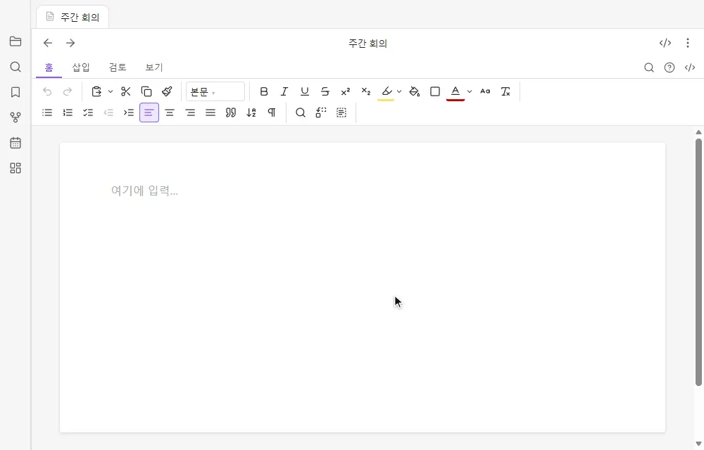
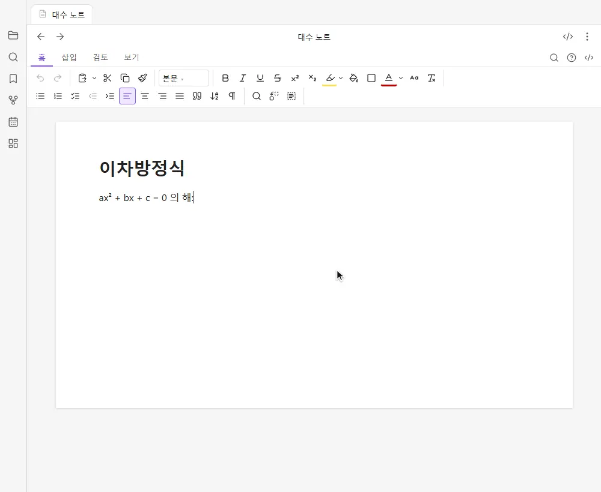

# Word Mode

[English](README.md) | [繁體中文](README.zh-TW.md) | [日本語](README.ja.md) | **한국어**

[Obsidian](https://obsidian.md) 노트를 Word처럼 편집하세요. 리본 도구 모음, 표, 수식, 다이어그램을 지원하며, Markdown 문법을 외울 필요가 없습니다. 모든 노트는 일반 Markdown 파일 그대로 저장됩니다.

> 이 한국어 문서는 원어민의 검수를 받지 않았습니다. 어색한 표현이 있으면 Issue로 알려 주세요.

## Word Mode를 쓰는 이유

- **외울 것이 없습니다**: 도구 모음 버튼과 워드프로세서에서 익숙한 단축키(굵게는 `Ctrl+B`, 링크는 `Ctrl+K` 등)로 서식을 지정합니다.
- **파일은 Markdown 그대로**: 노트를 편집하면 변경한 블록만 다시 기록되고, 나머지는 한 글자도 바뀌지 않습니다. 동기화와 버전 기록에는 편집한 부분만 남습니다.
- **언제든 전환**: `Ctrl+E`(macOS에서는 `Cmd+E`)를 누르거나 노트 머리글의 버튼을 선택하면 Word 모드와 Obsidian 기본 편집기를 오갈 수 있습니다.
- **Obsidian을 위한 설계**: 링크, 태그, 속성, 콜아웃, 포함(임베드), 각주, 수식, Mermaid 다이어그램, Dataview 쿼리를 Word 모드에서도 쓸 수 있습니다.

## 기능

### 입력할 때 자동 서식

맨 위의 애니메이션에서 보여 주는 기능입니다. 문단 첫머리에 `# `, `- `, `1. `, `> `, `[ ] `를 입력하거나 `**굵게**`, `*기울임*`, `[[노트]]`를 입력을 마치면 서식으로 바뀝니다. 실행 취소를 한 번 누르면 서식만 취소되고 입력한 글자는 남습니다. `[[`로 노트나 제목을, `#`로 태그를 고를 수 있습니다.

### 리본 도구 모음

- **홈, 삽입, 검토, 보기 탭**: 워드프로세서와 같은 배치입니다.
- **글꼴 색과 형광펜**: 표준 색과 밝기 단계 팔레트, 최근 사용한 색을 제공하며, 색을 고르거나 색상 코드를 입력해 지정할 수도 있습니다. 형광펜은 원하는 색과 불투명도를 쓸 수 있습니다.
- **원하는 대로 조정**: 탭 줄은 글자, 아이콘, 또는 둘 다로 표시할 수 있고, 메뉴 버튼 하나로 접거나 탭 이름을 바꿀 수도 있습니다. 버튼 그룹은 이름을 바꾸거나, 순서를 바꾸거나, 숨기거나, 다른 탭으로 옮길 수 있습니다.
- **Markdown과 읽기 모드에도 같은 도구 모음**: 레이아웃이 같아서 모드를 바꿔도 화면이 움직이지 않습니다. 두 모드 모두 표시, 한쪽에서만 표시, 모두 숨기기 중에서 고를 수 있습니다.
- **자세한 도움말**: 켜면 버튼에 마우스를 올렸을 때 설명과 애니메이션이 표시되며, 보기 모드 버튼과 상태 표시줄 버튼에도 있습니다.
- **상태 표시줄**: 글자 수, 저장 상태, Word 모드/Markdown/읽기 전환 버튼, 속성 보기, 확대/축소. Markdown과 읽기 모드에서도 같은 버튼이 남고 글자 수도 같은 방식으로 셉니다. 설정에서 끌 수 있습니다.

### 표

- 격자에서 크기를 고르고, 입력한 뒤 Tab으로 다음 칸으로 이동합니다. 마지막 칸에서 Tab을 누르면 행이 추가됩니다.
- 셀을 오른쪽 클릭하면 행과 열을 추가·삭제·이동하고, 열 기준으로 정렬하고, 열 맞춤을 지정할 수 있습니다.
- 스프레드시트에서 복사한 셀을 붙여 넣으면 표가 됩니다.

### 수식

- 분수, 근호, 위·아래 첨자, 괄호, 행렬은 바로 입력할 수 있는 칸입니다. 팔레트에서 구조를 고르거나 `\frac`, `\sqrt`, `\alpha`를 입력하고 스페이스를 누릅니다.
- Tab, Enter, 화살표 키로 칸 사이를 이동합니다. 빈 칸에서 Backspace를 누르면 바깥 구조를 없앱니다.
- 언제든 LaTeX 원본으로 바꿀 수 있습니다. 수식은 일반 `$…$` 또는 `$$…$$`로 저장되므로 Obsidian이 수식을 표시하는 곳이면 어디서나 보입니다.

수식 편집기의 다른 기능

- "삽입 → 수식"으로 엽니다. 수식을 두 번 클릭하거나, 수식을 선택하고 Enter를 눌러도 열립니다.
- `^`와 `_`로 위 첨자와 아래 첨자 칸을 엽니다. 위아래 키로 분자와 분모 사이를 이동합니다.
- 실행 취소와 다시 실행: 버튼 또는 `Ctrl+Z`, `Ctrl+Y`.
- **자주 쓰는 수식과 최근 수식**: 이차방정식의 해나 표준편차 같은 수식을 통째로 넣고 필요한 부분만 고칩니다.
- **내 수식**: 미리 보기 옆의 책갈피 버튼으로 현재 수식에 이름을 붙여 저장할 수 있습니다. 저장한 수식은 팔레트의 "내 수식"에 표시되며 한 번 눌러 삽입합니다.
- 고치지 않은 수식은 원래 그대로 다시 기록됩니다.
- **휴대폰과 태블릿**: 화면 키보드에는 화살표 키가 없으므로 편집 영역 위에 "이전 칸", "다음 칸", "커서가 있는 구조 없애기" 버튼이 있습니다. 휴대폰에서는 팔레트를 스크롤해도 편집 영역이 맨 위에 고정됩니다.

### 다이어그램

- **11가지 Mermaid 다이어그램에 양식이 있습니다**: 순서도, 시퀀스 다이어그램, 간트 차트, 원형 차트, 상태 다이어그램, 클래스 다이어그램, 마인드맵, 타임라인, ER 다이어그램, 여정 다이어그램, 사분면 차트.
- **다이어그램 위에서 편집**: 미리 보기의 글자를 선택해 그 자리에서 고치고, 다음 단계를 추가하거나 채우기 색을 고를 수 있습니다.
- **자유 작성**: 양식이 없는 종류(Git 그래프, XY 차트 등)를 포함해 Mermaid 코드를 직접 작성할 수 있습니다. 미리 보기는 입력하는 대로 갱신됩니다.
- 다이어그램은 일반 Mermaid 코드 블록으로 저장됩니다. 양식이 지원하지 않는 문법을 쓴 다이어그램은 이유를 보여 주고 코드로 열리므로 내용이 사라지지 않습니다.

다이어그램 편집기의 다른 기능

- "삽입 → 다이어그램"으로 열거나 Mermaid 블록의 편집 버튼을 누릅니다.
- 다이어그램 위에서 Enter로 적용하고, Tab으로 적용한 뒤 다음 글자로 이동합니다. 참여자, 상태, 클래스, 엔터티의 이름을 여기서 바꾸면 그것을 참조하는 곳도 모두 바뀝니다.
- **모양**: 다이어그램 하나에 Mermaid 테마를 고를 수 있고, 순서도는 단계마다 채우기 색을 고를 수 있습니다.
- **미리 보기**: 버튼으로, 또는 `Ctrl`을 누른 채 마우스 휠로 확대·축소합니다. 다이어그램은 글자를 읽을 수 없을 만큼 줄어들지 않고 실제 크기로 표시됩니다. 버튼 하나로 다이어그램 전체를 미리 보기 너비에 맞출 수 있습니다.
- **위치 찾기**: 양식의 한 행에 커서를 두면 미리 보기에서 해당 항목이 테두리로 표시됩니다. 미리 보기에서 항목을 선택하면 양식도 그 행으로 이동합니다.
- **내 템플릿**: "내 템플릿"에서 현재 다이어그램에 이름을 붙여 저장하고 다음에는 거기서 시작할 수 있습니다. 설정에서 새 다이어그램의 처음 내용과 표시할 기본 제공 종류를 고를 수 있습니다.
- **긴 다이어그램**: 양식의 목록은 40행씩 표시되고 입력해서 필터링할 수 있어, 단계가 수백 개인 순서도도 빠르게 편집할 수 있습니다. 노트에서 세로로 긴 다이어그램은 일정한 높이로 접히며 버튼으로 전체를 볼 수 있습니다. 다이어그램은 스크롤해서 보이는 위치에 왔을 때 그려집니다.
- 새로운 종류의 다이어그램은 Obsidian에 내장된 Mermaid가 지원해야 그려집니다.
- **휴대폰**: 미리 보기가 맨 위에 고정되고 그 아래에 양식이 표시됩니다. 입력란과 버튼은 터치하기 좋은 크기입니다.

### 그 밖의 기능

- **속성**: 양식으로 편집합니다. 태그와 링크는 선택해서 열 수 있는 칩으로, 중첩된 값은 트리로 표시하며, 속성 아이콘에서 유형을 바꾸거나 이름을 바꿀 수 있습니다. 보기 탭과 상태 표시줄의 "속성 보기"로 맨 위까지 스크롤하지 않고 볼 수 있고, 속성이 많으면 필터로 좁힐 수 있습니다. 스크롤할 때 위쪽에 얇은 속성 막대를 표시하는 설정도 있으며, 클릭하면 전체 목록을 펼칩니다. 모양은 테두리와 배경색이 있는 상자, 테두리만, 테두리 없는 간결한 스타일 중에서 고를 수 있습니다.
- **이미지**: 붙여 넣거나 선택해서 삽입하고, 드래그해서 크기를 조절합니다.
- **링크**: 노트, 제목, 웹 페이지로 연결합니다. 커서가 링크 위에 있으면 작은 도구 모음이 나타납니다.
- **찾기 및 바꾸기**: 단어 단위 검색과 정규식을 쓸 수 있습니다.
- **개요 사이드바**와 제목 접기.
- **포함(임베드)**: 포함한 노트, 제목, 오디오, 동영상, PDF, YouTube 링크를 그 자리에 표시합니다. Dataview 쿼리와 다른 플러그인의 코드 블록도 결과로 표시됩니다.
- **각주**: 각주 삽입, 번호에 마우스를 올려 내용 확인, 문법을 신경 쓰지 않고 내용 편집.
- **콜아웃**(접을 수 있는 것 포함), **할 일 목록**(`[/]`, `[-]` 등 사용자 지정 상태 포함), **태그**, **코드 블록**(구문 강조 포함, 줄 번호 표시 가능).
- **편집 기호**(`¶` 등) 표시와, 보이지 않는 문자나 불필요한 기호를 정리하는 도구.
- **Markdown 텍스트 붙여넣기**: 한 번에 서식으로 변환할 수 있습니다.
- **동기화 충돌 처리**: 저장하지 않은 수정이 있는 노트가 디스크에서 변경되면 어느 쪽을 유지할지 선택할 수 있습니다.
- **단축키 목록**: 검색하거나 분류별로 볼 수 있고, 항목을 누르면 그 단축키의 동작을 짧은 애니메이션으로 확인할 수 있습니다.
- 인터페이스 언어: 중국어 번체, 대만어(한자), 중국어 간체, 영어, 일본어, 한국어, 스페인어, 아랍어, 히브리어.

HTML 블록처럼 Word Mode에서 시각적으로 편집할 수 없는 내용은 원문 블록으로 표시되며 그대로 저장됩니다.

## 시작하기

### 설치

Obsidian 1.5.7 이상이 필요합니다.

1. [최신 릴리스](https://github.com/NatLee/obsidian-word-mode/releases/latest)에서 `main.js`, `manifest.json`, `styles.css`를 내려받습니다.
2. 세 파일을 `<보관함>/.obsidian/plugins/natlee-word-mode/`에 복사합니다.
3. Obsidian에서 "설정 → 커뮤니티 플러그인"을 열고 "Word Mode"를 활성화합니다.

### 사용법

플러그인을 활성화하면 Markdown 노트가 기본적으로 Word 모드로 열립니다.

- Word 모드와 Markdown을 전환하려면 노트 오른쪽 위의 버튼을 선택하거나 `Ctrl+E`(macOS에서는 `Cmd+E`)를 누릅니다.
- 모드를 지정해서 열려면 노트를 마우스 오른쪽 버튼으로 클릭하고 "Word 모드로 열기" 또는 "Markdown으로 열기"를 선택합니다.
- 특정 노트에서 Word 모드를 사용하지 않으려면 노트 속성에 `word-mode: false`를 추가합니다.
- 폴더 전체에서 Word 모드를 사용하지 않으려면 "설정 → Word Mode → Word 모드를 사용하지 않을 폴더"에 폴더를 입력합니다.

설정은 분류별로 나뉘어 있으며, 설정 화면 위쪽의 분류 탭으로 한 번에 한 분류만 표시합니다. 어느 분류에 있는지 모르는 설정은 탭 위의 검색 상자에 입력해 찾을 수 있습니다. 입력하는 동안 맞는 설정을 제안하고, 드롭다운 선택지와 다른 언어의 설정 이름도 함께 검색합니다(한국어 화면에서 영어로 입력해도 찾을 수 있습니다). 제안을 선택하면 그 설정으로 바로 이동합니다.

### 명령

| 명령 | 설명 |
| --- | --- |
| 현재 노트를 Word 모드로 편집 | 현재 노트를 Word 모드로 전환합니다. |
| 현재 노트를 Markdown으로 편집 | 현재 노트를 Markdown 편집기로 되돌립니다. |
| Word 모드/Markdown 전환 | 두 모드를 전환합니다. |
| 개요 사이드바 열기/닫기 | 개요를 표시하거나 숨깁니다. |
| 찾기 | 현재 노트에서 검색합니다. |
| 찾기 및 바꾸기 | 현재 노트에서 검색하고 바꿉니다. |
| 개요: 제목으로 이동 | 현재 노트의 제목으로 이동합니다. |
| 단축키 목록 보기 | Word 모드의 모든 단축키를 표시합니다. |

기본 단축키가 지정된 명령은 없습니다. "설정 → 단축키"에서 직접 지정할 수 있습니다.

## 개인정보 및 고지 사항

- **네트워크**: 노트가 이미 가리키고 있는 웹 콘텐츠를 표시하는 데만 사용합니다. 노트에 웹 주소의 이미지, 오디오, 동영상이 있으면 Word 모드가 해당 주소에서 불러옵니다. 노트에 YouTube 링크가 포함되어 있으면 Word 모드가 YouTube 플레이어를 표시하며, 플레이어는 `youtube.com`에 연결합니다. 이는 Obsidian 기본 편집기가 같은 노트에서 불러오는 내용과 같습니다. 플러그인은 노트나 데이터를 어디에도 전송하지 않습니다.
- **텔레메트리**: 없습니다.
- **계정 및 결제**: 필요하지 않습니다.
- **보관함 밖의 파일**: 읽거나 쓰지 않습니다.
- **보관함의 파일 이름**: 링크, 이미지, 템플릿 선택 창과 `[[` 입력 후의 추천 목록에 표시하기 위해 보관함의 파일을 나열합니다. 목록은 기기 밖으로 나가지 않습니다.
- **클립보드**: 도구 모음이나 오른쪽 클릭 메뉴에서 "붙여넣기"를 선택할 때만 읽고, "잘라내기", "복사" 또는 복사 버튼을 선택할 때만 씁니다.
- **플러그인이 만드는 파일**: 붙여 넣은 이미지는 첨부 파일 폴더에 저장됩니다. 동기화 충돌에서 두 버전을 모두 유지하도록 선택하면 내 버전이 노트 옆에 사본으로 저장됩니다.

## 알려진 제한 사항

- 모바일에서의 동작은 실제 기기에서 테스트하지 않았습니다.
- Markdown 모드와 읽기 모드에 표시되는 도구 모음의 일부 버튼은 Obsidian 기본 명령을 호출하며, 모두 개별적으로 테스트하지는 않았습니다.
- 중국어 번체와 영어 이외의 번역은 원어민의 검수를 받지 않았습니다.
- 아랍어와 히브리어는 문자열만 번역되어 있으며, 도구 모음과 대화 상자는 왼쪽에서 오른쪽 레이아웃을 그대로 사용합니다.
- 다이어그램과 쿼리의 결과, 포함, 페이지 미리 보기는 Obsidian이 그립니다. Obsidian을 흉내 낸 자동 테스트로 확인했지만 모든 플러그인이나 테마와의 조합은 확인하지 않았습니다.
- 다이어그램의 모양(Mermaid 테마)과 순서도의 채우기 색은 Obsidian 안의 Mermaid가 그립니다. Mermaid 자체에서는 확인했지만 모든 Obsidian 테마와의 조합은 확인하지 않았습니다.

## 개발 참여

버그 신고와 아이디어는 [Issues](https://github.com/NatLee/obsidian-word-mode/issues)에 남겨 주세요. 빌드, 테스트, 내부 구조, 릴리스 방법은 [개발자 가이드(영어)](docs/development.md)를 참고하세요.

## 크레딧

Word Mode는 다음 오픈 소스 라이브러리를 포함합니다.

- [ProseMirror](https://prosemirror.net)(Marijn Haverbeke 및 기여자), MIT 라이선스.
- [markdown-it](https://github.com/markdown-it/markdown-it) 및 [markdown-it-mark](https://github.com/markdown-it/markdown-it-mark), MIT 라이선스.
- [entities](https://github.com/fb55/entities), BSD 2-Clause 라이선스.

## 라이선스

[MIT 라이선스](LICENSE).
