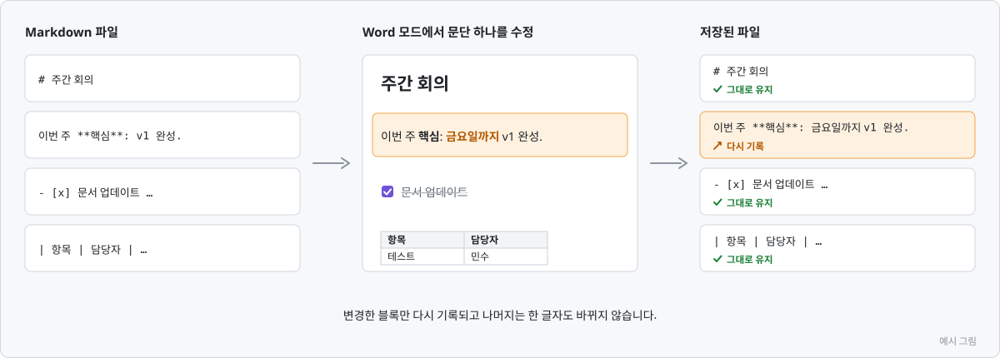
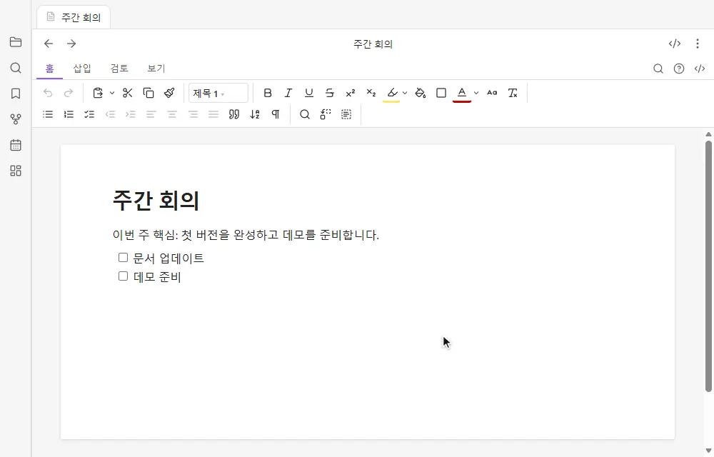
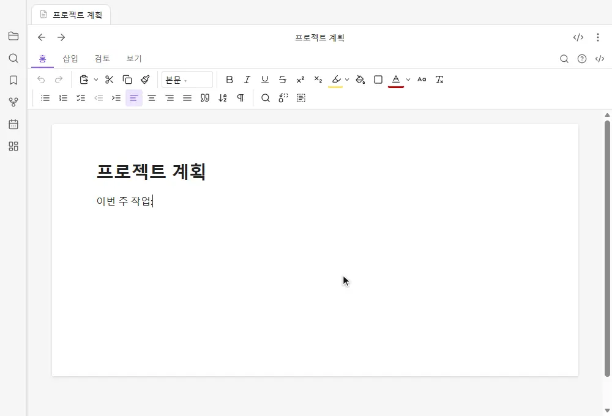
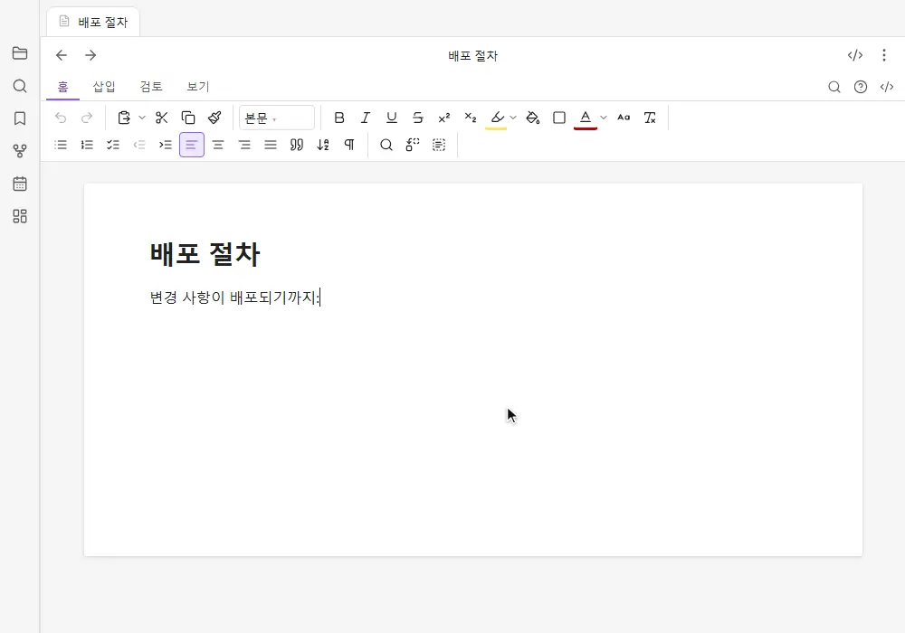

# Word Mode

[English](README.md) | [繁體中文](README.zh-TW.md) | [台文](README.nan-TW.md) | [粵語](README.yue-HK.md) | [简体中文](README.zh-CN.md) | [日本語](README.ja.md) | **한국어** | [Tiếng Việt](README.vi.md) | [Français](README.fr.md) | [Deutsch](README.de.md) | [Español](README.es.md) | [العربية](README.ar.md) | [עברית](README.he.md)

[Obsidian](https://obsidian.md) 노트를 Word처럼 편집하세요. 리본 도구 모음, 표, 수식, 다이어그램을 지원하며, Markdown 문법을 외울 필요가 없습니다. 모든 노트는 일반 Markdown 파일 그대로 저장됩니다.

> 이 한국어 문서는 원어민의 검수를 받지 않았습니다. 어색한 표현이 있으면 Issue로 알려 주세요.

## Word Mode를 쓰는 이유

- **외울 것이 없습니다**: 도구 모음 버튼과 워드프로세서에서 익숙한 단축키(굵게는 `Ctrl+B`, 링크는 `Ctrl+K` 등)로 서식을 지정합니다.
- **파일은 Markdown 그대로**: 노트를 편집하면 변경한 블록만 다시 기록되고, 나머지는 한 글자도 바뀌지 않습니다. 동기화와 버전 기록에는 편집한 부분만 남습니다.
- **언제든 전환**: `Ctrl+E`(macOS에서는 `Cmd+E`)를 누르거나 노트 머리글의 버튼을 선택하면 Word 모드와 Obsidian 기본 편집기를 오갈 수 있습니다.
- **Obsidian을 위한 설계**: 링크, 태그, 속성, 콜아웃, 포함(임베드), 각주, 수식, Mermaid 다이어그램, Dataview 쿼리를 Word 모드에서도 쓸 수 있습니다.

## 기능

### 입력할 때 자동 서식

맨 위의 애니메이션에서 보여 주는 기능입니다. 문단 첫머리에 `# `, `- `, `1. `, `> `, `[ ] `를 입력하거나 `**굵게**`, `*기울임*`, `[[노트]]`를 입력을 마치면 서식으로 바뀝니다. 실행 취소를 한 번 누르면 서식만 취소되고 입력한 글자는 남습니다. `[[`로 노트나 제목을, `#`로 태그를 고를 수 있습니다.

### 리본 도구 모음

- **홈, 삽입, 검토, 보기 탭**: 워드프로세서와 같은 배치입니다.
- **글꼴 색과 형광펜**: 표준 색과 밝기 단계 팔레트, 최근 사용한 색을 제공하며, 색을 고르거나 색상 코드를 입력해 지정할 수도 있습니다. 형광펜은 원하는 색과 불투명도를 쓸 수 있습니다.
- **원하는 대로 조정**: 탭 줄은 글자, 아이콘, 또는 둘 다로 표시할 수 있고, 메뉴 버튼 하나로 접거나 탭 이름을 바꿀 수도 있습니다. 버튼 그룹은 이름을 바꾸거나, 순서를 바꾸거나, 숨기거나, 다른 탭으로 옮길 수 있습니다.

도구 모음의 다른 기능

- **Markdown과 읽기 모드에도 같은 도구 모음**: 레이아웃이 같아서 모드를 바꿔도 화면이 움직이지 않습니다. 두 모드 모두 표시, 한쪽에서만 표시, 모두 숨기기 중에서 고를 수 있습니다.
- **자세한 도움말**: 버튼에 마우스를 올리면 설명과 애니메이션이 표시되며, 보기 모드 버튼과 상태 표시줄 버튼에도 있습니다. 처음부터 켜져 있고, 설정이나 단축키 목록에서 끌 수 있습니다.

### 휴대폰과 태블릿

- **드래그로 커서 이동**: 휴대폰에서 키보드가 열려 있을 때 키보드 위의 줄이 트랙패드가 됩니다. 아무 곳이나 잠깐 길게 눌러 버튼이 흐려지면 좌우로 끌어 커서를 한 칸씩 옮기고, 위아래로 끌어 줄을 바꿉니다. 맨 앞의 탭 메뉴 버튼은 길게 누르지 않고 바로 끌면 됩니다. 끄는 동안 커서 위에 확대 미리 보기가 나타나 커서가 어느 글자 사이에 있는지 잘 보입니다. 버튼 탭과 줄의 좌우 스크롤은 그대로입니다. 길게 누르는 시간, 이동 속도, 돋보기 모양(캡슐 또는 카드)·배율·너비는 설정에서 조절할 수 있고, 돋보기를 끌 수도 있습니다. 돋보기 옆에는 커서 위치(본문·제목·목록·표의 몇 행 몇 열 같은 블록 종류와 몇 번째 글자인지)가 표시되며, 끌 수도 있습니다. 위아래로 옮길 때는 같은 열을 유지하고(표 안에서도), 지나가는 수식·도표·가로줄에서는 잠깐 멈춰 무엇인지 알려 주며, 문서의 처음이나 끝에서는 평소의 위치 정보 앞에 안내가 나타납니다. 손가락을 천천히 움직이면 한 칸씩, 빠르게 밀면 멀리 이동합니다(노트북 트랙패드처럼). 한두 칸만 옮길 때는 "제어 키"를 엽니다(키보드 숨기기 버튼 왼쪽, 키보드가 닫혀 있으면 탭 줄 오른쪽): 화살표 키, Home, End, Tab, Esc, Ctrl, Shift. 화살표 키를 탭하면 한 칸, 길게 누르면 계속 이동하고, Shift로 선택하며, Ctrl과 키보드로 입력한 글자로 단축키를 씁니다.
- **휴대폰으로 입력할 때 더 넓게**: 화면 키보드가 열려 있는 동안 도구 모음이 키보드 위 한 줄로 줄어듭니다. 탭은 메뉴 버튼으로 모이고 버튼은 아이콘만 표시되며, 키보드를 닫으면 원래대로 돌아옵니다. 설정에서 끌 수 있습니다.
- **휴대폰 제스처**: "실행 취소"를 위로 쓸어 올리면 다시 실행, "다시 실행"을 위로 쓸어 올리면 실행 취소입니다(두 들여쓰기 버튼도 같으며, 이 버튼들에는 작은 점이 표시됩니다). 두 손가락으로 탭하면 문단 전체를 선택합니다. 표의 셀을 탭하면 바로 커서가 들어가고, 시스템의 오려두기/복사/붙여넣기 메뉴가 가리지 않습니다. 기호 삽입에는 선택한 텍스트를 감싸는 괄호와 따옴표 쌍도 있습니다. 두 표 사이의 빈 곳을 탭하면 그 자리에 빈 단락이 삽입됩니다.
- **슬래시로 삽입**(기본은 꺼짐, 설정에서 켭니다): 빈 문단 맨 앞에서 `/` 를 입력하면 제목, 목록, 표, 코드 블록, 콜아웃, 수식, 다이어그램, 이미지, 링크를 고를 수 있고, 계속 입력하면 걸러집니다. 휴대폰에서는 도구 모음을 스크롤해 찾는 것보다 빠릅니다. Word 모드, Markdown, 읽기 모드를 오가도 노트의 같은 위치에 머뭅니다. 휴대폰의 읽기 모드에서는 도구 모음이 쓸 수 있는 버튼만 남은 한 줄로 줄어듭니다. 화면 키보드에는 Tab이 없으므로 표에 "이전 셀" "다음 셀" 버튼이 있습니다. 휴대폰에서는 표, 수식, 다이어그램, 코드 블록의 버튼이 커지고 간격이 넓어지며, 삭제는 빨간색으로 따로 떨어져 있습니다.

휴대폰과 태블릿의 다른 기능

- **휴대폰에서는 하단 서랍**: 도구 모음의 드롭다운 패널(탭, 스타일, 개요, 색, 기호, 표 삽입)이 Obsidian 모바일 메뉴처럼 화면 아래에서 올라오며, 키보드가 열려 있으면 그 위에 표시됩니다.
- **키보드 숨기기**: 화면 키보드가 열려 있는 동안 도구 모음 맨 끝(수식·다이어그램 편집기에서는 "취소" 옆)의 버튼으로 키보드를 내릴 수 있습니다.
- **휴대폰에서 더 부드럽게**: 도구 모음이 키보드를 따라 미끄러지듯 움직입니다. 도구 모음을 아래로 쓸어내리면 키보드가 내려갑니다. 서랍에는 제목이 있고 현재 선택에 체크가 표시되며 아래로 끌어 닫을 수 있습니다. 찾기 막대의 닫기 버튼은 맨 오른쪽에 고정됩니다. 표·다이어그램·코드 블록의 버튼이 내용을 가리지 않습니다. Markdown과 읽기 모드에서도 도구 모음이 아래에 머물고, 도구 모음에서 좌우로 쓸어도 Obsidian 사이드바가 나오지 않습니다.
- **칸에 맞는 키보드**: 수식·코드·검색 칸은 입력한 그대로 들어갑니다(자동 대문자, 자동 수정 없음. 커서가 코드 블록이나 인라인 코드 안에 있을 때도 같습니다). 숫자 칸은 숫자 키보드, 링크 칸은 URL 키보드가 열리고, 리턴 키는 필요한 곳에서 "검색", "완료"로 표시됩니다.
- **휴대폰의 수식·다이어그램 편집기**: 키보드가 열려 있으면 대화 상자 전체가 키보드 위에 머물고 필요한 것만 보여 줍니다. 편집 중인 수식, 좌우로 넘기는 한 줄의 기호, 미리보기입니다. 제목과 모드 전환은 키보드를 닫으면 돌아옵니다.

### 표

- 격자에서 크기를 고르고, 입력한 뒤 Tab으로 다음 칸으로 이동합니다. 마지막 칸에서 Tab을 누르면 행이 추가됩니다.
- 셀을 오른쪽 클릭하면 행과 열을 추가·삭제·이동하고, 열 기준으로 정렬하고, 열 맞춤을 지정할 수 있습니다.
- 스프레드시트에서 복사한 셀을 붙여 넣으면 표가 됩니다.
- 커서가 표 안에 있으면 리본에 **표** 탭이 나타납니다. 표 가장자리의 핸들로 행 전체나 열 전체를 선택하고 메뉴를 열 수 있으며, 휴대폰에서도 사용할 수 있습니다. 마지막 행의 빈 줄에서 Enter를 한 번 더 누르면 표 아래의 새 단락으로 나갑니다(목록에서 Enter를 두 번 누르는 것처럼). **표** 탭과 표 메뉴에서 표 위나 아래에 단락을 삽입할 수도 있습니다. 표 위나 아래에 입력할 곳이 없으면(표 두 개가 붙어 있을 때 등) 커서가 표 안에 있는 동안 그쪽 가장자리에 "＋ 단락" 버튼이 나타납니다.
- 행 전체, 열 전체 또는 표 전체를 선택하고 Backspace를 누르면 삭제됩니다(Delete는 내용만 지움). 표 옆의 버튼으로 Markdown으로 복사하거나 한 번에 표를 삭제할 수 있습니다.
- 탭, `|`, 쉼표로 구분한 몇 줄을 선택하면 표로 바꿀 수 있고, 표를 다시 텍스트로 바꿀 수도 있습니다. Ctrl+Enter를 누르면 표에서 나와 아래에 이어서 입력합니다. 복사한 표를 스프레드시트에 붙여 넣으면 열로 나뉩니다.

### 수식

- 분수, 근호, 위·아래 첨자, 괄호, 행렬은 바로 입력할 수 있는 칸입니다. 팔레트에서 구조를 고르거나 `\frac`, `\sqrt`, `\alpha`를 입력하고 스페이스를 누릅니다.
- Tab, Enter, 화살표 키로 칸 사이를 이동합니다. 빈 칸에서 Backspace를 누르면 바깥 구조를 없앱니다.
- 언제든 LaTeX 원본으로 바꿀 수 있습니다. 수식은 일반 `$…$` 또는 `$$…$$`로 저장되므로 Obsidian이 수식을 표시하는 곳이면 어디서나 보입니다.

수식 편집기의 다른 기능

- "삽입 → 수식"으로 엽니다. 수식을 두 번 클릭하거나, 수식을 선택하고 Enter를 눌러도 열립니다.
- 독립된 줄의 수식에 마우스를 올리면(휴대폰에서는 탭하면) 오른쪽 위에 작은 버튼이 나타납니다: 편집, 기타 옵션(텍스트 안으로, LaTeX 또는 Markdown 복사), 삭제.
- `^`와 `_`로 위 첨자와 아래 첨자 칸을 엽니다. 위아래 키로 분자와 분모 사이를 이동합니다.
- 실행 취소와 다시 실행: 버튼 또는 `Ctrl+Z`, `Ctrl+Y`.
- **자주 쓰는 수식과 최근 수식**: 이차방정식의 해나 표준편차 같은 수식을 통째로 넣고 필요한 부분만 고칩니다.
- **내 수식**: 미리 보기 옆의 책갈피 버튼으로 현재 수식에 이름을 붙여 저장할 수 있습니다. 저장한 수식은 팔레트의 "내 수식"에 표시되며 한 번 눌러 삽입합니다.
- 고치지 않은 수식은 원래 그대로 다시 기록됩니다.
- **휴대폰과 태블릿**: 화면 키보드에는 화살표 키가 없으므로 편집 영역 위에 "이전 칸", "다음 칸", "커서가 있는 구조 없애기" 버튼이 있습니다. 휴대폰에서는 팔레트를 스크롤해도 편집 영역이 맨 위에 고정됩니다. 휴대폰에서는 Markdown과 읽기 모드에서도 Word 모드와 같은 상태 표시줄을 도구 모음 아래에 두어, 모드를 바꿔도 배치가 그대로입니다.
- **실수로 잃지 않음**: 아직 적용하지 않은 변경 내용이 있으면 Esc, 대화 상자 바깥 클릭, × 중 무엇을 눌러도 먼저 버릴지 묻습니다. 다이어그램 편집기도 같습니다.

### 다이어그램

- **11가지 Mermaid 다이어그램에 양식이 있습니다**: 순서도, 시퀀스 다이어그램, 간트 차트, 원형 차트, 상태 다이어그램, 클래스 다이어그램, 마인드맵, 타임라인, ER 다이어그램, 여정 다이어그램, 사분면 차트.
- **다이어그램 위에서 편집**: 미리 보기의 글자를 선택해 그 자리에서 고치고, 다음 단계를 추가하거나 채우기 색을 고를 수 있습니다.
- **자유 작성**: 양식이 없는 종류(Git 그래프, XY 차트 등)를 포함해 Mermaid 코드를 직접 작성할 수 있습니다. 미리 보기는 입력하는 대로 갱신됩니다.
- 다이어그램은 일반 Mermaid 코드 블록으로 저장됩니다. 양식이 지원하지 않는 문법을 쓴 다이어그램은 이유를 보여 주고 코드로 열리므로 내용이 사라지지 않습니다.

다이어그램 편집기의 다른 기능

- "삽입 → 다이어그램"으로 열거나 Mermaid 블록의 편집 버튼을 누릅니다.
- 노트의 다이어그램에 마우스를 올리면 오른쪽 위에 버튼이 나타납니다: 편집, 코드 보기, 복사, 삭제. 삭제하면 다이어그램 전체가 지워지고, 실행 취소로 되돌릴 수 있습니다.
- 다이어그램 위에서 Enter로 적용하고, Tab으로 적용한 뒤 다음 글자로 이동합니다. 참여자, 상태, 클래스, 엔터티의 이름을 여기서 바꾸면 그것을 참조하는 곳도 모두 바뀝니다.
- **모양**: 다이어그램 하나에 Mermaid 테마를 고를 수 있고, 순서도는 단계마다 채우기 색을 고를 수 있습니다.
- **미리 보기**: 버튼으로, 또는 `Ctrl`을 누른 채 마우스 휠로 확대·축소합니다. 다이어그램은 글자를 읽을 수 없을 만큼 줄어들지 않고 실제 크기로 표시됩니다. 버튼 하나로 다이어그램 전체를 미리 보기 너비에 맞출 수 있습니다.
- **위치 찾기**: 양식의 한 행에 커서를 두면 미리 보기에서 해당 항목이 테두리로 표시됩니다. 미리 보기에서 항목을 선택하면 양식도 그 행으로 이동합니다.
- **내 템플릿**: "내 템플릿"에서 현재 다이어그램에 이름을 붙여 저장하고 다음에는 거기서 시작할 수 있습니다. 설정에서 새 다이어그램의 처음 내용과 표시할 기본 제공 종류를 고를 수 있습니다.
- **긴 다이어그램**: 양식의 목록은 40행씩 표시되고 입력해서 필터링할 수 있어, 단계가 수백 개인 순서도도 빠르게 편집할 수 있습니다. 노트에서 세로로 긴 다이어그램은 일정한 높이로 접히며 버튼으로 전체를 볼 수 있습니다. 다이어그램은 스크롤해서 보이는 위치에 왔을 때 그려집니다.
- 새로운 종류의 다이어그램은 Obsidian에 내장된 Mermaid가 지원해야 그려집니다.
- **휴대폰**: 미리 보기가 맨 위에 고정되고 그 아래에 양식이 표시됩니다. 입력란과 버튼은 터치하기 좋은 크기입니다.

### 그 밖의 기능

모두 보기: 속성, 이미지, 링크, 찾기와 바꾸기, 상태 표시줄, 커서 등

- **상태 표시줄**: 글자 수, 저장 상태, Word 모드/Markdown/읽기 전환 버튼, 속성 보기, 확대/축소. Markdown과 읽기 모드에서도 같은 버튼이 남고 글자 수도 같은 방식으로 셉니다. 설정에서 끌 수 있습니다. 단어 수만 표시하며 Markdown 기호와 링크 주소는 세지 않습니다. 문자 수와 예상 읽기 시간은 도움말에 나옵니다. Obsidian 기본 글자 수와 같은 숫자를 원하면 설정의 '글자 수 세는 방식'에서 바꿀 수 있습니다.
- **노트 경로와 경로 복사**: 데스크톱에서는 상태 표시줄에 노트의 폴더와 파일 이름이 표시됩니다. 클릭하거나 마우스 오른쪽 버튼을 누르면 보관소 내 경로, 컴퓨터의 전체 경로, Obsidian URL, 파일 이름, 폴더를 복사할 수 있습니다. 문서 안의 링크, 임베드, 이미지를 마우스 오른쪽 버튼으로 누르면 가리키는 파일이 표시되고 같은 방식으로 경로를 복사할 수 있습니다.
- **빈 줄이 보입니다**: Markdown에 연속으로 있는 빈 줄은 Word에서 Enter를 여러 번 누른 것처럼 빈 단락으로 표시됩니다. 하나를 지우면 빈 줄이 하나 줄고, 건드리지 않은 빈 줄은 그대로 저장됩니다.
- **보기 좋고 바꿀 수 있는 커서**: 커서는 강조색의 둥근 가는 선으로, 입력할 때 미끄러지듯 움직이고 멈춰 있을 때는 서서히 흐려졌다 돌아옵니다. 설정에서 모양(가는 선, 굵은 선, 블록, 밑줄, 시스템 기본), 색, 깜박임 방식과 속도, 부드럽게 이동할지를 고를 수 있습니다. 휴대폰과 태블릿에서도 쓸 수 있으며(길게 눌러 선택 영역을 끄는 동안에도 손가락을 따라 움직입니다), 설정 화면에서 바로 미리 볼 수 있습니다.
- **속성**: 양식으로 편집합니다. 태그와 링크는 선택해서 열 수 있는 칩으로, 중첩된 값은 트리로 표시하며, 속성 아이콘에서 유형을 바꾸거나 이름을 바꿀 수 있습니다. 보기 탭과 상태 표시줄의 "속성 보기"로 맨 위까지 스크롤하지 않고 볼 수 있고, 속성이 많으면 필터로 좁힐 수 있습니다. 속성 제목 줄의 핀 버튼(또는 설정)으로 스크롤할 때도 위쪽에 얇은 속성 막대를 표시할 수 있으며, 클릭하면 전체 목록을 펼칩니다. 모양은 테두리와 배경색이 있는 상자, 테두리만, 테두리 없는 간결한 스타일 중에서 고를 수 있습니다.
- **이미지**: 붙여 넣거나 선택해서 삽입하고, 드래그해서 크기를 조절합니다.
- **링크**: 노트, 제목, 웹 페이지로 연결합니다. 커서가 링크 위에 있으면 작은 도구 모음이 나타납니다.
- **찾기 및 바꾸기**: 단어 단위 검색과 정규식을 쓸 수 있습니다.
- **개요 사이드바**와 제목 접기.
- **포함(임베드)**: 포함한 노트, 제목, 오디오, 동영상, PDF, YouTube 링크를 그 자리에 표시합니다. Dataview 쿼리와 다른 플러그인의 코드 블록도 결과로 표시됩니다.
- **각주**: 각주 삽입, 번호에 마우스를 올려 내용 확인, 문법을 신경 쓰지 않고 내용 편집.
- **콜아웃**(접을 수 있는 것 포함), **할 일 목록**(`[/]`, `[-]` 등 사용자 지정 상태 포함), **태그**, **코드 블록**(구문 강조 포함, 줄 번호 표시 가능).
- **편집 기호**(`¶` 등) 표시와, 보이지 않는 문자나 불필요한 기호를 정리하는 도구.
- **Markdown 텍스트 붙여넣기**: 한 번에 서식으로 변환할 수 있습니다.
- **동기화 충돌 처리**: 저장하지 않은 수정이 있는 노트가 디스크에서 변경되면 어느 쪽을 유지할지 선택할 수 있습니다.
- **단축키 목록**: 검색하거나 분류별로 볼 수 있고, 항목을 누르면 그 단축키의 동작을 짧은 애니메이션으로 확인할 수 있습니다. 아래쪽 체크박스로 자세한 도움말을 켜고 끌 수 있습니다.
- 인터페이스 언어: 중국어 번체, 대만어(한자), 광둥어, 중국어 간체, 영어, 일본어, 한국어, 베트남어, 프랑스어, 독일어, 스페인어, 아랍어, 히브리어.

HTML 블록처럼 Word Mode에서 시각적으로 편집할 수 없는 내용은 원문 블록으로 표시되며 그대로 저장됩니다. 이런 블록(각주, 주석 블록 포함)에 마우스를 올리면 오른쪽 위에 편집, 복사, 삭제 버튼이 나타납니다. 각주를 삭제하면 본문의 번호도 함께 지워집니다.

## 시작하기

### 설치

Obsidian 1.5.7 이상이 필요합니다.

1. [최신 릴리스](https://github.com/NatLee/obsidian-word-mode/releases/latest)에서 `main.js`, `manifest.json`, `styles.css`를 내려받습니다.
2. 세 파일을 `<보관함>/.obsidian/plugins/natlee-word-mode/`에 복사합니다.
3. Obsidian에서 "설정 → 커뮤니티 플러그인"을 열고 "Word Mode"를 활성화합니다.

### 사용법

플러그인을 활성화하면 Markdown 노트가 기본적으로 Word 모드로 열립니다.

- Word 모드와 Markdown을 전환하려면 노트 오른쪽 위의 버튼을 선택하거나 `Ctrl+E`(macOS에서는 `Cmd+E`)를 누릅니다.
- 모드를 지정해서 열려면 노트를 마우스 오른쪽 버튼으로 클릭하고 "Word 모드로 열기" 또는 "Markdown으로 열기"를 선택합니다.
- 특정 노트에서 Word 모드를 사용하지 않으려면 노트 속성에 `word-mode: false`를 추가합니다.
- 폴더 전체에서 Word 모드를 사용하지 않으려면 "설정 → Word Mode → Word 모드를 사용하지 않을 폴더"에 폴더를 입력합니다.

설정은 분류별로 나뉘어 있으며, 설정 화면 위쪽의 분류 탭으로 한 번에 한 분류만 표시합니다. 어느 분류에 있는지 모르는 설정은 탭 위의 검색 상자에 입력해 찾을 수 있습니다. 입력하는 동안 맞는 설정을 제안하고, 드롭다운 선택지와 다른 언어의 설정 이름도 함께 검색합니다(한국어 화면에서 영어로 입력해도 찾을 수 있습니다). 제안을 선택하면 그 설정으로 바로 이동합니다. 설정이 많은 분류는 제목이 있는 구역으로 다시 나뉩니다. 예를 들어 "표시"의 커서 관련 설정은 "커서" 구역에 모여 있고, 맨 위에서 미리 볼 수 있습니다.

### 명령

명령 목록 보기

| 명령 | 설명 |
| --- | --- |
| 현재 노트를 Word 모드로 편집 | 현재 노트를 Word 모드로 전환합니다. |
| 현재 노트를 Markdown으로 편집 | 현재 노트를 Markdown 편집기로 되돌립니다. |
| Word 모드/Markdown 전환 | 두 모드를 전환합니다. |
| 개요 사이드바 열기/닫기 | 개요를 표시하거나 숨깁니다. |
| 찾기 | 현재 노트에서 검색합니다. |
| 찾기 및 바꾸기 | 현재 노트에서 검색하고 바꿉니다. |
| 개요: 제목으로 이동 | 현재 노트의 제목으로 이동합니다. |
| 단축키 목록 보기 | Word 모드의 모든 단축키를 표시합니다. |

기본 단축키가 지정된 명령은 없습니다. "설정 → 단축키"에서 직접 지정할 수 있습니다.

## 개인정보 및 고지 사항

- **네트워크**: 노트가 이미 가리키고 있는 웹 콘텐츠를 표시하는 데만 사용합니다. 노트에 웹 주소의 이미지, 오디오, 동영상이 있으면 Word 모드가 해당 주소에서 불러옵니다. 노트에 YouTube 링크가 포함되어 있으면 Word 모드가 YouTube 플레이어를 표시하며, 플레이어는 `youtube.com`에 연결합니다. 이는 Obsidian 기본 편집기가 같은 노트에서 불러오는 내용과 같습니다. 플러그인은 노트나 데이터를 어디에도 전송하지 않습니다.
- **텔레메트리**: 없습니다.
- **계정 및 결제**: 필요하지 않습니다.
- **보관함 밖의 파일**: 읽거나 쓰지 않습니다.
- **보관함의 파일 이름**: 링크, 이미지, 템플릿 선택 창과 `[[` 입력 후의 추천 목록에 표시하기 위해 보관함의 파일을 나열합니다. 목록은 기기 밖으로 나가지 않습니다.
- **클립보드**: 도구 모음이나 오른쪽 클릭 메뉴에서 "붙여넣기"를 선택할 때만 읽고, "잘라내기", "복사" 또는 복사 버튼을 선택할 때만 씁니다.
- **플러그인이 만드는 파일**: 붙여 넣은 이미지는 첨부 파일 폴더에 저장됩니다. 동기화 충돌에서 두 버전을 모두 유지하도록 선택하면 내 버전이 노트 옆에 사본으로 저장됩니다.

## 알려진 제한 사항

- 휴대폰과 태블릿은 실제 iPhone에서만 테스트했습니다. Android와 iPad는 실제 기기에서 테스트하지 않았습니다.
- Markdown 모드와 읽기 모드에 표시되는 도구 모음의 일부 버튼은 Obsidian 기본 명령을 호출하며, 모두 개별적으로 테스트하지는 않았습니다.
- 중국어 번체와 영어 이외의 번역은 원어민의 검수를 받지 않았습니다.
- 아랍어와 히브리어는 문자열만 번역되어 있으며, 도구 모음과 대화 상자는 왼쪽에서 오른쪽 레이아웃을 그대로 사용합니다.
- 다이어그램과 쿼리의 결과, 포함, 페이지 미리 보기는 Obsidian이 그립니다. Obsidian을 흉내 낸 자동 테스트로 확인했지만 모든 플러그인이나 테마와의 조합은 확인하지 않았습니다.
- 다이어그램의 모양(Mermaid 테마)과 순서도의 채우기 색은 Obsidian 안의 Mermaid가 그립니다. Mermaid 자체에서는 확인했지만 모든 Obsidian 테마와의 조합은 확인하지 않았습니다.

## 개발 참여

버그 신고와 아이디어는 [Issues](https://github.com/NatLee/obsidian-word-mode/issues)에 남겨 주세요. 빌드, 테스트, 내부 구조, 릴리스 방법은 [개발자 가이드(영어)](docs/development.md)를 참고하세요.

## 크레딧

Word Mode는 다음 오픈 소스 라이브러리를 포함합니다.

- [ProseMirror](https://prosemirror.net)(Marijn Haverbeke 및 기여자), MIT 라이선스.
- [markdown-it](https://github.com/markdown-it/markdown-it) 및 [markdown-it-mark](https://github.com/markdown-it/markdown-it-mark), MIT 라이선스.
- [entities](https://github.com/fb55/entities), BSD 2-Clause 라이선스.

## 라이선스

[MIT 라이선스](LICENSE).
