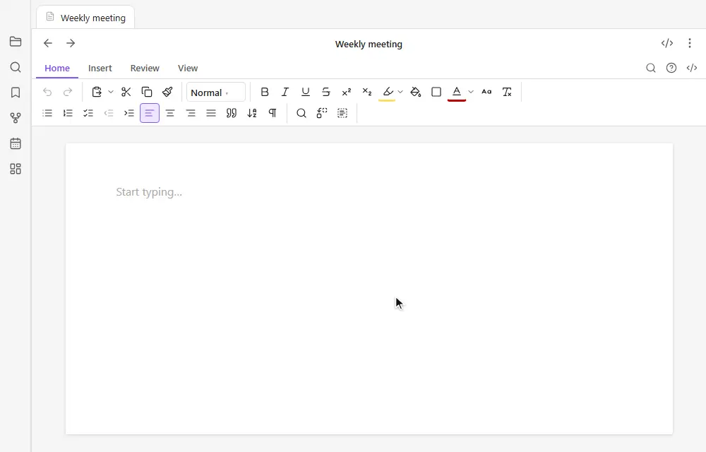

# Word Mode

**English** | [繁體中文](README.zh-TW.md) | [日本語](README.ja.md) | [한국어](README.ko.md)

Edit your [Obsidian](https://obsidian.md) notes the way you would in Word: a ribbon toolbar, tables, equations, and diagrams, with no Markdown syntax to remember. Every note is still saved as a plain Markdown file.

## Why Word Mode

- **Nothing to memorize.** Format with toolbar buttons and the shortcuts you know from a word processor, such as `Ctrl+B` for bold and `Ctrl+K` for a link.
- **Your files stay Markdown.** When you edit a note, only the blocks you changed are written again. Everything else is kept exactly as it was, character for character, so sync and version history see only what you edited.
- **Switch any time.** Press `Ctrl+E` (`Cmd+E` on macOS), or select the button in the note's header, to go between Word mode and Obsidian's own editor.
- **Made for Obsidian.** Links, tags, properties, callouts, embeds, footnotes, math, Mermaid diagrams, and Dataview queries all work in Word mode.

## Features

### Formatting as you type

Shown in the animation at the top. Start a paragraph with `# `, `- `, `1. `, `> `, or `[ ] `, or finish `**bold**`, `*italic*`, or `[[note]]`, and it turns into formatting. One undo removes the formatting and keeps what you typed. Type `[[` to pick a note or heading, or `#` to pick a tag.

### Ribbon toolbar

- **Home, Insert, Review, and View tabs**, arranged like a word processor.
- **Font color and highlight**: standard colors with tints and shades, your recent colors, or any color you pick or type as a hex code. Highlights can use any color and opacity.
- **Make it yours**: show the tabs as text, icons, or both, collapse them into one menu button, and rename them. Rename, reorder, hide, or move button groups to another tab.
- **The same toolbar in Markdown and reading mode**, with the same layout, so nothing jumps when you switch. You can show it in both, in one of them, or in neither.
- **Detailed tooltips**: turn them on and hovering a button explains it with a short animation, including the view mode buttons and the status bar buttons.
- **Status bar** with the word count, save status, buttons to switch between Word mode, Markdown and reading view, view properties, and zoom. Markdown and reading view keep the same buttons and count words the same way. You can turn this off in settings.

### Tables

- Pick a size from the grid, then type and press Tab to move to the next cell. Tab in the last cell adds a row.
- Right-click a cell to add, remove, or move rows and columns, sort by a column, or set a column's alignment.
- Paste cells from a spreadsheet, and they become a table.

### Equations

- Fractions, roots, superscripts, brackets, and matrices are boxes you type in. Pick a structure from the palette, or type `\frac`, `\sqrt`, or `\alpha` followed by a space.
- Tab, Enter, and the arrow keys move between boxes. Backspace in an empty box removes the structure around it.
- Switch to plain LaTeX at any time. Equations are saved as ordinary `$…$` or `$$…$$`, so they render wherever Obsidian renders math.

More about the equation editor

- Open it with **Insert → Equation**, by double-clicking an equation, or by pressing Enter on a selected one.
- `^` and `_` open a superscript or subscript. The up and down arrows move between a numerator and a denominator.
- Undo and redo with the buttons, or with `Ctrl+Z` and `Ctrl+Y`.
- **Common formulas and recent equations**: insert a whole formula, such as the quadratic formula or a standard deviation, and then change the parts you need.
- **Your own formulas**: select the bookmark button next to the preview to save the current equation under a name. Saved formulas appear under **My formulas** in the palette, and one click inserts them.
- An equation you don't change is written back exactly as it was.
- **On phones and tablets**: buttons above the editing area move to the previous or next box and remove the structure at the cursor, because on-screen keyboards have no arrow keys. On a phone, the editing area stays at the top while you scroll the palette.

### Diagrams

- **Eleven kinds of Mermaid diagram have a form**: flowchart, sequence diagram, Gantt chart, pie chart, state diagram, class diagram, mind map, timeline, ER diagram, user journey, and quadrant chart.
- **Edit on the diagram**: select a label on the preview to change it in place, add the next step, or pick a fill color.
- **Freeform**: write any Mermaid code with a live preview, including kinds without a form, such as Git graphs and XY charts.
- Diagrams are saved as ordinary Mermaid code blocks. A diagram that uses syntax the form doesn't cover opens as code, with the reason shown, so nothing is lost.

More about the diagram editor

- Open it with **Insert → Diagram**, or with the edit button on a Mermaid block.
- On the diagram, press Enter to apply a change, or Tab to apply it and move to the next label. Renaming a participant, state, class, or entity renames every reference to it.
- **Appearance**: choose a Mermaid theme for a single diagram, and a fill color for each flowchart step.
- **Preview**: zoom with the buttons, or with `Ctrl` and the mouse wheel. A diagram is shown at its real size instead of being shrunk until the text is unreadable, and one button fits the whole diagram to the width of the preview.
- **Finding your place**: put the cursor in a row of the form and the preview outlines that item. Select an item on the preview and the form jumps to its row.
- **Your own templates**: save the current diagram under a name from **My templates**, and start from it next time. In the settings you choose which diagram a new one starts with and which built-in kinds are listed.
- **Long diagrams**: lists in the form show forty rows at a time and can be filtered by typing, so a flowchart with hundreds of steps stays fast to edit. In a note, a very tall diagram is collapsed to a fixed height with a button to show all of it, and diagrams are drawn as you scroll to them.
- Newer diagram kinds are drawn only if the Mermaid version built into Obsidian supports them.
- **On phones**: the preview stays at the top with the form below it, and the fields and buttons are sized for touch.

### And more

- **Properties** as a form: tags and links appear as chips that you can select to open, nested values appear as a tree, and you can change a property's type or rename it from its icon. View properties, in the View tab and the status bar, shows them without scrolling to the top and lets you filter a long list. A setting can also pin a slim properties bar to the top while you scroll; click it to see the full list. You can show properties as a box with a border and background, with a border only, or in a minimal style without a border.
- **Images**: paste or pick an image, then drag to resize it.
- **Links** to notes, headings, and web pages, with a small toolbar that appears when the cursor is on a link.
- **Find and replace**, with whole-word and regular-expression options.
- **Outline sidebar** and heading folding.
- **Embeds**: embedded notes, headings, audio, video, PDFs, and YouTube links are shown in place. Dataview queries and code blocks from other plugins are shown as their results.
- **Footnotes**: insert a footnote, hover over its number to read it, and edit its text without touching the syntax.
- **Callouts** (including foldable ones), **task lists** with custom statuses such as `[/]` and `[-]`, **tags**, and **code blocks** with syntax highlighting and optional line numbers.
- **Formatting marks** such as `¶`, and a cleanup tool for invisible or stray characters.
- **Paste Markdown text** and convert it to formatted text in one step.
- **Sync conflict handling**: if a note changes on disk while you have unsaved edits, you choose which version to keep.
- **Shortcut list**: search it or pick a category, and select a shortcut to watch a short animation of what it does.
- Interface in Traditional Chinese, Taiwanese (Han characters), Simplified Chinese, English, Japanese, Korean, Spanish, Arabic, and Hebrew.

Anything Word Mode can't edit visually, such as an HTML block, is shown as a raw block and saved unchanged.

## Getting started

### Install

Requires Obsidian 1.5.7 or later.

1. Download `main.js`, `manifest.json`, and `styles.css` from the [latest release](https://github.com/NatLee/obsidian-word-mode/releases/latest).
2. Copy the three files to `<your vault>/.obsidian/plugins/natlee-word-mode/`.
3. In Obsidian, open **Settings → Community plugins** and enable **Word Mode**.

### Use it

After you enable the plugin, Markdown notes open in Word mode.

- To switch between Word mode and Markdown, select the button in the upper-right corner of the note, or press `Ctrl+E` (`Cmd+E` on macOS).
- To open a note in a specific mode, right-click the note and select **Open in Word mode** or **Open as Markdown**.
- To keep a single note out of Word mode, add `word-mode: false` to its properties.
- To keep whole folders out of Word mode, list them under **Settings → Word Mode → Folders excluded from Word mode**.

The settings are grouped into categories, with a row of tabs at the top that shows one category at a time. To find a setting without knowing its category, type in the search box above the tabs. It suggests matching settings as you type, also matches dropdown options and the setting names in other languages (you can type English while the interface is in Chinese), and takes you to the one you pick.

### Commands

| Command | Description |
| --- | --- |
| Edit current note in Word mode | Switch the current note to Word mode. |
| Edit current note as Markdown | Switch the current note back to the Markdown editor. |
| Toggle Word mode / Markdown | Switch between the two. |
| Toggle outline sidebar | Show or hide the outline. |
| Find | Search in the current note. |
| Find and replace | Search and replace in the current note. |
| Outline: jump to heading | Jump to a heading in the current note. |
| Show keyboard shortcuts | List all Word mode shortcuts. |

No command has a default hotkey. You can assign your own under **Settings → Hotkeys**.

## Privacy and disclosures

- **Network use**: only to display web content that your notes already point to. If a note contains an image, audio, or video from a web address, Word mode loads it from that address. If a note embeds a YouTube link, Word mode shows the YouTube player, which connects to `youtube.com`. This is the same content Obsidian's own editor loads for that note. The plugin sends none of your notes or data anywhere.
- **Telemetry**: none.
- **Accounts and payment**: not required.
- **Files outside your vault**: never read or written.
- **File names in your vault**: the plugin lists the files in your vault to offer them in the link, image, and template pickers and in the suggestions after `[[`. The list stays on your device.
- **Clipboard**: read only when you select **Paste** on the toolbar or in the right-click menu, and written only when you select **Cut**, **Copy**, or a copy button.
- **Files the plugin creates**: images you paste are saved to your attachment folder. If you choose to keep both versions in a sync conflict, your version is saved as a copy next to the note.

## Known limitations

- Mobile use hasn't been tested on real devices.
- Some buttons on the toolbar shown in Markdown and reading mode call built-in Obsidian commands and haven't all been tested individually.
- The translations other than Traditional Chinese and English haven't been reviewed by native speakers.
- In Arabic and Hebrew, the text is translated but the toolbar and dialogs keep their left-to-right layout.
- Diagram and query results, embeds, and page previews are drawn by Obsidian. They are covered by automated tests that simulate Obsidian, and haven't been checked with every plugin and theme.
- A diagram's appearance (Mermaid theme) and flowchart fill colors are drawn by Mermaid inside Obsidian. They were checked against Mermaid itself, not against every Obsidian theme.

## Contributing

Bug reports and ideas are welcome in [Issues](https://github.com/NatLee/obsidian-word-mode/issues). To build the plugin, run the tests, see how it works inside, or publish a release, read the [developer guide](docs/development.md).

## Credits

Word Mode bundles these open source libraries:

- [ProseMirror](https://prosemirror.net) by Marijn Haverbeke and contributors, MIT License.
- [markdown-it](https://github.com/markdown-it/markdown-it) and [markdown-it-mark](https://github.com/markdown-it/markdown-it-mark), MIT License.
- [entities](https://github.com/fb55/entities), BSD 2-Clause License.

## License

[MIT License](LICENSE).
