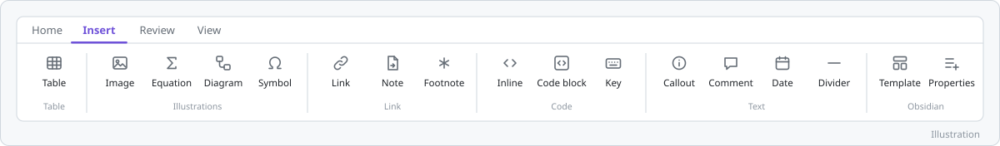
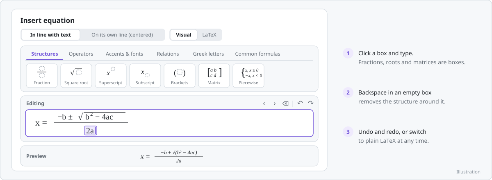
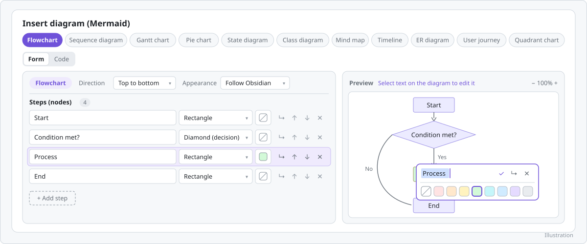

# Word Mode

**English** | [繁體中文](README.zh-TW.md) | [日本語](README.ja.md) | [한국어](README.ko.md)

Edit Markdown notes in [Obsidian](https://obsidian.md) like a Word document, with a ribbon toolbar, tables, and images. Notes are still saved as clean Markdown.


## What it does

Word Mode adds a second editor for `.md` notes. You see formatted text instead of Markdown syntax, and you format with toolbar buttons and the keyboard shortcuts you know from a word processor.

Your files stay plain Markdown. When you edit a note, only the blocks you changed are written again. Everything else is kept exactly as it was, character for character.


## Features



- **Ribbon toolbar** with Home, Insert, Review, and View tabs. The tab row can show text, icons, or both, collapse into a single menu button, and use your own tab names. Button groups can be renamed, reordered, hidden, and moved to another tab. The toolbar in Markdown and reading mode has the same layout, so nothing jumps when you switch modes. A setting hides the text on the three view mode buttons if you prefer icons only.
- **Font color and highlight**: a palette of standard colors with tints and shades, your recent custom colors, and a custom color you pick or type as a hex code. Highlights can use any color and opacity.
- **Tables** you edit in place: add, remove, and move rows and columns, sort by a column, set alignment, and paste cells from a spreadsheet. The right-click menu groups these into short submenus.
- **Properties** as a form: tags and links appear as chips that you can select to open, nested values appear as a tree, and you can change a property's type or rename it from its icon.
- **Images**: paste or pick an image, then drag to resize it.
- **Links** to notes, headings, and web pages, with a small toolbar that appears when the cursor is on a link.
- **Find and replace**, with whole-word and regular-expression options.
- **Outline sidebar** and heading folding.
- **Formatting marks** such as `¶`, and a cleanup tool for invisible or stray characters.
- **Formatting as you type**: start a paragraph with `- `, `1. `, `# `, `> `, or `[ ] `, or finish `**bold**`, `*italic*`, or `[[note]]`, and it turns into formatting. Each change is its own undo step, so one undo removes the formatting and keeps what you typed.
- **Suggestions** for notes and headings when you type `[[`, and for tags when you type `#`.
- **Diagrams**: Mermaid diagrams are shown as diagrams, and eleven kinds can be edited as a form or directly on the preview. See [Diagram editor](#diagram-editor). Dataview queries and code blocks from other plugins are shown as their results.
- **Equations**: a visual editor where fractions, roots, superscripts, and matrices are boxes you type in, or plain LaTeX. See [Equation editor](#equation-editor).
- **Embeds**: embedded notes, headings, audio, video, PDFs, and YouTube links are shown in place.
- **Footnotes**: insert a footnote, hover over its number to read it, and edit its text without touching the syntax.
- **Callouts** (including foldable ones), **task lists** with custom statuses such as `[/]` and `[-]`, **tags**, and **code blocks** with syntax highlighting and optional line numbers. Inside a code block, the buttons that do not apply to plain text are turned off.
- **Paste Markdown text** and convert it to formatted text in one step.
- **Sync conflict handling**: if a note changes on disk while you have unsaved edits, you choose which version to keep.
- Interface in Traditional Chinese, English, Japanese, and Korean.

Anything Word Mode can't edit visually, such as HTML blocks, is shown as a raw block and saved unchanged.

## Equation editor



Open it with **Insert → Equation**, by double-clicking an equation, or by pressing Enter on a selected one. Equations are saved as ordinary LaTeX (`$…$` or `$$…$$`), so they render wherever Obsidian renders math.

- **Visual editing**: fractions, roots, superscripts, brackets, and matrices are boxes. Select a box and type, or pick a structure or symbol from the palette. You can switch to plain LaTeX at any time, and an equation you do not change is written back exactly as it was.
- **Keyboard**: `^` and `_` open a superscript or subscript. Tab or Enter moves to the next box, and the arrow keys move between boxes, including up and down between a numerator and a denominator. Backspace in an empty box removes the structure around it. Typing `\frac`, `\sqrt`, or `\alpha` followed by a space builds the structure or the symbol.
- **Undo and redo** with the buttons or `Ctrl+Z` and `Ctrl+Y`.
- **Common formulas and recent equations**: insert a whole formula, such as the quadratic formula or a standard deviation, and then change the parts you need.
- **Your own formulas**: select the bookmark button next to the preview to save the current equation under a name. Saved formulas appear under **My formulas** in the palette, and one click inserts them.
- **On phones and tablets**: buttons above the editing area move to the previous or next box and remove the structure at the cursor, because on-screen keyboards have no arrow keys. On a phone, the editing area stays at the top while you scroll the palette.

## Diagram editor



Open it with **Insert → Diagram**, or with the edit button on a Mermaid block. Diagrams are saved as ordinary Mermaid code blocks.

- **Eleven kinds with a form**: flowchart, sequence diagram, Gantt chart, pie chart, state diagram, class diagram, mind map, timeline, ER diagram, user journey, and quadrant chart. Pick a kind at the top to start from a template, and then add, reorder, and delete rows.
- **Freeform**: **Freeform** at the top starts from a blank editor where you write your own Mermaid code. It is not limited to the eleven kinds with a form (for example Git graphs, XY charts, and C4 diagrams), and it has the same live preview, with mistakes shown above it. Newer diagram kinds are drawn only if the Mermaid version built into Obsidian supports them.
- **Editing on the diagram**: select a label on the preview to change it in place. Press Enter to apply, or Tab to apply and move on to the next label. From the same box you can delete that row, add the next flowchart step or a mind map sub-branch, and pick a fill color for a flowchart step. Renaming a participant, state, class, or entity there renames every reference to it.
- **Appearance**: choose a Mermaid theme for a single diagram, and a fill color for each flowchart step.
- **Preview**: zoom with the buttons, or with `Ctrl` and the mouse wheel. A diagram is shown at its real size instead of being shrunk until the text is unreadable, and one button fits the whole diagram to the width of the preview. While you edit, the preview keeps its scroll position and does not flicker.
- **Finding your place**: put the cursor in a row of the form and the preview outlines that item and scrolls to it. Select an item on the preview and the form jumps to its row.
- **Your own templates**: save the current diagram under a name from **My templates** at the top of the editor, and start from it next time. In the settings you choose which diagram a new one starts with and which built-in kinds are listed.
- **Long diagrams**: lists in the form show forty rows at a time and can be filtered by typing, so a flowchart with hundreds of steps stays fast to edit. In a note, a very tall diagram is collapsed to a fixed height with a button to show all of it, and diagrams are drawn as you scroll to them.
- **Nothing is lost**: a diagram opens in the form only when reading it and writing it back changes nothing. A diagram that uses syntax the form does not cover, such as loops, nested states, or custom styles, opens as code with the reason shown. A diagram you do not change is written back exactly as it was.
- **On phones**: the preview stays at the top with the form below it, and the fields and buttons are sized for touch.

## Usage

After you enable the plugin, Markdown notes open in Word mode by default.

- To switch between Word mode and Markdown, select the button in the upper-right corner of the note, or press `Ctrl+E` (`Cmd+E` on macOS).
- To open a note in a specific mode, right-click the note and select **Open in Word mode** or **Open as Markdown**.
- To keep a single note out of Word mode, add `word-mode: false` to its properties.
- To keep whole folders out of Word mode, list them under **Settings → Word Mode → Folders excluded from Word mode**.

### Commands

| Command | Description |
| --- | --- |
| Edit current note in Word mode | Switch the current note to Word mode. |
| Edit current note as Markdown | Switch the current note back to the Markdown editor. |
| Toggle Word mode / Markdown | Switch between the two. |
| Toggle outline sidebar | Show or hide the outline. |
| Find | Search in the current note. |
| Find and replace | Search and replace in the current note. |
| Outline: jump to heading | Jump to a heading in the current note. |
| Show keyboard shortcuts | List all Word mode shortcuts. |

No command has a default hotkey. You can assign your own under **Settings → Hotkeys**.

## Installation

Requires Obsidian 1.5.7 or later.

1. Download `main.js`, `manifest.json`, and `styles.css` from the [latest release](https://github.com/NatLee/obsidian-word-mode/releases/latest).
2. Copy the three files to `<your vault>/.obsidian/plugins/natlee-word-mode/`.
3. In Obsidian, open **Settings → Community plugins** and enable **Word Mode**.

## Privacy and disclosures

- **Network use**: only to display web content that your notes already point to. If a note contains an image, audio, or video from a web address, Word mode loads it from that address. If a note embeds a YouTube link, Word mode shows the YouTube player, which connects to `youtube.com`. This is the same content Obsidian's own editor loads for that note. The plugin sends none of your notes or data anywhere.
- **Telemetry**: none.
- **Accounts and payment**: not required.
- **Files outside your vault**: never read or written.
- **File names in your vault**: the plugin lists the files in your vault to offer them in the link, image, and template pickers and in the suggestions after `[[`. The list stays on your device.
- **Clipboard**: read only when you select **Paste** on the toolbar or in the right-click menu, and written only when you select **Cut**, **Copy**, or a copy button.
- **Files the plugin creates**: images you paste are saved to your attachment folder. If you choose to keep both versions in a sync conflict, your version is saved as a copy next to the note.

## Known limitations

- Mobile use hasn't been tested on real devices.
- Some buttons on the toolbar shown in Markdown and reading mode call built-in Obsidian commands and haven't all been tested individually.
- The Japanese and Korean translations haven't been reviewed by native speakers.
- Diagram and query results, embeds, and page previews are drawn by Obsidian. They are covered by automated tests that simulate Obsidian, and haven't been checked with every plugin and theme.
- A diagram's appearance (Mermaid theme) and flowchart fill colors are drawn by Mermaid inside Obsidian. They were checked against Mermaid itself, not against every Obsidian theme.

## Development

Requires Node.js 22. The source is TypeScript. esbuild bundles it, and `tsc` only checks the types.

| Command | Description |
| --- | --- |
| `npm install` | Install dependencies. |
| `npm run typecheck` | Check the types with `tsc`. |
| `npm run lint` | Run ESLint with the rules Obsidian uses to review community plugins. |
| `npm test` | Check the types, then run the conversion tests and the editing tests, which simulate Obsidian with jsdom. The last line should be `ALL PASS`. |
| `npm run build` | Build `main.js`, `manifest.json`, and `styles.css` to `dist/`. This is the production build. |
| `npm run dev` | Build to `dist/` without minifying. |
| `npm run test:vault -- <vault path>` | Round-trip every note in a vault. Read-only. Prints statistics and file paths only. |

After you change `src/markdown.ts` or `src/schema.ts`, run `npm run test:vault` against a real vault and confirm that `notExact` and `lossyBlocks` are both `0`.

Don't keep this folder or `node_modules` inside a folder that a sync client watches, such as Synology Drive.

The `obsidian` typings are pinned to the version in `minAppVersion`, so using an Obsidian API newer than the plugin supports fails the type check. To raise the minimum version, update `minAppVersion` in `manifest.json` and install the matching `obsidian` package.

Obsidian APIs that aren't public are declared in one place, `src/obsidian-internal.d.ts`, each as optional. Check that a member exists before you call it.

### Project structure

| Path | Contents |
| --- | --- |
| `src/main.ts` | Plugin entry point and settings tab. |
| `src/view.ts` | The Word mode view (`TextFileView`). |
| `src/markdown.ts` | Conversion between Markdown and the document model. |
| `src/schema.ts` | Document model (ProseMirror schema). |
| `src/editor.ts` | Editor state setup. |
| `src/commands.ts` | Editing commands. Pure ProseMirror, no Obsidian dependency. |
| `src/toolbar.ts` | Ribbon toolbar, and the order, tab, and name of each button group. |
| `src/groupsettings.ts` | Settings list for customizing tabs and button groups. |
| `src/colorpicker.ts` | Color panel for font color and highlight. |
| `src/mdbar.ts` | Toolbar shown in Markdown and reading mode. |
| `src/bubble.ts` | Floating toolbar for links and images. |
| `src/nodeviews.ts` | Rendering of links, images, tables, and raw blocks. |
| `src/links.ts` | Link and image detection. |
| `src/paste.ts` | Paste handling for spreadsheets and Markdown text. |
| `src/find.ts` | Find and replace. |
| `src/fold.ts` | Heading folding. |
| `src/outline.ts` | Outline sidebar. |
| `src/marks.ts` | Formatting marks and stray-character cleanup. |
| `src/codehl.ts` | Syntax highlighting for code blocks. |
| `src/autoformat.ts` | Formatting as you type. |
| `src/suggest.ts`, `src/complete.ts` | Suggestions for notes, headings, and tags. |
| `src/dialogs.ts` | Dialogs: links, equations, shortcuts, cleanup, word count. |
| `src/mathvisual.ts` | Visual equation editor. |
| `src/templates.ts`, `src/templateui.ts` | Formulas and diagram templates you save yourself: the data operations, and the list in the settings that manages them. |
| `src/mermaid.ts`, `src/diagrams.ts`, `src/flowchart.ts` | Diagram editor, the description of each diagram kind (parser, generator, and form fields) that drives its form and on-diagram editing, and the flowchart parser. |
| `src/embeds.ts` | Embedded notes, media, and PDFs. |
| `src/footnotes.ts` | Footnote commands. |
| `src/decoutil.ts`, `src/dom.ts`, `src/textstats.ts` | Shared helpers. |
| `src/hints.ts` | Detailed button tooltips. |
| `src/i18n.ts`, `src/i18n-*.ts` | Translations, keyed by the Traditional Chinese text. An interface string with no entry in the English dictionary fails the type check. |
| `src/obsidian-internal.d.ts` | Declarations for the Obsidian APIs the plugin uses that aren't public. |
| `src/globals.d.ts`, `src/markdown-it-mark.d.ts` | Declarations for globals and for a dependency that ships no types. |
| `styles/word-mode.css` | Styles. |
| `tests/` | Conversion tests, editing tests, and the vault round-trip check. `tests/run.mjs` bundles a test with esbuild before running it. |
| `docs/images/` | The illustrations in the READMEs. `node docs/images/generate.mjs` redraws them in all four languages from the plugin's interface text and diagram templates. |
| `tsconfig.json` | TypeScript settings. |
| `build.mjs` | Build script. |
| `version-bump.mjs` | Syncs the version to `manifest.json` and `versions.json`. |
| `release-local.mjs` | Publishes a release from your computer, without attestations. Use it only when GitHub Actions is unavailable. |

### Releasing

The version number lives in `package.json`. `manifest.json` and `versions.json` are updated from it.

1. Run `npm version patch`, `npm version minor`, or `npm version major`. This updates `package.json`, `manifest.json`, and `versions.json`, then creates a commit and a tag such as `1.3.1`.
2. Run `git push origin main --follow-tags`.

Pushing the tag starts the release workflow on GitHub Actions. It runs the tests, builds the plugin, creates a [build provenance attestation](https://docs.github.com/en/actions/security-for-github-actions/using-artifact-attestations/using-artifact-attestations-to-establish-provenance-for-builds) for `main.js`, `manifest.json`, and `styles.css`, and attaches them to a GitHub release. Release files are always built there, so anyone can verify that they come from this source:

```sh
gh attestation verify main.js --repo NatLee/obsidian-word-mode
```

The tag must match the version exactly, without a `v` prefix, because Obsidian looks for a release with that tag.

`npm run build` is the production build, and it is the build the Obsidian community directory runs to check a release against the source.

The CI workflow doesn't run automatically. To run it, open the **Actions** tab, select **CI**, and then select **Run workflow**.

## Credits

Word Mode bundles these open source libraries:

- [ProseMirror](https://prosemirror.net) by Marijn Haverbeke and contributors, MIT License.
- [markdown-it](https://github.com/markdown-it/markdown-it) and [markdown-it-mark](https://github.com/markdown-it/markdown-it-mark), MIT License.
- [entities](https://github.com/fb55/entities), BSD 2-Clause License.

## License

[MIT License](LICENSE).
