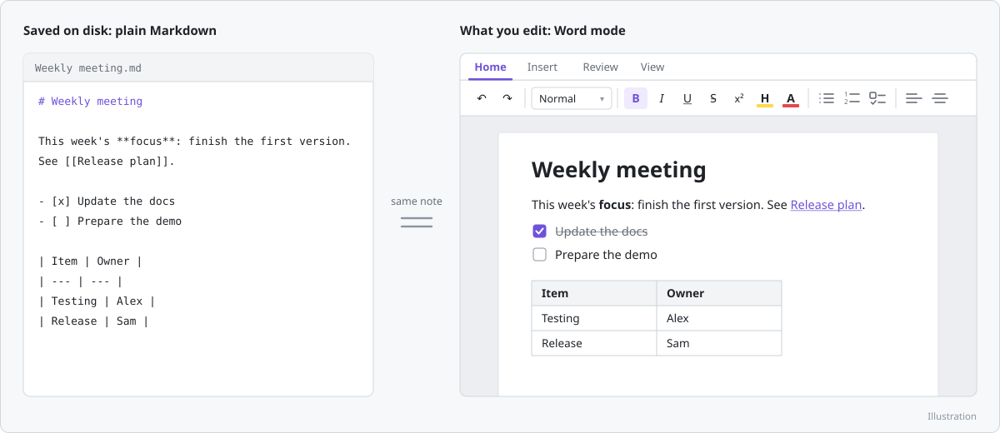
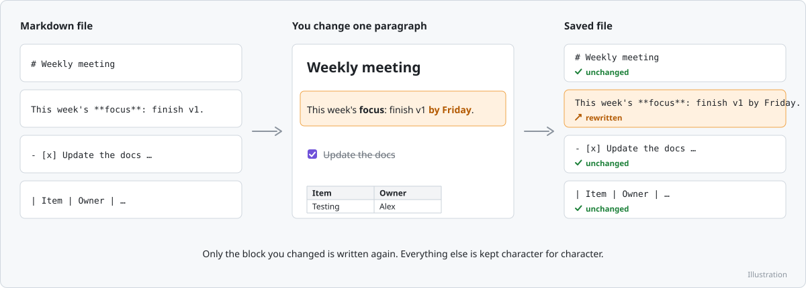

# Word Mode

**English** | [繁體中文](README.zh-TW.md) | [日本語](README.ja.md) | [한국어](README.ko.md)

Edit Markdown notes in [Obsidian](https://obsidian.md) like a Word document, with a ribbon toolbar, tables, and images. Notes are still saved as clean Markdown.

## What it does

Word Mode adds a second editor for `.md` notes. You see formatted text instead of Markdown syntax, and you format with toolbar buttons and the keyboard shortcuts you know from a word processor.

Your files stay plain Markdown. When you edit a note, only the blocks you changed are written again. Everything else is kept exactly as it was, character for character.

## Features

- **Ribbon toolbar** with Home, Insert, Review, and View tabs.
- **Tables** you edit in place: add and remove rows and columns, set alignment, and paste cells from a spreadsheet.
- **Images**: paste or pick an image, then drag to resize it.
- **Links** to notes, headings, and web pages, with a small toolbar that appears when the cursor is on a link.
- **Find and replace**, with whole-word and regular-expression options.
- **Outline sidebar** and heading folding.
- **Formatting marks** such as `¶`, and a cleanup tool for invisible or stray characters.
- **Formatting as you type**: start a paragraph with `- `, `1. `, `# `, `> `, or `[ ] `, or finish `**bold**`, `*italic*`, or `[[note]]`, and it turns into formatting. Each change is its own undo step, so one undo removes the formatting and keeps what you typed.
- **Suggestions** for notes and headings when you type `[[`, and for tags when you type `#`.
- **Diagrams**: Mermaid diagrams are shown as diagrams. A diagram editor lets you edit flowcharts as a list of steps and connections, or any diagram as code, with a live preview. Dataview queries and code blocks from other plugins are shown as their results.
- **Equations**: a visual editor where fractions, roots, superscripts, and matrices are boxes you type in, or plain LaTeX. You choose the default in the settings.
- **Embeds**: embedded notes, headings, audio, video, PDFs, and YouTube links are shown in place.
- **Footnotes**: insert a footnote, hover over its number to read it, and edit its text without touching the syntax.
- **Callouts** (including foldable ones), **task lists** with custom statuses such as `[/]` and `[-]`, **tags**, and **code blocks** with syntax highlighting.
- **Paste Markdown text** and convert it to formatted text in one step.
- **Sync conflict handling**: if a note changes on disk while you have unsaved edits, you choose which version to keep.
- Interface in Traditional Chinese, English, Japanese, and Korean.

Anything Word Mode can't edit visually, such as HTML blocks, is shown as a raw block and saved unchanged.

## Usage

After you enable the plugin, Markdown notes open in Word mode by default.

- To switch between Word mode and Markdown, select the button in the upper-right corner of the note, or press `Ctrl+E` (`Cmd+E` on macOS).
- To open a note in a specific mode, right-click the note and select **Open in Word mode** or **Open as Markdown**.
- To keep a single note out of Word mode, add `word-mode: false` to its properties.
- To keep whole folders out of Word mode, list them under **Settings → Word Mode → Folders excluded from Word mode**.

### Commands

| Command | Description |
| --- | --- |
| Edit current note in Word mode | Switch the current note to Word mode. |
| Edit current note as Markdown | Switch the current note back to the Markdown editor. |
| Toggle Word mode / Markdown | Switch between the two. |
| Toggle outline sidebar | Show or hide the outline. |
| Find | Search in the current note. |
| Find and replace | Search and replace in the current note. |
| Outline: jump to heading | Jump to a heading in the current note. |
| Show keyboard shortcuts | List all Word mode shortcuts. |

No command has a default hotkey. You can assign your own under **Settings → Hotkeys**.

## Installation

Requires Obsidian 1.5.7 or later.

1. Download `main.js`, `manifest.json`, and `styles.css` from the [latest release](https://github.com/NatLee/obsidian-word-mode/releases/latest).
2. Copy the three files to `<your vault>/.obsidian/plugins/natlee-word-mode/`.
3. In Obsidian, open **Settings → Community plugins** and enable **Word Mode**.

## Privacy and disclosures

- **Network use**: only to display web content that your notes already point to. If a note contains an image, audio, or video from a web address, Word mode loads it from that address. If a note embeds a YouTube link, Word mode shows the YouTube player, which connects to `youtube.com`. This is the same content Obsidian's own editor loads for that note. The plugin sends none of your notes or data anywhere.
- **Telemetry**: none.
- **Accounts and payment**: not required.
- **Files outside your vault**: never read or written.
- **Files the plugin creates**: images you paste are saved to your attachment folder. If you choose to keep both versions in a sync conflict, your version is saved as a copy next to the note.

## Known limitations

- Mobile use hasn't been tested on real devices.
- Some buttons on the toolbar shown in Markdown and reading mode call built-in Obsidian commands and haven't all been tested individually.
- The Japanese and Korean translations haven't been reviewed by native speakers.
- Diagram and query results, embeds, and page previews are drawn by Obsidian. They are covered by automated tests that simulate Obsidian, and haven't been checked with every plugin and theme.

## Development

Requires Node.js 22. The source is TypeScript. esbuild bundles it, and `tsc` only checks the types.

| Command | Description |
| --- | --- |
| `npm install` | Install dependencies. |
| `npm run typecheck` | Check the types with `tsc`. |
| `npm run lint` | Run ESLint with the rules Obsidian uses to review community plugins. |
| `npm test` | Check the types, then run the conversion tests and the editing tests, which simulate Obsidian with jsdom. The last line should be `ALL PASS`. |
| `npm run build` | Build to `dist/` without minifying. |
| `npm run build:prod` | Build `main.js`, `manifest.json`, and `styles.css` to `dist/`. |
| `npm run test:vault -- <vault path>` | Round-trip every note in a vault. Read-only. Prints statistics and file paths only. |

After you change `src/markdown.ts` or `src/schema.ts`, run `npm run test:vault` against a real vault and confirm that `notExact` and `lossyBlocks` are both `0`.

Don't keep this folder or `node_modules` inside a folder that a sync client watches, such as Synology Drive.

The `obsidian` typings are pinned to the version in `minAppVersion`, so using an Obsidian API newer than the plugin supports fails the type check. To raise the minimum version, update `minAppVersion` in `manifest.json` and install the matching `obsidian` package.

Obsidian APIs that aren't public are declared in one place, `src/obsidian-internal.d.ts`, each as optional. Check that a member exists before you call it.

### Project structure

| Path | Contents |
| --- | --- |
| `src/main.ts` | Plugin entry point and settings tab. |
| `src/view.ts` | The Word mode view (`TextFileView`). |
| `src/markdown.ts` | Conversion between Markdown and the document model. |
| `src/schema.ts` | Document model (ProseMirror schema). |
| `src/editor.ts` | Editor state setup. |
| `src/commands.ts` | Editing commands. Pure ProseMirror, no Obsidian dependency. |
| `src/toolbar.ts` | Ribbon toolbar. |
| `src/mdbar.ts` | Toolbar shown in Markdown and reading mode. |
| `src/bubble.ts` | Floating toolbar for links and images. |
| `src/nodeviews.ts` | Rendering of links, images, tables, and raw blocks. |
| `src/links.ts` | Link and image detection. |
| `src/paste.ts` | Paste handling for spreadsheets and Markdown text. |
| `src/find.ts` | Find and replace. |
| `src/fold.ts` | Heading folding. |
| `src/outline.ts` | Outline sidebar. |
| `src/marks.ts` | Formatting marks and stray-character cleanup. |
| `src/codehl.ts` | Syntax highlighting for code blocks. |
| `src/autoformat.ts` | Formatting as you type. |
| `src/suggest.ts`, `src/complete.ts` | Suggestions for notes, headings, and tags. |
| `src/dialogs.ts` | Dialogs: links, equations, shortcuts, cleanup, word count. |
| `src/mathvisual.ts` | Visual equation editor. |
| `src/mermaid.ts`, `src/flowchart.ts` | Diagram editor, and the flowchart parser behind its form. |
| `src/embeds.ts` | Embedded notes, media, and PDFs. |
| `src/footnotes.ts` | Footnote commands. |
| `src/decoutil.ts`, `src/dom.ts`, `src/textstats.ts` | Shared helpers. |
| `src/hints.ts` | Detailed button tooltips. |
| `src/i18n.ts`, `src/i18n-*.ts` | Translations, keyed by the Traditional Chinese text. |
| `src/obsidian-internal.d.ts` | Declarations for the Obsidian APIs the plugin uses that aren't public. |
| `src/globals.d.ts`, `src/markdown-it-mark.d.ts` | Declarations for globals and for a dependency that ships no types. |
| `styles/word-mode.css` | Styles. |
| `tests/` | Conversion tests, editing tests, and the vault round-trip check. `tests/run.mjs` bundles a test with esbuild before running it. |
| `docs/images/` | The illustrations in the READMEs. `node docs/images/generate.mjs` redraws them in all four languages from the plugin's interface text. |
| `tsconfig.json` | TypeScript settings. |
| `build.mjs` | Build script. |
| `version-bump.mjs` | Syncs the version to `manifest.json` and `versions.json`. |
| `release-local.mjs` | Publishes a release from your computer. |

### Releasing

The version number lives in `package.json`. `manifest.json` and `versions.json` are updated from it.

1. Run `npm version patch`, `npm version minor`, or `npm version major`. This updates `package.json`, `manifest.json`, and `versions.json`, then creates a commit and a tag such as `1.2.1`.
2. Run `git push origin main`.
3. Run `npm run release:local`. This runs the tests, builds the plugin, pushes the tag, and creates a GitHub release with `main.js`, `manifest.json`, and `styles.css` attached. It requires the [GitHub CLI](https://cli.github.com) and doesn't use GitHub Actions.

The tag must match the version exactly, without a `v` prefix, because Obsidian looks for a release with that tag.

The CI and release workflows don't run automatically. To run one, open the **Actions** tab, select the workflow, and then select **Run workflow**. For the release workflow, select the tag to release under **Use workflow from**.

## Credits

Word Mode bundles these open source libraries:

- [ProseMirror](https://prosemirror.net) by Marijn Haverbeke and contributors, MIT License.
- [markdown-it](https://github.com/markdown-it/markdown-it) and [markdown-it-mark](https://github.com/markdown-it/markdown-it-mark), MIT License.
- [entities](https://github.com/fb55/entities), BSD 2-Clause License.

## License

[MIT License](LICENSE).
