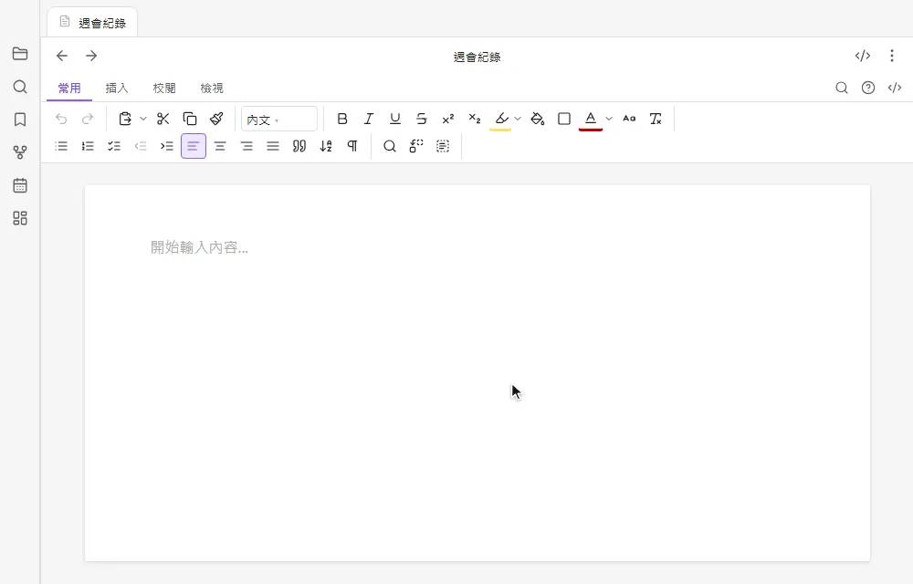
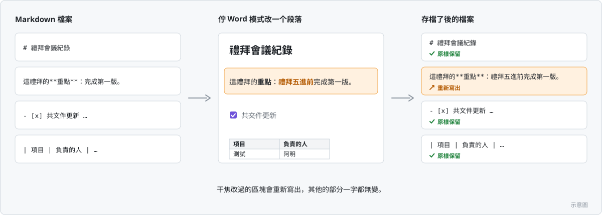
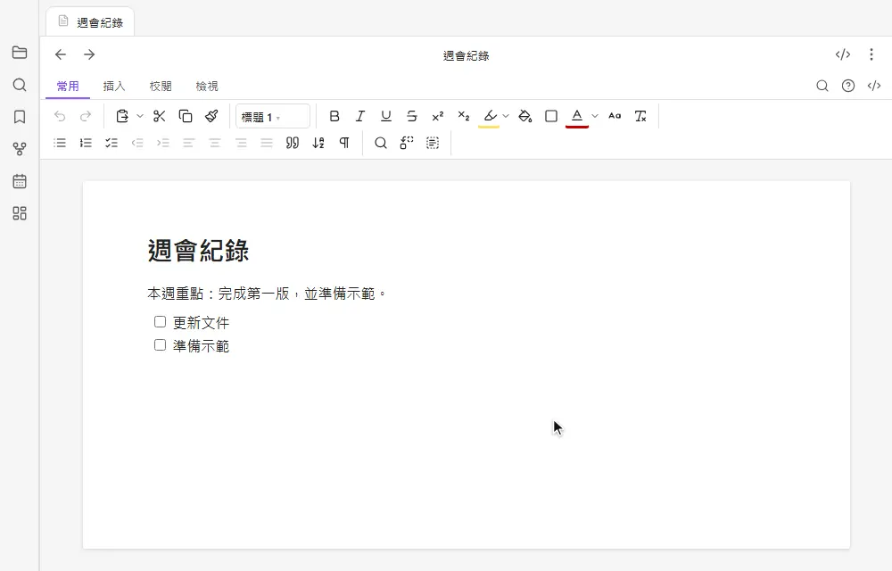
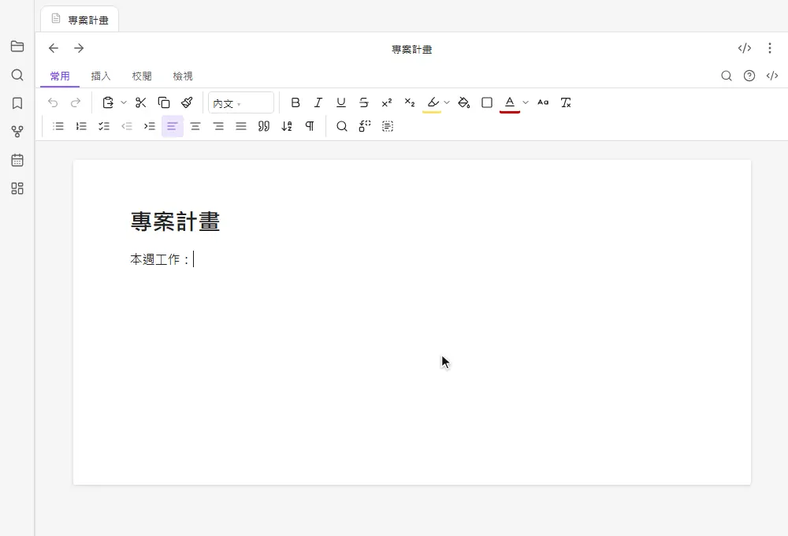
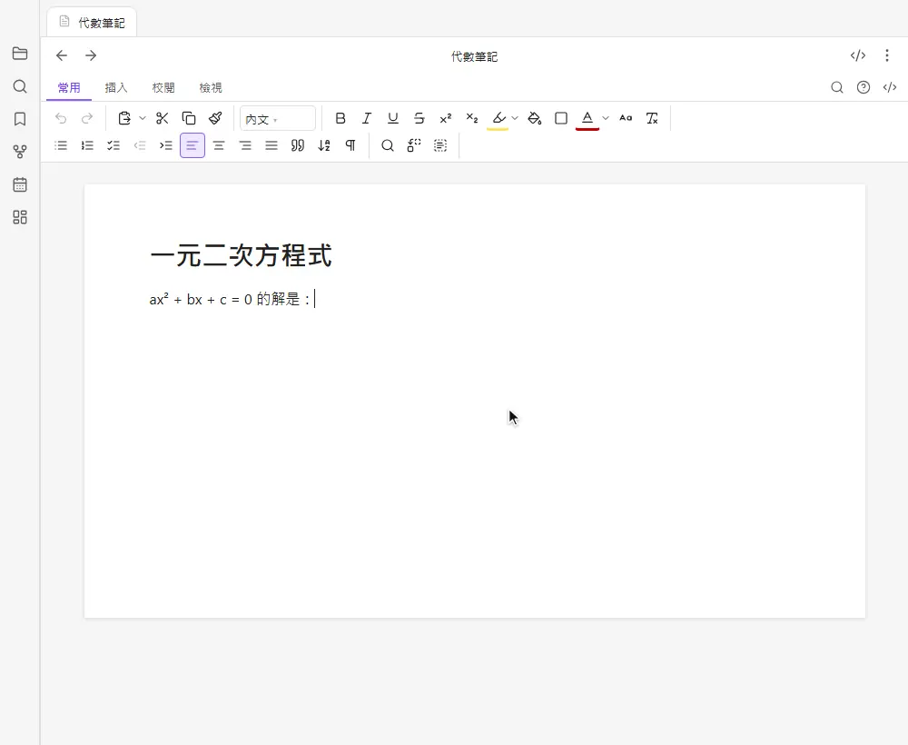
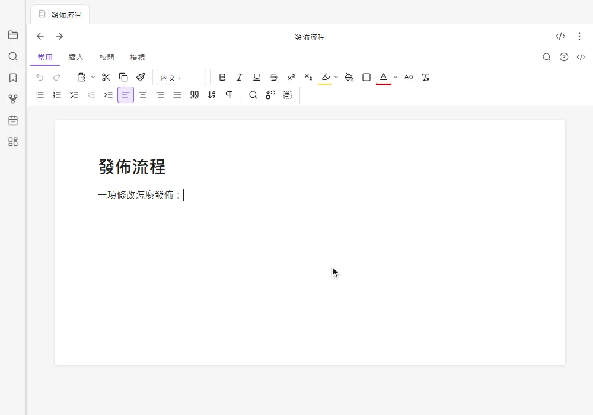

# Word Mode

[English](README.md) | [繁體中文](README.zh-TW.md) | **台文** | [粵語](README.yue-HK.md) | [简体中文](README.zh-CN.md) | [日本語](README.ja.md) | [한국어](README.ko.md) | [Tiếng Việt](README.vi.md) | [Français](README.fr.md) | [Deutsch](README.de.md) | [Español](README.es.md) | [العربية](README.ar.md) | [עברית](README.he.md)

親像用 Word 仝款來編輯 [Obsidian](https://obsidian.md) 的筆記：有功能區工具列、表格、方程式、圖表，毋免記 Markdown 語法。逐篇筆記存檔了後，猶原是純 Markdown 檔案。

> 這个台文版猶未予母語的人校對過。若有讀起來無啥自然的講法，請佇 Issue 共阮講。

## 為啥物欲用 Word 模式

- **毋免記語法**：用工具列的按鈕佮文書軟體常見的快速鍵來設定格式，像 `Ctrl+B` 是粗體、`Ctrl+K` 是連結。
- **檔案猶原是 Markdown**：編輯筆記的時陣，干焦有改過的區塊會重新輸出，其他的部分一字都無改，照原文保留；同步佮版本紀錄看著的，干焦你改的所在。
- **隨時會當切換**：揤 `Ctrl+E`（macOS 是 `Cmd+E`）抑是筆記標題列的按鈕，就會當佇 Word 模式佮 Obsidian 原本的編輯器中間切換。
- **專工為 Obsidian 設計**：連結、標籤、文件屬性、提示框、內嵌、註腳、數學式、Mermaid 圖表、Dataview 查詢，佇 Word 模式攏會當用。

## 功能

### 拍字的時陣自動套用格式

就是上頂懸動畫示範的功能。佇段落的開頭拍 `# `、`- `、`1. `、`> `、`[ ] `，抑是拍完 `**粗體**`、`*斜體*`、`[[筆記]]`，就會變做格式。揤一擺復原干焦取消格式，拍的字猶佇咧。拍 `[[` 會當揀筆記抑是標題，拍 `#` 會當揀標籤。

### 功能區工具列

- **常用、插入、校閱、檢視四个分頁**，排法佮文書軟體仝款。
- **字型色彩佮醒目提示**：有標準色彩佮深淺變化的色盤、最近用過的色彩，嘛會當家己揀色抑是拍色碼。醒目提示會當用任何色，閣會當調整不透明度。
- **照家己的習慣調整**：分頁列會當顯示文字、圖示抑是兩項攏顯示，嘛會當收做一个選單按鈕，分頁名稱會當家己改。按鈕群組會當改名、調整順序、隱藏，抑是徙去別个分頁。
- **Markdown 佮閱讀模式嘛有仝一條工具列**，版面仝款，切換模式的時陣畫面袂跳動。會當設定兩種模式攏顯示、干焦佇其中一種顯示，抑是攏無顯示。
- **詳細提示**：拍開了後，滑鼠停佇按鈕頂懸會顯示說明佮動畫示範；檢視模式佮狀態列的按鈕嘛有。
- **狀態列**：字數、存檔狀態、Word 模式／Markdown／閱讀的切換按鈕、看文件屬性佮縮放。切換去 Markdown 抑是閱讀模式的時陣保留仝款的按鈕，字數嘛用仝款的算法；會當佇設定內底關掉。

### 表格

- 對格仔揀大小，拍好揤 Tab 跳去後一格；佇上尾一格揤 Tab 會新增一列。
- 佇儲存格頂懸揤右鍵，會當新增、刪除、徙動列佮欄，照欄排序，設定規欄的對齊。
- 對試算表複製的儲存格，貼落去就是表格。

### 方程式

- 分數、根號、上下標、括號、矩陣攏是會當直接拍字的格仔。對面板揀結構，抑是拍 `\frac`、`\sqrt`、`\alpha` 才揤空白。
- Tab、Enter 佮方向鍵佇格仔中間徙動；佇空格仔內底揤 Backspace 會提掉外口的結構。
- 隨時會當切去 LaTeX 原始碼。方程式存做一般的 `$…$` 抑是 `$$…$$`，Obsidian 顯示數學式的所在攏看會著。

方程式編輯器的其他功能

- 對「插入 → 方程式」拍開，嘛會當佇方程式頂懸揤兩下，抑是選方程式了後揤 Enter。
- `^`、`_` 開上標、下標的格仔；上下鍵會當佇分子佮分母中間徙動。
- 復原佮取消復原：用按鈕，抑是 `Ctrl+Z`、`Ctrl+Y`。
- **常用公式佮最近用過**：規條插入（像一元二次方程式的解、標準差），才改需要的部分。
- **我的公式**：揤預覽邊仔的書籤按鈕，共這馬的方程式號一个名存起來。存過的公式佇面板的「我的公式」分類內底，揤一下就插入。
- 無改過的方程式會照原樣寫轉去，一字都無變。
- **手機佮平板**：螢幕鍵盤無方向鍵，所以編輯區頂懸有「頂一格」「後一格」佮「提掉游標所在的結構」的按鈕。佇手機仔，面板往下捲的時陣，編輯區會固定佇上頂懸。

### 圖表

- **十一種 Mermaid 圖表有表單**：流程圖、循序圖、甘特圖、圓餅圖、狀態圖、類別圖、心智圖、時間軸、ER 圖、旅程圖、象限圖。
- **佇圖頂懸編輯**：揤預覽圖頂懸的文字直接改，嘛會當新增後一步、揀底色。
- **自由寫**：家己寫任何 Mermaid 程式碼，仝款有即時預覽，包括無表單的種類（像 Git 分支圖、XY 圖表）。
- 圖表存做一般的 Mermaid 程式碼區塊。用著表單無支援的寫法的圖，會用程式碼拍開，閣講明原因，內容袂無去。

圖表編輯器的其他功能

- 對「插入 → 圖表」拍開，抑是揤 Mermaid 區塊頂懸的編輯按鈕。
- 佇圖頂懸揤 Enter 套用，抑是揤 Tab 套用閣跳去後一段文字。佇圖頂懸共參與者、狀態、類別、實體改名，所有用著伊的所在會做伙改。
- **外觀**：會當為單一張圖揀 Mermaid 的佈景，流程圖的逐个步驟會當揀底色。
- **預覽**：用按鈕縮放，抑是揤咧 `Ctrl` 閣捲滑鼠輪仔。圖用原本的大小顯示，袂規張縮甲字看袂著；另外有一个按鈕共規張圖縮甲佮預覽仝闊。
- **揣會著位置**：游標入去表單的某一列，預覽圖頂懸會用外框標出彼个項目；佇圖頂懸揤一个項目，表單嘛會跳去彼列。
- **我的範本**：佇「我的範本」共這馬的圖表號一个名存起來，後擺直接對伊開始。設定內底會當揀新圖表一開始的內容，閣有欲列出佗幾種內建的圖表種類。
- **真長的圖表**：表單的清單一擺顯示四十列，會當拍字篩選，幾若百个步驟的流程圖編輯起來嘛猶是真順。筆記內底真懸的圖表會先收合做固定的懸度，揤一下就顯示完整內容；圖表愛捲到看會著才會畫。
- 較新的圖表種類，愛 Obsidian 內建的 Mermaid 有支援才畫會出來。
- **手機**：預覽固定佇頂懸，表單佇下跤；欄位佮按鈕放大做適合觸控的大細。

### 閣有這寡

- **文件屬性**：用表單編輯。標籤佮連結顯示做會當揤的標籤，巢狀資料顯示做樹仔形，揤屬性的圖示會當改類型抑是改名。功能區「檢視」分頁佮狀態列的「看文件屬性」毋免捲去上頂懸就看會著，屬性真濟的時陣會當篩選。嘛會當設定做捲動的時陣佇頂懸顯示一條精簡的屬性列，揤一下展開完整清單。外觀會當揀有框線佮底色的區塊、干焦框線，抑是無框線的簡潔樣式。
- **圖片**：貼圖片抑是揀圖片，用拖的就會當調整大小。
- **連結**：連去筆記、標題抑是網頁；游標佇連結頂懸的時陣，會出現一條細細的工具列。
- **揣佮取代**，會當全字相符抑是用正規表示式。
- **大綱側邊欄**佮標題收合。
- **內嵌**：內嵌的筆記、標題、錄音、影片、PDF、YouTube 連結會直接顯示內容。Dataview 查詢佮其他外掛的程式碼區塊嘛會顯示做結果。
- **註腳**：插入註腳、滑鼠徙去編號頂懸看內容、編輯內容的時陣毋免管語法。
- **提示框**（包括會當收合的）、**待辦清單**（包括 `[/]`、`[-]` 這款自訂狀態）、**標籤**、**程式碼區塊**（有語法上色，會當顯示行號）。
- **編輯標記**（像 `¶`），閣有清掉看袂著的字元抑是賰落來的符號的工具。
- **貼 Markdown 文字**的時陣，會當揤一下就轉做格式。
- **同步衝突處理**：筆記有猶未存檔的修改，煞閣佇磁碟頂懸予人改過，會當揀欲保留佗一份。
- **快速鍵說明**：會當揣，抑是干焦看某一類，揤一下快速鍵閣會當看伊效果的動畫示範。
- 介面語言：繁體中文、台文（漢字）、粵語、簡體中文、英文、日文、韓文、越南文、法文、德文、西班牙文、阿拉伯文、希伯來文。

無法度用 Word 方式編輯的內容（像 HTML 區塊）會顯示做原文區塊，存檔的時陣照原樣保留。

## 開始用

### 安裝

愛 Obsidian 1.5.7 以上的版本。

1. 去[最新版本](https://github.com/NatLee/obsidian-word-mode/releases/latest)下載 `main.js`、`manifest.json`、`styles.css`。
2. 共這三个檔案囥佇 `<你的 vault>/.obsidian/plugins/natlee-word-mode/`。
3. 佇 Obsidian 拍開「設定 → 第三方外掛」，啟用「Word Mode」。

### 按怎用

啟用外掛了後，Markdown 筆記預設用 Word 模式拍開。

- 切換 Word 模式佮 Markdown：揤筆記正爿頂懸的按鈕，抑是揤 `Ctrl+E`（macOS 是 `Cmd+E`）。
- 指定用佗一種模式拍開：佇筆記頂懸揤右鍵，揀「用 Word 模式拍開」抑是「用 Markdown 拍開」。
- 予單一篇筆記毋用 Word 模式：佇筆記屬性加 `word-mode: false`。
- 予規个資料夾毋用 Word 模式：去「設定 → Word Mode → 毋用 Word 模式的資料夾」共資料夾填入去。

設定分做幾若類，設定頁頂懸有一排分類頁籤，一擺干焦顯示一類。毋知設定佇佗一類的時陣，佇頁籤頂懸的搜尋框拍字：那拍那列出符合的設定，嘛會比對下拉選單的選項佮其他語言的設定名稱（介面是中文嘛會當拍英文），揀一个就直接跳過去。

### 指令

| 指令 | 說明 |
| --- | --- |
| 用 Word 模式編輯這篇筆記 | 共這篇筆記切換去 Word 模式。 |
| 用 Markdown 編輯這篇筆記 | 共這篇筆記切轉去 Markdown 編輯器。 |
| 切換 Word 模式／Markdown | 佇兩種模式中間切換。 |
| 拍開／關掉大綱側邊欄 | 顯示抑是隱藏大綱。 |
| 揣 | 佇這篇筆記內底揣。 |
| 揣佮取代 | 佇這篇筆記內底揣閣取代。 |
| 大綱：跳去標題 | 跳去這篇筆記的某一个標題。 |
| 看快速鍵說明 | 列出 Word 模式所有的快速鍵。 |

所有的指令攏無預設快速鍵，會當去「設定 → 快捷鍵」家己指定。

## 隱私佮揭露事項

- **網路**：干焦用來顯示筆記本底就指向的網路內容。筆記內底有對網址來的圖片、錄音抑是影片的時陣，Word 模式會對彼个網址載入。筆記內嵌 YouTube 連結的時陣，Word 模式會顯示 YouTube 播放器，播放器會連去 `youtube.com`。這寡內容，佮 Obsidian 內建的編輯器拍開仝一篇筆記的時陣載入的仝款。外掛袂共你的筆記抑是資料傳去任何所在。
- **遙測**：無。
- **帳號佮付費**：毋免。
- **vault 以外的檔案**：袂讀取，嘛袂寫入。
- **vault 內底的檔案名稱**：外掛會列出 vault 內底的檔案，用佇連結、圖片、範本的選擇視窗，閣有拍 `[[` 了後的建議清單。清單干焦留佇你的裝置。
- **剪貼簿**：干焦佇你揤工具列抑是右鍵選單的「貼」的時陣才讀取；干焦佇你揤「剪」「複製」抑是複製按鈕的時陣才寫入。
- **外掛會建立的檔案**：貼的圖片會存去附件資料夾。同步衝突的時陣若揀兩份攏保留，你的版本會另外存佇筆記邊仔。

## 已知的限制

- 手機頂懸的操作猶未佇實機測試過。
- Markdown 佮閱讀模式的工具列有一寡按鈕是叫 Obsidian 內建的指令，猶未一个一个實際測試。
- 繁體中文佮英文以外的翻譯，猶未經過母語的人校對。
- 阿拉伯文、希伯來文干焦翻譯文字，工具列佮對話框猶是對倒爿到正爿的版面。
- 圖表佮查詢的結果、內嵌、頁面預覽是 Obsidian 畫的。這寡功能有模擬 Obsidian 的自動測試，毋過無配合逐種外掛佮佈景主題實際測試。
- 圖表的外觀（Mermaid 佈景）佮流程圖的底色，是 Obsidian 內底的 Mermaid 畫的。這兩項干焦對 Mermaid 本身測試過，無配合逐種 Obsidian 佈景主題實際測試。

## 參與開發

問題回報佮建議請去 [Issues](https://github.com/NatLee/obsidian-word-mode/issues)。欲建置外掛、執行測試、了解內部按怎運作，抑是發佈新版本，請看[開發指南（繁體中文版）](docs/development.zh-TW.md)。

## 感謝

Word Mode 包入去這寡開放原始碼函式庫：

- [ProseMirror](https://prosemirror.net)，作者 Marijn Haverbeke 佮貢獻者，MIT 授權。
- [markdown-it](https://github.com/markdown-it/markdown-it) 佮 [markdown-it-mark](https://github.com/markdown-it/markdown-it-mark)，MIT 授權。
- [entities](https://github.com/fb55/entities)，BSD 2-Clause 授權。

## 授權

[MIT 授權](LICENSE)。
