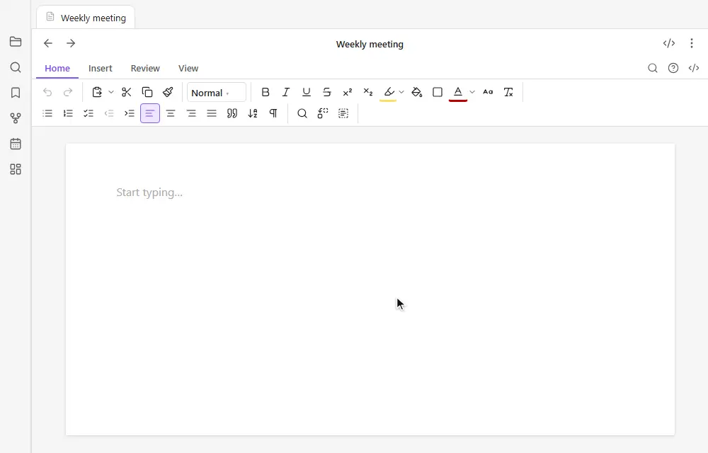
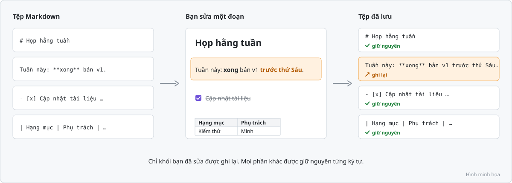
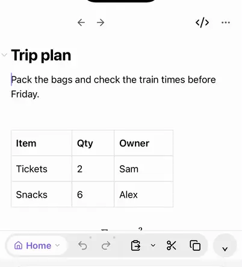
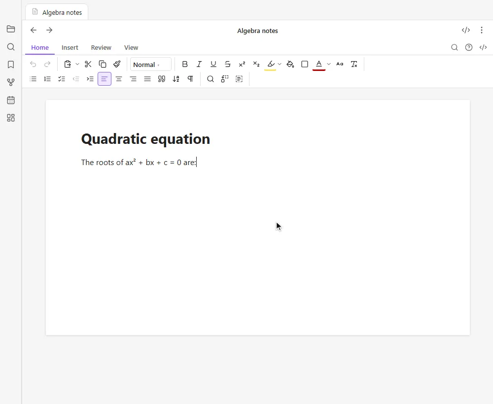

# Word Mode

[English](README.md) | [繁體中文](README.zh-TW.md) | [台文](README.nan-TW.md) | [粵語](README.yue-HK.md) | [简体中文](README.zh-CN.md) | [日本語](README.ja.md) | [한국어](README.ko.md) | **Tiếng Việt** | [Français](README.fr.md) | [Deutsch](README.de.md) | [Español](README.es.md) | [العربية](README.ar.md) | [עברית](README.he.md)

Chỉnh sửa ghi chú [Obsidian](https://obsidian.md) giống như trong Word: có thanh công cụ dạng dải băng, bảng, phương trình và sơ đồ, không cần nhớ cú pháp Markdown. Mọi ghi chú vẫn được lưu dưới dạng tệp Markdown thuần.

> Bản tiếng Việt này chưa được người bản ngữ hiệu đính. Nếu bạn thấy chỗ nào diễn đạt chưa tự nhiên, hãy cho chúng tôi biết qua Issue.

## Vì sao dùng Word Mode

- **Không cần ghi nhớ.** Định dạng bằng các nút trên thanh công cụ và những phím tắt quen thuộc từ trình soạn thảo văn bản, như `Ctrl+B` để in đậm và `Ctrl+K` để chèn liên kết.
- **Tệp vẫn là Markdown.** Khi bạn sửa một ghi chú, chỉ những khối bạn đã thay đổi mới được ghi lại. Mọi phần khác được giữ nguyên đúng từng ký tự, nên công cụ đồng bộ và lịch sử phiên bản chỉ thấy những gì bạn đã sửa.
- **Chuyển đổi bất cứ lúc nào.** Nhấn `Ctrl+E` (`Cmd+E` trên macOS), hoặc chọn nút ở phần đầu ghi chú, để chuyển qua lại giữa chế độ Word và trình soạn thảo có sẵn của Obsidian.
- **Làm riêng cho Obsidian.** Liên kết, thẻ, thuộc tính, callout, nội dung nhúng, chú thích cuối trang, công thức toán, sơ đồ Mermaid và truy vấn Dataview đều hoạt động trong chế độ Word.

## Tính năng

### Định dạng ngay khi gõ

Đây là tính năng trong hoạt ảnh ở đầu trang. Bắt đầu đoạn văn bằng `# `, `- `, `1. `, `> ` hoặc `[ ] `, hoặc gõ xong `**in đậm**`, `*in nghiêng*` hay `[[ghi chú]]`, và nội dung sẽ chuyển thành định dạng. Một lần hoàn tác sẽ bỏ định dạng và giữ lại chữ bạn đã gõ. Gõ `[[` để chọn ghi chú hoặc tiêu đề, hoặc `#` để chọn thẻ.

### Thanh công cụ dải băng

- **Các tab Trang đầu, Chèn, Xem lại và Xem**, sắp xếp giống trình soạn thảo văn bản.
- **Màu chữ và tô sáng**: các màu chuẩn cùng sắc độ đậm nhạt, các màu bạn dùng gần đây, hoặc bất kỳ màu nào bạn chọn hay nhập bằng mã hex. Tô sáng có thể dùng bất kỳ màu và độ đục nào.
- **Tùy chỉnh theo ý bạn**: hiện các tab dưới dạng chữ, biểu tượng hoặc cả hai, gộp chúng vào một nút menu, và đổi tên chúng. Đổi tên, sắp xếp lại, ẩn hoặc chuyển các nhóm nút sang tab khác.

Thêm về thanh công cụ

- **Cùng một thanh công cụ trong chế độ Markdown và chế độ đọc**, với cùng bố cục, nên không có gì bị nhảy khi bạn chuyển chế độ. Bạn có thể hiện nó ở cả hai, ở một trong hai, hoặc không hiện ở đâu cả.
- **Gợi ý chi tiết**: di chuột lên một nút sẽ thấy lời giải thích kèm một hoạt ảnh ngắn, kể cả các nút chế độ xem và các nút trên thanh trạng thái. Gợi ý được bật sẵn; bạn có thể tắt trong phần cài đặt hoặc trong danh sách phím tắt.

### Trên điện thoại và máy tính bảng

- **Kéo để di chuyển con trỏ**: khi bàn phím đang mở trên điện thoại, hàng phía trên bàn phím trở thành bàn di chuột. Nhấn giữ một chút ở bất kỳ đâu cho đến khi các nút mờ đi, rồi kéo trái phải để di chuyển con trỏ từng vị trí, kéo lên xuống để đổi dòng. Nút menu tab ở đầu hàng không cần nhấn giữ, kéo ngay là được. Khi kéo, bản xem trước phóng to phía trên con trỏ cho thấy rõ con trỏ đang ở đâu. Nhấn nút và cuộn hàng nút sang ngang vẫn như cũ. Có thể chỉnh thời gian nhấn giữ, tốc độ kéo, kiểu kính lúp (viên nang hoặc thẻ), độ phóng to và độ rộng trong cài đặt, hoặc tắt kính lúp. Cạnh kính lúp có nhãn nhỏ cho biết con trỏ đang ở đâu: loại khối (văn bản, tiêu đề, danh sách, hàng và cột của bảng) và ký tự thứ mấy; có thể tắt. Khi kéo lên xuống, con trỏ giữ nguyên cột (cả trong bảng), dừng lại ở phương trình, sơ đồ và đường kẻ ngang trên đường đi và cho biết đó là gì; ở đầu hoặc cuối tài liệu, thông báo hiện ngay trước vị trí như thường lệ. Di ngón tay chậm thì con trỏ đi từng bước, vuốt nhanh thì đi xa (giống bàn di chuột của laptop). Khi chỉ cần đi một hai bước, hãy mở “Phím điều khiển” (bên trái nút ẩn bàn phím, hoặc ở cuối hàng thẻ khi bàn phím đã ẩn): phím mũi tên, Home, End, Tab, Esc, Ctrl, Shift. Chạm phím mũi tên để đi một bước, giữ để đi liên tục; Shift để chọn, Ctrl cộng một chữ gõ trên bàn phím là phím tắt.
- **Thêm chỗ khi gõ trên điện thoại**: khi bàn phím ảo đang mở, thanh công cụ thu lại thành một hàng phía trên bàn phím. Các tab gộp vào một nút menu và các nút chỉ hiện biểu tượng; đóng bàn phím thì mọi thứ trở lại. Có thể tắt trong cài đặt.
- **Cử chỉ trên điện thoại**: vuốt lên trên nút Hoàn tác để làm lại, vuốt lên trên nút Làm lại để hoàn tác (hai nút thụt lề cũng vậy; các nút này có một chấm nhỏ). Chạm bằng hai ngón để chọn cả đoạn. Chạm vào ô của bảng là đặt con trỏ ngay, không bị menu Cắt / Sao chép / Dán của hệ thống che mất. Bảng chèn ký hiệu cũng có các cặp ngoặc và dấu nháy để bao quanh phần đã chọn. Chạm vào khoảng trống giữa hai bảng sẽ chèn một đoạn trống ở đó.
- **Chèn bằng dấu gạch chéo** (mặc định tắt; bật trong phần cài đặt): gõ `/` ở đầu một đoạn trống để chọn tiêu đề, danh sách, bảng, khối mã, khung chú thích, phương trình, sơ đồ, hình ảnh hoặc liên kết, gõ tiếp để lọc. Trên điện thoại cách này nhanh hơn cuộn thanh công cụ. Chuyển giữa chế độ Word, Markdown và chế độ đọc vẫn giữ nguyên vị trí trong ghi chú; ở chế độ đọc trên điện thoại, thanh công cụ thu lại thành một hàng gồm những nút còn dùng được; và bảng có thêm nút **Ô trước**, **Ô sau** vì bàn phím ảo không có phím Tab. Trên điện thoại, các nút trên bảng, phương trình, sơ đồ và khối mã lớn hơn, cách xa nhau hơn, nút xóa có màu đỏ và đặt tách riêng.

Thêm cho điện thoại và máy tính bảng

- **Ngăn kéo phía dưới trên điện thoại**: các bảng thả xuống của thanh công cụ (tab, kiểu, dàn ý, màu, ký hiệu, chèn bảng) trượt lên từ cạnh dưới màn hình như menu của Obsidian trên điện thoại, và nằm ngay trên bàn phím khi bàn phím đang mở.
- **Ẩn bàn phím**: khi bàn phím ảo đang mở, một nút ở cuối thanh công cụ (và cạnh nút Hủy trong trình soạn công thức và sơ đồ) sẽ cất bàn phím đi.
- **Mượt hơn trên điện thoại**: thanh công cụ trượt theo bàn phím thay vì nhảy; vuốt xuống trên thanh công cụ để cất bàn phím; các ngăn kéo có tiêu đề, đánh dấu lựa chọn hiện tại và kéo xuống để đóng; thanh tìm kiếm giữ nút Đóng ở cuối bên phải; các nút trên bảng, sơ đồ và khối mã không còn che nội dung; thanh công cụ cũng nằm ở dưới trong chế độ Markdown và chế độ đọc; và vuốt dọc thanh công cụ không còn kéo thanh bên của Obsidian ra.
- **Bàn phím phù hợp cho từng ô**: công thức, mã và ô tìm kiếm được gõ đúng như bạn nhập (không tự viết hoa, không tự sửa, kể cả khi con trỏ nằm trong khối mã hoặc mã trong dòng); ô số mở bàn phím số, ô liên kết mở bàn phím URL; phím return hiện Tìm kiếm hoặc Xong ở những chỗ nó làm đúng việc đó.
- **Trình soạn công thức và sơ đồ trên điện thoại**: khi bàn phím mở, cả hộp thoại nằm phía trên bàn phím và chỉ hiện những gì cần: công thức đang sửa, một hàng ký hiệu vuốt ngang được và phần xem trước; tiêu đề và các nút chuyển chế độ trở lại khi đóng bàn phím.

### Bảng

- Chọn kích thước từ lưới, rồi gõ và nhấn Tab để chuyển sang ô tiếp theo. Nhấn Tab ở ô cuối cùng sẽ thêm một hàng.
- Nhấp chuột phải vào một ô để thêm, xóa hoặc di chuyển hàng và cột, sắp xếp theo một cột, hoặc đặt căn chỉnh cho một cột.
- Dán các ô từ bảng tính, chúng sẽ trở thành bảng.
- Khi con trỏ nằm trong bảng, dải băng sẽ có thêm thẻ **Bảng**. Các tay cầm ở mép bảng giúp chọn cả hàng hoặc cả cột và mở menu của nó, dùng được cả trên điện thoại. Nhấn Enter thêm một lần ở dòng trống trong hàng cuối sẽ chuyển xuống đoạn mới bên dưới bảng (giống nhấn Enter hai lần trong danh sách); thẻ **Bảng** và menu của bảng cũng có thể chèn đoạn văn phía trên hoặc phía dưới bảng. Khi phía trên hoặc dưới bảng không có chỗ để gõ (chẳng hạn hai bảng liền nhau), nút “+ Đoạn” sẽ hiện ở cạnh đó khi con trỏ nằm trong bảng.
- Chọn cả hàng, cả cột hoặc cả bảng rồi nhấn Backspace để xóa chúng; Delete chỉ xóa nội dung. Các nút bên cạnh bảng giúp sao chép bảng dưới dạng Markdown hoặc xóa bảng chỉ với một lần nhấp.
- Chọn vài dòng được phân tách bằng Tab, `|` hoặc dấu phẩy để chuyển thành bảng, hoặc chuyển bảng về lại văn bản. Ctrl+Enter thoát khỏi bảng và bắt đầu một đoạn bên dưới. Bảng đã sao chép khi dán vào bảng tính sẽ được chia thành các cột.

### Phương trình

- Phân số, căn, chỉ số trên, dấu ngoặc và ma trận là các ô để bạn gõ vào. Chọn một cấu trúc từ bảng ký hiệu, hoặc gõ `\frac`, `\sqrt` hay `\alpha` rồi nhấn dấu cách.
- Tab, Enter và phím mũi tên di chuyển giữa các ô. Backspace trong ô trống sẽ bỏ cấu trúc bao quanh nó.
- Chuyển sang LaTeX thuần bất cứ lúc nào. Phương trình được lưu dưới dạng `$…$` hoặc `$$…$$` thông thường, nên hiển thị được ở mọi nơi Obsidian hiển thị công thức toán.

Thêm về trình soạn phương trình

- Mở bằng **Chèn → Phương trình**, bằng cách nhấp đúp vào một phương trình, hoặc nhấn Enter khi đang chọn một phương trình.
- Phương trình nằm riêng một dòng hiện các nút nhỏ ở góc trên bên phải khi bạn trỏ chuột vào (trên điện thoại thì chạm vào): sửa, tùy chọn khác (chuyển thành cùng dòng, sao chép LaTeX hoặc Markdown) và xóa.
- `^` và `_` mở chỉ số trên hoặc chỉ số dưới. Phím mũi tên lên và xuống di chuyển giữa tử số và mẫu số.
- Hoàn tác và làm lại bằng các nút, hoặc bằng `Ctrl+Z` và `Ctrl+Y`.
- **Công thức thường dùng và phương trình gần đây**: chèn cả một công thức, như công thức nghiệm phương trình bậc hai hay độ lệch chuẩn, rồi sửa những phần bạn cần.
- **Công thức của riêng bạn**: chọn nút dấu trang bên cạnh bản xem trước để lưu phương trình hiện tại với một cái tên. Các công thức đã lưu xuất hiện trong mục **Công thức của tôi** trên bảng ký hiệu, và chỉ cần nhấp một lần là chèn.
- Phương trình bạn không thay đổi sẽ được ghi lại đúng như cũ.
- **Trên điện thoại và máy tính bảng**: các nút phía trên vùng soạn thảo giúp chuyển sang ô trước hoặc ô sau và bỏ cấu trúc tại con trỏ, vì bàn phím ảo không có phím mũi tên. Trên điện thoại, vùng soạn thảo luôn nằm ở trên cùng khi bạn cuộn bảng ký hiệu. Trên điện thoại, chế độ Markdown và chế độ đọc cũng có thanh trạng thái giống chế độ Word dưới thanh công cụ, nên khi chuyển chế độ mọi thứ vẫn ở nguyên chỗ.
- **Không mất do vô ý**: khi còn thay đổi chưa áp dụng, nhấn Esc, bấm ra ngoài hộp thoại hoặc nhấn × sẽ hỏi trước có bỏ chúng không. Trình chỉnh sửa sơ đồ cũng vậy.

### Sơ đồ

- **Mười một loại sơ đồ Mermaid có biểu mẫu**: lưu đồ, sơ đồ tuần tự, biểu đồ Gantt, biểu đồ tròn, sơ đồ trạng thái, sơ đồ lớp, sơ đồ tư duy, dòng thời gian, sơ đồ ER, hành trình người dùng và biểu đồ góc phần tư.
- **Sửa ngay trên sơ đồ**: chọn một nhãn trên bản xem trước để sửa tại chỗ, thêm bước tiếp theo, hoặc chọn màu nền.
- **Tự do**: viết bất kỳ mã Mermaid nào với bản xem trước trực tiếp, kể cả các loại chưa có biểu mẫu, như Git graph và biểu đồ XY.
- Sơ đồ được lưu dưới dạng khối mã Mermaid thông thường. Sơ đồ dùng cú pháp mà biểu mẫu không hỗ trợ sẽ mở dạng mã, kèm theo lý do, nên không mất gì cả.

Thêm về trình soạn sơ đồ

- Mở bằng **Chèn → Sơ đồ**, hoặc bằng nút sửa trên một khối Mermaid.
- Trỏ chuột vào một sơ đồ trong ghi chú để hiện các nút ở góc trên bên phải: sửa, xem mã, sao chép và xóa. Xóa sẽ bỏ cả sơ đồ, và hoàn tác sẽ đưa nó trở lại.
- Trên sơ đồ, nhấn Enter để áp dụng thay đổi, hoặc Tab để áp dụng và chuyển sang nhãn tiếp theo. Đổi tên một bên tham gia, trạng thái, lớp hoặc thực thể sẽ đổi tên ở mọi chỗ tham chiếu đến nó.
- **Hình thức**: chọn theme Mermaid cho riêng một sơ đồ, và màu nền cho từng bước của lưu đồ.
- **Xem trước**: thu phóng bằng các nút, hoặc bằng `Ctrl` và con lăn chuột. Sơ đồ được hiển thị đúng kích thước thật thay vì bị thu nhỏ đến mức không đọc được chữ, và một nút giúp thu cả sơ đồ cho vừa chiều rộng bản xem trước.
- **Dễ định vị**: đặt con trỏ vào một hàng của biểu mẫu thì bản xem trước sẽ viền mục đó. Chọn một mục trên bản xem trước thì biểu mẫu sẽ nhảy đến hàng của mục đó.
- **Mẫu của riêng bạn**: lưu sơ đồ hiện tại với một cái tên trong **Mẫu của tôi**, và bắt đầu từ nó vào lần sau. Trong cài đặt, bạn chọn sơ đồ mới sẽ bắt đầu bằng gì và những loại có sẵn nào được liệt kê.
- **Sơ đồ dài**: danh sách trong biểu mẫu hiện bốn mươi hàng mỗi lần và có thể lọc bằng cách gõ, nên lưu đồ có hàng trăm bước vẫn sửa nhanh. Trong ghi chú, sơ đồ quá cao được thu gọn về một chiều cao cố định với nút để hiện toàn bộ, và sơ đồ chỉ được vẽ khi bạn cuộn đến.
- Các loại sơ đồ mới hơn chỉ được vẽ nếu phiên bản Mermaid tích hợp trong Obsidian hỗ trợ.
- **Trên điện thoại**: bản xem trước nằm ở trên cùng với biểu mẫu bên dưới, và các trường cùng các nút có kích thước phù hợp để chạm.

### Và còn nữa

Xem tất cả: thuộc tính, hình ảnh, liên kết, tìm và thay thế, thanh trạng thái, con trỏ…

- **Thanh trạng thái** với số từ, trạng thái lưu, các nút chuyển giữa chế độ Word, Markdown và chế độ đọc, xem thuộc tính và thu phóng. Chế độ Markdown và chế độ đọc giữ nguyên các nút này và đếm từ theo cùng một cách. Bạn có thể tắt tính năng này trong cài đặt. Thanh trạng thái chỉ hiện số từ, không tính ký hiệu Markdown và địa chỉ liên kết; số ký tự và thời gian đọc ước tính nằm trong chú thích. Muốn có cùng con số với bộ đếm từ có sẵn của Obsidian, hãy đổi “Cách đếm từ” trong cài đặt.
- **Đường dẫn của ghi chú và sao chép đường dẫn**: trên máy tính, thanh trạng thái hiện thư mục và tên tệp của ghi chú. Nhấp hoặc nhấp chuột phải để sao chép đường dẫn trong kho, đường dẫn đầy đủ trên máy tính, URL Obsidian, tên tệp hoặc thư mục. Nhấp chuột phải vào liên kết, nội dung nhúng hoặc hình ảnh trong tài liệu sẽ hiện tệp mà nó trỏ tới và cho sao chép đường dẫn theo cùng cách.
- **Dòng trống vẫn hiện ra**: nhiều dòng trống liên tiếp trong Markdown hiện thành các đoạn trống, giống như nhấn Enter nhiều lần trong Word. Xóa một đoạn thì bớt một dòng trống; những dòng không đụng tới được lưu y nguyên.
- **Con trỏ đẹp hơn và tùy chỉnh được**: con trỏ là một vạch mảnh bo tròn theo màu nhấn, trượt theo khi bạn gõ và mờ dần rồi hiện lại khi đứng yên. Trong cài đặt bạn có thể chọn hình dạng (nét mảnh, nét đậm, khối, gạch dưới hoặc con trỏ của hệ thống), màu, kiểu và tốc độ nhấp nháy, và có di chuyển mượt hay không. Điện thoại và máy tính bảng cũng dùng được (khi nhấn giữ để kéo vùng chọn, con trỏ vẫn đi theo ngón tay), và trang cài đặt có bản xem trước trực tiếp.
- **Thuộc tính** dưới dạng biểu mẫu: thẻ và liên kết hiện thành các chip bạn có thể chọn để mở, giá trị lồng nhau hiện dạng cây, và bạn có thể đổi loại hoặc đổi tên thuộc tính từ biểu tượng của nó. Nút Xem thuộc tính, trong tab Xem và trên thanh trạng thái, hiện các thuộc tính mà không cần cuộn lên đầu và cho phép lọc danh sách dài. Nút ghim ở tiêu đề phần thuộc tính (hoặc một cài đặt) giữ một thanh thuộc tính mảnh ở trên cùng khi bạn cuộn; nhấp vào thanh để xem danh sách đầy đủ. Bạn có thể hiện thuộc tính dạng hộp có viền và nền, chỉ có viền, hoặc kiểu tối giản không viền.
- **Ảnh**: dán hoặc chọn một ảnh, rồi kéo để đổi kích thước.
- **Liên kết** đến ghi chú, tiêu đề và trang web, với một thanh công cụ nhỏ xuất hiện khi con trỏ nằm trên liên kết.
- **Tìm và thay thế**, với tùy chọn khớp nguyên từ và biểu thức chính quy.
- **Thanh bên dàn ý** và thu gọn tiêu đề.
- **Nhúng**: ghi chú, tiêu đề, âm thanh, video, PDF và liên kết YouTube được nhúng sẽ hiển thị ngay tại chỗ. Truy vấn Dataview và khối mã của các plugin khác được hiển thị thành kết quả.
- **Chú thích cuối trang**: chèn chú thích cuối trang, di chuột lên số của nó để đọc, và sửa nội dung mà không cần đụng đến cú pháp.
- **Callout** (kể cả loại thu gọn được), **danh sách việc cần làm** với trạng thái tùy chỉnh như `[/]` và `[-]`, **thẻ**, và **khối mã** có tô màu cú pháp và tùy chọn hiện số dòng.
- **Dấu định dạng** như `¶`, cùng công cụ dọn các ký tự vô hình hoặc ký tự lạc chỗ.
- **Dán văn bản Markdown** và chuyển nó thành văn bản có định dạng chỉ trong một bước.
- **Xử lý xung đột đồng bộ**: nếu ghi chú thay đổi trên ổ đĩa trong khi bạn có chỉnh sửa chưa lưu, bạn sẽ chọn giữ phiên bản nào.
- **Phím tắt**: tìm kiếm hoặc chọn một danh mục, rồi chọn một phím tắt để xem hoạt ảnh ngắn về tác dụng của nó. Ô đánh dấu ở cuối danh sách dùng để bật hoặc tắt gợi ý chi tiết.
- Giao diện bằng tiếng Trung phồn thể, tiếng Đài Loan (chữ Hán), tiếng Quảng Đông, tiếng Trung giản thể, tiếng Anh, tiếng Nhật, tiếng Hàn, tiếng Việt, tiếng Pháp, tiếng Đức, tiếng Tây Ban Nha, tiếng Ả Rập và tiếng Do Thái.

Những nội dung Word Mode không sửa trực quan được, như khối HTML, sẽ được hiển thị dưới dạng khối thô và được lưu nguyên vẹn. Trỏ chuột vào khối đó (hoặc khối chú thích cuối trang, khối bình luận) để hiện các nút sửa, sao chép và xóa ở góc trên bên phải. Xóa một chú thích cuối trang cũng xóa các số của nó trong văn bản.

## Bắt đầu

### Cài đặt

Cần Obsidian 1.5.7 trở lên.

1. Tải `main.js`, `manifest.json` và `styles.css` từ [bản phát hành mới nhất](https://github.com/NatLee/obsidian-word-mode/releases/latest).
2. Sao chép ba tệp vào `<kho của bạn>/.obsidian/plugins/natlee-word-mode/`.
3. Trong Obsidian, mở **Cài đặt → Plugin cộng đồng** và bật **Word Mode**.

### Cách dùng

Sau khi bật plugin, ghi chú Markdown sẽ mở ở chế độ Word.

- Để chuyển giữa chế độ Word và Markdown, chọn nút ở góc trên bên phải ghi chú, hoặc nhấn `Ctrl+E` (`Cmd+E` trên macOS).
- Để mở ghi chú ở một chế độ cụ thể, nhấp chuột phải vào ghi chú và chọn **Mở ở chế độ Word** hoặc **Mở dạng Markdown**.
- Để một ghi chú không dùng chế độ Word, thêm `word-mode: false` vào thuộc tính của ghi chú đó.
- Để cả thư mục không dùng chế độ Word, liệt kê các thư mục đó trong **Cài đặt → Word Mode → Thư mục không dùng chế độ Word**.

Các cài đặt được chia thành các danh mục, với một hàng tab ở trên cùng hiển thị từng danh mục một. Để tìm một cài đặt khi không biết nó thuộc danh mục nào, hãy gõ vào ô tìm kiếm phía trên các tab. Ô này gợi ý các cài đặt phù hợp ngay khi bạn gõ, cũng khớp với các tùy chọn trong menu thả xuống và tên cài đặt bằng các ngôn ngữ khác (bạn có thể gõ tiếng Anh khi giao diện đang là tiếng Việt), và đưa bạn đến cài đặt bạn chọn. Các danh mục có nhiều cài đặt được chia tiếp thành các mục có tiêu đề; ví dụ, các cài đặt về con trỏ trong “Hiển thị” nằm chung ở mục “Con trỏ”, với bản xem trước trực tiếp ở trên cùng.

### Lệnh

Xem các lệnh

| Lệnh | Mô tả |
| --- | --- |
| Sửa ghi chú hiện tại ở chế độ Word | Chuyển ghi chú hiện tại sang chế độ Word. |
| Sửa ghi chú hiện tại dạng Markdown | Đưa ghi chú hiện tại về trình soạn thảo Markdown. |
| Chuyển đổi chế độ Word / Markdown | Chuyển qua lại giữa hai chế độ. |
| Bật/tắt thanh bên dàn ý | Hiện hoặc ẩn dàn ý. |
| Tìm | Tìm trong ghi chú hiện tại. |
| Tìm và thay thế | Tìm và thay thế trong ghi chú hiện tại. |
| Dàn ý: nhảy đến tiêu đề | Nhảy đến một tiêu đề trong ghi chú hiện tại. |
| Hiện phím tắt | Liệt kê mọi phím tắt của chế độ Word. |

Không lệnh nào có phím tắt mặc định. Bạn có thể tự gán trong **Cài đặt → Phím tắt**.

## Quyền riêng tư và công bố thông tin

- **Sử dụng mạng**: chỉ để hiển thị nội dung web mà ghi chú của bạn đã trỏ đến. Nếu ghi chú chứa ảnh, âm thanh hoặc video từ một địa chỉ web, chế độ Word sẽ tải nội dung đó từ địa chỉ ấy. Nếu ghi chú nhúng một liên kết YouTube, chế độ Word sẽ hiện trình phát YouTube, và trình phát này kết nối đến `youtube.com`. Đây cũng chính là nội dung mà trình soạn thảo có sẵn của Obsidian tải cho ghi chú đó. Plugin không gửi ghi chú hay dữ liệu nào của bạn đi đâu cả.
- **Thu thập dữ liệu sử dụng (telemetry)**: không có.
- **Tài khoản và thanh toán**: không cần.
- **Tệp bên ngoài kho**: không bao giờ đọc hay ghi.
- **Tên tệp trong kho**: plugin liệt kê các tệp trong kho để đề xuất chúng trong các hộp chọn liên kết, ảnh và mẫu, và trong gợi ý sau `[[`. Danh sách này chỉ nằm trên thiết bị của bạn.
- **Bảng tạm**: chỉ đọc khi bạn chọn **Dán** trên thanh công cụ hoặc trong menu chuột phải, và chỉ ghi khi bạn chọn **Cắt**, **Sao chép** hoặc một nút sao chép.
- **Tệp do plugin tạo ra**: ảnh bạn dán được lưu vào thư mục tệp đính kèm. Nếu bạn chọn giữ cả hai phiên bản khi xung đột đồng bộ, phiên bản của bạn được lưu thành bản sao bên cạnh ghi chú.

## Hạn chế đã biết

- Trên điện thoại và máy tính bảng, mới chỉ thử nghiệm trên iPhone thật; chưa thử trên thiết bị Android và iPad thật.
- Một số nút trên thanh công cụ ở chế độ Markdown và chế độ đọc gọi các lệnh có sẵn của Obsidian và chưa được kiểm tra riêng từng nút.
- Các bản dịch ngoài tiếng Trung phồn thể và tiếng Anh chưa được người bản ngữ hiệu đính.
- Với tiếng Ả Rập và tiếng Do Thái, văn bản đã được dịch nhưng thanh công cụ và hộp thoại vẫn giữ bố cục từ trái sang phải.
- Kết quả sơ đồ và truy vấn, nội dung nhúng và bản xem trước trang do Obsidian vẽ. Chúng được kiểm tra bằng các bài kiểm thử tự động mô phỏng Obsidian, nhưng chưa được thử với mọi plugin và theme.
- Hình thức của sơ đồ (theme Mermaid) và màu nền của lưu đồ do Mermaid bên trong Obsidian vẽ. Chúng đã được đối chiếu với chính Mermaid, chứ chưa được thử với mọi theme của Obsidian.

## Đóng góp

Báo lỗi và ý tưởng xin gửi tại [Issues](https://github.com/NatLee/obsidian-word-mode/issues). Để build plugin, chạy kiểm thử, tìm hiểu cách hoạt động bên trong, hoặc phát hành phiên bản mới, hãy đọc [hướng dẫn dành cho nhà phát triển (tiếng Anh)](docs/development.md).

## Ghi công

Word Mode đóng gói kèm các thư viện mã nguồn mở sau:

- [ProseMirror](https://prosemirror.net) của Marijn Haverbeke và những người đóng góp, giấy phép MIT.
- [markdown-it](https://github.com/markdown-it/markdown-it) và [markdown-it-mark](https://github.com/markdown-it/markdown-it-mark), giấy phép MIT.
- [entities](https://github.com/fb55/entities), giấy phép BSD 2-Clause.

## Giấy phép

[Giấy phép MIT](LICENSE).
