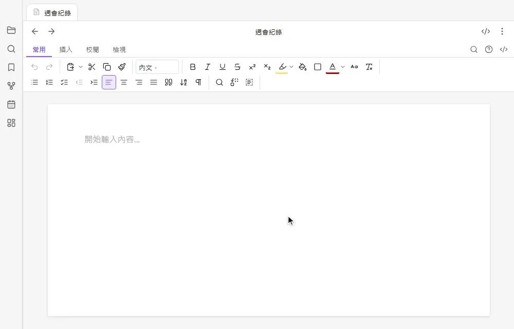
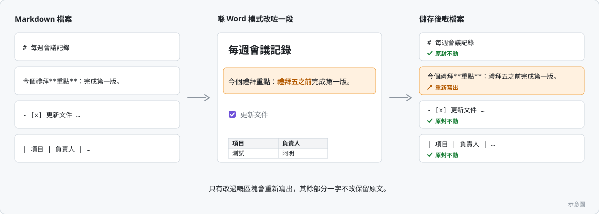
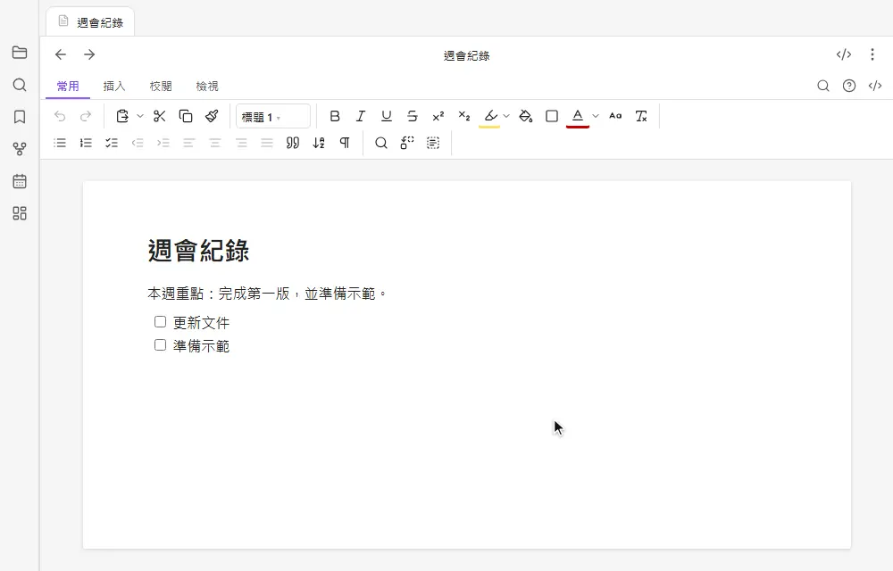
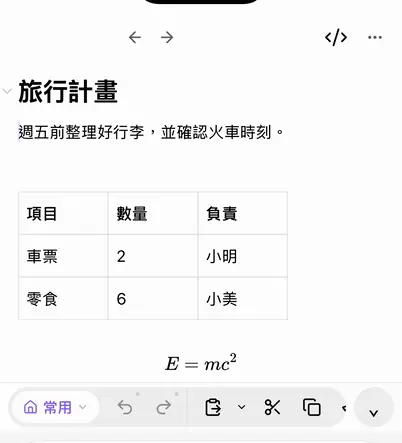
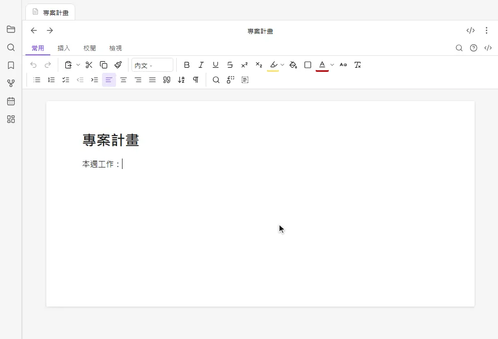
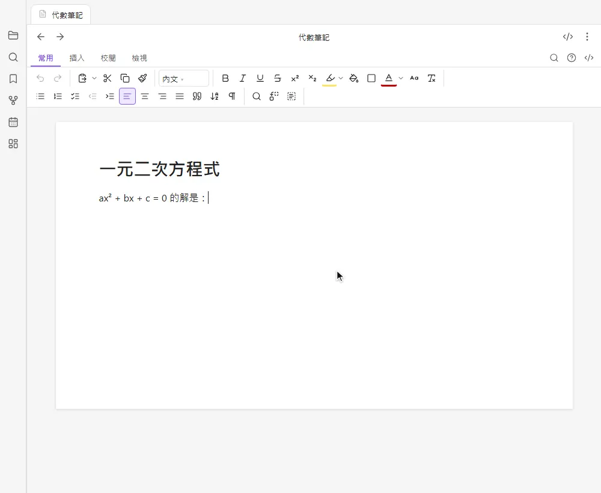
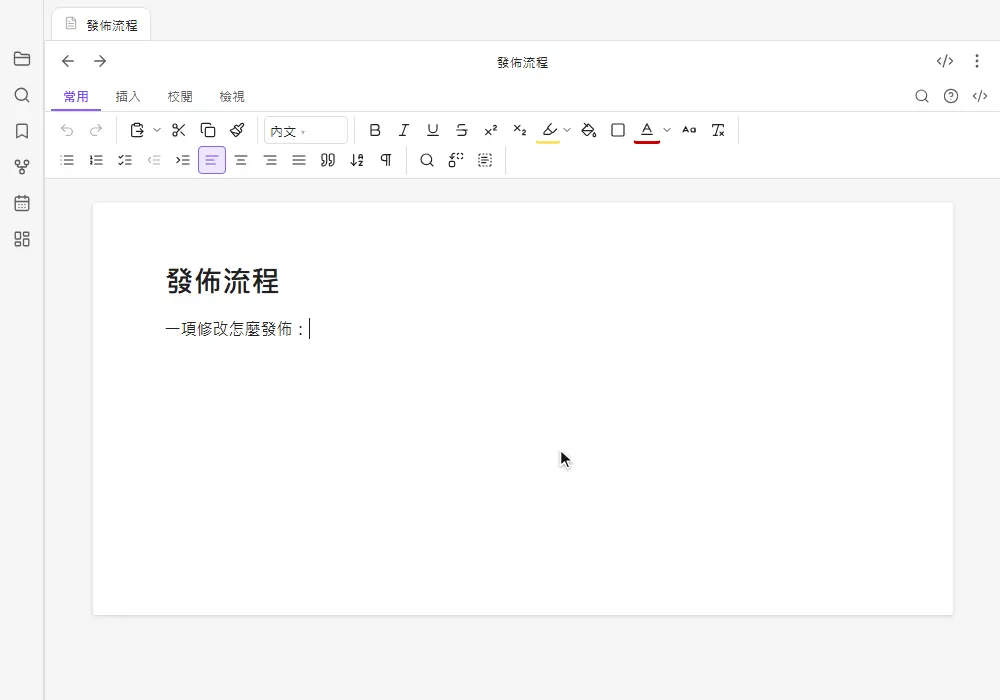

# Word Mode

[English](README.md) | [繁體中文](README.zh-TW.md) | [台文](README.nan-TW.md) | **粵語** | [简体中文](README.zh-CN.md) | [日本語](README.ja.md) | [한국어](README.ko.md) | [Tiếng Việt](README.vi.md) | [Français](README.fr.md) | [Deutsch](README.de.md) | [Español](README.es.md) | [العربية](README.ar.md) | [עברית](README.he.md)

好似用 Word 咁編輯 [Obsidian](https://obsidian.md) 筆記：有功能區工具列、表格、方程式、圖表，唔使記 Markdown 語法。每份筆記儲存之後仍然係純 Markdown 檔案。

> 呢個粵語版未經母語人士校對。如果有讀落唔自然嘅講法，請喺 Issue 話我哋知。

## 點解用 Word 模式

- **唔使記語法**：用工具列按鈕同文書軟件常見嘅快速鍵設定格式，例如 `Ctrl+B` 粗體、`Ctrl+K` 連結。
- **檔案仍然係 Markdown**：編輯筆記嗰陣，只有改過嘅區塊會重新輸出，其餘部分一字不差保留原文；同步同版本紀錄睇到嘅就只有你改過嘅地方。
- **隨時切換**：撳 `Ctrl+E`（macOS 係 `Cmd+E`）或者筆記標題列嘅按鈕，就可以喺 Word 模式同 Obsidian 原本嘅編輯器之間切換。
- **為 Obsidian 而設計**：連結、標籤、文件屬性、提示框、內嵌、註腳、數學式、Mermaid 圖表、Dataview 查詢喺 Word 模式都用得。

## 功能

### 打字嗰陣自動套用格式

就係最上面動畫示範嘅功能。段落開頭打 `# `、`- `、`1. `、`> `、`[ ] `，或者打完 `**粗體**`、`*斜體*`、`[[筆記]]`，就會變做格式。撳一次復原只會取消格式，打咗嘅字仲喺度。打 `[[` 可以揀筆記或者標題，打 `#` 可以揀標籤。

### 功能區工具列

- **常用、插入、校閱、檢視四個分頁**，排法同文書軟件一樣。
- **字型色彩同醒目提示**：標準色彩同深淺變化嘅色盤、最近用過嘅色彩，又可以自己揀色或者輸入色碼。醒目提示可以用任何顏色，仲可以調整不透明度。
- **跟自己嘅習慣調整**：分頁列可以顯示文字、圖示或者兩樣都顯示，又可以收埋做一個選單按鈕，分頁名稱可以自己改。按鈕群組可以改名、調整次序、隱藏，或者搬去另一個分頁。

工具列嘅更多功能

- **Markdown 同閱讀模式都有同一條工具列**，版面一樣，切換模式嗰陣畫面唔會跳。可以設定兩種模式都顯示、只喺其中一種顯示，或者兩種都唔顯示。
- **詳細提示**：滑鼠停喺按鈕上面會顯示說明同動畫示範；檢視模式同狀態列嘅按鈕都有。預設開咗，可以喺設定或者快速鍵說明度閂咗佢。

### 手機同平板

- **拖住郁游標**：手機鍵盤打開嗰陣，鍵盤上面嗰行就係觸控板。喺任何位置撳住一陣，等按鈕變淡，再左右拖令游標一格一格咁郁，上下拖就換行；最前面嘅分頁選單按鈕唔使撳住，直接拖就得。拖嗰陣游標上面有放大嘅預覽，睇得清楚游標停喺邊兩個字中間。撳按鈕、左右捲按鈕列都同原本一樣。撳住嘅時間、郁嘅速度，同埋放大鏡嘅外觀（膠囊或者卡片）、倍率同闊度都可以喺設定度調整，亦可以熄咗放大鏡。放大鏡旁邊會顯示游標喺邊：邊一種段落（內文、標題、清單、表格第幾列第幾欄）同第幾個字，亦可以熄咗。上下郁會保持喺同一欄（表格入面都係），經過方程式、圖表、水平線嗰陣會先停喺上面同寫出係乜；去到文件開頭或者結尾嗰陣，提示寫喺位置前面，照樣睇到停咗喺邊。手指慢慢郁嗰陣一格一格咁行，快速一掃就行好遠（好似手提電腦嘅觸控板）。淨係想郁一兩格嘅話，打開「控制鍵」（收起鍵盤按鈕嘅左邊，鍵盤打開先會出現）：方向鍵、Home、End、Tab、Esc、Ctrl、Shift。㩒一下方向鍵行一格，㩒住一直行；Shift 用嚟揀字，Ctrl 加上用鍵盤打嘅字母就係快捷鍵。Markdown 編輯一樣用得到觸控板同控制鍵，包括 Obsidian 自己喺鍵盤上面嘅工具列。Markdown 編輯冇放大鏡，拖嗰陣工具列上面會顯示游標喺第幾行第幾個字，同埋游標前後嘅字。
- **手機打字嗰陣多啲位**：螢幕鍵盤打開嗰陣，工具列縮做鍵盤上面嘅一行，分頁收埋做一粒淨係得圖示嘅選單按鈕、按鈕只顯示圖示；鍵盤收返就還原。可以喺設定度熄咗佢。
- **手機上面嘅手勢**：喺「復原」度向上掃係取消復原，喺「取消復原」度向上掃係復原（兩粒縮排按鈕都一樣；呢啲按鈕右上角有一點）。兩隻手指撳一下揀晒成段。撳表格嘅格仔會即刻放游標，唔會畀系統嘅剪下／拷貝／貼上選單遮住。「插入符號」入面仲有成對嘅括號同引號，撳落去包住揀咗嘅文字。㩒兩個表格中間嘅空位會喺嗰度插入一個空段落。
- **打斜線插入**（預設熄咗，喺設定度開）：喺空白段落開頭打 `/`，揀標題、清單、表格、程式碼區塊、提示框、方程式、圖表、圖片或者連結，繼續打字可以篩選；手機上面快過捲工具列搵按鈕。喺 Word 模式、Markdown 同閱讀模式之間切換會停喺筆記嘅同一個位置；手機嘅閱讀模式工具列縮做一行，只留用得嘅按鈕；螢幕鍵盤冇 Tab，所以表格多咗「上一個儲存格」「下一個儲存格」按鈕。手機上面表格、方程式、圖表同程式碼區塊嘅按鈕大咗、隔開咗，刪除用紅色另外擺。

手機同平板嘅更多功能

- **手機用底部抽屜**：工具列嘅下拉面板（分頁、樣式、大綱、色彩、符號、插入表格）由畫面下面滑上嚟，同 Obsidian 手機版自己嘅選單一樣；鍵盤打開嗰陣貼住鍵盤上面。
- **收埋鍵盤**：螢幕鍵盤打開嗰陣，工具列最右邊（方程式、圖表編輯器入面喺「取消」隔籬）有粒按鈕可以收埋鍵盤。
- **手機上面更順**：工具列跟住鍵盤滑，唔係用跳；喺工具列度向下掃就收埋鍵盤；抽屜有標題、而家揀緊嗰項會打剔、可以向下拖走；搜尋列嘅關閉掣固定喺最右邊；表格、圖表、程式碼區塊嘅按鈕唔再遮住內容；Markdown 同閱讀模式嘅工具列都留喺下面；喺工具列度左右掃唔會再拉咗 Obsidian 嘅側邊欄出嚟。
- **每個欄位出啱嘅鍵盤**：方程式、程式碼、搜尋欄位打咩就係咩（唔會自動大寫、自動修正，游標喺程式碼區塊或者行內程式碼入面都一樣）；數字欄位出數字鍵盤、網址欄位出網址鍵盤；右下角粒鍵喺要搜尋、要完成嘅地方顯示「搜尋」「完成」。
- **手機上面嘅方程式同圖表編輯器**：全螢幕嘅編輯器：取消、插入喺最上面，最下面一條擴充列貼住鍵盤上面，常用嘅鍵同符號都喺手邊，唔使上下碌。方程式嘅擴充列有上一格、下一格、拎走結構、復原，仲有符號嘅分類同一行符號；LaTeX 模式改擺 `\` `{` `}` `^` `_` 呢類要切換鍵盤先打到嘅字元。圖表嘅擴充列喺表單嗰陣係上一欄、下一欄，程式碼嗰陣係移動游標、縮排同呢種圖表常用嘅符號（流程圖嘅箭咀、括號，循序圖嘅訊息箭咀…）。最右邊嘅鍵盤掣收埋或者叫返出鍵盤，收埋鍵盤嗰陣成個編輯器都留喺度。打開嗰陣唔會自動彈出鍵盤，㩒輸入框先出。
- **手機上面唔擺狀態列**：睇文件屬性喺右上角（切換模式嘅按鈕隔籬），㩒落去用彈出嘅視窗顯示，喺視窗入面就可以直接改：改值、新增、刪除、換類型，同文件入面嘅屬性表單一樣；字數統計同閱讀模式喺右上角嘅「⋯」選單入面。Word 模式同 Markdown／閱讀模式都一樣，編輯區多咗一行嘅位。想返去用畫面下面嘅狀態列，喺設定嘅「手機上面嘅字數同文件屬性」切換。

### 表格

- 由格仔揀大小，輸入完撳 Tab 跳去下一格；喺最後一格撳 Tab 會新增一行。
- 喺儲存格上面撳右鍵，可以增刪同搬移行同欄、按欄排序、設定成欄對齊。
- 由試算表複製嘅儲存格，貼上就係表格。
- 游標喺表格入面嗰陣，功能區會出現「表格」分頁；表格邊上嘅把手可以揀成行或者成欄，再打開選單，手機都用得。喺最後一行嘅空行再㩒一次 Enter 會跳去表格下面嘅新段落（好似清單連㩒兩次 Enter）；「表格」分頁同表格嘅選單都可以喺表格上面或者下面插入段落。表格上面或者下面冇位打字嗰陣（例如兩個表格貼住），游標喺表格入面時嗰邊會出現「＋ 段落」按鈕。
- 揀咗成行、成欄或者成個表格之後撳 Backspace 就會刪除（Delete 淨係清空內容）；表格旁邊嘅掣一撳就可以複製做 Markdown 或者刪除成個表格。
- 揀幾行用 Tab、`|` 或者逗號分隔嘅文字就可以轉做表格，表格都可以轉返做文字；撳 Ctrl+Enter 跳出表格，喺下面繼續打字。複製嘅表格貼去試算表會自動分欄。

### 方程式

- 分數、根號、上下標、括號、矩陣都係可以直接輸入嘅格仔。由面板揀結構，或者打 `\frac`、`\sqrt`、`\alpha` 再撳空白鍵。
- Tab、Enter 同方向鍵喺格仔之間移動；喺空格仔入面撳 Backspace 會拎走外面嘅結構。
- 隨時可以轉去 LaTeX 原始碼。方程式會存做一般嘅 `$…$` 或者 `$$…$$`，Obsidian 顯示數學式嘅地方都睇得到。

方程式編輯器嘅其他功能

- 由「插入 → 方程式」打開，又可以喺方程式上面撳兩下，或者揀咗方程式之後撳 Enter。
- 獨立一行嘅方程式，滑鼠移過去（手機撳一下）右上角會出現細掣：編輯、更多功能（改做文字中間、複製 LaTeX 或者 Markdown）、刪除。
- `^`、`_` 開上標、下標嘅格仔；上下鍵可以喺分子同分母之間移動。
- 復原同取消復原：用按鈕，或者 `Ctrl+Z`、`Ctrl+Y`。
- **常用公式同最近用過**：成條插入（例如一元二次方程式嘅解、標準差），再改需要嘅部分。
- **我嘅公式**：撳預覽旁邊嘅書籤按鈕，幫而家嘅方程式改個名存起身。存咗嘅公式喺面板嘅「我嘅公式」分類入面，撳一下就插入。
- 冇改過嘅方程式會原封不動寫返落去。
- **手機同平板**：螢幕鍵盤冇方向鍵，所以編輯區上面有「上一格」「下一格」同「拎走游標所在嘅結構」嘅按鈕。喺手機度，向下捲面板嗰陣編輯區會固定喺最上面。手機上面，Markdown 同閱讀模式都喺工具列下面放同 Word 模式一樣嘅狀態列，切換模式嗰陣啲嘢都喺原本嘅位置。
- **唔會唔小心整唔見**：有仲未套用嘅修改嗰陣，撳 Esc、撳對話框出面或者撳 × 會先問你係咪要放棄。圖表編輯器都一樣。

### 圖表

- **十一種 Mermaid 圖表有表單**：流程圖、循序圖、甘特圖、餅圖、狀態圖、類別圖、心智圖、時間軸、ER 圖、旅程圖、象限圖。
- **喺圖上面編輯**：撳預覽圖上面嘅文字直接修改，又可以新增下一步、揀底色。
- **自由編寫**：自己寫任何 Mermaid 程式碼，一樣有即時預覽，包括冇表單嘅種類（例如 Git 分支圖、XY 圖表）。
- 圖表會存做一般嘅 Mermaid 程式碼區塊。用咗表單唔支援嘅寫法嘅圖會用程式碼打開，仲會講明原因，唔會整唔見內容。

圖表編輯器嘅其他功能

- 由「插入 → 圖表」打開，或者撳 Mermaid 區塊上面嘅編輯按鈕。
- 筆記入面嘅圖表，滑鼠移過去右上角會出現掣：編輯、顯示程式碼、複製、刪除。刪除會刪咗成張圖，撳復原就返嚟。
- 喺圖上面撳 Enter 套用，或者撳 Tab 套用再跳去下一段文字。喺圖上面幫參與者、狀態、類別、實體改名，所有用到佢嘅地方都會一齊改。
- **外觀**：可以幫單一幅圖揀 Mermaid 嘅佈景，流程圖每個步驟都可以揀底色。
- **預覽**：用按鈕縮放，或者撳住 `Ctrl` 再捲滑鼠滾輪。圖會用原本大小顯示，唔會成幅縮細到睇唔到啲字；另外有個按鈕可以將成幅圖縮到同預覽一樣闊。
- **搵得到位置**：游標入咗表單嘅某一行，預覽圖上面會用外框標出嗰個項目；喺圖上面撳一個項目，表單都會跳去嗰一行。
- **我嘅範本**：喺「我嘅範本」幫而家嘅圖表改個名存起身，下次直接由佢開始。設定入面可以揀新圖表一開始嘅內容，同埋要列出邊啲內建嘅圖表種類。
- **好長嘅圖表**：表單嘅清單一次顯示四十行，可以打字篩選，幾百個步驟嘅流程圖編輯起嚟都唔會卡。筆記入面好高嘅圖表會先收埋做固定高度，撳一下就顯示完整內容；圖表捲到睇得到先會畫。
- 比較新嘅圖表種類要 Obsidian 內建嘅 Mermaid 支援先畫得出嚟。
- **手機**：預覽固定喺上面，表單喺下面；欄位同按鈕會放大到啱用手指撳嘅尺寸。

### 仲有呢啲

展開全部：文件屬性、圖片、連結、搵同取代、狀態列、游標等等

- **狀態列**：字數、儲存狀態、Word 模式／Markdown／閱讀嘅切換按鈕、睇文件屬性同縮放。切換去 Markdown 或者閱讀模式嗰陣保留同樣嘅按鈕，字數都用同樣嘅計法；可以喺設定入面關閉。字數淨係計睇得到嘅字，Markdown 符號同連結網址唔計；字元數同預計閱讀時間喺提示入面。想同 Obsidian 內建嘅字數一樣，可以喺設定嘅「字數嘅計法」切換。手機上面預設唔擺狀態列，睇上面嘅「手機上面唔擺狀態列」。
- **筆記嘅路徑同複製路徑**：電腦上面，狀態列顯示呢份筆記嘅資料夾同檔名。撳一下或者撳右鍵可以複製：保管庫入面嘅路徑、電腦上面嘅完整路徑、Obsidian 網址、檔名、所在資料夾。文件入面嘅連結、內嵌同圖片撳右鍵，會寫出佢指向嘅檔案，都可以用同樣方法複製路徑。
- **空行睇得到**：Markdown 入面連續幾個空行顯示做空白段落，好似喺 Word 度撳咗幾次 Enter。刪走一個就少一個空行；冇郁過嘅照原樣儲存。
- **靚啲、可以調整嘅游標**：游標係強調色嘅圓角幼線，打字嗰陣滑去新嘅位置，停低嗰陣淡入淡出。設定入面可以揀形狀（幼線、粗線、方塊、底線，或者系統原本嘅游標）、顏色、閃爍嘅方式同速度，同埋要唔要順滑移動。手機同平板都一樣（㩒住拖曳選取嗰陣都跟住手指郁），設定頁有即時預覽。
- **文件屬性**：用表單編輯。標籤同連結會顯示做可以撳嘅標籤，巢狀資料顯示做樹狀，撳屬性嘅圖示可以換類型或者改名。功能區「檢視」分頁同狀態列嘅「睇文件屬性」唔使捲到最頂都睇到，屬性好多嗰陣可以篩選。撳文件屬性標題列右邊嘅圖釘（或者喺設定開啟），捲動嗰陣上面會一直顯示一條精簡嘅屬性列，撳一下展開完整清單。外觀可以揀有框線同底色嘅區塊、只有框線，或者冇框線嘅簡潔樣式。
- **圖片**：貼上或者揀圖片，拖曳就可以調整大小。
- **連結**：連去筆記、標題或者網頁；游標喺連結上面嗰陣會出現細工具列。
- **搵同取代**，可以全字相符或者用正規表示式。
- **大綱側邊欄**同摺埋標題。
- **內嵌**：內嵌嘅筆記、標題、錄音、影片、PDF、YouTube 連結會直接顯示內容。Dataview 查詢同其他外掛嘅程式碼區塊都會顯示做結果。
- **註腳**：插入註腳、滑鼠移到編號上面睇內容、編輯內容嗰陣唔使理語法。
- **提示框**（包括可以摺埋嘅）、**待辦清單**（包括 `[/]`、`[-]` 等自訂狀態）、**標籤**、**程式碼區塊**（有語法上色，可以顯示行號）。
- **編輯標記**（例如 `¶`），同埋清走睇唔到嘅字元或者殘留符號嘅工具。
- **貼上 Markdown 文字**嗰陣可以撳一下就轉做格式。
- **同步衝突處理**：筆記有未儲存嘅修改，同時又喺磁碟上面畀人改過，可以揀要保留邊一份。
- **快速鍵說明**：可以搜尋或者只睇某一類，撳一下快速鍵仲可以睇佢效果嘅動畫示範。下面嘅剔選格可以開關按鈕嘅詳細提示。
- 介面語言：繁體中文、台文（漢字）、粵語、簡體中文、英文、日文、韓文、越南文、法文、德文、西班牙文、阿拉伯文、希伯來文。

冇辦法用 Word 方式編輯嘅內容（例如 HTML 區塊）會顯示做原文區塊，儲存嗰陣原樣保留。滑鼠移到呢類區塊（包括註腳、註解區塊）上面，右上角會出現編輯、複製、刪除嘅掣；刪除註腳嗰陣，文中嘅編號會一齊刪埋。

## 開始使用

### 安裝

要 Obsidian 1.5.7 或以上。

1. 去[最新版本](https://github.com/NatLee/obsidian-word-mode/releases/latest)下載 `main.js`、`manifest.json`、`styles.css`。
2. 將三個檔案放入 `<你嘅 vault>/.obsidian/plugins/natlee-word-mode/`。
3. 喺 Obsidian 打開「設定 → 第三方外掛」，啟用「Word Mode」。

### 使用方法

啟用外掛之後，Markdown 筆記預設用 Word 模式打開。

- 切換 Word 模式同 Markdown：撳筆記右上角嘅按鈕，或者撳 `Ctrl+E`（macOS 係 `Cmd+E`）。
- 指定用邊種模式打開：喺筆記上面撳右鍵，揀「用 Word 模式打開」或者「用 Markdown 打開」。
- 令單一筆記唔用 Word 模式：喺筆記屬性加 `word-mode: false`。
- 令成個資料夾唔用 Word 模式：去「設定 → Word Mode → 唔用 Word 模式嘅資料夾」填資料夾。

設定分做幾類，設定頁上面有一排分類頁籤，一次只顯示一類。唔知設定喺邊一類嘅話，就喺頁籤上面嘅搜尋框打字：邊打邊列出符合嘅設定，亦會比對下拉選單嘅選項同其他語言嘅設定名稱（介面係中文都可以打英文），揀一個就直接跳過去。設定多嘅分類再分做幾個有標題嘅小節，例如「顯示」入面同游標有關嘅設定都喺「游標」呢一節，最上面有即時預覽。

### 指令

展開指令列表

| 指令 | 說明 |
| --- | --- |
| 用 Word 模式編輯而家呢份筆記 | 將而家呢份筆記切換去 Word 模式。 |
| 用 Markdown 編輯而家呢份筆記 | 將而家呢份筆記轉返 Markdown 編輯器。 |
| 切換 Word 模式／Markdown | 喺兩種模式之間切換。 |
| 打開／關閉大綱側邊欄 | 顯示或者隱藏大綱。 |
| 搵 | 喺而家呢份筆記入面搵嘢。 |
| 搵同取代 | 喺而家呢份筆記入面搵嘢同取代。 |
| 大綱：跳去標題 | 跳去而家呢份筆記嘅某個標題。 |
| 顯示快速鍵說明 | 列出 Word 模式所有快速鍵。 |

所有指令都冇預設快速鍵，可以去「設定 → 快捷鍵」自己指定。

## 私隱同披露事項

- **網絡**：只會用嚟顯示筆記本身已經指向嘅網上內容。筆記入面有嚟自網址嘅圖片、錄音或者影片，Word 模式會由嗰個網址載入。筆記內嵌 YouTube 連結嘅話，Word 模式會顯示 YouTube 播放器，播放器會連去 `youtube.com`。呢啲內容同用 Obsidian 內建編輯器打開同一份筆記嗰陣載入嘅一樣。外掛唔會將你嘅筆記或者資料傳送去任何地方。
- **遙測**：冇。
- **帳戶同付費**：唔需要。
- **vault 以外嘅檔案**：唔會讀取或者寫入。
- **vault 入面嘅檔案名稱**：外掛會列出 vault 入面嘅檔案，用喺連結、圖片、範本嘅揀選視窗，同埋輸入 `[[` 之後嘅建議清單。清單只會留喺你部裝置度。
- **剪貼簿**：只有喺你撳工具列或者右鍵選單嘅「貼上」嗰陣先會讀取；只有喺你撳「剪下」「複製」或者複製按鈕嗰陣先會寫入。
- **外掛會建立嘅檔案**：貼上嘅圖片會存去附件資料夾。同步衝突嗰陣如果揀兩份都保留，你嘅版本會另存喺筆記旁邊。

## 已知限制

- 手機同平板只喺 iPhone 真機測試過；Android 同 iPad 仲未喺真機測試。
- Markdown 同閱讀模式嘅工具列有部分按鈕會叫用 Obsidian 內建指令，未逐個實測。
- 繁體中文同英文以外嘅翻譯未經母語人士校對。
- 阿拉伯文、希伯來文只翻譯咗文字，工具列同對話框仍然係由左到右嘅版面。
- 圖表同查詢嘅結果、內嵌、頁面預覽係由 Obsidian 畫嘅。呢啲功能有模擬 Obsidian 嘅自動測試，但未配合每一種外掛同佈景主題實測。
- 圖表嘅外觀（Mermaid 佈景）同流程圖嘅底色係由 Obsidian 入面嘅 Mermaid 畫嘅。呢兩項只係對 Mermaid 本身測試過，未配合每一種 Obsidian 佈景主題實測。

## 參與開發

問題回報同建議請去 [Issues](https://github.com/NatLee/obsidian-word-mode/issues)。想建置外掛、行測試、了解內部點樣運作，或者發佈新版本，請睇[開發指南（繁體中文版）](docs/development.zh-TW.md)。

## 鳴謝

Word Mode 打包咗以下呢啲開放原始碼函式庫：

- [ProseMirror](https://prosemirror.net)，作者 Marijn Haverbeke 同貢獻者，MIT 授權。
- [markdown-it](https://github.com/markdown-it/markdown-it) 同 [markdown-it-mark](https://github.com/markdown-it/markdown-it-mark)，MIT 授權。
- [entities](https://github.com/fb55/entities)，BSD 2-Clause 授權。

## 授權

[MIT 授權](LICENSE)。
