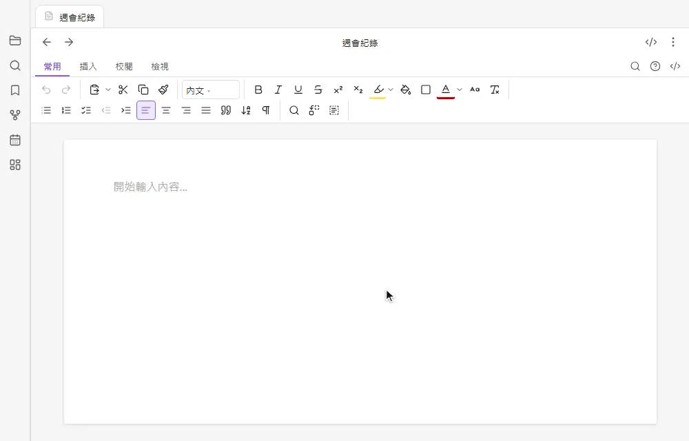
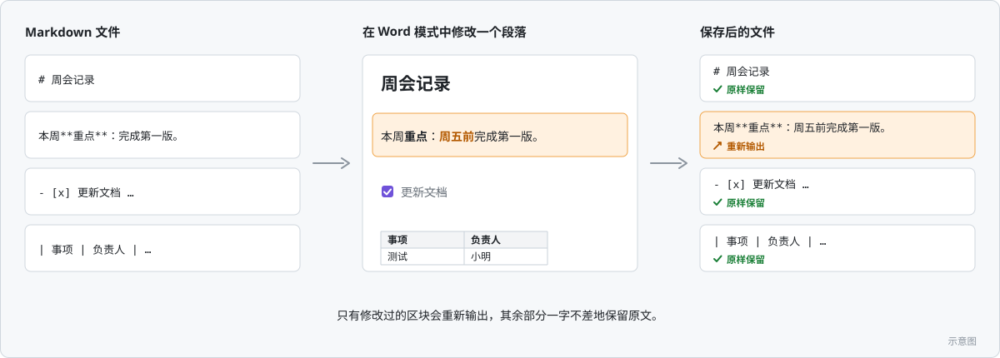
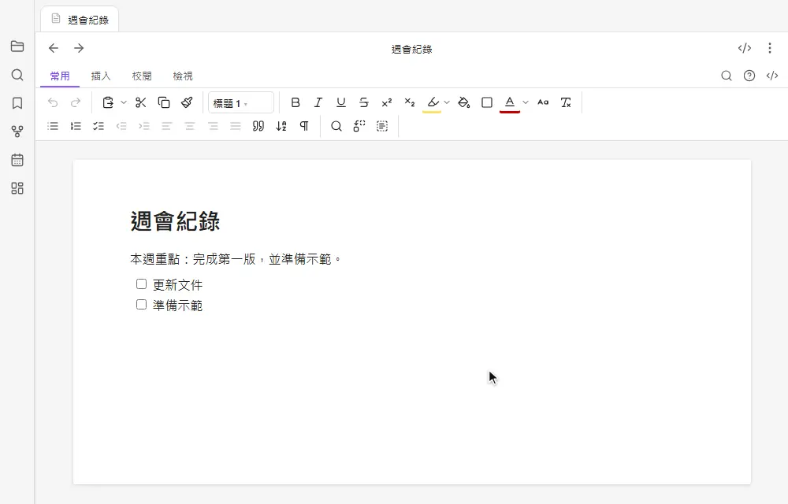
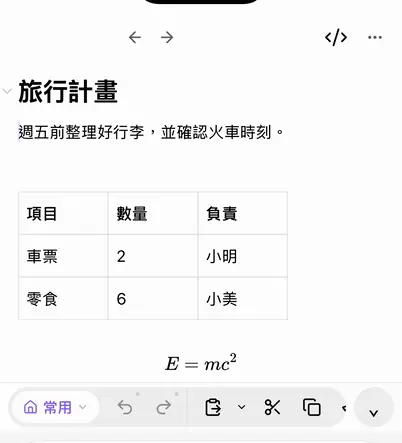
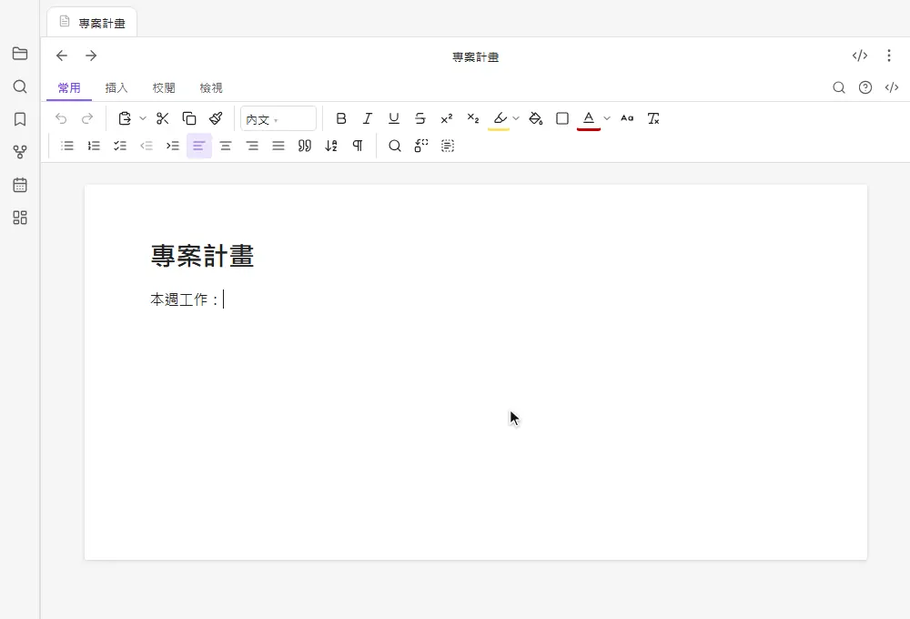
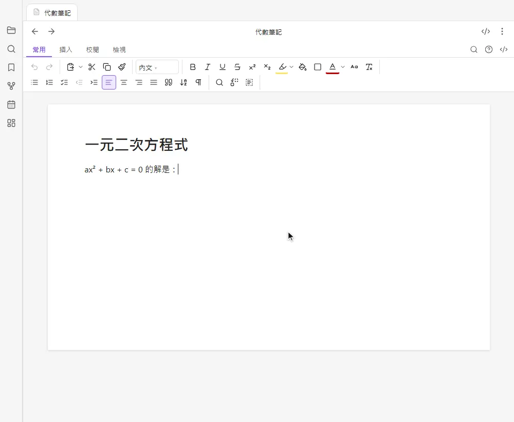
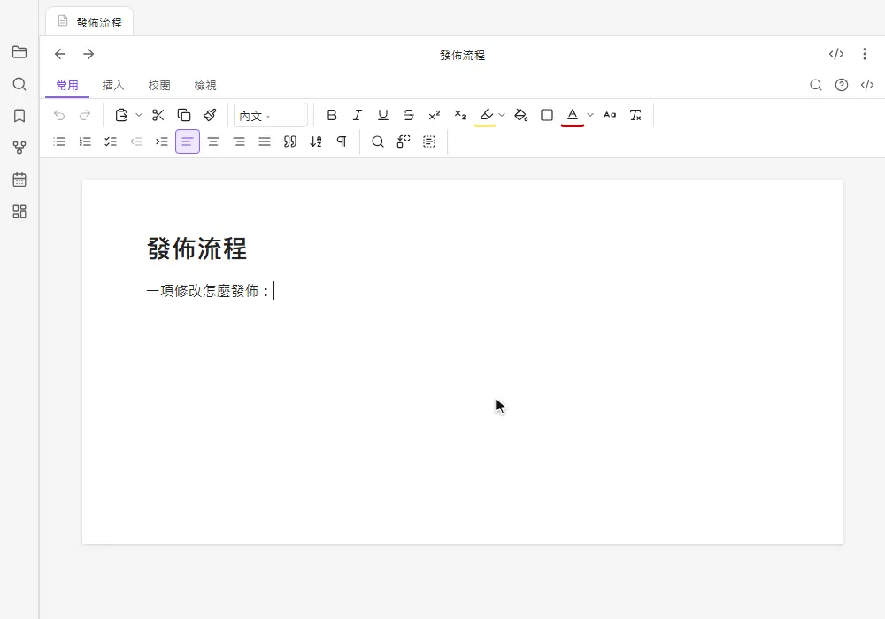

# Word Mode

[English](README.md) | [繁體中文](README.zh-TW.md) | [台文](README.nan-TW.md) | [粵語](README.yue-HK.md) | **简体中文** | [日本語](README.ja.md) | [한국어](README.ko.md) | [Tiếng Việt](README.vi.md) | [Français](README.fr.md) | [Deutsch](README.de.md) | [Español](README.es.md) | [العربية](README.ar.md) | [עברית](README.he.md)

像用 Word 一样编辑 [Obsidian](https://obsidian.md) 笔记：有功能区工具栏、表格、公式、图表，无需记忆 Markdown 语法。每篇笔记保存后仍然是纯 Markdown 文件。

> 此简体中文版尚未经过母语者校对。如有不自然的表述，欢迎在 Issue 中反馈。

## 为什么选择 Word 模式

- **无需记忆语法**：用工具栏按钮和文字处理软件中常用的快捷键设置格式，例如 `Ctrl+B` 加粗、`Ctrl+K` 插入链接。
- **文件仍然是 Markdown**：编辑笔记时，只有修改过的区块会重新输出，其余部分一字不差地保留原文；同步与版本历史中只会看到你修改的地方。
- **随时切换**：按 `Ctrl+E`（macOS 上是 `Cmd+E`）或点击笔记标题栏的按钮，就能在 Word 模式与 Obsidian 原生编辑器之间切换。
- **为 Obsidian 设计**：链接、标签、文档属性、提示框、嵌入、脚注、数学公式、Mermaid 图表、Dataview 查询在 Word 模式中都能使用。

## 功能

### 输入时自动应用格式

就是最上方动画演示的功能。在段落开头输入 `# `、`- `、`1. `、`> `、`[ ] `，或输入完 `**粗体**`、`*斜体*`、`[[笔记]]`，就会变成格式。撤销一次只会取消格式，输入的文字仍然保留。输入 `[[` 可以选择笔记或标题，输入 `#` 可以选择标签。

### 功能区工具栏

- **开始、插入、审阅、视图四个选项卡**，排列方式与文字处理软件相同。
- **字体颜色与突出显示**：标准色及其深浅变化的调色板、最近使用的颜色，也可以自己选色或输入色值。突出显示可以使用任意颜色，并可调整不透明度。
- **按自己的习惯调整**：选项卡栏可以显示文字、图标或两者，也可以收成一个菜单按钮，选项卡名称可以自行修改。按钮组可以重命名、调整顺序、隐藏，或移到其他选项卡。

工具栏的更多功能

- **Markdown 与阅读视图也有同一条工具栏**，布局相同，切换模式时界面不会跳动。可以设置为两种模式都显示、只在其中一种显示，或都不显示。
- **详细提示**：鼠标悬停在按钮上会显示说明与动画演示；视图模式与状态栏的按钮也有。默认开启，可以在设置或快捷键说明里关闭。

### 手机与平板

- **拖动移动光标**：手机的键盘打开时，键盘上方那一行就是触控板。在任意位置按住一下，等按钮变淡，再左右拖让光标一格一格移动，上下拖则换行；最前面的选项卡菜单按钮不用按住，直接拖就行。拖动时光标上方会有放大的预览，看得清楚光标停在哪两个字中间。点按钮、左右滚动按钮栏都和原来一样。按住的时间、移动速度，以及放大镜的外观（胶囊或卡片）、倍率与宽度都可以在设置里调整，也可以关闭放大镜。放大镜旁边会显示光标在哪里：哪一种段落（正文、标题、列表、表格第几行第几列）与第几个字，也可以关闭。上下移动会保持在同一列（表格里也是），经过公式、图表、水平线时先停在上面并写出是什么；到文档开头或结尾时，提示写在位置的前面，照样看得到停在哪里。手指慢慢移动时一格一格走，快速一滑就走很远（像笔记本电脑的触控板）。只需移动一两格时，“开始”选项卡还有“方向键”：点一下走一格，按住连续走。
- **手机打字时多一点空间**：屏幕键盘打开时，工具栏缩成键盘上方的一行，选项卡收成菜单按钮、按钮只显示图标；键盘收起来就恢复。可以在设置里关闭。
- **手机上的手势**：在“撤销”上往上滑是重做，在“重做”上往上滑是撤销（两个缩进按钮也一样；这些按钮右上角有一个小点）。两指点一下选中整段。点表格单元格会直接放光标，不会被系统的剪切／拷贝／粘贴菜单挡住。“插入符号”里也有成对的括号与引号，按下去把选中的文字包起来。点两个表格之间的空白会在那里插入一个空段落。
- **输入斜线插入**（默认关闭，在设置里开启）：在空白段落的开头输入 `/`，选标题、列表、表格、代码块、提示框、公式、图表、图片或链接，继续输入可以筛选；手机上比滚动工具栏找按钮快。在 Word 模式、Markdown 与阅读视图之间切换会停在笔记的同一个位置；手机的阅读视图工具栏缩成一行，只留能用的按钮；屏幕键盘没有 Tab，所以表格多了“上一个单元格”“下一个单元格”按钮。手机上表格、公式、图表与代码块的按钮变大、彼此隔开，删除用红色另外放。

手机与平板的更多功能

- **手机用底部抽屉**：工具栏的下拉面板（选项卡、样式、大纲、颜色、符号、插入表格）从屏幕下方滑上来，和 Obsidian 手机版自己的菜单一样；键盘打开时贴在键盘上方。
- **收起键盘**：屏幕键盘打开时，工具栏最右边（公式、图表编辑器里在“取消”旁边）有一个按钮可以把键盘收起来。
- **手机上更顺**：工具栏跟着键盘滑动，不是用跳的；在工具栏上往下滑就收起键盘；抽屉有标题、当前的选项会打勾、可以往下拖掉；查找栏的关闭按钮固定在最右边；表格、图表、代码块的按钮不再盖住内容；Markdown 与阅读视图的工具栏也留在下方；在工具栏上左右滑不会再把 Obsidian 的侧边栏拉出来。
- **每个栏位出对的键盘**：公式、代码、搜索栏位打什么就是什么（不自动大写、不自动更正，光标在代码块或行内代码里也一样）；数字栏位出数字键盘、网址栏位出网址键盘；右下角的键在该搜索、该完成的地方显示“搜索”“完成”。
- **手机上的公式与图表编辑器**：键盘打开时整个对话框留在键盘上方，只显示需要的东西：编辑中的公式、可以左右滑的一行符号与预览；标题与模式切换在键盘收起后回来。

### 表格

- 从格子中选择大小，输入完按 Tab 跳到下一个单元格；在最后一个单元格按 Tab 会新增一行。
- 在单元格上右键单击，可以插入、删除和移动行与列，按列排序，设置整列对齐。
- 从电子表格复制的单元格，粘贴后就是表格。
- 光标在表格里时，功能区会出现“表格”选项卡；表格边上的手柄可以选择整行或整列并打开菜单，手机上也能用。在最后一行的空行再按一次 Enter 会跳到表格下方的新段落（像列表连按两次 Enter）；“表格”选项卡与表格的菜单也能在表格上方或下方插入段落。
- 选中整行、整列或整个表格后按 Backspace 就会删除（Delete 只清空内容）；表格旁的按钮一按就能复制成 Markdown 或删除整个表格。
- 选中用 Tab、`|` 或逗号分隔的几行文字就能转换成表格，表格也能转回文字；按 Ctrl+Enter 跳出表格，在下面继续输入。复制的表格粘贴到电子表格会自动分列。

### 公式

- 分数、根号、上下标、括号、矩阵都是可以直接输入的格子。从面板中选择结构，或输入 `\frac`、`\sqrt`、`\alpha` 再按空格。
- Tab、Enter 与方向键在格子之间移动；在空格子里按 Backspace 会去掉外层的结构。
- 随时可以切换到 LaTeX 源码。公式保存为普通的 `$…$` 或 `$$…$$`，Obsidian 能显示数学公式的地方都能看到。

公式编辑器的其他功能

- 从“插入 → 公式”打开，也可以双击公式，或选中公式后按 Enter。
- 独立成行的公式，鼠标移上去（手机上点一下）右上角会出现小按钮：编辑、更多功能（改为文本中、复制 LaTeX 或 Markdown）、删除。
- `^`、`_` 打开上标、下标的格子；上下方向键可以在分子与分母之间移动。
- 撤销与重做：用按钮，或按 `Ctrl+Z`、`Ctrl+Y`。
- **常用公式与最近使用**：整条插入（例如一元二次方程的解、标准差），再修改需要的部分。
- **我的公式**：点击预览旁边的书签按钮，给当前的公式起个名字保存起来。保存过的公式在面板的“我的公式”分类里，点一下就能插入。
- 没有修改的公式会原样写回，一字不改。
- **手机与平板**：屏幕键盘没有方向键，所以编辑区上方有“上一格”“下一格”与“去掉光标所在的结构”按钮。在手机上，向下滚动面板时编辑区会固定在最上方。手机上的功能区与状态栏合成一张浮起来的毛玻璃卡片，跟 Obsidian 的浮动导航栏同一种样式，换主题、深色模式也会跟着变。
- **不会不小心弄丢**：有还没应用的修改时，按 Esc、点对话框外面或按 × 会先询问是否放弃。图表编辑器也一样。

### 图表

- **十一种 Mermaid 图表有表单**：流程图、时序图、甘特图、饼图、状态图、类图、思维导图、时间线、ER 图、旅程图、象限图。
- **在图上编辑**：点击预览图上的文字直接修改，也可以添加下一步、选择填充色。
- **自由编写**：自己编写任意 Mermaid 代码，同样有实时预览，包括没有表单的类型（例如 Git 分支图、XY 图表）。
- 图表保存为普通的 Mermaid 代码块。使用了表单不支持的写法的图表会以代码打开，并说明原因，不会丢失内容。

图表编辑器的其他功能

- 从“插入 → 图表”打开，或点击 Mermaid 代码块上的编辑按钮。
- 笔记里的图表，鼠标移上去右上角会出现按钮：编辑、显示代码、复制、删除。删除会删掉整张图，按撤销就能恢复。
- 在图上按 Enter 应用，或按 Tab 应用并跳到下一段文字。在图上为参与者、状态、类、实体重命名时，所有引用它的地方会一起修改。
- **外观**：可以为单张图选择 Mermaid 主题，流程图的每个步骤可以选择填充色。
- **预览**：用按钮缩放，或按住 `Ctrl` 滚动鼠标滚轮。图表以原始大小显示，不会整张缩小到看不清文字；另有一个按钮可以把整张图缩到与预览一样宽。
- **快速定位**：光标进入表单的某一行时，预览图上会用外框标出该项目；在图上点击一个项目，表单也会跳到那一行。
- **我的模板**：在“我的模板”中给当前的图表起个名字保存起来，下次直接从它开始。在设置中可以选择新图表的初始内容，以及要列出哪些内置的图表类型。
- **很长的图表**：表单的列表一次显示四十行，可以输入文字筛选，几百个步骤的流程图编辑起来也不会卡顿。笔记中很高的图表会先折叠成固定高度，点击即可显示完整内容；图表滚动到可见位置时才绘制。
- 较新的图表类型需要 Obsidian 内置的 Mermaid 支持才能绘制。
- **手机**：预览固定在上方，表单在下方；字段与按钮放大到适合触控的尺寸。

### 其他功能

展开全部：文档属性、图片、链接、查找和替换、状态栏、光标等等

- **状态栏**：字数、保存状态、Word 模式／Markdown／阅读的切换按钮、查看文档属性与缩放。切换到 Markdown 或阅读视图时保留同样的按钮，字数也用同样的算法统计；可以在设置中关闭。字数只统计看得到的文字，Markdown 符号与链接网址不计；字符数与预计阅读时间在提示里。想要与 Obsidian 内置的字数统计一样，可以在设置的“字数算法”中切换。
- **笔记的路径与复制路径**：电脑上，状态栏显示这份笔记的文件夹与文件名。点一下或按右键可以复制：仓库内的路径、电脑上的完整路径、Obsidian 网址、文件名、所在文件夹。文档里的链接、嵌入与图片按右键，会写出它指向的文件，也能用同样的方式复制路径。
- **空行看得到**：Markdown 里连续的几个空行显示成空白段落，就像在 Word 里按了几次 Enter。删掉一个就少一个空行；没动过的照原样保存。
- **更好看、可以调整的光标**：光标是强调色的圆角细线，打字时滑到新的位置，停下来时淡入淡出。设置里可以选形状（细线、粗线、方块、下划线，或系统原本的光标）、颜色、闪烁的方式与速度，以及要不要平滑移动。手机与平板也一样（长按拖动选取时也跟着手指走），设置页上有实时预览。
- **文档属性**：以表单编辑。标签与链接显示为可点击打开的小标签，嵌套数据显示为树状结构，点击属性的图标可以更换类型或重命名。功能区“视图”选项卡与状态栏中的“查看文档属性”无需滚动到最上方就能查看，属性很多时可以筛选。点击文档属性标题栏右侧的图钉（或在设置中开启），滚动时上方会一直显示一条精简的属性栏，点击即可展开完整列表。外观可以选择带边框与底色的区块、仅边框，或无边框的简洁样式。
- **图片**：粘贴或选择图片，拖动即可调整大小。
- **链接**：链接到笔记、标题或网页；光标位于链接上时会出现小工具栏。
- **查找和替换**，支持全字匹配与正则表达式。
- **大纲侧边栏**与标题折叠。
- **嵌入**：嵌入的笔记、标题、音频、视频、PDF、YouTube 链接会直接显示内容。Dataview 查询与其他插件的代码块也会显示为结果。
- **脚注**：插入脚注，鼠标移到编号上即可查看内容，编辑内容时无需理会语法。
- **提示框**（含可折叠的）、**待办列表**（含 `[/]`、`[-]` 等自定义状态）、**标签**、**代码块**（支持语法高亮，可以显示行号）。
- **编辑标记**（例如 `¶`），以及清除不可见字符或残留符号的工具。
- **粘贴 Markdown 文本**时可以一键转换格式。
- **同步冲突处理**：笔记有未保存的修改时又在磁盘上被修改，可以选择要保留哪一份。
- **快捷键说明**：可以搜索或只看某一类，点击快捷键还能看到其效果的动画演示。底部的复选框可以开关按钮的详细提示。
- 界面语言：繁体中文、台语（汉字）、粤语、简体中文、英语、日语、韩语、越南语、法语、德语、西班牙语、阿拉伯语、希伯来语。

无法以 Word 方式编辑的内容（例如 HTML 区块）会显示为源码区块，保存时原样保留。鼠标移到这类区块（也包括脚注、注释区块）上，右上角会出现编辑、复制、删除按钮；删除脚注时，正文中的编号也会一起删除。

## 开始使用

### 安装

需要 Obsidian 1.5.7 或更高版本。

1. 从[最新版本](https://github.com/NatLee/obsidian-word-mode/releases/latest)下载 `main.js`、`manifest.json`、`styles.css`。
2. 把这三个文件放到 `<你的仓库>/.obsidian/plugins/natlee-word-mode/`。
3. 在 Obsidian 中打开“设置 → 第三方插件”，启用“Word Mode”。

### 使用方法

启用插件后，Markdown 笔记默认以 Word 模式打开。

- 切换 Word 模式与 Markdown：点击笔记右上角的按钮，或按 `Ctrl+E`（macOS 上是 `Cmd+E`）。
- 指定以哪种模式打开：在笔记上右键单击，选择“以 Word 模式打开”或“以 Markdown 打开”。
- 让单篇笔记不使用 Word 模式：在笔记属性中添加 `word-mode: false`。
- 让整个文件夹不使用 Word 模式：在“设置 → Word Mode → 不使用 Word 模式的文件夹”中填入文件夹。

设置分为几类，设置页面上方有一排分类标签页，一次只显示一类。不知道某项设置在哪一类时，在标签页上方的搜索框中输入：边输入边列出匹配的设置，也会匹配下拉菜单的选项与其他语言的设置名称（界面是中文时也可以输入英文），选择一项就会直接跳转过去。设置较多的分类再分成几个有标题的小节，例如“显示”里与光标有关的设置都在“光标”这一节，最上面有实时预览。

### 命令

展开命令列表

| 命令 | 说明 |
| --- | --- |
| 以 Word 模式编辑当前笔记 | 把当前笔记切换到 Word 模式。 |
| 以 Markdown 编辑当前笔记 | 把当前笔记切回 Markdown 编辑器。 |
| 切换 Word 模式／Markdown | 在两种模式之间切换。 |
| 打开／关闭大纲侧边栏 | 显示或隐藏大纲。 |
| 查找 | 在当前笔记中搜索。 |
| 查找和替换 | 在当前笔记中搜索并替换。 |
| 大纲：跳转到标题 | 跳转到当前笔记的某个标题。 |
| 显示快捷键说明 | 列出 Word 模式的所有快捷键。 |

所有命令都没有默认快捷键，可以到“设置 → 快捷键”中自行指定。

## 隐私与披露事项

- **网络**：仅用于显示笔记本身指向的网络内容。笔记中有来自网址的图片、音频或视频时，Word 模式会从该网址加载。笔记嵌入 YouTube 链接时，Word 模式会显示 YouTube 播放器，播放器会连接到 `youtube.com`。这些内容与 Obsidian 内置编辑器打开同一篇笔记时加载的内容相同。插件不会把你的笔记或数据发送到任何地方。
- **遥测**：无。
- **账号与付费**：不需要。
- **仓库以外的文件**：不会读取或写入。
- **仓库中的文件名**：插件会列出仓库中的文件，用于链接、图片、模板的选择窗口，以及输入 `[[` 之后的建议列表。该列表只保留在你的设备上。
- **剪贴板**：只有在你点击工具栏或右键菜单中的“粘贴”时才读取；只有在你点击“剪切”“复制”或复制按钮时才写入。
- **插件会创建的文件**：粘贴的图片会保存到附件文件夹。同步冲突时如果选择两份都保留，你的版本会另存在笔记旁边。

## 已知限制

- 手机与平板只在 iPhone 真机上测试过；Android 与 iPad 还没有在真机上测试。
- Markdown 与阅读视图的工具栏中，有部分按钮调用 Obsidian 内置命令，没有逐一实测。
- 繁体中文与英语以外的翻译没有经过母语者校对。
- 阿拉伯语、希伯来语只翻译了文字，工具栏与对话框仍是从左到右的布局。
- 图表与查询的结果、嵌入、页面预览是由 Obsidian 绘制的。这些功能有模拟 Obsidian 的自动化测试，但没有搭配每一种插件与主题实测。
- 图表的外观（Mermaid 主题）与流程图的填充色是由 Obsidian 中的 Mermaid 绘制的。这两项只针对 Mermaid 本身测试过，没有搭配每一种 Obsidian 主题实测。

## 参与开发

问题反馈与建议请提交到 [Issues](https://github.com/NatLee/obsidian-word-mode/issues)。要构建插件、运行测试、了解内部原理，或发布新版本，请参阅[开发指南（英文）](docs/development.md)。

## 致谢

Word Mode 打包了以下开源库：

- [ProseMirror](https://prosemirror.net)，作者 Marijn Haverbeke 及贡献者，MIT 许可证。
- [markdown-it](https://github.com/markdown-it/markdown-it) 与 [markdown-it-mark](https://github.com/markdown-it/markdown-it-mark)，MIT 许可证。
- [entities](https://github.com/fb55/entities)，BSD 2-Clause 许可证。

## 许可证

[MIT 许可证](LICENSE)。
