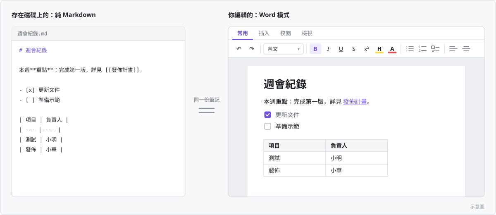
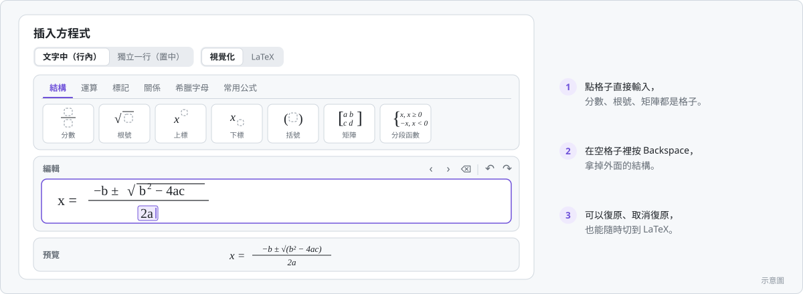
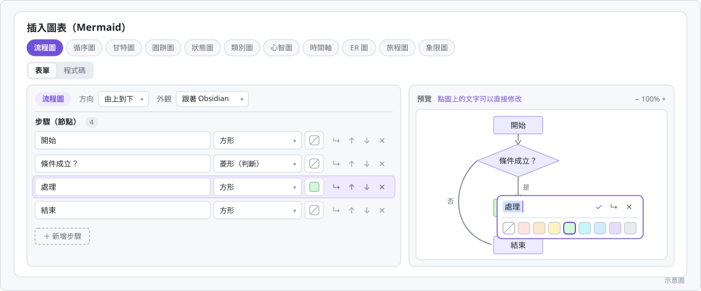

# Word Mode（Word 模式）

[English](README.md) | **繁體中文** | [日本語](README.ja.md) | [한국어](README.ko.md)

把 [Obsidian](https://obsidian.md) 的 Markdown 筆記變成像 Word 一樣編輯：有工具列、表格、圖片，存檔仍然是乾淨的 Markdown。



## 這個外掛做什麼

Word Mode 替 `.md` 筆記多加一種編輯器。畫面上看到的是排版好的文字，不是 Markdown 符號；用工具列按鈕和文書軟體常見的快速鍵就能設定格式。

檔案仍然是純 Markdown。編輯筆記時，只有修改過的區塊會重新輸出，其餘部分一字不差保留原文。


## 功能


- **功能區工具列**：常用、插入、校閱、檢視四個分頁。分頁列可以顯示文字、圖示或兩者，也可以收成一個選單按鈕，分頁名稱可以自己改。按鈕群組可以改名稱、調整順序、隱藏，或移到別的分頁。Markdown 與閱讀模式的工具列是同樣的版面，切換模式時畫面不會跳動。三個檢視模式按鈕的文字可以在設定裡關閉，只顯示圖示。
- **字型色彩與醒目提示**：標準色彩與深淺變化的色盤、最近使用的自訂色彩，也可以自己挑色或輸入色碼。醒目提示可以用任何顏色，並調整不透明度。
- **表格**：直接在表格裡編輯，可以增刪與搬移列與欄、依欄排序、設定對齊，也可以從試算表貼上儲存格。右鍵選單把這些功能收成幾個子選單。
- **文件屬性**：以表單編輯。標籤與連結顯示成可以點的標籤，巢狀資料顯示成樹狀，點屬性的圖示可以換類型或改名。
- **圖片**：貼上或挑選圖片，拖曳就能調整大小。
- **連結**：連到筆記、標題或網頁；游標在連結上時會出現小工具列。
- **尋找與取代**，可以全字相符或使用正規表示式。
- **大綱側邊欄**與標題摺疊。
- **編輯標記**（例如 `¶`），以及清除看不見的字元或殘留符號的工具。
- **輸入時自動套用格式**：段落開頭打 `- `、`1. `、`# `、`> `、`[ ] `，或打完 `**粗體**`、`*斜體*`、`[[筆記]]`，就會變成格式。每次套用都是獨立的一步，按一次復原只取消格式，打的字還在。
- **輸入時的選單**：打 `[[` 列出筆記與標題，打 `#` 列出標籤。
- **圖表**：Mermaid 圖表直接顯示成圖，其中十一種可以用表單編輯，也可以直接在預覽圖上修改。見[圖表編輯器](#圖表編輯器)。Dataview 查詢與其他外掛的程式碼區塊也會顯示成結果。
- **方程式**：視覺化編輯（分數、根號、上下標、矩陣都是可以直接輸入的格子），或直接編輯 LaTeX。見[方程式編輯器](#方程式編輯器)。
- **內嵌**：內嵌的筆記、標題、錄音、影片、PDF、YouTube 連結會直接顯示內容。
- **註腳**：插入註腳、滑鼠移到編號上看內容、編輯內容時不用管語法。
- **提示框**（含可摺疊的）、**待辦清單**（含 `[/]`、`[-]` 等自訂狀態）、**標籤**、**程式碼區塊**（含語法上色，可以顯示行號）。游標在程式碼區塊裡時，不適用於純文字的按鈕會停用。
- **貼上 Markdown 文字**時可以一鍵轉成格式。
- **同步衝突處理**：筆記有未存檔的修改時又在磁碟上被改過，可以選擇要保留哪一份。
- 介面語言：繁體中文、英文、日文、韓文。

無法用 Word 方式編輯的內容（例如 HTML 區塊）會顯示成原文區塊，存檔時原樣保留。

## 方程式編輯器



從「插入 → 方程式」開啟，也可以在方程式上按兩下，或選取方程式後按 Enter。方程式存成一般的 LaTeX（`$…$` 或 `$$…$$`），Obsidian 顯示數學式的地方都看得到。

- **視覺化編輯**：分數、根號、上下標、括號、矩陣都是格子。點格子直接輸入，或從面板選結構與符號。隨時可以切到 LaTeX 原始碼；沒有修改的方程式會原樣寫回，一字不動。
- **鍵盤**：`^`、`_` 開上標、下標的格子；Tab 或 Enter 跳到下一格；方向鍵在格子之間移動，上下鍵可以在分子與分母之間移動；在空格子裡按 Backspace 會拿掉外面的結構。打 `\frac`、`\sqrt`、`\alpha` 再按空白，會變成對應的結構或符號。
- **復原與取消復原**：用按鈕，或 `Ctrl+Z`、`Ctrl+Y`。
- **常用公式與最近使用**：整條插入（例如一元二次方程式的解、標準差），再改需要的部分。
- **我的公式**：按預覽旁邊的書籤按鈕，把目前的方程式取個名字存起來。存過的公式在面板的「我的公式」分類裡，按一下就插入。
- **手機與平板**：螢幕鍵盤沒有方向鍵，所以編輯區上方有「上一格」「下一格」與「拿掉游標所在的結構」的按鈕。手機上，往下捲面板時編輯區會固定在最上面。

## 圖表編輯器



從「插入 → 圖表」開啟，或按 Mermaid 區塊上的編輯按鈕。圖表存成一般的 Mermaid 程式碼區塊。

- **十一種圖表有表單**：流程圖、循序圖、甘特圖、圓餅圖、狀態圖、類別圖、心智圖、時間軸、ER 圖、旅程圖、象限圖。在上方選一種就從範本開始，再新增、調整順序、刪除各列。
- **在圖上編輯**：點預覽圖上的文字就能直接改。按 Enter 套用，或按 Tab 套用並跳到下一段文字。同一個小框裡還可以刪除那一列、新增流程圖的下一步或心智圖的子分支、選流程圖步驟的底色。在圖上替參與者、狀態、類別、實體改名，所有用到它的地方會一起改。
- **外觀**：可以替單一張圖選 Mermaid 的佈景，流程圖的每個步驟可以選底色。
- **預覽**：用按鈕縮放，或按住 `Ctrl` 滾動滑鼠滾輪。圖以原本的大小顯示，不會整張縮小到字看不見；另有一顆按鈕把整張圖縮到跟預覽一樣寬。編輯時預覽會留在原本捲到的位置，也不會閃。
- **找得到位置**：游標進到表單的某一列，預覽圖上會用外框標出那個項目並捲過去；在圖上點一個項目，表單也會跳到那一列。
- **我的範本**：在編輯器上方的「我的範本」把目前的圖表取個名字存起來，下次直接從它開始。設定裡可以選新圖表一開始的內容，以及要列出哪些內建的圖表種類。
- **很長的圖表**：表單的清單一次顯示四十列，可以打字篩選，幾百個步驟的流程圖編輯起來也不會卡。筆記裡很高的圖表會先收合成固定的高度，按一下顯示完整內容；圖表捲到看得到才畫。
- **不會弄丟內容**：只有「讀進來再寫出去完全不變」的圖才會開在表單。用了表單不支援的寫法（例如 loop、子狀態、自訂樣式）的圖會開在程式碼，並說明原因。沒有修改的圖會原樣寫回。
- **手機**：預覽固定在上方，表單在下方；欄位與按鈕放大成適合觸控的尺寸。

## 使用方式

啟用外掛後，Markdown 筆記預設用 Word 模式開啟。

- 切換 Word 模式與 Markdown：按筆記右上角的按鈕，或按 `Ctrl+E`（macOS 是 `Cmd+E`）。
- 指定用哪一種模式開啟：在筆記上按右鍵，選「以 Word 模式開啟」或「以 Markdown 開啟」。
- 讓單一筆記不使用 Word 模式：在筆記屬性加上 `word-mode: false`。
- 讓整個資料夾不使用 Word 模式：到「設定 → Word Mode → 不使用 Word 模式的資料夾」填入資料夾。

### 指令

| 指令 | 說明 |
| --- | --- |
| 以 Word 模式編輯目前筆記 | 把目前的筆記切換到 Word 模式。 |
| 以 Markdown 編輯目前筆記 | 把目前的筆記切回 Markdown 編輯器。 |
| 切換 Word 模式／Markdown | 在兩種模式之間切換。 |
| 開啟／關閉大綱側邊欄 | 顯示或隱藏大綱。 |
| 尋找 | 在目前的筆記中搜尋。 |
| 尋找與取代 | 在目前的筆記中搜尋並取代。 |
| 大綱：跳到標題 | 跳到目前筆記的某個標題。 |
| 顯示快速鍵說明 | 列出 Word 模式所有的快速鍵。 |

所有指令都沒有預設快速鍵，可以到「設定 → 快捷鍵」自行指定。

## 安裝

需要 Obsidian 1.5.7 以上。

1. 到[最新版本](https://github.com/NatLee/obsidian-word-mode/releases/latest)下載 `main.js`、`manifest.json`、`styles.css`。
2. 把三個檔案放到 `<你的 vault>/.obsidian/plugins/natlee-word-mode/`。
3. 在 Obsidian 開啟「設定 → 第三方外掛」，啟用「Word Mode」。

## 隱私與揭露事項

- **網路**：只用來顯示筆記本來就指向的網路內容。筆記裡有來自網址的圖片、錄音或影片時，Word 模式會從該網址載入。筆記內嵌 YouTube 連結時，Word 模式會顯示 YouTube 播放器，播放器會連到 `youtube.com`。這些內容跟 Obsidian 內建編輯器開啟同一份筆記時載入的相同。外掛不會把你的筆記或資料傳送到任何地方。
- **遙測**：沒有。
- **帳號與付費**：不需要。
- **vault 以外的檔案**：不會讀取或寫入。
- **vault 裡的檔案名稱**：外掛會列出 vault 裡的檔案，用在連結、圖片、範本的選擇視窗，以及輸入 `[[` 之後的建議清單。清單只留在你的裝置上。
- **剪貼簿**：只有在你按工具列或右鍵選單的「貼上」時才讀取；只有在你按「剪下」「複製」或複製按鈕時才寫入。
- **外掛會建立的檔案**：貼上的圖片會存到附件資料夾。同步衝突時如果選擇兩份都保留，你的版本會另存在筆記旁邊。

## 已知限制

- 手機上的操作沒有在實機測試過。
- Markdown 與閱讀模式的工具列有部分按鈕呼叫 Obsidian 內建指令，沒有逐一實測。
- 日文、韓文翻譯沒有經過母語者校對。
- 圖表與查詢的結果、內嵌、頁面預覽是由 Obsidian 畫的。這些功能有模擬 Obsidian 的自動測試，但沒有搭配每一種外掛與佈景主題實測。
- 圖表的外觀（Mermaid 佈景）與流程圖的底色是由 Obsidian 裡的 Mermaid 畫的。這兩項只對 Mermaid 本身測過，沒有搭配每一種 Obsidian 佈景主題實測。

## 開發

需要 Node.js 22。原始碼是 TypeScript，由 esbuild 打包，`tsc` 只負責檢查型別。

| 指令 | 說明 |
| --- | --- |
| `npm install` | 安裝相依套件。 |
| `npm run typecheck` | 用 `tsc` 檢查型別。 |
| `npm run lint` | 執行 ESLint，使用 Obsidian 審查社群外掛的同一套規則。 |
| `npm test` | 先檢查型別，再執行轉換測試與編輯測試（以 jsdom 模擬 Obsidian）。最後一行應是 `ALL PASS`。 |
| `npm run build` | 建置 `main.js`、`manifest.json`、`styles.css` 到 `dist/`。這是正式建置。 |
| `npm run dev` | 建置到 `dist/`，不壓縮。 |
| `npm run test:vault -- <vault 路徑>` | 對 vault 裡每一份筆記做往返檢查。唯讀，只輸出統計與檔案路徑。 |

修改 `src/markdown.ts` 或 `src/schema.ts` 之後，請對真實的 vault 執行 `npm run test:vault`，確認 `notExact` 與 `lossyBlocks` 都是 `0`。

不要把這個資料夾或 `node_modules` 放在同步軟體監看的資料夾裡，例如 Synology Drive。

`obsidian` 的型別套件鎖在 `minAppVersion` 的版本，所以用到比外掛支援版本更新的 Obsidian API 時，型別檢查會失敗。要提高最低版本時，請更新 `manifest.json` 的 `minAppVersion`，並安裝對應版本的 `obsidian` 套件。

Obsidian 沒有公開的 API 集中宣告在 `src/obsidian-internal.d.ts`，全部標成可能不存在。呼叫之前請先檢查該成員是否存在。

程式結構請看[英文版 README](README.md#project-structure)。

### 發佈新版本

版本號寫在 `package.json`，`manifest.json` 與 `versions.json` 會跟著更新。

1. 執行 `npm version patch`、`npm version minor` 或 `npm version major`。這會更新 `package.json`、`manifest.json`、`versions.json`，並建立 commit 與 tag（例如 `1.3.1`）。
2. 執行 `git push origin main --follow-tags`。

推上 tag 之後，GitHub Actions 的 release workflow 會跑測試、建置外掛，為 `main.js`、`manifest.json`、`styles.css` 產生[建置來源證明](https://docs.github.com/en/actions/security-for-github-actions/using-artifact-attestations/using-artifact-attestations-to-establish-provenance-for-builds)，再附到 GitHub Release。發佈檔一律在那裡建置，任何人都能驗證檔案確實來自這份原始碼：

```sh
gh attestation verify main.js --repo NatLee/obsidian-word-mode
```

tag 必須與版本號完全相同，前面不加 `v`，因為 Obsidian 會找這個 tag 的 Release。

`npm run build` 是正式建置，Obsidian 社群目錄也是執行它來核對發佈檔與原始碼是否一致。

CI workflow 不會自動執行。要執行時，到 **Actions** 分頁選 **CI**，再選 **Run workflow**。

## 致謝

Word Mode 打包了這些開放原始碼函式庫：

- [ProseMirror](https://prosemirror.net)，作者 Marijn Haverbeke 與貢獻者，MIT 授權。
- [markdown-it](https://github.com/markdown-it/markdown-it) 與 [markdown-it-mark](https://github.com/markdown-it/markdown-it-mark)，MIT 授權。
- [entities](https://github.com/fb55/entities)，BSD 2-Clause 授權。

## 授權

[MIT 授權](LICENSE)。
