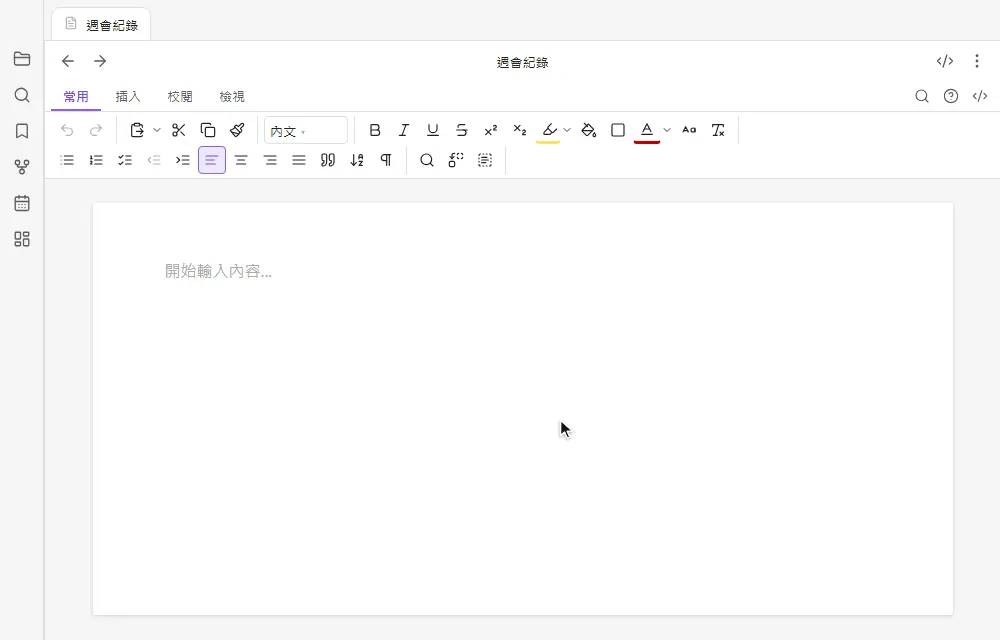
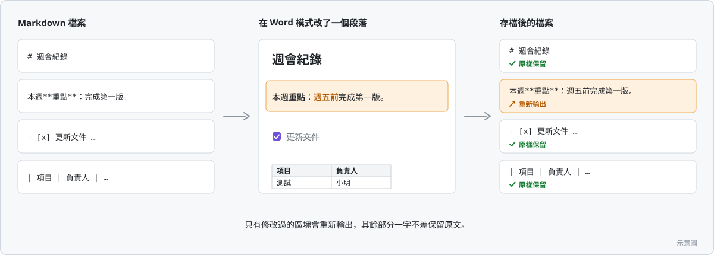
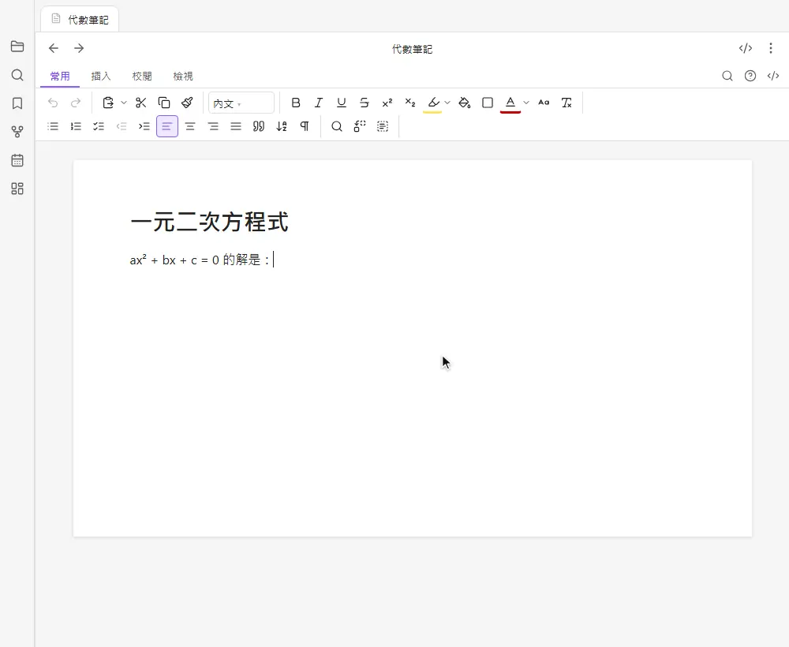
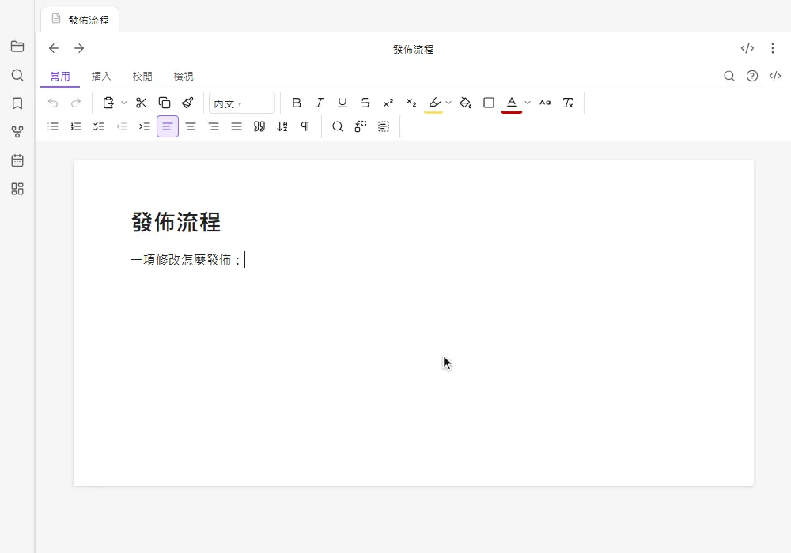

# Word Mode（Word 模式）

[English](README.md) | **繁體中文** | [台文](README.nan-TW.md) | [粵語](README.yue-HK.md) | [简体中文](README.zh-CN.md) | [日本語](README.ja.md) | [한국어](README.ko.md) | [Tiếng Việt](README.vi.md) | [Français](README.fr.md) | [Deutsch](README.de.md) | [Español](README.es.md) | [العربية](README.ar.md) | [עברית](README.he.md)

像用 Word 一樣編輯 [Obsidian](https://obsidian.md) 筆記：有功能區工具列、表格、方程式、圖表，不用記 Markdown 語法。每份筆記存檔後仍然是純 Markdown 檔案。

## 為什麼用 Word 模式

- **不用記語法**：用工具列按鈕和文書軟體常見的快速鍵設定格式，例如 `Ctrl+B` 粗體、`Ctrl+K` 連結。
- **檔案仍然是 Markdown**：編輯筆記時，只有修改過的區塊會重新輸出，其餘部分一字不差保留原文；同步與版本紀錄看到的只有你改的地方。
- **隨時切換**：按 `Ctrl+E`（macOS 是 `Cmd+E`）或筆記標題列的按鈕，就能在 Word 模式與 Obsidian 原本的編輯器之間切換。
- **為 Obsidian 設計**：連結、標籤、文件屬性、提示框、內嵌、註腳、數學式、Mermaid 圖表、Dataview 查詢在 Word 模式都能用。

## 功能

### 輸入時自動套用格式

就是最上面動畫示範的功能。段落開頭打 `# `、`- `、`1. `、`> `、`[ ] `，或打完 `**粗體**`、`*斜體*`、`[[筆記]]`，就會變成格式。按一次復原只取消格式，打的字還在。打 `[[` 可以選筆記或標題，打 `#` 可以選標籤。

### 功能區工具列

- **常用、插入、校閱、檢視四個分頁**，排法跟文書軟體一樣。
- **字型色彩與醒目提示**：標準色彩與深淺變化的色盤、最近使用的色彩，也可以自己挑色或輸入色碼。醒目提示可以用任何顏色，並調整不透明度。
- **照自己的習慣調整**：分頁列可以顯示文字、圖示或兩者，也可以收成一個選單按鈕，分頁名稱可以自己改。按鈕群組可以改名稱、調整順序、隱藏，或移到別的分頁。
- **Markdown 與閱讀模式也有同一條工具列**，版面相同，切換模式時畫面不會跳動。可以設定兩種模式都顯示、只在其中一種顯示，或都不顯示。
- **詳細提示**：滑鼠停在按鈕上會顯示說明與動畫示範；檢視模式與狀態列的按鈕也有。預設開啟，可以在設定或快速鍵說明裡關閉。
- **狀態列**：字數、存檔狀態、Word 模式／Markdown／閱讀的切換按鈕、查看文件屬性與縮放。切換到 Markdown 或閱讀模式時保留同樣的按鈕，字數也用同樣的算法；可以在設定裡關閉。

### 表格

- 從格子選大小，輸入完按 Tab 跳到下一格；在最後一格按 Tab 會新增一列。
- 在儲存格上按右鍵，可以增刪與搬移列與欄、依欄排序、設定整欄對齊。
- 從試算表複製的儲存格，貼上就是表格。

### 方程式

- 分數、根號、上下標、括號、矩陣都是可以直接輸入的格子。從面板選結構，或打 `\frac`、`\sqrt`、`\alpha` 再按空白。
- Tab、Enter 與方向鍵在格子之間移動；在空格子裡按 Backspace 會拿掉外面的結構。
- 隨時可以切到 LaTeX 原始碼。方程式存成一般的 `$…$` 或 `$$…$$`，Obsidian 顯示數學式的地方都看得到。

方程式編輯器的其他功能

- 從「插入 → 方程式」開啟，也可以在方程式上按兩下，或選取方程式後按 Enter。
- 獨立一行的方程式，滑鼠移上去（手機上點一下）右上角會出現小按鈕：編輯、更多功能（改成文字中、複製 LaTeX 或 Markdown）、刪除。
- `^`、`_` 開上標、下標的格子；上下鍵可以在分子與分母之間移動。
- 復原與取消復原：用按鈕，或 `Ctrl+Z`、`Ctrl+Y`。
- **常用公式與最近使用**：整條插入（例如一元二次方程式的解、標準差），再改需要的部分。
- **我的公式**：按預覽旁邊的書籤按鈕，把目前的方程式取個名字存起來。存過的公式在面板的「我的公式」分類裡，按一下就插入。
- 沒有修改的方程式會原樣寫回，一字不動。
- **手機與平板**：螢幕鍵盤沒有方向鍵，所以編輯區上方有「上一格」「下一格」與「拿掉游標所在的結構」的按鈕。手機上，往下捲面板時編輯區會固定在最上面。
- **不會不小心弄丟**：有還沒套用的修改時，按 Esc、點對話框外面或按 × 會先問要不要捨棄。圖表編輯器也一樣。

### 圖表

- **十一種 Mermaid 圖表有表單**：流程圖、循序圖、甘特圖、圓餅圖、狀態圖、類別圖、心智圖、時間軸、ER 圖、旅程圖、象限圖。
- **在圖上編輯**：點預覽圖上的文字直接修改，也可以新增下一步、選底色。
- **自由編寫**：自己寫任何 Mermaid 程式碼，一樣有即時預覽，包括沒有表單的種類（例如 Git 分支圖、XY 圖表）。
- 圖表存成一般的 Mermaid 程式碼區塊。用了表單不支援的寫法的圖會開在程式碼，並說明原因，不會弄丟內容。

圖表編輯器的其他功能

- 從「插入 → 圖表」開啟，或按 Mermaid 區塊上的編輯按鈕。
- 筆記裡的圖表，滑鼠移上去右上角會出現按鈕：編輯、顯示程式碼、複製、刪除。刪除會刪掉整張圖，按復原就回來。
- 在圖上按 Enter 套用，或按 Tab 套用並跳到下一段文字。在圖上替參與者、狀態、類別、實體改名，所有用到它的地方會一起改。
- **外觀**：可以替單一張圖選 Mermaid 的佈景，流程圖的每個步驟可以選底色。
- **預覽**：用按鈕縮放，或按住 `Ctrl` 滾動滑鼠滾輪。圖以原本的大小顯示，不會整張縮小到字看不見；另有一顆按鈕把整張圖縮到跟預覽一樣寬。
- **找得到位置**：游標進到表單的某一列，預覽圖上會用外框標出那個項目；在圖上點一個項目，表單也會跳到那一列。
- **我的範本**：在「我的範本」把目前的圖表取個名字存起來，下次直接從它開始。設定裡可以選新圖表一開始的內容，以及要列出哪些內建的圖表種類。
- **很長的圖表**：表單的清單一次顯示四十列，可以打字篩選，幾百個步驟的流程圖編輯起來也不會卡。筆記裡很高的圖表會先收合成固定的高度，按一下顯示完整內容；圖表捲到看得到才畫。
- 比較新的圖表種類要 Obsidian 內建的 Mermaid 支援才畫得出來。
- **手機**：預覽固定在上方，表單在下方；欄位與按鈕放大成適合觸控的尺寸。

### 還有這些

- **文件屬性**：以表單編輯。標籤與連結顯示成可以點的標籤，巢狀資料顯示成樹狀，點屬性的圖示可以換類型或改名。功能區「檢視」分頁與狀態列的「查看文件屬性」不用捲到最上方就能看，屬性很多時可以篩選。按文件屬性標題列右邊的圖釘（或在設定裡開啟），捲動時上方會一直顯示一條精簡的屬性列，點一下展開完整清單。外觀可以選有框線與底色的區塊、只有框線，或沒有框線的簡潔樣式。
- **圖片**：貼上或挑選圖片，拖曳就能調整大小。
- **連結**：連到筆記、標題或網頁；游標在連結上時會出現小工具列。
- **尋找與取代**，可以全字相符或使用正規表示式。
- **大綱側邊欄**與標題摺疊。
- **內嵌**：內嵌的筆記、標題、錄音、影片、PDF、YouTube 連結會直接顯示內容。Dataview 查詢與其他外掛的程式碼區塊也會顯示成結果。
- **註腳**：插入註腳、滑鼠移到編號上看內容、編輯內容時不用管語法。
- **提示框**（含可摺疊的）、**待辦清單**（含 `[/]`、`[-]` 等自訂狀態）、**標籤**、**程式碼區塊**（含語法上色，可以顯示行號）。
- **編輯標記**（例如 `¶`），以及清除看不見的字元或殘留符號的工具。
- **貼上 Markdown 文字**時可以一鍵轉成格式。
- **同步衝突處理**：筆記有未存檔的修改時又在磁碟上被改過，可以選擇要保留哪一份。
- **快速鍵說明**：可以搜尋或只看某一類，按一下快速鍵還能看它效果的動畫示範。下方的勾選框可以開關按鈕的詳細提示。
- 介面語言：繁體中文、台文（漢字）、粵語、簡體中文、英文、日文、韓文、越南文、法文、德文、西班牙文、阿拉伯文、希伯來文。

無法用 Word 方式編輯的內容（例如 HTML 區塊）會顯示成原文區塊，存檔時原樣保留。滑鼠移到這類區塊（也包括註腳、註解區塊）上，右上角會出現編輯、複製、刪除的按鈕；刪除註腳時，文中的編號也一起刪掉。

## 開始使用

### 安裝

需要 Obsidian 1.5.7 以上。

1. 到[最新版本](https://github.com/NatLee/obsidian-word-mode/releases/latest)下載 `main.js`、`manifest.json`、`styles.css`。
2. 把三個檔案放到 `<你的 vault>/.obsidian/plugins/natlee-word-mode/`。
3. 在 Obsidian 開啟「設定 → 第三方外掛」，啟用「Word Mode」。

### 使用方式

啟用外掛後，Markdown 筆記預設用 Word 模式開啟。

- 切換 Word 模式與 Markdown：按筆記右上角的按鈕，或按 `Ctrl+E`（macOS 是 `Cmd+E`）。
- 指定用哪一種模式開啟：在筆記上按右鍵，選「以 Word 模式開啟」或「以 Markdown 開啟」。
- 讓單一筆記不使用 Word 模式：在筆記屬性加上 `word-mode: false`。
- 讓整個資料夾不使用 Word 模式：到「設定 → Word Mode → 不使用 Word 模式的資料夾」填入資料夾。

設定分成幾類，設定頁上方有一排分類頁籤，一次只顯示一類。不知道設定在哪一類時，在頁籤上方的搜尋框打字：邊打邊列出符合的設定，也會比對下拉選單的選項與其他語言的設定名稱（介面是中文也可以打英文），選一個就直接跳過去。

### 指令

| 指令 | 說明 |
| --- | --- |
| 以 Word 模式編輯目前筆記 | 把目前的筆記切換到 Word 模式。 |
| 以 Markdown 編輯目前筆記 | 把目前的筆記切回 Markdown 編輯器。 |
| 切換 Word 模式／Markdown | 在兩種模式之間切換。 |
| 開啟／關閉大綱側邊欄 | 顯示或隱藏大綱。 |
| 尋找 | 在目前的筆記中搜尋。 |
| 尋找與取代 | 在目前的筆記中搜尋並取代。 |
| 大綱：跳到標題 | 跳到目前筆記的某個標題。 |
| 顯示快速鍵說明 | 列出 Word 模式所有的快速鍵。 |

所有指令都沒有預設快速鍵，可以到「設定 → 快捷鍵」自行指定。

## 隱私與揭露事項

- **網路**：只用來顯示筆記本來就指向的網路內容。筆記裡有來自網址的圖片、錄音或影片時，Word 模式會從該網址載入。筆記內嵌 YouTube 連結時，Word 模式會顯示 YouTube 播放器，播放器會連到 `youtube.com`。這些內容跟 Obsidian 內建編輯器開啟同一份筆記時載入的相同。外掛不會把你的筆記或資料傳送到任何地方。
- **遙測**：沒有。
- **帳號與付費**：不需要。
- **vault 以外的檔案**：不會讀取或寫入。
- **vault 裡的檔案名稱**：外掛會列出 vault 裡的檔案，用在連結、圖片、範本的選擇視窗，以及輸入 `[[` 之後的建議清單。清單只留在你的裝置上。
- **剪貼簿**：只有在你按工具列或右鍵選單的「貼上」時才讀取；只有在你按「剪下」「複製」或複製按鈕時才寫入。
- **外掛會建立的檔案**：貼上的圖片會存到附件資料夾。同步衝突時如果選擇兩份都保留，你的版本會另存在筆記旁邊。

## 已知限制

- 手機上的操作沒有在實機測試過。
- Markdown 與閱讀模式的工具列有部分按鈕呼叫 Obsidian 內建指令，沒有逐一實測。
- 繁體中文與英文以外的翻譯沒有經過母語者校對。
- 阿拉伯文、希伯來文只翻譯了文字，工具列與對話框仍是由左往右的版面。
- 圖表與查詢的結果、內嵌、頁面預覽是由 Obsidian 畫的。這些功能有模擬 Obsidian 的自動測試，但沒有搭配每一種外掛與佈景主題實測。
- 圖表的外觀（Mermaid 佈景）與流程圖的底色是由 Obsidian 裡的 Mermaid 畫的。這兩項只對 Mermaid 本身測過，沒有搭配每一種 Obsidian 佈景主題實測。

## 參與開發

問題回報與建議請到 [Issues](https://github.com/NatLee/obsidian-word-mode/issues)。要建置外掛、跑測試、了解內部怎麼運作，或發佈新版本，請看[開發指南](docs/development.zh-TW.md)。

## 致謝

Word Mode 打包了這些開放原始碼函式庫：

- [ProseMirror](https://prosemirror.net)，作者 Marijn Haverbeke 與貢獻者，MIT 授權。
- [markdown-it](https://github.com/markdown-it/markdown-it) 與 [markdown-it-mark](https://github.com/markdown-it/markdown-it-mark)，MIT 授權。
- [entities](https://github.com/fb55/entities)，BSD 2-Clause 授權。

## 授權

[MIT 授權](LICENSE)。
