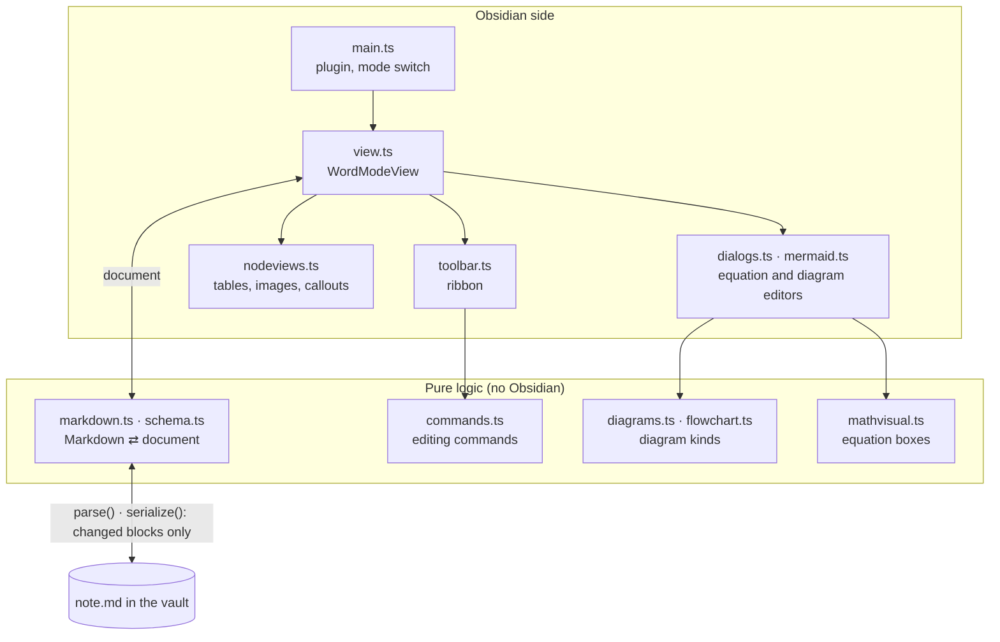
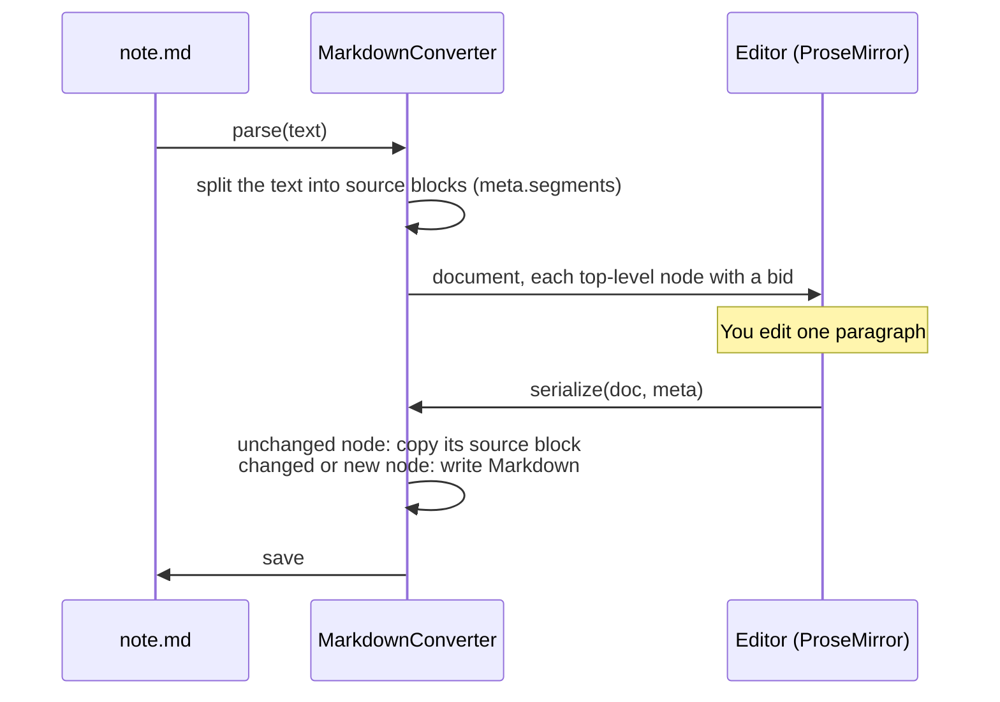
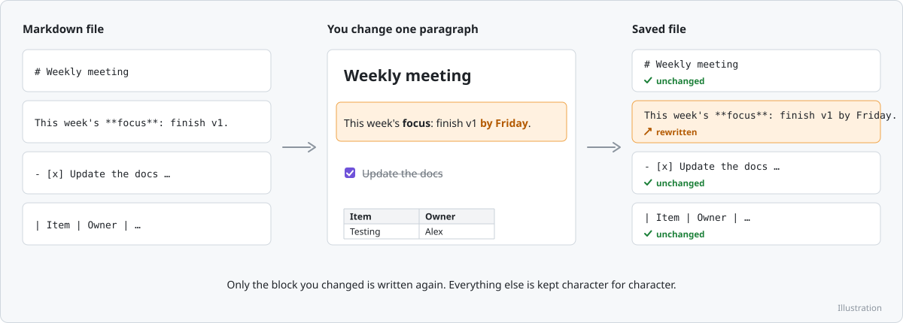
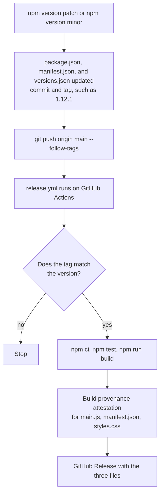

# Developer guide

**English** | [繁體中文](development.zh-TW.md)

This guide is for people who want to build Word Mode, change it, or publish a release. To use the plugin, see the [README](../README.md).

- [Set up](#set-up)
- [How it works](#how-it-works)
- [Project structure](#project-structure)
- [Rules for changes](#rules-for-changes)
- [Tests](#tests)
- [README images](#readme-images)
- [Releasing](#releasing)

## Set up

Requires Node.js 22. The source is TypeScript. esbuild bundles it, and `tsc` only checks the types.

| Command | Description |
| --- | --- |
| `npm install` | Install dependencies. |
| `npm run typecheck` | Check the types with `tsc`. |
| `npm run lint` | Run ESLint with the rules Obsidian uses to review community plugins. It must report no warnings. |
| `npm test` | Check the types, then run the conversion tests and the editing tests, which simulate Obsidian with jsdom. Each test file ends with `ALL PASS`. |
| `npm run build` | Build `main.js`, `manifest.json`, and `styles.css` to `dist/`. This is the production build. |
| `npm run dev` | Build to `dist/` without minifying. |
| `npm run test:vault -- <vault path>` | Round-trip every note in a vault. Read-only. Prints statistics and file paths only. |

To try a build in Obsidian, copy the three files from `dist/` to `<a test vault>/.obsidian/plugins/natlee-word-mode/` and reload the plugin.

Don't keep this folder or `node_modules` inside a folder that a sync client watches, such as Synology Drive.

## How it works



The modules in the lower box don't import Obsidian, so `tests/run.mjs` can test them directly. Put new logic there when you can.

### Saving without touching what you didn't change

Keeping the Markdown file intact is the core of the plugin. `MarkdownConverter.parse()` in `src/markdown.ts` splits the text into source blocks and keeps them in `meta.segments`. Each top-level node of the editor document has a `bid` attribute that points at its block. `serialize(doc, meta)` writes only the blocks that changed and copies every other block exactly as it was.





- A new node has a `bid` of `null`. Pasted or copied nodes go through `stripBids` first, so they never claim another block's source.
- Content that Word mode can't edit visually, such as HTML, math, footnotes, and comments, is kept as a `raw_block` or `raw_inline` node whose `src` attribute is the original text.
- After you change `src/markdown.ts` or `src/schema.ts`, run `npm run test:vault` against a real vault and confirm that `notExact` and `lossyBlocks` are both `0`.

### The view and the toolbars

`WordModeView` in `src/view.ts` is the hub. It creates the editor, the ribbon, and the find bar, opens every dialog, and handles the right-click menu, pasting, and sync conflicts. The ribbon in `src/toolbar.ts` doesn't call Obsidian directly. It asks the view through the callbacks in `ToolbarContext.dialogs`.

The ribbon in Word mode (`src/toolbar.ts`) and the one in Markdown and reading mode (`src/mdbar.ts`) look the same because both are built from `src/ribbon.ts`. That file holds the tab and group lists (`TABS`, `GROUPS`, `groupLayout`), the shell that creates the tab row, panels, groups, and buttons (`RibbonShell`), and `ACTIONS`, a catalogue with the icon, name, label, shortcut, description, and hint animation of every button the two ribbons share. Each ribbon only says what a button does: `toolbar.ts` gives a ProseMirror command or a click handler, `mdbar.ts` gives a function that works on the Markdown editor. Where the two deliberately differ, such as a shortcut that only Word mode binds, the difference sits next to the action in `ACTIONS` under `word` or `md`. A button that exists in only one ribbon is written in that ribbon's file.

### The diagram editor is data-driven

`src/diagrams.ts` describes each kind of diagram as a `DiagramKind`: how to read it, how to write it back, and which fields its form has. `src/mermaid.ts` draws the form and the on-diagram editing from that description. A diagram opens in the form only when reading it and writing it back gives the same text. Otherwise it opens as code, with the reason shown.

### Interface text

Interface strings are keyed by their Traditional Chinese text. `I18nKey` is `keyof typeof EN`, so a new string that isn't in `src/i18n-en.ts` fails the type check. Add the same key to the other translation files too: `src/i18n-ja.ts`, `i18n-ko.ts`, `i18n-nan.ts` (Taiwanese, Han characters), `i18n-yue.ts` (Cantonese), `i18n-zh-cn.ts`, `i18n-vi.ts`, `i18n-fr.ts`, `i18n-de.ts`, `i18n-es.ts`, `i18n-ar.ts` and `i18n-he.ts`. A missing key falls back to English (Taiwanese and Cantonese fall back to the Traditional Chinese source). The list of languages, with the name each one shows in the settings, is `LANGUAGE_NAMES` in `src/i18n.ts`.

Don't build a sentence by joining translated pieces (`t('插入') + t('…的圖片')`): word order differs between languages, and English ends up with no space ("Insertimage"). Make the whole sentence one key and put the changing part in a `{name}` variable. When the pieces must stay separate elements, as in the hint animations where one word is animated, languages that separate words with spaces carry the space inside their translation of that piece; `tests/view/ui.mjs` checks those joins for every such language.

### Styles

All styles are in `styles/word-mode.css`, and every class starts with `wm-`. The file has grown release by release, and later rules override earlier ones, so search the rest of the file before you change an existing component.

## Project structure

| Path | Contents |
| --- | --- |
| `src/main.ts` | Plugin entry point, and switching between Word mode and Markdown. |
| `src/settings.ts`, `src/settingstab.ts` | `Settings` and `DEFAULTS`; the settings tab. |
| `src/view.ts` | The Word mode view (`TextFileView`). |
| `src/contextmenu.ts` | The right-click menu of the Word mode view. |
| `src/markdown.ts` | Conversion between Markdown and the document model. |
| `src/schema.ts` | Document model (ProseMirror schema). |
| `src/editor.ts` | Editor state setup. |
| `src/commands.ts` | Editing commands. Pure ProseMirror, no Obsidian dependency. |
| `src/toolbar.ts` | Ribbon in Word mode: what each button does, and its dropdown panels. |
| `src/ribbon.ts` | What both ribbons share: tabs and button groups (order, tab, name), the look of each shared button (`ACTIONS`), and the shell that builds tabs, groups, and buttons. |
| `src/groupsettings.ts` | Settings list for customizing tabs and button groups. |
| `src/settingsnav.ts` | Category tabs at the top of the settings, and the search box above them (suggestions as you type, jumping to the chosen setting). |
| `src/settingsearch.ts` | Matching and ranking for the settings search: setting names, descriptions, dropdown options, the names in other languages, and synonyms. Pure functions. |
| `src/colorpicker.ts` | Color panel for font color and highlight. |
| `src/mdbar.ts` | Ribbon shown in Markdown and reading mode: what each button does to the Markdown editor. |
| `src/statusbar.ts` | Status bar contents (word count, save status, view switch, properties, zoom), shared by Word mode and Markdown and reading mode. |
| `src/paths.ts` | File paths: the path shown in the status bar and the "copy path" entries (for the note itself and for files that links and images point to). |
| `src/caret.ts` | The custom cursor (shape, blinking, smooth movement) and its live preview on the settings page. The built-in caret is hidden with CSS and comes back during IME composition; on phones and tablets it is hidden only while the custom cursor is drawn (selection handles follow `caret-color`), and while a finger is down the custom cursor follows the system selection every frame, so it stays with the iOS magnifier during a long-press drag. |
| `src/props.ts`, `src/propview.ts` | Property values (types, conversion, reading the frontmatter), and the properties popover and the pinned properties bar. |
| `src/bubble.ts` | Floating toolbar for links and images. |
| `src/tablegrips.ts` | Row and column handles on the table at the cursor (select a whole row or column and open its menu). |
| `src/nodeviews.ts` | Rendering of links, images, tables, and raw blocks. |
| `src/links.ts` | Link and image detection. |
| `src/paste.ts` | Paste handling for spreadsheets and Markdown text. |
| `src/find.ts` | Find and replace. |
| `src/fold.ts` | Heading folding. |
| `src/outline.ts` | Outline sidebar. |
| `src/marks.ts` | Formatting marks and stray-character cleanup. |
| `src/codehl.ts` | Syntax highlighting for code blocks. |
| `src/autoformat.ts` | Formatting as you type. |
| `src/suggest.ts`, `src/complete.ts` | Suggestions for notes, headings, and tags. |
| `src/dialogs.ts` | Dialogs: links, equations, shortcuts, cleanup, word count. |
| `src/confirmclose.ts` | Base class for the editing dialogs: asks before closing with unapplied changes. |
| `src/mathvisual.ts` | Visual equation editor. |
| `src/templates.ts`, `src/templateui.ts` | Formulas and diagram templates you save yourself: the data operations, and the list in the settings that manages them. |
| `src/mermaid.ts`, `src/diagrams.ts`, `src/flowchart.ts` | Diagram editor, the description of each diagram kind (parser, generator, and form fields) that drives its form and on-diagram editing, and the flowchart parser. |
| `src/embeds.ts` | Embedded notes, media, and PDFs. |
| `src/footnotes.ts` | Footnote commands. |
| `src/decoutil.ts`, `src/dom.ts`, `src/icons.ts`, `src/mathrender.ts`, `src/textstats.ts` | Shared helpers. |
| `src/hints.ts` | Detailed button tooltips. |
| `src/i18n.ts`, `src/i18n-*.ts` | Translations, keyed by the Traditional Chinese text. |
| `src/obsidian-internal.d.ts` | Declarations for the Obsidian APIs the plugin uses that aren't public. |
| `src/globals.d.ts`, `src/markdown-it-mark.d.ts` | Declarations for globals and for a dependency that ships no types. |
| `styles/word-mode.css` | Styles. |
| `tests/` | Conversion tests, editing tests, and the vault round-trip check. |
| `docs/images/` | Images in the READMEs and this guide. |
| `docs/record/` | Records the animations in the READMEs. See [README images](#readme-images). |
| `build.mjs` | Build script. |
| `version-bump.mjs` | Syncs the version to `manifest.json` and `versions.json`. |
| `release-local.mjs` | Publishes a release from your computer, without attestations. Use it only when GitHub Actions is unavailable. |

## Rules for changes

- **No regular expression lookbehind** (`(?<=…)` or `(?<!…)`). On iOS before 16.4 it stops the whole plugin from loading. Lookahead is fine.
- **Follow the Obsidian plugin guidelines**: no `innerHTML`, no global `app`, static styles in CSS rather than in JavaScript, no default hotkeys for commands, and sentence case for English interface text.
- **Obsidian API version**: the `obsidian` typings are pinned to the version in `minAppVersion` (1.5.7), so using a newer API fails the type check. To raise the minimum version, update `minAppVersion` in `manifest.json` and install the matching `obsidian` package.
- **APIs that aren't public** are declared in one place, `src/obsidian-internal.d.ts`, each as optional. Check that a member exists before you call it, so that only one feature is lost if Obsidian changes it.
- **Write new logic in the pure modules** (`commands.ts`, `markdown.ts`, `diagrams.ts`, and so on) when you can. They can be tested without Obsidian.
- **Keep the thirteen READMEs in step** (`README.md` and `README.<lang>.md` for `zh-TW`, `nan-TW` (Taiwanese), `yue-HK` (Cantonese), `zh-CN`, `ja`, `ko`, `vi`, `fr`, `de`, `es`, `ar`, `he`) when a feature changes. The Arabic and Hebrew READMEs are wrapped in `<div dir="rtl">`. The animations are recorded in English, Traditional Chinese, Japanese and Korean only: the Taiwanese, Cantonese and Simplified Chinese READMEs use the Traditional Chinese ones, and the other READMEs use the English ones. The saving illustration (`docs/images/generate.mjs`) exists in every language; for Arabic and Hebrew it is mirrored.

Before you open a pull request, run `npm test`, `npm run lint`, and `npm run build`, and search `src/` for `(?<=` and `(?<!`.

## Tests

| Layer | Files | What it covers |
| --- | --- | --- |
| Pure functions | `tests/*.mjs` | Conversion, round trips, diagram parsers, the equation editor model, and templates. `tests/run.mjs` bundles each file with esbuild and runs it. |
| Editing in a simulated Obsidian | `tests/view/test.mjs`, `features.mjs`, `ui.mjs` | The whole `WordModeView` in jsdom, with Obsidian replaced by `tests/view/obsidian-mock.js`. `tests/view/build-test.mjs` bundles them first. |
| Real notes | `npm run test:vault -- <vault path>` | Parses and saves every note in a vault without writing anything, and reports any note that doesn't come back exactly as it was. |

To run one file: `node tests/run.mjs tests/diagrams.mjs`, or `node tests/view/build-test.mjs && node tests/view/ui.mjs`. A failed check prints a line that starts with `FAIL`.

jsdom can't measure layout or draw diagrams. For layout, real typing, and drawing, use the recorder below, which runs the view in a real browser.

## README images

- **Animations** (`docs/images/<scene>.<language>.webp`) show the real plugin code running in headless Chrome, with Obsidian's API replaced by a stand-in that draws real icons (Lucide), equations (MathJax), and diagrams (Mermaid). They are animated WebP, which GitHub and Obsidian both play, at about half the size of a GIF.
- **Re-record only the scenes whose interface changed.** Every recorded file stays in the Git history for good, so the recorder needs the scene names, and `--all` to record everything:

  ```sh
  node docs/record/record.mjs table                    # one scene, all four recorded languages
  node docs/record/record.mjs table --lang en --png    # save only the last frame, to check a scene
  node docs/record/record.mjs --all                    # every scene
  ```

  This needs Google Chrome (or set `CHROME` to its path), `ffmpeg` on the `PATH`, and an internet connection for the libraries from jsDelivr. The scenes are in `docs/record/scenes.mjs`.
- **The phone trackpad animation** (`docs/images/trackpad.<language>.webp`, English and Traditional Chinese only) is not made with the recorder above: it needs a real on-screen keyboard and iOS touch handling. It was recorded from the plugin running in a WKWebView in the iOS Simulator with `xcrun simctl io <device> recordVideo`, cut into 12 fps frames with `ffmpeg` and assembled with `img2webp -lossy -q 70 -d 83`. Simulator recordings do not show touches, so the page drew a grey dot that follows the finger. Re-record it the same way when the trackpad interface changes.
- **Illustration** (`docs/images/saving.*.svg`) is drawn by `node docs/images/generate.mjs`.

## Releasing

The version number lives in `package.json`. `manifest.json` and `versions.json` are updated from it, so don't edit the version by hand.



1. Run `npm version patch` for fixes, or `npm version minor` for new features. This updates `package.json`, `manifest.json`, and `versions.json`, then creates a commit and a tag such as `1.12.1`.
2. Run `git push origin main --follow-tags`.

Pushing the tag publishes the release: the release workflow runs the tests, builds the plugin, creates a [build provenance attestation](https://docs.github.com/en/actions/security-for-github-actions/using-artifact-attestations/using-artifact-attestations-to-establish-provenance-for-builds) for `main.js`, `manifest.json`, and `styles.css`, and attaches them to a GitHub release. Release files are always built there, so anyone can verify that they come from this source:

```sh
gh attestation verify main.js --repo NatLee/obsidian-word-mode
```

To check a release, run `gh run list --limit 1` and `gh release view <version>`. The release should have three files.

- The tag must match the version exactly, without a `v` prefix, because Obsidian looks for a release with that tag.
- `npm run build` is the production build, and it is the build the Obsidian community directory runs to check a release against the source.
- The CI workflow (`.github/workflows/ci.yml`) doesn't run automatically. To run it, open the **Actions** tab, select **CI**, and then select **Run workflow**.
- If GitHub Actions is unavailable, `npm run release:local` publishes from your computer, without an attestation.
