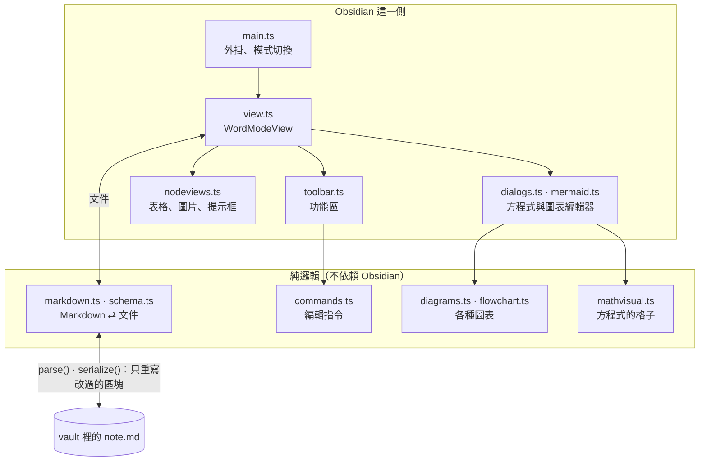
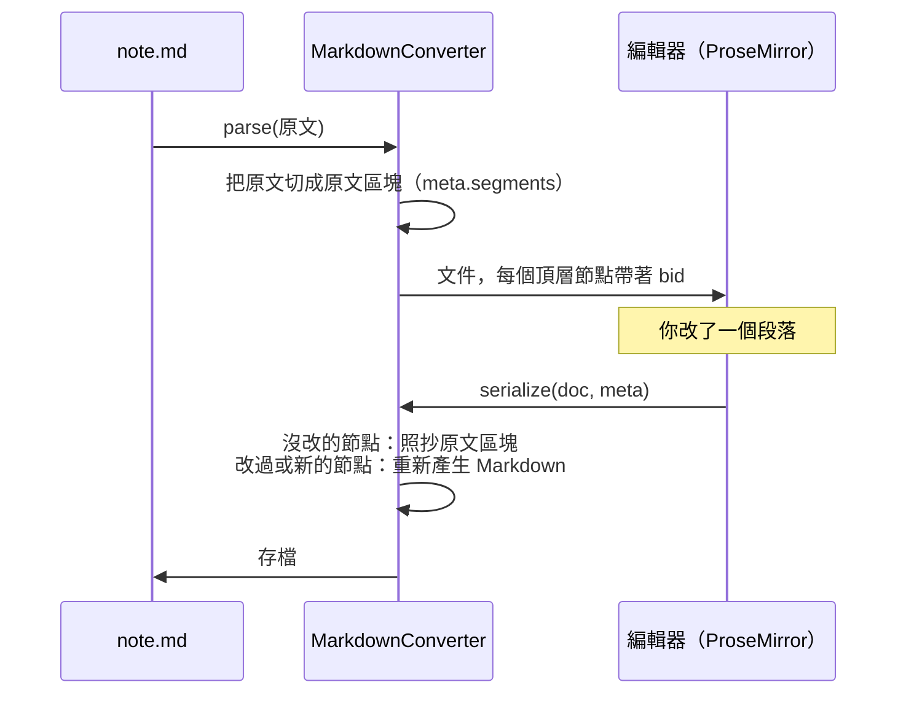
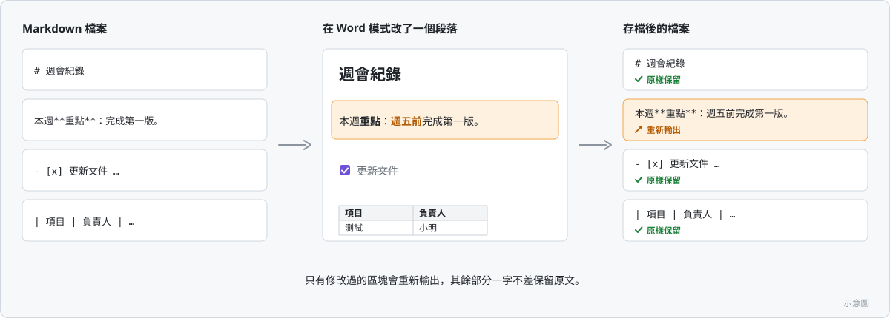
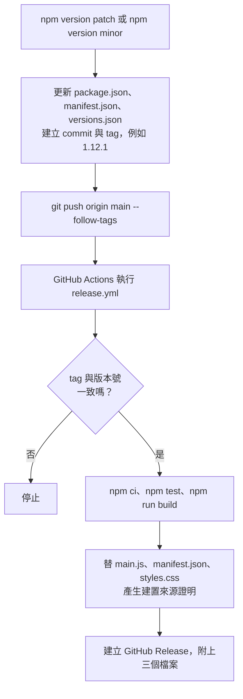

# 開發指南

[English](development.md) | **繁體中文**

這份指南寫給要建置、修改 Word Mode，或發佈新版本的人。要使用外掛，請看 [README](../README.zh-TW.md)。

- [準備環境](#準備環境)
- [運作方式](#運作方式)
- [程式結構](#程式結構)
- [修改時的規則](#修改時的規則)
- [測試](#測試)
- [README 的圖片](#readme-的圖片)
- [發佈新版本](#發佈新版本)

## 準備環境

需要 Node.js 22。原始碼是 TypeScript，由 esbuild 打包，`tsc` 只負責檢查型別。

| 指令 | 說明 |
| --- | --- |
| `npm install` | 安裝相依套件。 |
| `npm run typecheck` | 用 `tsc` 檢查型別。 |
| `npm run lint` | 執行 ESLint，使用 Obsidian 審查社群外掛的同一套規則。不能有任何警告。 |
| `npm test` | 先檢查型別，再執行轉換測試與編輯測試（以 jsdom 模擬 Obsidian）。每個測試檔最後一行是 `ALL PASS`。 |
| `npm run build` | 建置 `main.js`、`manifest.json`、`styles.css` 到 `dist/`。這是正式建置。 |
| `npm run dev` | 建置到 `dist/`，不壓縮。 |
| `npm run test:vault -- <vault 路徑>` | 對 vault 裡每一份筆記做往返檢查。唯讀，只輸出統計與檔案路徑。 |

要在 Obsidian 裡試用建置結果，把 `dist/` 的三個檔案複製到 `<測試用的 vault>/.obsidian/plugins/natlee-word-mode/`，再重新載入外掛。

不要把這個資料夾或 `node_modules` 放在同步軟體監看的資料夾裡，例如 Synology Drive。

## 運作方式



下面那一框的模組不匯入 Obsidian，可以用 `tests/run.mjs` 直接測試；新的邏輯盡量寫在這裡。

### 存檔時不動沒改過的地方

Markdown 檔案往返不失真是這個外掛的核心。`src/markdown.ts` 的 `MarkdownConverter.parse()` 把原文切成一個個原文區塊，存在 `meta.segments`；編輯器文件的每個頂層節點都有 `bid` 屬性，指回它的區塊。`serialize(doc, meta)` 只重新產生改過的區塊，其他區塊一字不差輸出原文。





- 新建的節點 `bid` 是 `null`。貼上或複製的節點要先經過 `stripBids`，才不會冒用別的區塊的原文。
- 無法用 Word 方式編輯的內容（HTML、數學式、註腳、註解）存成 `raw_block` 或 `raw_inline` 節點，`src` 屬性就是原文。
- 修改 `src/markdown.ts` 或 `src/schema.ts` 之後，請對真實的 vault 執行 `npm run test:vault`，確認 `notExact` 與 `lossyBlocks` 都是 `0`。

### 檢視與工具列

`src/view.ts` 的 `WordModeView` 是中樞：建立編輯器、功能區、尋找列，是所有對話框的進入點，也處理右鍵選單、貼上、同步衝突。`src/toolbar.ts` 的功能區不直接呼叫 Obsidian，而是透過 `ToolbarContext.dialogs` 的回呼請檢視處理。

Word 模式的功能區（`src/toolbar.ts`）與 Markdown、閱讀模式的功能區（`src/mdbar.ts`）共用 `TABS`、`GROUPS`、同樣的 DOM 結構與 CSS 類別，所以兩條長得一樣。改其中一邊的版面，另一邊也要跟著改。

### 圖表編輯器是資料驅動的

`src/diagrams.ts` 替每種圖表寫一份 `DiagramKind`：怎麼讀、怎麼寫回、表單有哪些欄位。`src/mermaid.ts` 依這份描述畫出表單與「在圖上編輯」。只有讀進來再寫出去內容完全不變的圖才開在表單；否則開在程式碼，並說明原因。

### 介面文字

介面文字以繁體中文原文為鍵。`I18nKey` 是 `keyof typeof EN`，新字串沒加進 `src/i18n-en.ts` 型別檢查就會失敗。其他翻譯檔也要一併補上：`src/i18n-ja.ts`、`i18n-ko.ts`、`i18n-nan.ts`（台文，漢字）、`i18n-yue.ts`（粵語）、`i18n-zh-cn.ts`、`i18n-vi.ts`、`i18n-fr.ts`、`i18n-de.ts`、`i18n-es.ts`、`i18n-ar.ts`、`i18n-he.ts`。沒有的鍵會退回英文（台文、粵語退回繁體中文原文）。有哪些語言、設定頁上顯示的名稱，在 `src/i18n.ts` 的 `LANGUAGE_NAMES`。

不要把翻譯好的片段接成一句（`t('插入') + t('…的圖片')`）：各語言的語序不同，英文還會少空格（「Insertimage」）。整句當一個鍵，會變的部分寫成 `{name}` 變數。一定要分開的片段（例如示意動畫裡有一個字會動），用空格分詞的語言要在那一段的譯文裡自己帶空格；`tests/view/ui.mjs` 會在每種這樣的語言檢查這些交界。

### 樣式

樣式全部在 `styles/word-mode.css`，類別前綴都是 `wm-`。這個檔案是隨版本往後加的，後面的規則會蓋掉前面的，改既有元件前先搜尋檔案後段有沒有覆蓋。

## 程式結構

| 路徑 | 內容 |
| --- | --- |
| `src/main.ts` | 外掛進入點、Word 模式與 Markdown 的切換。 |
| `src/settings.ts`、`src/settingstab.ts` | `Settings` 與 `DEFAULTS`；設定頁。 |
| `src/view.ts` | Word 模式的檢視（`TextFileView`）。 |
| `src/contextmenu.ts` | Word 模式檢視的右鍵選單。 |
| `src/markdown.ts` | Markdown 與文件模型之間的轉換。 |
| `src/schema.ts` | 文件模型（ProseMirror schema）。 |
| `src/editor.ts` | 編輯器狀態的設定。 |
| `src/commands.ts` | 編輯指令。純 ProseMirror，不依賴 Obsidian。 |
| `src/toolbar.ts` | 功能區工具列，以及每個按鈕群組的順序、分頁與名稱。 |
| `src/groupsettings.ts` | 設定頁裡自訂分頁與按鈕群組的清單。 |
| `src/settingsnav.ts` | 設定頁上方的分類頁籤，以及上面的搜尋框（邊打邊列出符合的設定，選了就跳過去）。 |
| `src/settingsearch.ts` | 設定搜尋的比對與排序：設定名稱、說明、下拉選單的選項、其他語言的名稱與同義詞。純函式。 |
| `src/colorpicker.ts` | 字型色彩與醒目提示的色彩面板。 |
| `src/mdbar.ts` | Markdown 與閱讀模式的工具列。 |
| `src/statusbar.ts` | 狀態列的內容（字數、存檔狀態、檢視切換、文件屬性、縮放），Word 模式與 Markdown、閱讀模式共用。 |
| `src/props.ts`、`src/propview.ts` | 文件屬性的值（類型、轉換、讀出文件屬性），以及查看文件屬性的小視窗與固定在上方的屬性列。 |
| `src/bubble.ts` | 連結與圖片的浮動工具列。 |
| `src/nodeviews.ts` | 連結、圖片、表格、原文區塊的畫面。 |
| `src/links.ts` | 連結與圖片的辨識。 |
| `src/paste.ts` | 貼上試算表與 Markdown 文字。 |
| `src/find.ts` | 尋找與取代。 |
| `src/fold.ts` | 標題摺疊。 |
| `src/outline.ts` | 大綱側邊欄。 |
| `src/marks.ts` | 編輯標記與殘留字元的清理。 |
| `src/codehl.ts` | 程式碼區塊的語法上色。 |
| `src/autoformat.ts` | 輸入時自動套用格式。 |
| `src/suggest.ts`、`src/complete.ts` | 筆記、標題、標籤的建議清單。 |
| `src/dialogs.ts` | 對話框：連結、方程式、快速鍵、清理符號、字數統計。 |
| `src/mathvisual.ts` | 視覺化方程式編輯器。 |
| `src/templates.ts`、`src/templateui.ts` | 自己存的公式與圖表範本：資料操作，以及設定頁裡管理它們的清單。 |
| `src/mermaid.ts`、`src/diagrams.ts`、`src/flowchart.ts` | 圖表編輯器；每種圖表的描述（解析、產生、表單欄位），表單與在圖上編輯都依它運作；流程圖的解析。 |
| `src/embeds.ts` | 內嵌的筆記、媒體、PDF。 |
| `src/footnotes.ts` | 註腳指令。 |
| `src/decoutil.ts`、`src/dom.ts`、`src/icons.ts`、`src/mathrender.ts`、`src/textstats.ts` | 共用的輔助函式。 |
| `src/hints.ts` | 按鈕的詳細提示。 |
| `src/i18n.ts`、`src/i18n-*.ts` | 翻譯，以繁體中文原文為鍵。 |
| `src/obsidian-internal.d.ts` | 外掛用到的 Obsidian 非公開 API 的宣告。 |
| `src/globals.d.ts`、`src/markdown-it-mark.d.ts` | 全域變數，以及沒有附型別的相依套件的宣告。 |
| `styles/word-mode.css` | 樣式。 |
| `tests/` | 轉換測試、編輯測試、vault 往返檢查。 |
| `docs/images/` | README 與這份指南裡的圖片。 |
| `docs/record/` | 錄製 README 裡的動畫。見 [README 的圖片](#readme-的圖片)。 |
| `build.mjs` | 建置腳本。 |
| `version-bump.mjs` | 把版本號同步到 `manifest.json` 與 `versions.json`。 |
| `release-local.mjs` | 在自己的電腦上發佈，沒有來源證明。只在 GitHub Actions 不能用時使用。 |

## 修改時的規則

- **不用正規表示式的 lookbehind**（`(?<=…)`、`(?<!…)`）：iOS 16.4 以前會讓整個外掛載入失敗。lookahead 可以用。
- **遵守 Obsidian 外掛規範**：不用 `innerHTML`、不用全域的 `app`、靜態樣式寫在 CSS 不寫在 JavaScript、指令不設預設快速鍵、英文介面文字用 sentence case。
- **Obsidian API 的版本**：`obsidian` 型別套件鎖在 `minAppVersion` 的版本（1.5.7），用到更新的 API 時型別檢查會失敗。要提高最低版本時，請更新 `manifest.json` 的 `minAppVersion`，並安裝對應版本的 `obsidian` 套件。
- **非公開的 API** 集中宣告在 `src/obsidian-internal.d.ts`，全部標成可能不存在。呼叫前先檢查成員是否存在，Obsidian 改掉時只會少一項功能。
- **新的邏輯盡量寫在純邏輯的模組**（`commands.ts`、`markdown.ts`、`diagrams.ts` 等），不需要 Obsidian 就能測試。
- **功能有變動時，十三份 README 一起更新**（`README.md`，以及 `zh-TW`、`nan-TW`（台文）、`yue-HK`（粵語）、`zh-CN`、`ja`、`ko`、`vi`、`fr`、`de`、`es`、`ar`、`he` 的 `README.<語言>.md`）。阿拉伯文、希伯來文 README 整份包在 `<div dir="rtl">` 裡。操作動畫只錄了英文、繁體中文、日文、韓文：台文、粵語、簡體中文的 README 用繁體中文的動畫，其他語言用英文的。存檔示意圖（`docs/images/generate.mjs`）每種語言都有，阿拉伯文與希伯來文整張左右鏡像。

開 pull request 之前，請執行 `npm test`、`npm run lint`、`npm run build`，並在 `src/` 搜尋 `(?<=` 與 `(?<!`。

## 測試

| 層級 | 檔案 | 涵蓋範圍 |
| --- | --- | --- |
| 純函式 | `tests/*.mjs` | 轉換、往返、圖表解析、方程式編輯器的模型、範本。`tests/run.mjs` 先用 esbuild 打包再執行。 |
| 在模擬的 Obsidian 裡編輯 | `tests/view/test.mjs`、`features.mjs`、`ui.mjs` | 在 jsdom 裡跑整個 `WordModeView`，Obsidian 由 `tests/view/obsidian-mock.js` 代替。要先用 `tests/view/build-test.mjs` 打包。 |
| 真實的筆記 | `npm run test:vault -- <vault 路徑>` | 讀進並輸出 vault 裡的每一份筆記（不寫入任何檔案），列出沒有原樣回來的筆記。 |

單跑一個檔案：`node tests/run.mjs tests/diagrams.mjs`，或 `node tests/view/build-test.mjs && node tests/view/ui.mjs`。檢查失敗的行以 `FAIL` 開頭。

jsdom 量不到版面，也畫不出圖表。版面、真的打字、畫圖這類東西，用下面的錄製工具在真的瀏覽器裡看。

## README 的圖片

- **動畫**（`docs/images/<場景>.<語言>.webp`）是真的外掛程式碼在無頭 Chrome 裡執行的畫面。Obsidian 的 API 換成替身，但圖示（Lucide）、數學式（MathJax）、圖表（Mermaid）都是真的。格式是 WebP 動畫，GitHub 與 Obsidian 都能播放，大小約是 GIF 的一半。
- **只重錄介面有變的場景**：每次錄出來的檔案都會永久留在 git 歷史裡，所以錄製工具要指名場景，全部重錄要明確加 `--all`：

  ```sh
  node docs/record/record.mjs table                    # 一個場景、錄製的四種語言
  node docs/record/record.mjs table --lang en --png    # 只存最後一個畫面，檢查場景用
  node docs/record/record.mjs --all                    # 全部場景
  ```

  需要 Google Chrome（或用環境變數 `CHROME` 指定路徑）、`PATH` 上的 `ffmpeg`，以及網路（從 jsDelivr 載入函式庫）。各場景的操作寫在 `docs/record/scenes.mjs`。
- **示意圖**（`docs/images/saving.*.svg`）由 `node docs/images/generate.mjs` 畫出來。

## 發佈新版本

版本號寫在 `package.json`，`manifest.json` 與 `versions.json` 會跟著更新，不要手動改版本號。



1. 修正執行 `npm version patch`，新功能執行 `npm version minor`。這會更新 `package.json`、`manifest.json`、`versions.json`，並建立 commit 與 tag（例如 `1.12.1`）。
2. 執行 `git push origin main --follow-tags`。

推上 tag 就是公開發佈：release workflow 會跑測試、建置外掛，為 `main.js`、`manifest.json`、`styles.css` 產生[建置來源證明](https://docs.github.com/en/actions/security-for-github-actions/using-artifact-attestations/using-artifact-attestations-to-establish-provenance-for-builds)，再附到 GitHub Release。發佈檔一律在那裡建置，任何人都能驗證檔案確實來自這份原始碼：

```sh
gh attestation verify main.js --repo NatLee/obsidian-word-mode
```

要確認發佈結果，執行 `gh run list --limit 1` 與 `gh release view <版本>`，Release 應該有三個檔案。

- tag 必須與版本號完全相同，前面不加 `v`，因為 Obsidian 會找這個 tag 的 Release。
- `npm run build` 是正式建置，Obsidian 社群目錄也是執行它來核對發佈檔與原始碼是否一致。
- CI workflow（`.github/workflows/ci.yml`）不會自動執行。要執行時，到 **Actions** 分頁選 **CI**，再選 **Run workflow**。
- GitHub Actions 不能用時，`npm run release:local` 可以從自己的電腦發佈，但沒有來源證明。
